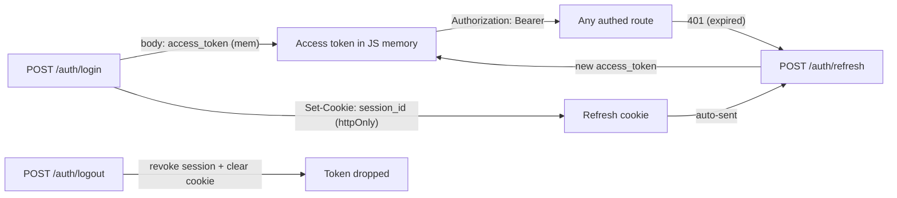
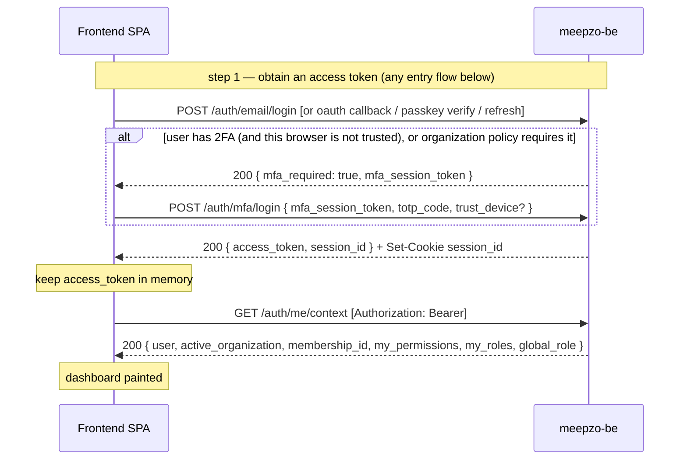

# Frontend auth & headers guide

> **No passwords.** Sign in by email code, Google/Apple OAuth or a passkey; `POST /auth/login` and
> `/auth/password/*` do not exist (404). A person with two-factor sign-in (TOTP) adds the 2FA code
> after the first factor, and may tick "trust this device for 30 days". Step-up before a sensitive
> action is the email code for a person without settled 2FA, the 2FA code otherwise.

How a browser frontend (SPA) authenticates against meepzo-be, keeps the user logged in, switches the
active organization, and which headers it must send on which routes. This is the **client-integration**
companion to the backend security docs — it does not restate the server internals, it tells the
frontend exactly what to do.

> Backend internals live elsewhere: credential types and rate limits in
> [authentication.md](../security/authentication.md); cookie/CSRF posture in
> [csrf-and-session-cookies.md](../security/csrf-and-session-cookies.md); the organization model in
> [personal-vs-team-organizations.md](../architecture/personal-vs-team-organizations.md).
>
> Realigning FE calls (passkeys, notifications, preferences, webhooks, MFA, sessions, organization logo,
> billing gating) to the real routes: [frontend-endpoint-mapping.md](frontend-endpoint-mapping.md).

---

## TL;DR — the seven rules

1. **Access token lives in JavaScript memory** (a module variable), never `localStorage`.
2. **Send it as `Authorization: Bearer <token>`** on every authenticated request. It is the only
   always-on header.
3. **Refresh reactively**: on a `401`, call `POST /auth/refresh` once, then retry the request once.
4. **De-duplicate refreshes** (single-flight) — many parallel `401`s share one refresh call.
5. **Refresh on app boot** — the in-memory token is gone after a reload, but the `session_id` cookie
   survives, so a silent refresh logs the user back in.
6. **The active organization is inside the token** (`org` claim). To change it, call a switch
   endpoint and **replace the in-memory token** with the one it returns. There is no organization header or
   organization path segment.
7. **Read the body envelope**: every success response is `{ "data": { … } }`, so the access token is
   `json.data.access_token`.

---

## The model

meepzo-be splits one short-lived, JS-held **access token** from one long-lived, browser-held
**refresh cookie**:

| Credential | Where it lives | Lifetime | Sent how | Purpose |
|------------|----------------|----------|----------|---------|
| **Access token** (JWT, RS256) | JavaScript memory | ~15 min | `Authorization: Bearer` header | Authorizes every API call; carries the signed **`org`** claim (active organization; the compact key is intentional — JWT claim convention, rides on every request) |
| **Refresh session** | `session_id` httpOnly cookie (path `/api/v1/auth`, `SameSite=Strict`; a browser-session cookie — no `Max-Age`) | ends after 30 min without a request or refresh, and 12 h after sign-in (`AUTH_SESSION_IDLE_TIMEOUT_SECONDS` / `AUTH_SESSION_ABSOLUTE_TIMEOUT_SECONDS`) | browser sends it automatically to `/auth/*` | Mints fresh access tokens via `POST /auth/refresh`; revocable server-side |
| **CSRF token** | `csrf_token` cookie (readable by JS) | matches session | mirrored into `X-CSRF-Token` **only** for cookie-auth fallback | Double-submit defense on `/auth/refresh` when no `Origin` is sent |

Why this split (and why not put the access token in a cookie too): a `Bearer` header is **never
auto-attached** by the browser, so every authenticated route is CSRF-immune for free — only
`/auth/refresh` (cookie-borne) needs CSRF handling. The long-lived secret (`session_id`) is httpOnly,
so XSS can't exfiltrate it. The 15-minute access token is the only thing in JS, and its blast radius
is small and server-revocable.



---

## Headers the client sends

| Header | Send on | Required? | Notes |
|--------|---------|-----------|-------|
| `Authorization: Bearer <access_token>` | every authenticated request | **Yes** (authed routes) | The in-memory access token. Carries the active `org` claim. |
| `Content-Type: application/json` | any request with a JSON body | **Yes** for JSON bodies | — |
| `X-Idempotency-Key: <uuid>` | `POST`/`PUT`/`PATCH` writes | **Required** on the routes marked `req` in the [route catalog](../../routes.txt), optional elsewhere | `422` if missing on a required route. See [Idempotency keys](#idempotency-keys). |
| `X-Captcha-Token: <widget token>` | public auth forms | **Required only when Turnstile is configured** (production) | From the Cloudflare Turnstile widget. Routes: `email/send-code`, `email/login`, `mfa/login`, `webauthn/authenticate/options`. Not OAuth init (`GET /auth/oauth/:provider`) — the provider authenticates the user. |
| `X-CSRF-Token: <csrf_token cookie value>` | `POST /auth/refresh` **only**, **only if you don't send `Origin`** | Browsers: **not needed** | Browsers always send `Origin`, which satisfies the refresh origin check. This is a fallback for non-browser clients. |

**Cookies — never touched by JS.** The browser stores and sends `session_id` (httpOnly) and
`csrf_token` automatically, scoped to `/api/v1/auth`. Always call `fetch` with
`credentials: 'include'` so they ride along on auth routes.

**Server-managed headers you never set:** `X-Request-Id` (correlation; echoed in responses),
`X-RateLimit-*` (response only), `Stripe-Signature` (Stripe → server only), `X-Hub-Signature-256` (Meta → server only, the Instagram webhook), and the metrics scrape
token (ops/Prometheus only — not a browser concern).

**What you do *not* send for multi-tenancy:** there is **no** organization header and **no**
`/organizations/{id}/` path segment on the app routes. The active organization is the token's `org`
claim — see [Active organization & switching](#active-organization--switching).

---

## Token lifecycle (reactive refresh)

You don't watch a clock. When a call returns `401` (token expired), refresh once and retry:

- **Active user** → effectively one refresh per ~15 min (the first call after each expiry).
- **Idle user** → zero refreshes.
- **Reload / app open** → one silent refresh at boot (memory was cleared; the cookie survived).

| Step | Request | Result |
|------|---------|--------|
| **Email code — send** | `POST /auth/email/send-code` | `200` (uniform — no enumeration). Emails a one-time 6-digit sign-in code; auto-creates an account for an unknown email. Answers `resend_after_seconds` (60) and `expires_in_seconds` (900); a resend sooner is `429 code_resend_too_soon` + `retry_after_seconds`. |
| **Email code — login** | `POST /auth/email/login` | `200` → `{ data: { access_token } }` + `Set-Cookie: session_id` (or `{ mfa_required, mfa_session_token }`). Verifies the code, logging in or completing first-time sign-up. Refusals: `401 code_wrong` + `tries_left`, `401 code_expired`, `401 code_used_up` (ask a new code), `429 code_day_limit` + `retry_after_seconds`. |
| Use | any route + `Authorization: Bearer` | `2xx` |
| Expiry | any route | `401` → trigger refresh |
| Refresh | `POST /auth/refresh` (cookie auto-sent) | `200` → `{ data: { access_token } }`, session cookie rotated |
| Logout | `POST /auth/logout` + `Authorization: Bearer` | `200`, session revoked server-side, cookie cleared |

If **refresh itself fails** (`401`/`403`), the session is gone (logged out elsewhere, admin-suspended,
or expired) → clear the in-memory token and send the user to login. Two refresh 401s say why in
`error.reason`, so the login screen can tell the user (the server has already revoked the session):

| `error.reason` | Meaning |
|----------------|---------|
| `idle_timeout` | No request or refresh for `AUTH_SESSION_IDLE_TIMEOUT_SECONDS` (default 30 min). |
| `session_expired` | The session reached `AUTH_SESSION_ABSOLUTE_TIMEOUT_SECONDS` since sign-in (default 12 h). |

---

## Active organization & switching

Every access token is scoped to exactly one active organization via its signed **`org`** claim. The
backend resolves the tenant, permissions, and row-level security from that claim and re-checks
membership on every request — the claim is **scope, not authority**.

To act in a different organization, **re-mint the token**:

| Endpoint | Body | Auth | Result |
|----------|------|------|--------|
| `POST /auth/switch-to-organization` | `{ "organization_id": "org_…" }` | `Bearer` | `200` → new `access_token` scoped to that organization. `403` if the caller isn't a member, `403` with `error.reason: "mfa_required"` if the organization requires MFA and this session hasn't proved it ([below](#organizations-that-require-mfa)), `400` if the id is missing. |
| `POST /auth/switch-to-personal` | none | `Bearer` | `200` → new `access_token` scoped to the caller's personal organization. Never `403` for membership; only `403` `mfa_required` if the user made their own personal organization require MFA and this session hasn't proved it. |

Switching re-binds the session to the new token, so **the previous access token immediately stops
working** (hash drift). Always swap your in-memory token for the returned one. No new refresh cookie
is issued — the same `session_id` keeps working, and a later refresh re-mints with the now-current
`org` claim (unless that organization requires MFA the session hasn't proved — see below).

`switch-to-organization` also **remembers the organization as the login default**: the next sign-in
mints its token for that organization (while the membership is active), else for the most recently joined
organization, and only then for the personal organization. So a returning user lands straight in the organization
they last worked in — route on `active_organization` from `GET /auth/me/context` as usual; there is
nothing to store on the client. `switch-to-personal` leaves the remembered organization alone.

To let someone **choose** the organization that opens at sign-in, read and write `default_organization_id`
on `GET` / `PATCH /users/me/settings`: an `org_…` id pins that organization (it then wins over the organization
last switched to), `null` returns to automatic. Only an organization they actively belong to can be pinned —
anything else is `422` with `error.reason: "default_organization_unavailable"`. `GET` reports `null`
while a pinned organization is not usable (they left it, or it was suspended).

**One authoritative call — `GET /auth/me/context`.** Instead of stitching several endpoints, this returns everything a permission-aware UI needs in one request:

```json
{
  "data": {
    "user": { "id": "usr_…", "email": "…", "is_mfa_enabled": false, "onboarding_completed": true },
    "active_organization": {
      "id": "org_…",
      "type": "TEAM",
      "plan_access": {
        "state": "grace",
        "grace_ends_at": "2026-10-31T09:30:00.000Z",
        "trial_ends_at": null,
        "plan": { "id": "pln_…", "name": "Creator" },
        "features": { "message_month_limit": 10000, "channel_accounts_max": 3, "has_priority_support": false, "feature_switches": { "broadcasts": true } },
        "is_plan_choice_required": false
      },
      "channel_accounts_count": 2
    },
    "membership_id": "mem_…",
    "my_permissions": ["organization:read", "membership:create"],
    "my_role_ids": ["rol_…"],
    "my_roles": [{ "id": "rol_…", "name": "Admin", "tone": "lavender", "is_system": true }],
    "global_role": null
  }
}
```

- **Who am I in this organization.** `membership_id` is the caller's own membership (the `id` of
  their `GET /tenancy/organization/memberships` row — no list scan to find it); `my_role_ids` / `my_roles` are the
  roles they hold, the main role first, `my_roles` naming each (`name`, `tone`, `is_system`) so a
  member without `role:read` can show their own role. A system role's name never changes. Without an
  active organization or a live membership, `membership_id` is `null` and both lists are empty.

- **Can this organization still write — `active_organization.plan_access`.** `state` is `active` (a
  live plan — Free never ends; always for a personal organization, and for every organization while the
  server's read-only mode is off), `grace` (a paid plan whose payment failed — everything works until
  `grace_ends_at`, so show the countdown and the way to pay) or `read_only` (a lapsed or cancelled paid
  plan since `grace_ends_at`). In `read_only` every product write behind the write guard answers
  **403 with `error.reason` `organization_read_only`** — disable those write actions up front; reads,
  billing (so the organization can choose a plan), auth, user, tenancy and upload stay open.
  `grace_ends_at` is ISO 8601, `null` when `active`; `trial_ends_at` is when a running trial ends,
  `null` otherwise. Paying lifts it on the next request — re-fetch this context after checkout.
  `plan` (`{ id, name }`) and `features` are the plan whose limits and switches apply now (read the
  exact switch in `features.feature_switches` before showing a paid feature); `is_plan_choice_required`
  is `true` while the organization still pays a retired plan (Starter, Growth, Pro) — it is held to
  Free's features until it picks Creator or Studio, so show "Choose Creator or Studio".
  `channel_accounts_count` is how many channel accounts are connected (not revoked).
- **`type` vs `my_permissions` — render on the intersection.** The organization `type` says what the organization **kind** allows (only a `TEAM` organization can invite members); `my_permissions` is what **this caller** may do in the active organization (resolved permission codes). Show a team-only action only when `type === 'TEAM'` **and** the caller holds the permission.
- **The organization-switcher list is NOT here.** It lives at `GET /users/me/organizations`, which is **paginated** — follow the cursor to the end before rendering, or a user in more than one page of organizations silently loses the rest from their switcher. It was embedded in this response once, as a flat array with no cursor filled by a default-limit read, which is exactly the truncation this split fixes. Derive each row's "is this the active one?" by comparing its `id` to `active_organization.id`.
- **Switch flow (one call):** `POST /auth/switch-to-organization` (or `…-personal`) re-mints the token **and returns the active-organization delta** — `{ access_token, active_organization, my_permissions, global_role }`, `active_organization` carrying its `plan_access` as here. Swap your in-memory Bearer for the new `access_token` and repaint from `active_organization` + `my_permissions`. The `user` is stable across a switch, so **no follow-up `GET /auth/me/context` is needed** — re-fetch the full context only on a cold reload. Your cached organization list is stable too: switching changes which organization is active, not which ones you belong to, so re-derive the active row from the new `active_organization.id` rather than re-fetching the list.
- **Join flow:** `POST /tenancy/membership-invitations/{membership_invitation_id}/accept` returns the joined `organization_id`; pass it straight to `POST /auth/switch-to-organization` (above) to land on the new team's dashboard — no lookup in between If the team requires MFA and the session hasn't proved it, the switch answers `403` `mfa_required` — see [Organizations that require MFA](#organizations-that-require-mfa).
  - **Invited user with no account (first time):** the invite already created a passwordless, unverified **placeholder** for that email, and `accept` requires a **verified** email (else `403 errors:invitationRequiresVerifiedEmail` — a forwarded invite must not be claimable by the wrong person). So the new user first authenticates in a way that proves email control: **email verification-code** (`/auth/email/send-code` → `/auth/email/login`) or **OAuth** both claim the placeholder, verify the email, and provision their personal organization in one step. After that, the same `accept` → (`organization_id`) → `switch-to-organization` tail applies. Don't hard-block the UI when `is_email_verified` is false — route the user through the email-code login, then call `accept`.
  - **Invitations found after sign-in (launch D84):** `GET /users/me/membership-invitations` lists the signed-in person's pending invitations on their **verified** email — the organization (`id`, `name`, `slug`, `logo_url`), `role_names`, `inviter_name`, `expires_at` (none for an unverified email). Ask it after every sign-in, before onboarding or the organization picker: someone with no organization yet who has invitations should see them, not "create an organization". `accept` takes **no token** for that signed-in owner of the email (send `{}`; a token from the link must still match), then the same `switch-to-organization` tail. `POST /tenancy/membership-invitations/{membership_invitation_id}/decline` turns one down (expired or not): the invited membership ends (`end_reason` `declined`, its seat freed) and the inviter is told in the app. An invite left 7 days past its expiry is ended by a daily sweep (`end_reason` `invitation_expired`).

This works **identically for personal and team organizations** — there is one route surface, and the organization `type` (not different URLs) tells the UI what to show. See [route-consistency-and-organization-model.md](route-consistency-and-organization-model.md).

`GET /users/me` (profile + `personal_organization_id`) and `GET /users/me/organizations` (paginated organization list) remain available if you need them individually.

> The organization-scoped resources are **flat**: `/api/v1/tenancy/organization` (singular — settings, logo,
> audit-logs, api-keys, notification-policies, memberships, roles, invitations live under it),
> `/api/v1/billing/subscriptions`, `/api/v1/notify/webhooks`. Account-level routes that aren't tied
> to one active organization stay plural: `POST /api/v1/tenancy/organizations`,
> `GET /api/v1/tenancy/organizations/by-slug/{slug}`, and the cross-organization invitation-accept action
> `POST /api/v1/tenancy/membership-invitations/{membership_invitation_id}/accept`.
>
> **Inviting is not a separate resource.** There is **no** `POST` or `GET /tenancy/organization/invitations`.
> To invite teammates, `POST /api/v1/tenancy/organization/memberships` with `{ emails, role_ids }` — 1–20
> emails and exactly one role (a system role, not Owner). Each email answers its own line in `results`
> (`invited` · `already_member` · `already_invited` · `invalid_email`, with `membership_id` when invited or
> already a member) plus `invited_count`; each invited email gets an **`invited` membership** and an
> emailed token. The members list's `meta.counts_by_role` gives the header counts per main role. The
> invitation page reads `POST /api/v1/tenancy/membership-invitations/{membership_invitation_id}/preview`
> with `{ token }` (public; send the bearer when signed in for `email_matches`). Invited people appear in the **members list**
> (`GET /api/v1/tenancy/organization/memberships`) with `status: "invited"` and an embedded `invitation`
> object; there is no separate pending-invitations list to fetch. Revoke with
> `DELETE /api/v1/tenancy/organization/memberships/{membership_id}/invitation` and resend with
> `POST /api/v1/tenancy/organization/memberships/{membership_id}/invitation/resend`. The invitee becomes `active`
> by calling `POST /api/v1/tenancy/membership-invitations/{membership_invitation_id}/accept`.

### Organizations that require MFA

An organization can require MFA (`security_policy.mfa_required`). That policy holds for the whole
life of a session, not only at login: a token is admitted into such an organization only when **its
session has proved a second factor** — the MFA login challenge, an authenticated MFA step-up, or
confirming MFA enrollment. Such tokens carry the standard `amr: ["mfa"]` claim; you never need to
read it.

When the session hasn't proved MFA, you get `403` with `error.reason: "mfa_required"` from:

- `POST /auth/switch-to-organization` — e.g. right after accepting an invitation into a team that
  requires MFA, when the user logged in without it;
- any organization route — e.g. the organization turned MFA on after the user logged in.

And `POST /auth/refresh` will not keep that organization in the new token — it falls back to the
personal organization (repaint with `GET /auth/me/context`).

The recovery is the same in every case:

1. `is_mfa_enabled` true → collect a code and call `POST /auth/me/mfa/verify { code }`.
   `is_mfa_enabled` false → enroll: `POST /auth/me/mfa/enroll` then
   `POST /auth/me/mfa/enroll/confirm { code }`. Both enroll calls need a recent step-up; if they
   answer `403 errors:recentStepUpRequired`, re-authenticate first.
2. Call `POST /auth/switch-to-organization { organization_id }` again. The new token carries
   `amr: ["mfa"]`, and the same session keeps it for later switches and refreshes.
3. Retry the request that failed.

---

### Step-up before an irreversible action

Deleting the account (`DELETE /users/me`), requesting the data export (`POST /users/me/data-export`),
transferring ownership (`POST /tenancy/organization/transfer-ownership`), deleting the organization
(`DELETE /tenancy/organization`) and changing its `status` (`PATCH /tenancy/organization` with
`status` — the owner's alone, like deleting it) need a recent step-up on **this** session, valid for 10 minutes: `POST /auth/step-up` with an
emailed code for a person without settled two-factor sign-in, or `POST /auth/me/mfa/verify` with the
2FA code for a person with it. Without it they answer `403 errors:recentStepUpRequired` — ask the
user to confirm who they are, then retry. A stolen access token alone can therefore not erase an
account or an organization.

The same step-up guards the security settings: revoking one session or every other one
(`DELETE /auth/me/sessions/{session_id}`, `DELETE /auth/me/sessions`), removing a passkey, a sign-in
way or the 2FA factor. Those need a **strong** step-up (`403 errors:strongStepUpRequired`
otherwise): the email code is strong for a person without settled 2FA — their mailbox can already
sign them in, so it gives no new power — and the 2FA code is strong for everyone. A TOTP factor
enrolled in the last 72 hours under an email-code step-up is not settled yet: until then the email
code still opens a strong step-up, and the new factor's own code opens only a weak one (enough to
enroll another factor).

**Client checklist (meepzo-fe).** Each of the calls above needs the same wrapper:

1. Send the request. On `403` with `errors:recentStepUpRequired`, keep the request and open a
   "confirm it's you" prompt; any other status is handled as before.
2. Step up on the current session with the email code first:
   - `POST /auth/email/send-code { email }` (one code per 60 s — a sooner send answers
     `429 code_resend_too_soon` with `retry_after_seconds`), then `POST /auth/step-up { code }` →
     `200 { stepped_up: true, factor: 'email_code' }`. A wrong code answers `401 code_wrong` with
     `tries_left`; `401 code_expired` asks for a new code; `401 code_used_up` after 5 wrong tries.
   - If it answers `403` with reason `mfa_step_up_required`, the person has settled 2FA: ask for the
     2FA code and `POST /auth/me/mfa/verify { code }` instead.
3. Retry the original request once. The window lasts 10 minutes on this session only — a token
   refresh keeps the session, a new login does not — so a second action inside it needs no prompt.

```ts
/** Opens a step-up window on this session: the email code, or the 2FA code when asked for it. */
export async function stepUp(email: string, askForCode: (kind: 'email' | 'mfa') => Promise<string>) {
  await postPublic('/auth/email/send-code', { email });
  const emailCode = await askForCode('email');
  const res = await apiFetch('/auth/step-up', { method: 'POST', body: JSON.stringify({ code: emailCode }) });
  if (res.ok) return;
  const { error } = await res.json();
  if (res.status === 403 && error?.reason === 'mfa_step_up_required') {
    const mfaCode = await askForCode('mfa');
    const verified = await apiFetch('/auth/me/mfa/verify', { method: 'POST', body: JSON.stringify({ code: mfaCode }) });
    if (verified.ok) return;
  }
  throw new Error(error?.reason ?? 'step_up_failed');                // code_wrong (tries_left), code_expired, …
}
```

The k6 scenarios `comprehensive-journey.js`, `fe-full-surface.js` (step 53) and
`auth-security-lifecycle.js` step up with the email code exactly this way.

## Entry flows → how many calls to the dashboard

Every way into the app converges on the same tail: **obtain an access token, then make one call — `GET /auth/me/context` ([above](#active-organization--switching)) — to paint the dashboard.** So "land on the dashboard" costs *(calls to obtain a token)* **+ 1**. The only exception is an organization **switch**, which returns the active-organization delta inline and needs no `/auth/me/context` follow-up.



The first-factor entry points (`email/login`, `oauth/.../callback`, `webauthn/authenticate/verify`) all return the **same discriminated body** — branch on the field, **not** the HTTP status (every POST here is `200`):

- `{ access_token, session_id }` → logged in; store the token and call `GET /auth/me/context`.
- `{ mfa_required: true, mfa_session_token }` → collect a TOTP or recovery code and call `POST /auth/mfa/login`, which then returns `{ access_token, session_id }`.

**The 2FA step (`POST /auth/mfa/login`).** Offer a "Trust this device for 30 days" box and send it as
`trust_device: true`: a right code then also sets the httpOnly `trusted_device` cookie (path
`/api/v1/auth`, 30 days — sent with `credentials: 'include'` like the session cookie), and the next
sign-in on this browser skips the 2FA code — never when one of the person's organizations requires
2FA, never for a super_admin, and never for a step-up. A person keeps at most 10 trusted browsers (an
11th ends the oldest); turning 2FA off, removing the last factor, or "sign out everywhere else" (all
but this browser) ends them. Its answers, by `error.reason`:

| Status · reason | When | What the app shows |
| --- | --- | --- |
| `401 mfa_code_wrong` (+ `tries_left`) | a wrong TOTP or recovery code | "That code is not right" — from the 3rd wrong try, a stronger line with the tries left |
| `429 mfa_locked` (+ `retry_after_seconds`) | over 10 wrong codes in 15 minutes | the wait; offer a recovery code (not counted) |
| `401 mfa_session_invalid` | the `mfa_session_token` expired, was spent or is unknown | start the sign-in again |

| Entry flow | API call sequence (in order) | Terminal success body | Calls to dashboard |
|------------|------------------------------|-----------------------|--------------------|
| **MFA second factor** *(continues any first factor)* | `POST /auth/mfa/login` → `GET /auth/me/context` | `{ access_token, session_id }` | the **+1** above |
| **Email verification-code / email OTP** | `POST /auth/email/send-code` → `POST /auth/email/login` → `GET /auth/me/context` | `{ access_token, session_id }` — unknown emails are auto-signed-up | **3** (+1 if MFA) |
| **OAuth (Google / Apple)** | `GET /auth/oauth/{provider}` *(redirect to provider)* → `GET /auth/oauth/{provider}/callback` → `GET /auth/me/context` | `{ access_token, session_id }` | **3** (+1 if MFA; optional `GET /auth/oauth/providers` to list) |
| **WebAuthn / passkey** | `POST /auth/webauthn/authenticate/options` → `POST /auth/webauthn/authenticate/verify` → `GET /auth/me/context` | `{ access_token, session_id }` | **3** (+1 if MFA) |
| **Silent resume (app boot / reload)** | `POST /auth/refresh` → `GET /auth/me/context` | `{ access_token }` — no `session_id`; restores the previously-active `org` | **2** |
| **Invited teammate → land in the team** | *onboard via email verification-code / OAuth (2–3)* → `POST /tenancy/membership-invitations/{membership_invitation_id}/accept` → `POST /auth/switch-to-organization` | `{ access_token, active_organization, my_permissions, global_role }` — switch delta, no `/auth/me/context` needed | onboarding **+ 2** |

Notes:

- **Two-step flows** (email verification-code, OAuth, passkey) cost an extra call because the first request only *starts* the challenge — send the code / redirect to the provider / fetch assertion options — and the **second** request is the one that returns the access token.
- **Captcha:** the public auth POSTs may require `X-Captcha-Token` when Turnstile is configured — see [Headers the client sends](#headers-the-client-sends).
- **No `session_id` on refresh:** `POST /auth/refresh` returns only `{ access_token }`; the `session_id` cookie is rotated via `Set-Cookie`, not echoed in the body.
- **Server-internal sequences** (services, DB, event bus, mail) for these journeys live in [`src/FLOWS.md`](../../../src/FLOWS.md) — this table is the **client-facing** view (HTTP calls only), so the two do not overlap.

---

## Reference implementation

A complete, framework-agnostic auth layer. Everything else in your app just calls `apiFetch`.

```js
// auth.js — the entire client auth layer
let accessToken = null;     // in memory ONLY — never localStorage
let refreshing = null;      // single-flight guard

const API = 'https://api.example.com/api/v1';

// --- core fetch wrapper: Bearer attach + reactive refresh-and-retry -----------
export async function apiFetch(path, opts = {}) {
  const isWrite = opts.method && opts.method !== 'GET';
  const send = (token) =>
    fetch(`${API}${path}`, {
      ...opts,
      credentials: 'include', // send/receive the httpOnly session + csrf cookies
      headers: {
        'Content-Type': 'application/json',
        ...opts.headers,
        ...(token ? { Authorization: `Bearer ${token}` } : {}),
        // required on the `req` writes in docs/routes.txt, optional elsewhere; fresh key per call
        ...(isWrite ? { 'X-Idempotency-Key': crypto.randomUUID() } : {}),
      },
    });

  let res = await send(accessToken);
  if (res.status === 401) {
    try {
      const fresh = await refresh();
      res = await send(fresh); // retry ONCE with the new token
    } catch {
      accessToken = null;
      redirectToLogin();
      throw new Error('unauthenticated');
    }
  }
  return res;
}

// --- single-flight refresh ----------------------------------------------------
function refresh() {
  refreshing ??= fetch(`${API}/auth/refresh`, {
    method: 'POST',
    credentials: 'include', // browser sends session_id automatically
  })
    .then((r) => {
      if (!r.ok) throw new Error('refresh_failed');
      return r.json();
    })
    .then(({ data }) => {
      accessToken = data.access_token;
      return accessToken;
    })
    .finally(() => {
      refreshing = null;
    });
  return refreshing;
}

// --- entry points -------------------------------------------------------------
// Email-code sign-in: POST /auth/email/send-code { email }, then this with the code the person typed.
export async function login(email, code, captchaToken) {
  const r = await fetch(`${API}/auth/email/login`, {
    method: 'POST',
    credentials: 'include', // sends the trusted_device cookie, so a trusted browser skips the 2FA step
    headers: {
      'Content-Type': 'application/json',
      ...(captchaToken ? { 'X-Captcha-Token': captchaToken } : {}),
    },
    body: JSON.stringify({ email, code }),
  });
  const { data, error } = await r.json();
  if (!r.ok) throw new Error(error?.reason ?? 'login_failed'); // code_wrong (tries_left), code_expired, …
  if (data.mfa_required) return data; // { mfa_required: true, mfa_session_token } → MFA step
  accessToken = data.access_token;
  return data;
}

export async function completeMfaLogin(mfaSessionToken, totpCode, captchaToken, trustDevice = false) {
  const r = await fetch(`${API}/auth/mfa/login`, {
    method: 'POST',
    credentials: 'include',
    headers: {
      'Content-Type': 'application/json',
      ...(captchaToken ? { 'X-Captcha-Token': captchaToken } : {}),
    },
    // send `recovery_code` instead of `totp_code` to use a backup code; trust_device: "trust this device for 30 days"
    body: JSON.stringify({ mfa_session_token: mfaSessionToken, totp_code: totpCode, trust_device: trustDevice }),
  });
  const { data, error } = await r.json();
  if (!r.ok) throw new Error(error?.reason ?? 'mfa_failed'); // mfa_code_wrong (tries_left), mfa_locked, mfa_session_invalid
  accessToken = data.access_token;
  return data;
}

export async function bootstrap() {
  try {
    await refresh(); // silent re-login if the session cookie is still alive
    return true;
  } catch {
    return false; // not logged in — show the login screen
  }
}

export async function logout() {
  await apiFetch('/auth/logout', { method: 'POST' }); // server revokes the session + clears cookie
  accessToken = null;
}

// --- organization switching ---------------------------------------------------
export async function switchOrganization(organizationId) {
  const res = await apiFetch('/auth/switch-to-organization', {
    method: 'POST',
    body: JSON.stringify({ organization_id: organizationId }),
  });
  if (!res.ok) {
    const { error } = await res.json();
    // 403 reason mfa_required → MFA step-up (or enrollment), then call switchOrganization again
    if (error?.reason === 'mfa_required') throw new Error('mfa_required');
    throw new Error('switch_failed'); // 403 not a member, 400 bad id
  }
  const { data } = await res.json();
  accessToken = data.access_token; // swap token; the previous one is now dead
  return accessToken;
}

export async function switchToPersonal() {
  const res = await apiFetch('/auth/switch-to-personal', { method: 'POST' });
  const { data } = await res.json();
  accessToken = data.access_token;
  return accessToken;
}
```

The four rules that keep it correct:

| Rule | Why |
|------|-----|
| Access token in **memory only** | `localStorage` is readable by any XSS; memory dies with the tab. |
| **Single-flight** refresh | Parallel `401`s must share one refresh — the session rotates each refresh, so concurrent refreshes would trip reuse-detection and kill the session. |
| Retry the original request **once**, then give up | One expiry = one refresh; if the retry also `401`s, the session is genuinely dead. |
| Refresh failure → clear token + login | The session was revoked or expired. |

---

## Typed contracts & `landOnDashboard()` helpers

The reference client above is the **transport layer** (Bearer attach, single-flight refresh, switching). This section adds the **TypeScript response contracts** and a **`landOnDashboard()` helper per entry flow** that composes those entry points with the single `GET /auth/me/context` paint. Rename `auth.js` → `auth.ts` to adopt the types; the snippets below live in the **same module**, so they share the in-memory `accessToken` and the `apiFetch` / `login` / `completeMfaLogin` / `switchOrganization` / `bootstrap` defined above — nothing from the transport layer is re-implemented here.

### Response contracts

Each interface mirrors a backend serializer; the `// source:` path is the single source of truth — keep the interface in step if that serializer changes.

```ts
// types.ts
// source: src/shared/utils/http/response.util.ts
export interface Envelope<T> { data: T; meta: { request_id: string } }

// source: src/domains/auth/auth.serializer.ts → AuthSerializer.accessToken
export interface AccessTokenResponse {
  access_token: string;
  session_id?: string;          // present on login/email verification-code/oauth/passkey/mfa; omitted by /auth/refresh
}
// source: src/domains/auth/auth.serializer.ts → AuthSerializer.mfaRequired
export interface MfaRequiredResponse { mfa_required: true; mfa_session_token: string }

/** First-factor entry points return one of these — discriminate on `mfa_required`. */
export type FirstFactorResponse = AccessTokenResponse | MfaRequiredResponse;

// source: src/domains/auth/auth.serializer.ts → AuthSerializer.verificationCodeSent
export interface VerificationCodeSentResponse { message: string; expires_in_minutes: number }

// source: src/domains/tenancy/sub-domains/organization/organization.types.ts → OrganizationOutput
// There is no `capabilities` object: a team-only action needs `type === 'TEAM'` AND its permission
// in `my_permissions`.
export interface Organization {
  id: string;                   // org_…
  name: string;
  slug: string | null;          // null for a PERSONAL organization
  type: 'PERSONAL' | 'TEAM';    // the only "is this available here?" signal
  status: string;
  owner_user_id: string | null; // usr_… — the owner; compare with user.id (null only if the login is gone)
  logo_url: string | null;
  logo_color: 'sky' | 'lavender' | 'sage' | 'peach' | 'slate'; // the tile colour without a logo
  timezone: string;             // IANA time zone
  currency: string;             // always `INR` at launch
  created_at: string;           // ISO-8601
  updated_at: string;
}
// source: src/domains/billing/sub-domains/plan/plan.types.ts → PlanFeatures
export interface PlanFeatures {
  message_month_limit: number;
  channel_accounts_max: number;
  has_priority_support: boolean;
  feature_switches: Record<string, boolean>; // one switch per feature key
}
// source: src/domains/billing/sub-domains/subscription/subscription.types.ts → PlanAccessOutput
export interface PlanAccess {
  state: 'active' | 'grace' | 'read_only';
  grace_ends_at: string | null; // ISO-8601; null when `active`
  trial_ends_at: string | null; // ISO-8601; null unless a trial runs
  plan: { id: string; name: string } | null; // the plan whose features apply
  features: PlanFeatures | null; // that plan's limits and one switch per feature
  is_plan_choice_required: boolean; // on a retired plan: held to Free until Creator or Studio
}
// source: src/domains/auth/auth-me-context.types.ts → AuthMeContextActiveOrganizationOutput
export type ActiveOrganization = Organization & {
  plan_access: PlanAccess;
  channel_accounts_count: number; // connected (not revoked) channel accounts
};
// source: src/shared/constants/roles.constants.ts → GlobalRole
export type GlobalRole = 'super_admin' | 'user';

// source: src/domains/user/user.types.ts → UserOutput (self projection)
export interface MeUser {
  id: string;                   // usr_…
  email: string;
  is_email_verified: boolean;
  is_mfa_enabled: boolean;
  first_name: string | null;
  last_name: string | null;
  job_title: string | null;
  avatar_url: string | null;
  presence: string;                // `online`, `busy` or `away`
  status: string;
  onboarding_completed: boolean;   // false → route to /onboarding (every mode; see below)
  created_at: string;
  updated_at: string;
  personal_organization_id?: string | null;   // null when personal organizations are disabled (team-only deployment)
}
// source: src/domains/auth/auth-me-context.types.ts → AuthMeContextOutput
export interface MeContext {
  user: MeUser;
  active_organization: ActiveOrganization | null;       // the active organization (may be an auto-provisioned personal organization)
  membership_id: string | null;                          // the caller's own membership ("mem_…"); null without one
  my_permissions: string[];                              // e.g. ["organization:read", "membership:create"]
  my_role_ids: string[];                                 // "rol_…", the main role first
  my_roles: { id: string; name: string; tone: string; is_system: boolean }[]; // the same roles, named
  global_role: GlobalRole | null;                        // null for a standard user
  // NOTE: no `organizations` — the switcher list is paginated and lives at
  // GET /users/me/organizations.
}
// Onboarding routing is driven by user.onboarding_completed, NOT by active_organization:
// every fresh user (any deployment mode) is routed to /onboarding once — even personal
// deployments, whose personal organization is auto-provisioned at signup. The wizard finish calls
// POST /users/me/onboarding/complete (idempotent; empty body) to stamp the flag, then
// re-reads /auth/me/context so the next resolve lands on the dashboard.
// source: src/domains/auth/auth.serializer.ts → AuthSerializer.accessTokenWithActiveOrganization
export interface SwitchResponse {
  access_token: string;
  active_organization: ActiveOrganization;
  my_permissions: string[];
  global_role: GlobalRole | null;
}
```

### The one paint call + a helper per flow

`getMeContext()` is the single dashboard read; each `landOnDashboard.*` composes an entry flow with it. Show a team-only action only when `active_organization.type === 'TEAM'` **and** `my_permissions` holds its permission (see [Active organization & switching](#active-organization--switching)).

```ts
// auth.ts (same module as the reference client) ------------------------------
import type {
  Envelope, FirstFactorResponse, VerificationCodeSentResponse, MeContext,
} from './types';

// --- thin helpers for public (unauthenticated) auth routes: no Bearer, no refresh-retry
async function postPublic<T>(path: string, body: unknown, captchaToken?: string): Promise<T> {
  const res = await fetch(`${API}${path}`, {
    method: 'POST',
    credentials: 'include',
    headers: { 'Content-Type': 'application/json', ...(captchaToken ? { 'X-Captcha-Token': captchaToken } : {}) },
    body: body == null ? undefined : JSON.stringify(body),
  });
  if (!res.ok) throw new Error(`request_failed_${res.status}`);
  return (await res.json() as Envelope<T>).data;
}
async function getPublic<T>(path: string): Promise<T> {
  const res = await fetch(`${API}${path}`, { method: 'GET', credentials: 'include' });
  if (!res.ok) throw new Error(`request_failed_${res.status}`);
  return (await res.json() as Envelope<T>).data;
}

// --- the single authoritative dashboard read ---------------------------------
export async function getMeContext(): Promise<MeContext> {
  const res = await apiFetch('/auth/me/context');       // Bearer attach + refresh-on-401 handled by apiFetch
  if (!res.ok) throw new Error('me_context_failed');
  return (await res.json() as Envelope<MeContext>).data;
}

// --- shared tail: token-or-MFA → dashboard -----------------------------------
export type LandResult =
  | { status: 'mfa_required'; mfaSessionToken: string }  // collect a code, then landOnDashboard.completeMfa(...)
  | { status: 'ready'; dashboard: MeContext };

async function finishFirstFactor(resp: FirstFactorResponse): Promise<LandResult> {
  if ('mfa_required' in resp) return { status: 'mfa_required', mfaSessionToken: resp.mfa_session_token };
  accessToken = resp.access_token;                       // store in-memory (shared module variable)
  return { status: 'ready', dashboard: await getMeContext() };
}

// --- entry points the reference client doesn't already have ------------------
export const sendEmailCode = (email: string, captcha?: string) =>
  postPublic<VerificationCodeSentResponse>('/auth/email/send-code', { email }, captcha);
export const emailLogin = (email: string, code: string) =>
  postPublic<FirstFactorResponse>('/auth/email/login', { email, code });
export const listOAuthProviders = () => getPublic<{ providers: string[] }>('/auth/oauth/providers');
export const startOAuth = (provider: string) => getPublic<{ url: string }>(`/auth/oauth/${provider}`); // then redirect to .url
export const passkeyOptions = (email?: string) =>
  postPublic<unknown>('/auth/webauthn/authenticate/options', { email });   // feed to navigator.credentials.get()
export const verifyPasskey = (assertion: unknown) =>
  postPublic<FirstFactorResponse>('/auth/webauthn/authenticate/verify', assertion);
export const acceptInvitation = (invitationId: string, token: string) =>   // authenticated write → apiFetch
  apiFetch(`/tenancy/membership-invitations/${invitationId}/accept`, { method: 'POST', body: JSON.stringify({ token }) })
    .then(async (r) => {
      if (!r.ok) throw new Error('accept_failed');
      return (await r.json() as Envelope<{ organization_id: string }>).data;
    });

// --- one helper per entry flow: returns the painted dashboard (or an MFA gate)
export const landOnDashboard = {
  // 3 calls — send-code + login + /me/context (unknown emails are auto-signed-up)
  emailCodeLogin: async (email: string, code: string) => finishFirstFactor(await emailLogin(email, code)),

  // the +1 for any MFA flow — mfa/login + /me/context. Recovery code: completeMfaLogin posts { recovery_code } instead.
  // trustDevice: the "trust this device for 30 days" box — the next sign-in on this browser skips this step.
  completeMfa: async (mfaSessionToken: string, totpCode: string, trustDevice = false, captcha?: string) => {
    await completeMfaLogin(mfaSessionToken, totpCode, captcha, trustDevice); // reference client fn (sets the token)
    return getMeContext();
  },

  // 3 calls — send + verify + /me/context (user types the emailed code between the two)
  emailCodeSend: (email: string, captcha?: string) => sendEmailCode(email, captcha),
  emailLogin: async (email: string, code: string) => finishFirstFactor(await emailLogin(email, code)),

  // 3 calls — start (redirect to provider) + callback + /me/context
  oauthStart: (provider: string) => startOAuth(provider),        // returns { url } → window.location = url
  oauthComplete: async (provider: string, code: string, state: string) =>
    finishFirstFactor(await getPublic<FirstFactorResponse>(
      `/auth/oauth/${provider}/callback?code=${encodeURIComponent(code)}&state=${encodeURIComponent(state)}`)),

  // 3 calls — options + verify + /me/context
  passkeyOptions: (email?: string) => passkeyOptions(email),
  passkeyVerify: async (assertion: unknown) => finishFirstFactor(await verifyPasskey(assertion)),

  // 2 calls — silent refresh + /me/context; null when there is no live session
  resume: async (): Promise<MeContext | null> => (await bootstrap()) ? getMeContext() : null,

  // invited teammate: accept → switch into the team → refresh context (the switcher list just gained an organization).
  // Onboarding (email verification-code / OAuth) happens via one of the flows above before this runs.
  acceptInvitationAndEnter: async (invitationId: string, token: string): Promise<MeContext> => {
    const { organization_id } = await acceptInvitation(invitationId, token);
    await switchOrganization(organization_id);                   // reference client fn — re-mints the token
    return getMeContext();
  },
};
```

---

## Idempotency keys

The server **requires** `X-Idempotency-Key` on every write registered with `idempotencyRequired`
(returns `422 idempotencyKeyRequired` / `idempotencyKeyInvalid` without it). The live set is the `I`
column of the [route catalog](../../routes.txt): every route marked `req` there, also listed with its
current count in the catalog's **IDEMPOTENCY-REQUIRED WRITES** footer. Each of those routes' OpenAPI
operation marks the header as required too. A few examples:

- Create team organization — `POST /tenancy/organizations`
- Create subscription — `POST /billing/subscriptions`
- Create upload — `POST /uploads`

Don't hard-code the set in the client: the wrapper above sends a key on every write, so a route that
becomes required needs no client change.

On any other route, an `X-Idempotency-Key` is **optional**: if you send one, the response is cached and
replayed for that key; if you don't, nothing happens. The wrapper above sends a **fresh** UUID on
every write, which satisfies the requirement and never causes a false replay.

**For true retry-safety** (e.g. the user double-clicks "Pay"), generate the key **once per logical
operation** and reuse the *same* key if you retry that operation — that's what lets the server
collapse duplicates. Reusing a key for a *different* request body is rejected. See
[idempotency.md](../reliability/idempotency.md).

---

## CSRF & the refresh route

Only `POST /auth/refresh` is cookie-authenticated, so it's the only route with CSRF considerations.
The backend accepts it when:

- an **`Origin`** header is present and in `ALLOWED_ORIGINS` (browsers always send `Origin` on
  cross-origin requests — this is the normal path), **or**
- (no `Origin`) the `X-CSRF-Token` header matches the `csrf_token` cookie (double-submit).

So a browser SPA needs **no CSRF token** in practice — keep `credentials: 'include'` and make sure
your frontend origin is in the server's `ALLOWED_ORIGINS`. Note that `X-CSRF-Token` is **not** in the
CORS `allowedHeaders`, so it can't be sent cross-origin anyway; cross-origin refresh relies entirely
on the `Origin` allowlist. The double-submit token only matters for same-origin clients that omit
`Origin`. Full posture: [csrf-and-session-cookies.md](../security/csrf-and-session-cookies.md).

---

## Local development

`SameSite=Strict`, path scoping (`/api/v1/auth`), and `Secure` interact with how you run the SPA and
API on `localhost`:

- Add your dev frontend origin (e.g. `http://localhost:5173`) to **`ALLOWED_ORIGINS`**, or refresh
  returns `403`.
- Always use `credentials: 'include'`, or the browser won't store/send `session_id` and refresh
  returns `401`.
- In production both the API and frontend must be HTTPS (cookies are `Secure`).

---

## Related

- [authentication.md](../security/authentication.md) — auth methods, rate limits, CAPTCHA boot guard
- [csrf-and-session-cookies.md](../security/csrf-and-session-cookies.md) — cookie + CSRF posture, Origin checks
- [personal-vs-team-organizations.md](../architecture/personal-vs-team-organizations.md) — organization model, `org` claim, switching
- [response-codes.md](response-codes.md) — method→status policy, error envelope
- [idempotency.md](../reliability/idempotency.md) — idempotency-key semantics
- [api-versioning.md](api-versioning.md) — the `/api/v1` prefix and what counts as a breaking change
