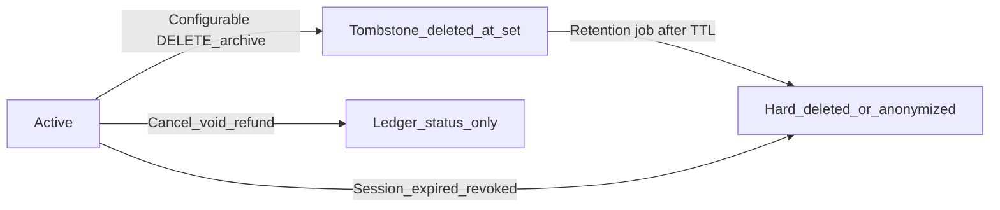

# Data lifecycle, deletion, and archival

How meepzo-be treats **removal** of persisted rows: tombstones (`deleted_at`), **revocation** flags, **immutable ledgers**, **ephemeral** credentials, and **retention** workers. Complements [domains-and-public-api-design.md](../architecture/domains-and-public-api-design.md) (API shape) and [api-versioning.md](../api/api-versioning.md) (HTTP versioning).

---

## Principles

1. **HTTP `DELETE` on tenant-owned configuration** should usually mean **tombstone** (soft delete) or an explicit **archive** action — not a silent SQL `DELETE`, unless the resource is **ephemeral** by design.
2. **Financial and subscription state** remains an **immutable operational ledger**: lifecycle is **`status`** and provider fields (subscriptions, Stripe webhook ledger) — not `deleted_at` as a hide switch.
3. **Secrets and sessions** favor **hard delete** after expiry/revocation to shrink attack surface; optional **retention** is time-boxed and documented.
4. Every **read** path for tombstoned entities must filter **`deleted_at IS NULL`** (Drizzle: `isNull(table.deleted_at)`) unless the handler is **admin**, **restore**, or **compliance export**.
5. **`INSERT`** on tenant-managed entities with a stable natural key uses **`onConflictDoUpdate`**: set **`deleted_at` to `NULL`** and refresh columns so **recreate becomes reactivation** (webhook URL per organization, notification-policy triple — see **Upserts** below).
6. Tombstones older than **`TOMBSTONE_RETENTION_DAYS`** (default **90**) are **hard-deleted** by dedicated BullMQ retention workers (distinct from audit/session jobs).
7. Introducing `deleted_at` on tables with **multiple natural keys** may require **composite unique indexes** for upsert + deduplication — see [be-sql-design-guard](../../../.cursor/skills/be-sql-design-guard/SKILL.md).

---

## Taxonomy (pick one primary class per table)

| Class                        | Meaning                                                     | Typical signal                                     |
| ---------------------------- | ----------------------------------------------------------- | -------------------------------------------------- |
| **Tombstone**                | Row hidden from normal API; may be restored or purged later | `deleted_at timestamptz` nullable                  |
| **Revocation / inactive**    | Row kept for audit; not shown in “active” lists             | `revoked_at`, `canceled_at`, `is_active`, `status` |
| **Immutable ledger**         | Business facts and money movement; no user “delete”         | `status`, provider ids, line items                 |
| **Ephemeral / high-risk**    | Tokens, sessions; remove when spent or revoked              | Hard `DELETE` after policy TTL                     |
| **Append-only / compliance** | Retained then purged by schedule                            | Retention worker, no user delete                   |
| **Junction / derived**       | Lifetime tied to parent                                     | Delete or orphan policy with parent                |

---

## Use-case checklist (all in scope for the lifecycle initiative)

Each area must be **documented and implemented** (correct queries, migrations, workers, or explicit guardrails). Work may ship in **multiple PRs**; ordering is for blast radius, not deferring scope.

- **Tenant-config delete** — webhooks, API keys, roles, organization notification policies, etc.
- **Membership / RBAC teardown** — memberships, role-permission links. A membership ends through **one leave step** (`MembershipService`, launch K4) for a removal (`delete_reason` = the manager's reason), leaving (`left`) and a deleted account (`account_deleted`): it soft-deletes the row, and revokes the person's API keys in the same transaction. The membership keeps its `display_name`, frozen once it ends.
- **Offboarding identity** — users, settings, notification preferences, uploads, linked rows.
- **Immutable operational ledger** — subscriptions and `billing.stripe_webhook_events`: **no** naive `deleted_at`; enforce **no stray SQL delete** and provider-aligned `status`.
- **Ephemeral secrets / credentials** — sessions, verification tokens; retention and hard delete.
- **Notification hygiene** — user notifications vs organization-level webhooks.
- **Compliance retention** — audit logs and other TTL tables.

For each **table × use-case** cell, classify **`implement_now`** vs **`not_applicable_to_table`** (e.g. `sessions` is not applicable to “immutable ledger”). **`not_applicable_to_table`** must be explicit — never blank.

---

## Lifecycle flow

---

## Execution order (recommended)

1. Freeze the **matrix** (spreadsheet or markdown appendix below) with stakeholder sign-off on **ledger** and **ephemeral** rules.
2. **Tenant-config**: align resources that still use Drizzle `.delete()` (e.g. **webhooks**) with **`deleted_at`** + filtered selects.
3. **Billing**: document + guardrails (tests / conventions) — **no** `deleted_at` on subscriptions / webhook ledger tables.
4. **Cross-cutting**: align naming (`revoked_at` vs tombstone) only where it reduces ambiguity in **this same initiative**.
5. **Retention**: tombstone TTL purge vs **audit/session** cleanup — separate jobs, explicit schedules.

---

## Upsert / reactivation

| Resource                | Unique conflict target                                    | On conflict behaviour                                                            |
| ----------------------- | --------------------------------------------------------- | -------------------------------------------------------------------------------- |
| Org notification policy | `(organization_id, notification_type, channel)`           | Tombstone cleared; preferences refreshed                                         |
| Webhook                 | `(organization_id, url)`                                  | Tombstone cleared; secret/events/`is_enabled` updated; **`public_id` unchanged** |

See migrations **`20260516000002_*` … `*_04_*`** for `deleted_at` columns and uniqueness.

---

## Immediate vs delayed cleanup

| Entity / table         | On HTTP soft-delete (immediate)                                                                             | After `TOMBSTONE_RETENTION_DAYS` (delayed)                                                   |
| ---------------------- | ----------------------------------------------------------------------------------------------------------- | -------------------------------------------------------------------------------------------- |
| `uploads`              | `DELETE` removes S3 object + sets `deleted_at`; user offboarding tombstones all user uploads (+ S3 per row) | Hard-delete row + S3 (`upload-tombstone-retention`)                                          |
| `users`                | Revoke all sessions + auth methods; clear avatar S3 key; tombstone uploads; **delete all GDPR export S3 keys + `auth.user_data_exports` rows**; **leave every organization** — every team membership ended through the leave step (`delete_reason = account_deleted`, the display name kept) as a manager's removal would (API keys revoked, `membership.deleted`, seat count reconciled), the personal organization tombstoned, the user's details nulled in stored `membership.*` webhook payloads | Hard-delete row (`user-tombstone-retention`). Attribution references (`created_by` / `updated_by`, an inviter, an uploader) are `ON DELETE SET NULL` and verification tokens cascade, so only a team organization the user still owns blocks it — and deletion is refused while one exists |
| `user_data_exports`    | Removed on user offboarding (`deleteAllExportsForUser`)                                                     | Daily `user-data-export-retention` when `expires_at` passed; S3 lifecycle on prefix `user-data-export/` (7 days) |
| `organizations`        | Clear logo S3 key; tombstone organization-scoped uploads (DB only); **no** child membership/role/API tombstone       | Hard-delete organization (`organization-tombstone-retention`; CASCADE children)                       |
| Other tombstone tables | API `DELETE` sets `deleted_at` only                                                                         | Matching `*-tombstone-retention` worker                                                      |

**Org tombstone window:** Child rows (memberships, webhooks, roles, etc.) may remain `deleted_at IS NULL` while the organization is tombstoned. Normal API access is blocked via `requireOrganizationByPublicId` / organization repository filters — not via cascading soft-delete.

### Tombstone purge cron order (FK-safe)

Registered in `src/infrastructure/queue/scheduler.ts` (default stagger 05:44–05:53 UTC):

1. `user-data-export-retention` — expired GDPR export artifacts (S3 + `auth.user_data_exports`)
2. `upload-tombstone-retention` — purges tombstoned uploads with their objects (`uploads.user_id` is `SET NULL` on the user's purge, so an organization's file survives its uploader)
3. `organization-tombstone-retention` — purges the departed user's tombstoned personal organization, releasing `owner_user_id`
4. Child tombstones (webhooks, policies, memberships, roles, API keys)
5. `user-tombstone-retention` — last

**Uploads of purged records (C-2, G2-5):** an upload is bound to the record it was first attached to;
the tombstone retention first tombstones the uploads whose bound record was purged, then removes the
tombstoned objects as usual (`tombstoneUploadsOfMissingRecords`, `upload-bound-records.ts`).

Batch deletes use `deleteInBatchesByCondition` with per-row FK fallback (`blockedCount` logged as `batch-delete.fkBlocked`). Every delete runs in a savepoint: the purges run inside one retention transaction, and before the savepoints a single blocked row (an invitation still referencing its inviter, say) aborted that transaction and failed the run every night. One run deletes at most `BATCH_DELETE_MAX_BATCHES_PER_RUN` batches (250 000 rows at the default batch size) — bounding the transaction's locks and WAL — and logs `batch-delete.run_capped` when rows remain for the next run.

---

## Table inventory (Drizzle `*.schema.ts`)

**`deleted_at`** (where applicable): `auth.users`, `tenancy.organizations`, `tenancy.memberships`, `tenancy.roles`, `tenancy.api_keys`, `tenancy.organization_notification_policies`, `notify.webhooks`, `upload.uploads`, `app.automations`.

**No `deleted_at` in `app`** (the Instagram automation domain) except on contacts and automations: an Instagram account is revoked, never deleted or tombstoned, and its token is erased on every disconnect; the account, its token and its settings leave only with their organization's hard delete (`ON DELETE CASCADE`, a referential action that runs whatever the table's RLS policy). The Instagram webhook events are a 30-day log: the daily `instagram-webhook-event-retention` hard-deletes every event received more than 30 days ago.

**Contact erase** (`app.contacts`, launch D22, feat-instagram-dm-sending CT11 — `DELETE /api/v1/app/contacts/{contact_id}`): the team honours a person's own request by **anonymising in place**, not by a soft delete that keeps the data: one transaction locks the live contact, runs the erasure steps other sub-domains register (sub-domain 3's: the contact's open runs cancelled, `trigger_text` and the queued automations cleared on its runs, and the comment-log copies — comment text, commenter username and Instagram id, email and phone received — cleared), then clears every personal column — Instagram user id, username, full name, picture, followers, follow status, email and phone with their times, tags, the team's note, her opt-out, the automations pause and the came-in ref — deletes her `app.contact_activities` row and her `app.contact_tag_events`, lowers the account's `app.contact_tag_counts`, and stamps `deleted_at` (`chk_contacts_erased` holds it). All or nothing: a step that fails rolls the whole erase back. Every unit of the run engine locks the contact's row first too (`FOR KEY SHARE`), so no copy outlives an erase that races an event. The row stays, without personal data, so the runs that point at it stay. No restore; a later event from the same person starts a fresh contact. The person's raw webhook events are not erased then — they expire with the 30-day clean-up (CQ1). Meta's data-deletion request never touches contacts (it names the account's owner, D22).

**Meta's deauthorize and data deletion** (launch D22, IA19, IA20; feat-instagram-dm-sending MC14–MC16, P46, P56 — `POST /api/v1/app/social/channel-connections/meta/deauthorize` and `/data-deletion`, PUBLIC, proved by Meta's `signed_request`): the person who connected a business removed the app, or asked Meta to delete their data. The signed id is matched as a channel account's provider account id first (every organization holding that account, any status), else as a connection's business id (every not-revoked account of that business's connections, and a connection left with no account). Only what was connected before Meta signed the request is changed — Meta retries a request it got no answer for, and a connection made since was never part of it, so it is left alone (launch D53): each account reached is revoked, and its connection's token deleted (with the connection revoked) once no other account uses it; the data deletion also erases each account's profile in place (username, name, biography, website, picture emptied, counts 0, `profile_erased_at` stamped — on an account match revoked rows of the same account too, once) and hard-deletes its stored posts (`app.instagram_media`). Settings, contacts and webhook events stay. The erase is done before Meta gets its answer — no request table, no background job (IQ2): the anonymous `app.channel_connection.data_deletion` audit entry (with the confirmation code Meta got) is the record. An id that matches nothing still gets its answer and code; it is logged at error level and handed to the team-alert port, to be deleted by hand (MC16 — the team email lands with ROUTE row R53). Safe to repeat: a second request finds what the first changed already done.

**Organization delete and its Instagram account** (launch D54 — `DELETE /api/v1/tenancy/organization`): as its last step before the soft delete, in the organization's own scope (row-level security hides a soft-deleted organization's rows from it, so later the erase would silently change none), the delete unsubscribes the live account from Instagram's webhook (best effort, outside the transaction) and in one transaction revokes every account the organization ever held, deletes its token, erases its profile and hard-deletes its stored posts — the same erase as Meta's data deletion. The Instagram account is free to connect in another organization at once, no token outlives the team, and a later deauthorize or data deletion of Meta's finds nothing left to erase (its rows are hidden anyway). A failed erase stops the delete before the soft delete; the offboarding reconcile worker runs it again. Automations, runs, comment logs, contacts, settings and webhook events stay until the organization's purge.

| Postgres table                       | Schema  | Primary class           | Deletion / inactive signal today          | Notes                                                                           |
| ------------------------------------ | ------- | ----------------------- | ----------------------------------------- | ------------------------------------------------------------------------------- |
| `users`                              | auth    | Tombstone + offboarding | `deleted_at`, `status`                    | Offboarding: sessions, auth methods, avatar S3, upload S3+tombstone, GDPR export S3+rows; purge last |
| `user_data_exports`                  | auth    | Compliance export       | `expires_at`, `status`                    | Presigned URL 15 min (900 s); S3 lifecycle + retention worker; offboarding deletes immediately |
| `user_settings`                      | auth    | Tombstone chain         | FK to user                                | Inherits visibility from user                                                   |
| `user_bug_reports`                   | auth    | Tombstone chain         | FK to user (`ON DELETE CASCADE`)          | Append-only bug reports; go with the account when its row is purged; in the data export|
| `user_notification_preferences`      | auth    | Tombstone chain         | FK to user                                | Same                                                                            |
| `sessions`                           | auth    | Ephemeral               | `expires_at`, `is_revoked`                | Cleanup worker hard-deletes                                                     |
| `trusted_devices`                    | auth    | Revocation + TTL        | `revoked_at`, `expires_at`                | "Trust this device" (30 days, ≤10 live); ended on 2FA off, sign-out-everywhere-else, account delete/suspend; FK cascade on purge; the session clean-up hard-deletes rows ended over 30 days ago (R50) |
| `auth_methods`                       | auth    | Revocation              | `revoked_at`                              | Not `deleted_at` by design                                                      |
| `mfa_methods`                        | auth    | Revocation              | `revoked_at`                              | Same                                                                            |
| `verification_tokens`                | auth    | Ephemeral               | `expires_at`, `used_at`                   | Audit-retention worker hard-deletes rows 7 days past `expires_at`               |
| `organizations`                      | tenancy | Tombstone               | `deleted_at`, `status`                    | Logo S3 + organization upload tombstone; no child cascade on soft-delete                 |
| `memberships`                        | tenancy | Tombstone               | `deleted_at`                              |                                                                                 |
| `membership_invitations`                 | tenancy | Revocation + TTL        | `revoked_at`, `expires_at`, `accepted_at` |                                                                                 |
| `roles`                              | tenancy | Tombstone               | `deleted_at`                              |                                                                                 |
| `role_permissions`                   | tenancy | Junction                | none                                      | Drops when role hard-removed — align with tombstone role                        |
| `permissions`                        | tenancy | Reference               | none                                      | Seeds only                                                                      |
| `organization_settings`              | tenancy | Tombstone chain         | FK organization                                    | Visibility from organization                                                             |
| `organization_notification_policies` | tenancy | Tenant-config           | `deleted_at`                              | Upsert + API soft-delete                                                        |
| `api_keys`                           | tenancy | Tombstone               | `deleted_at`                              |                                                                                 |
| `webhooks`                           | notify  | Tenant-config           | `deleted_at`                              | Unique `(organization_id, url)`; purge worker after `TOMBSTONE_RETENTION_DAYS`  |
| `webhook_delivery_attempts`          | notify  | Append / child          | FK `webhook_id`                           | Retain for audit; parent soft-deleted                                           |
| `notifications`                      | notify  | Notification hygiene    | Hard delete / read flags                  | User dismiss — not organization integration                                              |
| `logs`                               | audit   | Append-only             | Retention worker                          |                                                                                 |
| `plans`                              | billing | Reference / catalog     | `is_active`                               | Not user-deleted per row                                                        |
| `subscriptions`                      | billing | Immutable ledger        | `status`, `canceled_at`, provider ids     |                                                                                 |
| `stripe_webhook_events`              | billing | System ledger           | `processing_status`                       | No tenant RLS; deny-all + `meepzo_be_app` policy                                  |
| `uploads`                            | upload  | Tombstone               | `deleted_at`                              | Per-upload DELETE + user offboarding S3 sweep; retention purge deletes S3+row   |
| `channel_connections`                | app     | Revocation              | `status = 'revoked'`, `disconnected_at`   | one provider login per organization and business (MC1); no soft delete — "Disconnect business", its last account leaving or Meta's callbacks revoke it; a reconnect of the same business reuses the row; cascades with the organization |
| `channel_connection_usages`          | app     | Ephemeral cache-of-record | row overwritten                          | Meta's usage per connection, asset and type (S13, P107) — the newer reading wins; cascades with the connection and the organization |
| `instagram_accounts`                 | app     | Revocation              | `connection_status = 'revoked'`, `disconnected_at` | Never deleted: a disconnect (route 4) revokes the row and keeps the profile (Meta's data deletion erases it in place, `profile_erased_at`) and settings, Meta's deauthorize and data deletion revoke it too, so a reconnect of the same account reuses it; an organization delete revokes and erases it (launch D54, above); `connected_by_user_id` is `SET NULL` with the user; goes only with the organization (`ON DELETE CASCADE` on its hard delete) |
| `channel_connection_tokens`          | app     | Ephemeral / high-risk   | row deleted                               | `encryptFieldSecret` ciphertext only (MC9; the launch's `instagram_account_tokens` is gone, D24); deleted when the connection is revoked — "Disconnect business", its last account disconnected, Meta's callbacks, an organization delete (launch D54) — so a revoked connection holds no token; cascades with the connection and the organization; RLS has no retention sweep arm |
| `instagram_account_settings`         | app     | Tenant-config           | none (one row per account)                | Kept on a disconnect and reused on a reconnect; `updated_by_user_id` is `SET NULL` with the user; goes with the account and the organization (`ON DELETE CASCADE`) |
| `instagram_media`                    | app     | Tenant content          | row deleted                               | A post or reel an automation ran on, one per organization and Instagram media id, owned by one channel account (IA17, `channel_account_id`, feat-instagram-dm-sending P47) with its missed-comment watch and a Live's end (D40); kept on a disconnect, erased per account by Meta's data deletion (IA20, revoked rows of the same person too) and by an organization delete (launch D54), and goes with the organization (`ON DELETE CASCADE`, D8; the channel account key is `ON DELETE RESTRICT`); automations, runs and comment logs name a post by its Instagram media id without a key, so they outlive it; RLS has the retention sweep arm in `USING` only |
| `instagram_webhook_events`           | app     | Append / time-bound log | `created_at` (received) older than 30 days | Hard-deleted daily at 03:00 by `instagram-webhook-event-retention` (`INSTAGRAM_WEBHOOK_EVENT_RETENTION_DAYS = 30`, a constant — D8), whatever the status, `failed` included; a contact erase does **not** touch them — the person's events (payload as received) wait for this clean-up, and route 18 shows their payload masked meanwhile (WH18, contacts CQ1); cascades with the account and the organization; events of an account no team holds are never stored |
| `automations`                        | app     | Soft delete             | `deleted_at` + `delete_reason` / `delete_note` | Route 31 soft-deletes with an optional reason (`note` for `other` — feat-instagram-dm-sending AU16, P11) and cancels its open runs in the same transaction; never listed or read again and no restore route; purged 180 days after the delete once no run or comment log points at it — the daily `automation-tombstone-retention` at 03:40 UTC skips a still-referenced one and tries it again the next day (AQ7, its own 180 days, not `TOMBSTONE_RETENTION_DAYS`); the account link is `ON DELETE RESTRICT`; `created_by_user_id` / `updated_by_user_id` are `SET NULL` with the user; a "next post" never expires (P12); its counts (`automation_counts`) and reply state (`automation_reply_states`) go with it by cascade, and the contacts' `first_automation_id` / tag events' `source_automation_id` are set null; the retention sweep arm in `USING` only |
| `contacts`                           | app     | Erasure in place        | `deleted_at` + personal columns cleared   | Route 23 anonymises (above) — now also the note, the opt-out, the automations pause (when and by whom) and the came-in ref; `first_automation_id`, `came_in_via` and `channel` stay (CT11); never restored; no clean-up timer (D8, D12, AC-5.13): a contact stays until the team erases it or its organization is hard-deleted (`ON DELETE CASCADE`); the channel account link is `ON DELETE RESTRICT` (an account is never deleted); the retention sweep arm in `USING` only |
| `contact_activities`                 | app     | Deleted with the erase  | the contact's erase deletes the row       | Her fast-changing times and counts, 1:1 with a live contact (S5, ROUTE R10): message, DM window, sent, opening message, first message, comments, story, broadcast; deleted in the erase's transaction (her activity is personal data too, CT11); goes with its contact (`ON DELETE CASCADE`) and organization; organization arm only |
| `contact_tag_counts`                 | app     | Kept in the tag commit  | a count reaching 0 deletes its row        | Per channel account and tag, how many live contacts hold it (S7, ROUTE R10); moved in the same commit as every tag change and lowered by the erase; goes with its organization (`ON DELETE CASCADE`); organization arm only |
| `contact_tag_events`                 | app     | Time-bound (8 days)     | `created_at` older than 8 days; with the erase | One tag added to or removed from a contact, written in the tag change's commit (CT16, ROUTE R11); `queued_at` / `done_at` the only updates; deleted by the contact's erase (CT11) and, older than 8 days, by the hourly small-table clean-up in batches (WC-54, built at ROUTE R50 — until then rows accumulate); goes with its contact and organization (`ON DELETE CASCADE`); the retention sweep arm in `USING` for the pick-up and the clean-up |
| `automation_runs`                    | app     | Time-bound (month parts) | month part ended over 98 days ago        | One person going through one automation (feat-instagram-dm-sending AU21–AU27); **split by month of `started_at`** (P96, AU36) — a part is dropped once its month ended more than 98 days ago (90 days after the last run in it can have ended; `AUTOMATION_RUN_PART_DROP_AFTER_DAYS`) by the shared upkeep (WC-55, ROUTE R49), no batch delete; the hourly `automation-run-wait-expiry` cancels a run waiting more than 7 days (`wait_expired`, its open key deleted in the same commit — WC-45, P100); an automation delete cancels its open runs (`automation_deleted`) and a contact erase or pause cancels hers (`contact_deleted` / `contact_excluded` / `opted_out`); her free text is never kept on a run (D46); the automation and contact links are `ON DELETE RESTRICT`; the retention sweep arm in `USING` only |
| `automation_run_events`              | app     | Append-only history     | with its run's month part                 | One row per run status change, email or phone collected (never the value) and hello or follow tap (AU27); never updated; split by its run's start month (`automation_run_started_at`) and dropped with its run's part; `ON DELETE CASCADE` with its run |
| `automation_run_open_keys`           | app     | Kept while the run is open | the commit that ends the run             | One row per open run — the rule "one open run per automation and person" (AU37, P100); inserted in the run's start commit and deleted in the commit that ends it; a repair duty (WC-67, scheduled at ROUTE R47) removes a key a missed delete left; cascades with its automation and run; the retention sweep arm in `USING` only |
| `automation_comment_logs`            | app     | Time-bound (month parts) | month part 90 days after its month       | One comment an automation saw (AU28), the chosen automation and every other match; **split by month of `created_at`** (P96) — a part is dropped 90 days after its month by the shared upkeep (R49); its run is a copy (`automation_run_id` + `automation_run_started_at`) with no reference; a contact erase clears the comment text, the commenter's username and id, and the email and phone received (matched by `contact_id`) — the post and comment ids stay for the duplicate public reply rule; the automation and contact links are `ON DELETE RESTRICT`; the retention sweep arm in `USING` only |

---

## Related code

- **Repeatable cron index (all `upsertJobScheduler` retention jobs):** `src/infrastructure/queue/scheduler.ts`
- **Audit retention worker (processor):** `src/domains/audit/workers/audit-retention.worker.ts`
- **Session cleanup worker (processor):** `src/domains/auth/sub-domains/auth-session/workers/session-cleanup.worker.ts`
- **GDPR export retention:** `src/domains/user/sub-domains/user-data-export/workers/user-data-export-retention.worker.ts` — see [user-data-export.md](../data/user-data-export.md)
- **Instagram webhook event retention (30 days):** `src/domains/app/sub-domains/instagram-webhook/instagram-webhook-event/workers/instagram-webhook-event-retention.worker.ts`
- **Automation run clean-ups (D16, AU30, AU36):** the hourly 7-day wait cancel `src/domains/app/sub-domains/automation/automation-run/workers/automation-run-wait-expiry.worker.ts` (WC-45 — the open key deleted with the run); runs, run events and comment logs expire by month-part drops (the shared upkeep, ROUTE row R49) — the launch's daily run and comment-log batch deletes are retired (feat-instagram-dm-sending R14)
- **Deleted-automation purge (AQ7, 180 days, 03:40 UTC):** `src/domains/app/sub-domains/automation/workers/automation-tombstone-retention.worker.ts`
- **Instagram retention and erasure, end to end (AC-12.1–AC-12.13):** `src/domains/app/__tests__/e2e/instagram-retention-erasure.e2e.test.ts` — the flow is [`instagram-retention-erasure-flow`](../../../src/FLOWS.md#instagram-retention-erasure-flow)
- **Tombstone hard-delete** (uses **`TOMBSTONE_RETENTION_DAYS`**, default **90**): tombstoned `deleted_at` tables — `user/workers/user-tombstone-retention.worker.ts`, `tenancy/organization/workers/organization-tombstone-retention.worker.ts`, `tenancy/membership/workers/membership-tombstone-retention.worker.ts`, `tenancy/member-roles/workers/member-role-tombstone-retention.worker.ts`, `tenancy/organization/organization-api-key/workers/organization-api-key-tombstone-retention.worker.ts`, `tenancy/organization/organization-notification-policy/workers/organization-notification-policy-tombstone-retention.worker.ts`, `notify/webhook/workers/webhook-tombstone-retention.worker.ts`, `upload/workers/upload-tombstone-retention.worker.ts` (upload purge deletes S3 objects per row)
- **Billing ledger guard**: domain unit test `src/domains/billing/__tests__/unit/billing-ledger-immutability.unit.test.ts`
- **Tombstone read guard**: `src/domains/user/__tests__/unit/tombstone-repository-reads.unit.test.ts`
- **Batch delete FK fallback**: `src/infrastructure/database/utils/batch-delete.util.ts`, `src/tests/unit/infrastructure/database/batch-delete.util.unit.test.ts`
- **Scheduler tombstone order**: `src/tests/unit/infrastructure/queue/scheduler.unit.test.ts`
- **SQL design guard**: `.cursor/skills/be-sql-design-guard/SKILL.md`

After pulling schema changes (for example **`notify.webhooks.deleted_at`**), apply **`pnpm db:migrate`** so the database matches Drizzle definitions.

When you change any `*.schema.ts` or `migrations/*.sql`, follow **be-db-migration-maintainer** and **be-sql-design-guard**.

## Related

- [`src/PATTERNS.md`](../../../src/PATTERNS.md) § Soft Delete, § Tenant Isolation, § Audit Emission — cross-cutting patterns referenced by every lifecycle decision
- [`src/POLICIES.md`](../../../src/POLICIES.md) — `*_RETENTION_DAYS`, `TOMBSTONE_RETENTION_DAYS`, audit retention, GDPR export caps
- [`src/infrastructure/database/database.overview.md`](../../../src/infrastructure/database/database.overview.md) — RLS context family used by retention workers (`withMaintenanceDatabaseContext` + `MAINTENANCE_SCOPE.GLOBAL_RETENTION_CLEANUP`)
