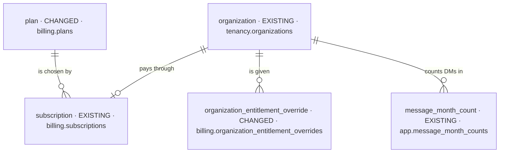
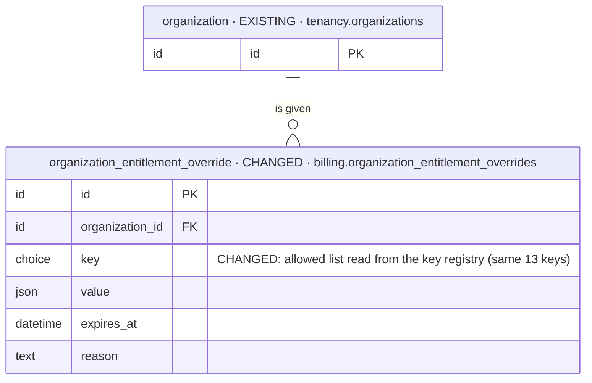
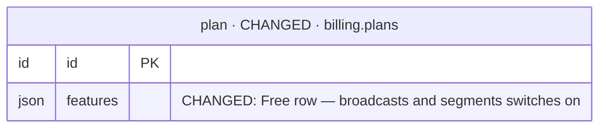
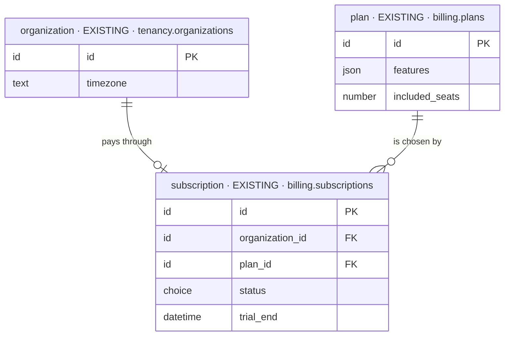
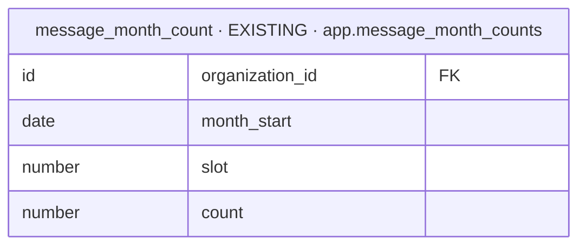

# DB changes — change-plan-gates-2026-11-26-mfku

Mode **initial** (Baseline `none`, Intake mode `brief`) · Intake hash `26273bac1cb0` · updated 2026-11-26 (Step 4: PG4, PG5, PG6, PG10).

**No new table and no column change.** The iteration changes how plan gates are read and enforced, not
what is stored. Two **data** changes ride with it:
- the Free plan row turns its `broadcasts` and `segments` switches on (PG10);
- the override table's allowed key list is read from the one key registry. The keys stay bare (PG4), and
  there's no seat key (PG6), so today's 13 keys are unchanged.

Everything else below is context, so the gate reads can be traced.

| Change | Count | Tables |
| --- | --- | --- |
| NEW | 0 | — |
| CHANGED | 2 (data only) | `billing.plans` (Free row's switches, PG10) · `billing.organization_entitlement_overrides` (allowed list from the registry; same 13 keys) |
| REMOVED | 0 | — |
| EXISTING (context) | 3 | organization, subscription, message month count |

## Overview

## Stage 1 — the override key list

### organization_entitlement_override

- **Holds:** one live value per organization and key (a feature switch on or off, or a limit number),
  with an optional expiry and a reason; super-admins set it, and it is laid over the plan's value on
  every plan read.
- **Table:** `billing.organization_entitlement_overrides` (exists, built in the oxak iteration's lane B).
- **Sources:** BRIEF:L19-L27, BRIEF:L89, BRIEF:L109, BRIEF:L120; code: the allowed key list holds 13 bare keys
  (11 switches + `message_month_limit`, `channel_accounts_max`).
- **Added / Replaced:**
  - The allowed list is read from the one key registry instead of two hand lists; the same 13 bare keys
    (PG2, PG4). Each registry entry also records its product (`instagram` or `core`), which isn't stored.
  - **Replaced:** the brief's namespaced spelling (`instagram.monthly_dms`) and seat key; neither is stored (PG4, PG6).
- **Open:** none.

## Stage 2 — Free plan data

### plan (the Free row)

- **Holds:** each plan's switches and limits; the Free row is the fallback for every organization without a paid plan.
- **Table:** `billing.plans` (exists).
- **Sources:** decisions PG10 (closes oxak pending #12 in favour of AC-9.1).
- **Added / Replaced:** the Free row's `broadcasts` and `segments` switches turn **on**; its seed values move
  with it. Free's month limit (1,000), accounts (1) and the other PRO switches are unchanged.
- **Open:** PG10-a: today the switched-off plan rows reuse Free's values, so do they get the two switches too? (Step 5.)

## Context — read by the gates, unchanged

### plan, subscription, organization

- **Holds:** the plan's switches and limits (`plan`), which plan an organization pays for and its trial end
  (`subscription`; grace and read-only are worked out from status and dates at read time), and the organization's time zone for the DM month
  (`organization`).
- **Table:** `billing.plans`, `billing.subscriptions`, `tenancy.organizations` (exist).
- **Sources:** BRIEF:L21 (resolve wraps today's plan-access read, which joins these in one statement).
- **Added / Replaced:** none.
- **Open:** none. The Free plan stays the fallback for no subscription, and a key a plan row lacks reads the
  registry default (PG5).

### message_month_count

- **Holds:** the organization's DMs sent this month (its own time zone), spread over slots so sends
  don't queue on one row.
- **Table:** `app.message_month_counts` (exists, lane C).
- **Sources:** BRIEF:L24, BRIEF:L92: `consume` wraps today's counter and month-cap logic unchanged.
- **Added / Replaced:** none.
- **Open:** none.

