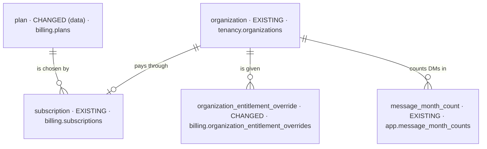
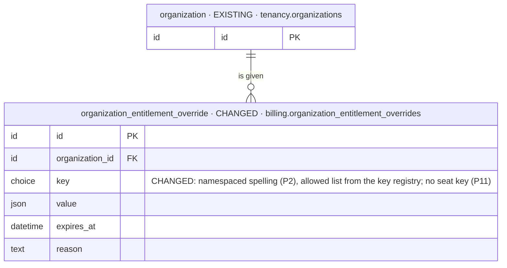
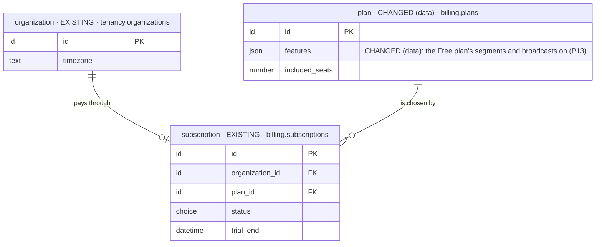
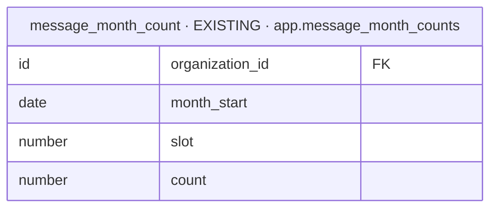

# DB changes — change-plan-gates-2026-11-26-mfku

Mode **initial** (Baseline `none`, Intake mode `brief`) · Intake hash `26273bac1cb0` · updated 2026-11-26 (Steps 1–3; the owner's answers, [decisions.md](decisions.md) P1–P15).

**No new table.** The iteration changes how plan gates are read and enforced. Two stored things change, each in
a new billing migration (`docs/reference/data/migrations.md`): the per-organization override table's key
spelling (P2 — namespaced; no seat key, P11), and the Free plan's catalog values (P13 — segments and broadcasts
on). Everything else below is context, so the gate reads can be traced.

| Change | Count | Tables |
| --- | --- | --- |
| NEW | 0 | — |
| CHANGED | 2 | `billing.organization_entitlement_overrides` (key spelling, P2) · `billing.plans` (the Free plan's feature values — data, P13) |
| REMOVED | 0 | — |
| EXISTING (context) | 3 | organization, subscription, message month count |

## Overview

## Stage 1 — the override key list

### organization_entitlement_override

- **Holds:** one live value per organization and key (a feature switch on or off, or a limit number),
  with an optional expiry and a reason; super-admins set it, and it is laid over the plan's value on
  every plan read.
- **Table:** `billing.organization_entitlement_overrides` (exists, built in the oxak iteration's lane B).
- **Sources:** BRIEF:L19-L27, BRIEF:L89, BRIEF:L109, BRIEF:L120; code: the allowed key list holds 13 bare keys
  (11 switches + `message_month_limit`, `channel_accounts_max`).
- **Added / Replaced:**
  - **P2 — the key spelling becomes namespaced** (`instagram.email_ask`, `instagram.message_month_limit`, …;
    the final names come from the key registry at Step 6). One new billing migration widens
    `chk_organization_entitlement_overrides_key` to the namespaced list, rewrites the stored rows to the new
    spelling, then narrows the CHECK to the namespaced list only. The override routes and
    `GET /billing/entitlements` return and accept the namespaced keys (route-changes; a contract change for
    meepzo-fe).
  - **P11 — no seat key**: seats stay outside the overrides (unlimited, D55); AC-6 holds for the other limits.
  - The allowed list is read from the one key registry instead of two hand lists.
- **Open:** none (P2, P11).

## Context — read by the gates, unchanged

### plan, subscription, organization

- **Holds:** the plan's switches and limits (`plan`), which plan an organization pays for and its trial end
  (`subscription`; grace and read-only are worked out from status and dates at read time), and the organization's time zone for the DM month
  (`organization`).
- **Table:** `billing.plans`, `billing.subscriptions`, `tenancy.organizations` (exist).
- **Sources:** BRIEF:L21 (resolve wraps today's plan-access read, which joins these in one statement).
- **Added / Replaced:**
  - **P13 — the Free plan turns `segments` and `broadcasts` on** (its `features.feature_switches`): a data change to
    the Free plan row, in a new billing migration (or the plan seed, per the migrations rule) under the
    namespaced keys of P2. Supersedes oxak P76 / BC3's Free values.
  - **P15 (AMBER) — the Free plan is the "global default" layer**: a key no paid plan or override sets reads
    the Free plan's value; the registry carries no code default per key.
- **Open:** none (P13; P15 to confirm at the plan review).

### message_month_count

- **Holds:** the organization's DMs sent this month (its own time zone), spread over slots so sends
  don't queue on one row.
- **Table:** `app.message_month_counts` (exists, lane C).
- **Sources:** BRIEF:L24, BRIEF:L92: `consume` wraps today's counter and month-cap logic unchanged.
- **Added / Replaced:** none.
- **Open:** none.

