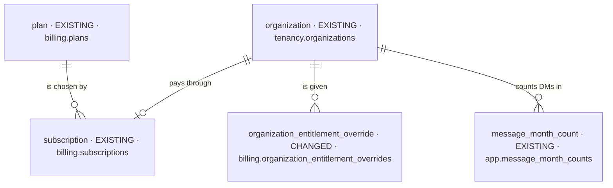
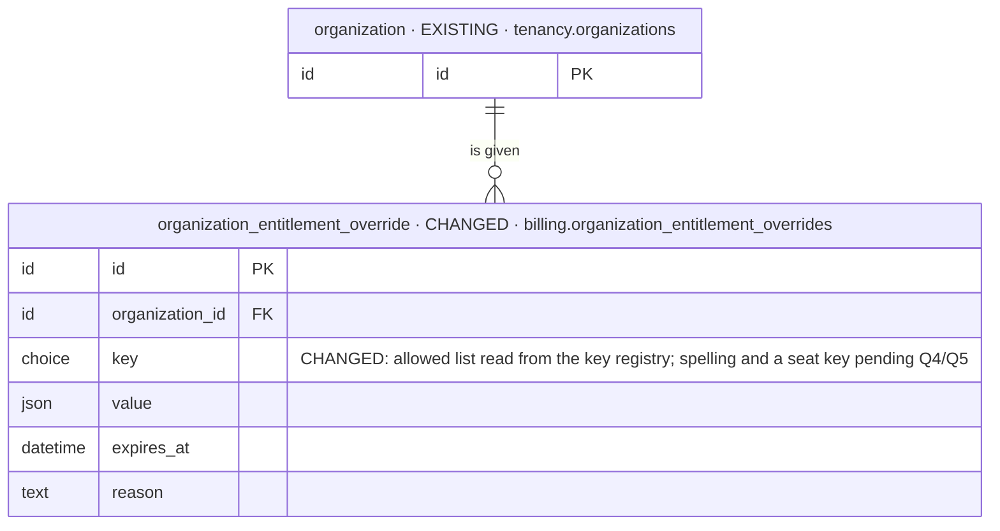
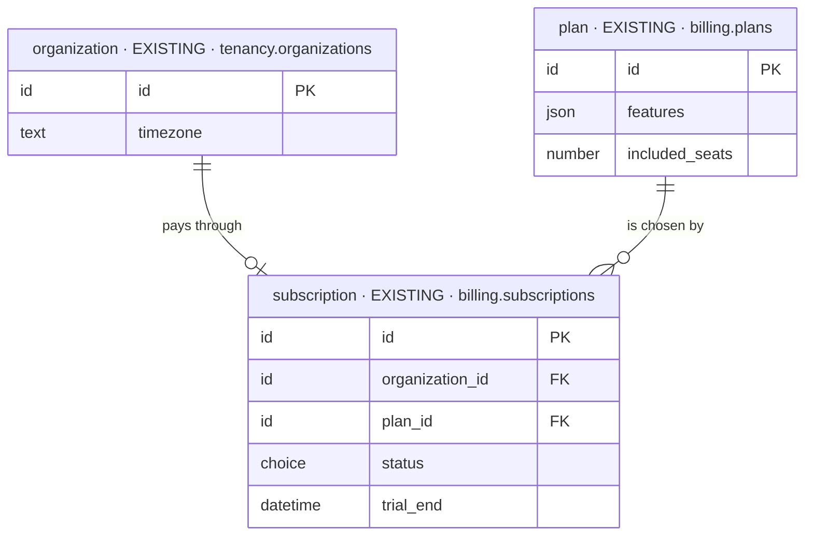
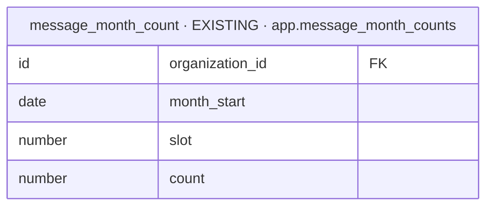

# DB changes — change-plan-gates-2026-11-26-mfku

Mode **initial** (Baseline `none`, Intake mode `brief`) · Intake hash `26273bac1cb0` · updated 2026-11-26 (Steps 1–3).

**No new table.** The iteration changes how plan gates are read and enforced, not what is stored. The one
table that may change is the per-organization override table: its allowed key list (and, depending on
Q4 and Q5, the key spelling and a seat key). Everything else below is context, so the gate reads can be
traced.

| Change | Count | Tables |
| --- | --- | --- |
| NEW | 0 | — |
| CHANGED | 1 (pending Q4/Q5) | `billing.organization_entitlement_overrides` |
| REMOVED | 0 | — |
| EXISTING (context) | 4 | organization, plan, subscription, message month count |

## Overview

## Stage 1 — the override key list

### organization_entitlement_override

- **Holds:** one live value per organization and key (a feature switch on or off, or a limit number),
  with an optional expiry and a reason; super-admins set it, and it is laid over the plan's value on
  every plan read.
- **Table:** `billing.organization_entitlement_overrides` (exists, built in the oxak iteration's lane B).
- **Sources:** BRIEF:L19-L27, BRIEF:L89, BRIEF:L109, BRIEF:L120; code: the allowed key list holds 13 bare keys
  (11 switches + `message_month_limit`, `channel_accounts_max`).
- **Added / Replaced:**
  - *pending Q4:* key spelling becomes namespaced (`instagram.email_ask`, …): the allowed list
    changes, and stored rows are rewritten to the new spelling in the same step.
  - *pending Q5:* a seat key (the seat ceiling) becomes allowed, so a seat limit can be one override row (BRIEF:L120).
  - The allowed list is read from the one key registry instead of two hand lists.
- **Open:** Q4 (namespacing and migration), Q5 (seat key).

## Context — read by the gates, unchanged

### plan, subscription, organization

- **Holds:** the plan's switches and limits (`plan`), which plan an organization pays for and its trial end
  (`subscription`; grace and read-only are worked out from status and dates at read time), and the organization's time zone for the DM month
  (`organization`).
- **Table:** `billing.plans`, `billing.subscriptions`, `tenancy.organizations` (exist).
- **Sources:** BRIEF:L21 (resolve wraps today's plan-access read, which joins these in one statement).
- **Added / Replaced:** none.
- **Open:** Q4 (whether the Free plan **is** the "global default" layer, or the registry carries a code
  default per key).

### message_month_count

- **Holds:** the organization's DMs sent this month (its own time zone), spread over slots so sends
  don't queue on one row.
- **Table:** `app.message_month_counts` (exists, lane C).
- **Sources:** BRIEF:L24, BRIEF:L92: `consume` wraps today's counter and month-cap logic unchanged.
- **Added / Replaced:** none.
- **Open:** none.

