# Database changes — feat-instagram-dm-sending-2026-11-23-oxak

| Field | Value |
| --- | --- |
| Iteration | `feat-instagram-dm-sending-2026-11-23-oxak` |
| Mode | initial (Baseline none) |
| Intake mode | brief (from scratch) |
| Intake hash | `e2875698ea64` |
| Date | 2026-11-23 |

The iteration's data model, kept current at every planning step. WHAT must be true, never HOW: logical
types only, no SQL, no indexes, no constraints. `pnpm db:viewer` draws this file in plan mode. Sources
are cited as `plan:L<line>` — lines of `intake-files/Instagram-DM-Sending-Plan-v8.md`. The plan's own
decisions are `D1`–`D73` (plan:L210–L284, locked); this plan's are `P<n>` in
[decisions.md](decisions.md) (`P1`–`P20` are the AMBER defaults A1–A20).

**Stated against the launch.** The launch iteration (`launch-2026-11-20-ujai`, frozen, not yet merged)
built the 10 `app` tables marked `EXISTING`, `CHANGED` or `REMOVED` here. Per plan D1 (plan:L212,
plan:L2888) this plan states every change against those tables, before → after; how the change ships
(the launch migrations changed in place, or new migrations after the launch merges) is *pending your
answer (Q2)*.

| Change | Count | Entities |
| --- | --- | --- |
| NEW | 26 | **Stages 1–6 (20):** meta_connection, meta_connection_token, contact_tag_event, automation_count, automation_reply_state, automation_backfill, automation_run_open_key, instagram_webhook_event_key, segment, broadcast, broadcast_recipient, instagram_send_lane, instagram_message, instagram_send_attempt, instagram_send_minute_count, direct_message_month_count, instagram_send_stop, sending_state, sending_helper_slot, meta_attachment · **Stage 8 (6, pending Q1):** trusted_device, trial_account, referral_link, referral, referral_earning, referral_payout |
| CHANGED | 16 | **app (9):** instagram_account, instagram_account_setting, instagram_media, contact, automation, automation_run, automation_run_event, automation_comment_log, instagram_webhook_event · **Stage 7 (3):** plan, subscription, upload · **Stage 8 (4, pending Q1):** organization, user, user_setting, session |
| REMOVED | 1 | instagram_account_token |
| EXISTING | 0 | — organization and user are context for every stage and change only in Stage 8; if Q1 keeps Part F out they go back to `EXISTING` (context only) |

**Where the tables live.** Every new sending table goes in the `app` schema with the plan's plural
snake_case name (plan:L2800, plan:L8481) — *proposed, pending your answer (Q11)*. Until Q11 is answered
the new entities carry no `domain.table` on their labels, so the DB Viewer draws them under `app` with
their plural name; each section's **Table** line names the proposal. Changed tables carry the label of
the live table they change. Part F's new tables follow their own domains as the plan names them
(plan:L8467) — *pending your answer (Q1)*.

**Names.** The plan's identifiers are rewritten to full names (A6, [P6](decisions.md)): `dm_month_counts`
→ `direct_message_month_counts`, `post_key` → `once_key`, `turn_no` → `turn_number`, `dm_sent_at` →
`direct_message_sent_at`, and the same for every `_no`, `_nos`, `_ms` and `dm` the plan uses
(`message_number`, `version_number`, `wording_number`, `text_number`, `chain_number`,
`version_numbers`, `duration_milliseconds`). New true/false fields take the `is_` form the repository's
SQL guide asks for (be-sql-design-guard rule 5, like the launch's `is_automation_enabled`); the plan's
name is in each field's comment — *a naming question not yet asked (N1, see the end)*.

**Rules every new table follows** (plan:L2800, plan:L4223–L4298):

- Every row belongs to one organization and goes away with it; a child row never points at another
  organization's row. Exceptions: the two global sending tables (`sending_state`,
  `sending_helper_slot`) have no organization — a documented exemption, read and written only by the
  maintenance login (A16, [P16](decisions.md)).
- A session sees and writes only its active organization's rows; background work runs in one
  organization's context at a time. The token table is readable only in its organization's own
  context — no clean-up across organizations reads it (plan:L4236–L4251).
- Instagram and Meta ids are digit strings, so they are `text`.
- Lists of values (scopes, keywords, stop words, starter questions) are `json` "list of text".

**How long rows stay** (plan §21, plan:L4124–L4217). The plan splits seven tables by time (webhook
events by day, send attempts by day, messages by week, runs, run events, comment logs and broadcast
recipients by month) and the webhook event keys by account, and drops old parts. Whether any table is
split is *pending your answer (Q6)*; this file records only how long each table keeps its rows, in each
table's **Holds**.

## Overview

```mermaid
erDiagram
  organization["organization · CHANGED · tenancy.organizations"]
  user["user · CHANGED · auth.users"]
  plan["plan · CHANGED · billing.plans"]
  subscription["subscription · CHANGED · billing.subscriptions"]
  upload["upload · CHANGED · upload.uploads"]
  meta_connection["meta_connection · NEW"]
  meta_connection_token["meta_connection_token · NEW"]
  instagram_account["instagram_account · CHANGED · app.instagram_accounts"]
  instagram_account_setting["instagram_account_setting · CHANGED · app.instagram_account_settings"]
  instagram_account_token["instagram_account_token · REMOVED · app.instagram_account_tokens"]
  instagram_media["instagram_media · CHANGED · app.instagram_media"]
  contact["contact · CHANGED · app.contacts"]
  contact_tag_event["contact_tag_event · NEW"]
  automation["automation · CHANGED · app.automations"]
  automation_count["automation_count · NEW"]
  automation_reply_state["automation_reply_state · NEW"]
  automation_backfill["automation_backfill · NEW"]
  automation_run["automation_run · CHANGED · app.automation_runs"]
  automation_run_event["automation_run_event · CHANGED · app.automation_run_events"]
  automation_comment_log["automation_comment_log · CHANGED · app.automation_comment_logs"]
  automation_run_open_key["automation_run_open_key · NEW"]
  instagram_webhook_event["instagram_webhook_event · CHANGED · app.instagram_webhook_events"]
  instagram_webhook_event_key["instagram_webhook_event_key · NEW"]
  segment["segment · NEW"]
  broadcast["broadcast · NEW"]
  broadcast_recipient["broadcast_recipient · NEW"]
  instagram_send_lane["instagram_send_lane · NEW"]
  instagram_message["instagram_message · NEW"]
  instagram_send_attempt["instagram_send_attempt · NEW"]
  instagram_send_minute_count["instagram_send_minute_count · NEW"]
  direct_message_month_count["direct_message_month_count · NEW"]
  instagram_send_stop["instagram_send_stop · NEW"]
  sending_state["sending_state · NEW"]
  sending_helper_slot["sending_helper_slot · NEW"]
  meta_attachment["meta_attachment · NEW"]
  user_setting["user_setting · CHANGED · auth.user_settings"]
  session["session · CHANGED · auth.sessions"]
  trusted_device["trusted_device · NEW"]
  trial_account["trial_account · NEW"]
  referral_link["referral_link · NEW"]
  referral["referral · NEW"]
  referral_earning["referral_earning · NEW"]
  referral_payout["referral_payout · NEW"]

  organization ||--o{ meta_connection : "ADDED: logs in to Meta through"
  meta_connection ||--|| meta_connection_token : "ADDED: signs in with"
  meta_connection ||--o{ instagram_account : "ADDED: brings in"
  organization ||--o{ instagram_account : "connects (many, D26)"
  instagram_account ||--|| instagram_account_setting : "is set up by"
  instagram_account ||--|| instagram_account_token : "REMOVED: signs in with"
  instagram_account ||--o{ instagram_media : "stores the posts of"
  instagram_account ||--o{ contact : "brings in"
  contact ||--o{ contact_tag_event : "ADDED: has tag changes"
  automation |o--o{ contact_tag_event : "ADDED: tagged by"
  automation |o--o{ contact : "ADDED: first brought in"
  user |o--o{ contact : "ADDED: paused automations for"
  instagram_account ||--o{ automation : "runs"
  automation ||--o{ automation_count : "ADDED: is counted in"
  automation ||--o| automation_reply_state : "ADDED: paces public replies by"
  automation ||--o{ automation_backfill : "ADDED: answers past comments through"
  automation ||--o{ automation_run : "starts"
  contact ||--o{ automation_run : "goes through"
  automation_run ||--o{ automation_run_event : "records"
  automation ||--o{ automation_comment_log : "logs"
  automation_run |o--o{ automation_comment_log : "is logged by"
  contact ||--o{ automation_comment_log : "is logged by"
  automation_run ||--o| automation_run_open_key : "ADDED: holds while open"
  instagram_account ||--o{ instagram_webhook_event : "receives events for"
  instagram_account ||--o{ instagram_webhook_event_key : "ADDED: remembers event keys of"
  instagram_account ||--o{ segment : "ADDED: saves audiences in"
  segment |o--o{ broadcast : "ADDED: is the audience of"
  instagram_account ||--o{ broadcast : "ADDED: sends"
  broadcast ||--o{ broadcast_recipient : "ADDED: goes to"
  contact ||--o{ broadcast_recipient : "ADDED: receives"
  instagram_account ||--|{ instagram_send_lane : "ADDED: sends through 4 lanes"
  automation_run |o--o{ instagram_message : "ADDED: sends"
  broadcast |o--o{ instagram_message : "ADDED: sends"
  instagram_message ||--o{ instagram_send_attempt : "ADDED: is tried by (no reference)"
  instagram_account ||--o{ instagram_send_minute_count : "ADDED: is counted per minute in"
  organization ||--o{ direct_message_month_count : "ADDED: is counted per month in"
  instagram_account ||--o{ instagram_send_stop : "ADDED: has stop history"
  instagram_account ||--o{ meta_attachment : "ADDED: has Meta file ids"
  upload ||--o{ meta_attachment : "ADDED: is uploaded to Meta as"
  plan ||--o{ subscription : "is paid through"
  organization ||--o| subscription : "pays for"
  user ||--|| user_setting : "is set up by"
  user ||--o{ session : "signs in through"
  user ||--o{ trusted_device : "ADDED: trusts"
  organization ||--o{ trial_account : "ADDED: has trialled with"
  plan ||--o{ trial_account : "ADDED: is trialled as"
  user ||--o| referral_link : "ADDED: refers with"
  referral_link ||--o{ referral : "ADDED: brings in"
  user ||--o{ referral : "ADDED: refers or is referred"
  referral ||--o{ referral_earning : "ADDED: earns"
  user ||--o{ referral_payout : "ADDED: is paid"
```

## Stage 1 — Meta connection and accounts

Everything hangs off a connected account, and every account now hangs off a Meta login: Unified Login
is the only login (D24), a workspace connects several accounts (D26), and the token moves from the
account to the connection (plan:L2922–L2944, plan:L3517–L3574).

### meta_connection

- **Holds:** one Meta login of a workspace — one workspace and one client business portfolio (D25,
  D27): the business id, the login configuration, the login type, its status, the granted scopes, who
  connected it and when, the last daily token check and its error codes (never Meta's text), and when
  it was disconnected. One row per organization and business: a reconnect reuses the row, a `revoked`
  one included. No soft delete — `revoked` stands in; rows stay until the organization is deleted. Has
  a public id (prefix not named by the plan). `status`: `connected` · `error` · `revoked` (plan
  §20.6) — `connected` to `error` on a token error, `revoked` on a disconnect or Meta's deauthorize
  request, back to `connected` by logging in with the same business again. `login_type`: `unified`
  only (room for a Facebook Pages login later, D27).
- **Table:** `app.meta_connections` (proposed, pending Q11)
- **Sources:** plan:L3517–L3553 (columns, rules), plan:L3998–L4013 (status), plan:L4528–L4575 (connect).
- **Added:** new — replaces the account-level login of the launch (Instagram Login, D24). The
  connect's plan check (accounts per plan, D26) locks the workspace's connection rows (plan:L3553).
- **Replaced:** the launch's per-account `scopes` move here (from `instagram_account`).
- **Open:**
  - The table's place and name — *pending your answer (Q11)*.
  - Public id prefix not named by the plan — new question (N2).

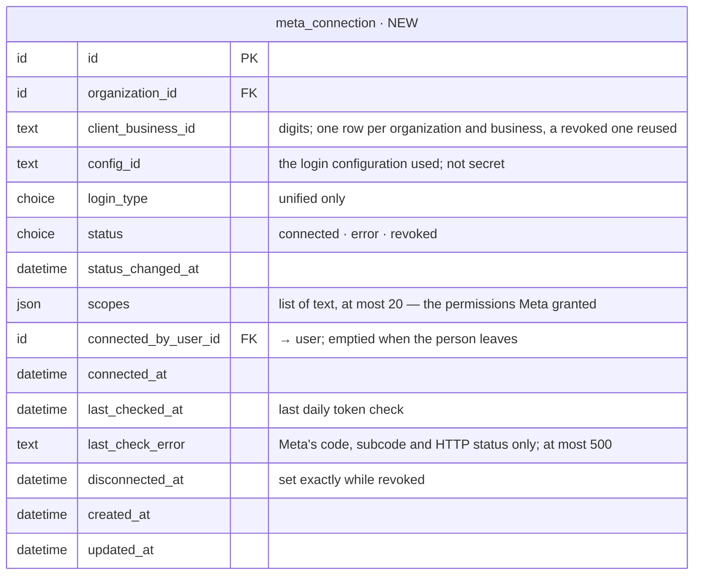

### meta_connection_token

- **Holds:** the connection's system-user access token, stored encrypted, its type and when it ends
  (empty = never, the default for a system-user token, D24). One per connection; deleted only when the
  connection is `revoked`. Read only on the Meta client's path — never in a cache, a log or a job
  payload. No public id. Goes away with its connection.
- **Table:** `app.meta_connection_tokens` (proposed, pending Q11)
- **Sources:** plan:L3555–L3574; plan:L4577 (connect writes it), plan:L4236–L4251 (organization
  context only).
- **Added:** new — the one token path (D24). Unlike the launch's account token it has no renewal: the
  daily check only tests it and sets the connection to `error` when Meta rejects it.
- **Replaced:** `instagram_account_token` (removed below) — one token per account → one per
  connection.
- **Open:** the table's place and name — *pending your answer (Q11)*.

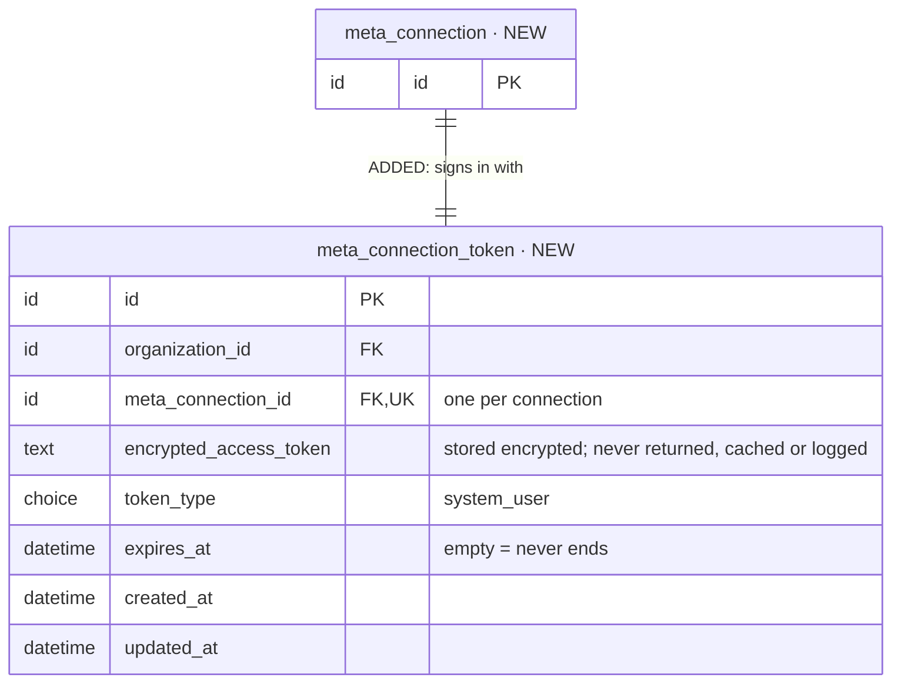

### instagram_account

- **Holds:** as at launch, an Instagram professional account a workspace connected — now reached
  through a Meta connection, and many per workspace (Free 1, Creator 3, Studio 10 by the plan's
  `instagram_accounts_max`, D26). One workspace per Instagram account stays: at most one row not
  `revoked` per Instagram account across organizations. The Instagram user id now comes from the
  connection's assigned-accounts list and is used for API paths and webhook routing. The daily check's
  profile refresh stays, inside the token check (A17, [P17](decisions.md)).
- **Table:** `app.instagram_accounts` (live)
- **Sources:** plan:L2922–L2944; plan:L4590–L4604 (connect, plan limit); current schema
  `src/domains/app/sub-domains/instagram-account/instagram-account.schema.ts`.
- **Added:**
  - `meta_connection_id` — the login this account came from (D25); required.
  - `starter_questions_set_at` — the last time this account's starter questions were sent to Meta;
    emptied when a starter-question automation goes live, pauses or changes its questions (D42).
- **Replaced:**
  - Accounts per organization: at most one not revoked (launch D5) → many, up to the plan's limit,
    checked at connect (D26).
  - `connection_status`: `connected` · `expired` · `error` · `revoked` → `connected` · `error` ·
    `revoked` — `expired` was the 60-day token's end (D24).
  - `instagram_app_user_id`, `scopes`, `token_expires_at` removed: Unified Login has no app-scoped
    id, the scopes move to `meta_connection`, the token ends on the connection (or never).
- **Open:**
  - The launch's Meta data-deletion and deauthorize requests found the account by
    `instagram_app_user_id`; the plan's new callback lookup is "id to be set by the Meta test"
    (plan:L4280–L4289) — tracked as a Meta-test item (Q9).
  - The launch's `access_expires_at` API field goes with `token_expires_at` (route-changes.md).

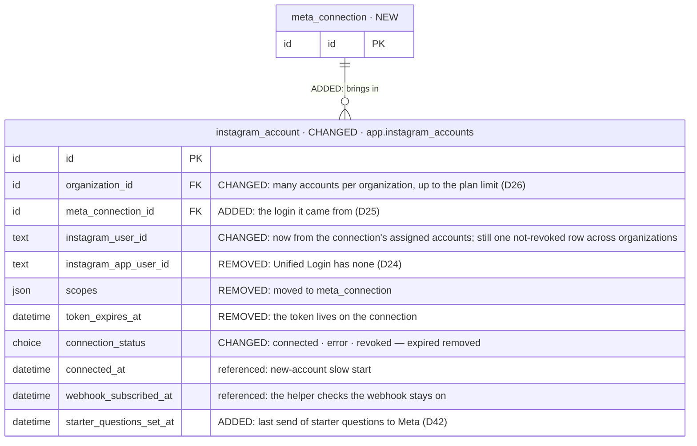

### instagram_account_setting

- **Holds:** as at launch, the account's automation master switch — plus the owner's sending limits
  and account-wide behaviour. Every new number is optional: empty means the value in the settings file
  (D22). The public reply safety moves to each automation (D32), so its five columns go. New:
  opening DMs per hour (1–750; the API stops at 700) and per day (used only when the day limit is on),
  fast messages per hour, messages per person per hour, broadcast messages per hour (1–2,000; empty =
  600), the "this is an automatic message" notice, the owner's extra stop words (at most 50, lower
  case), whether replies under comments start comment automations (on), once per person per post
  (on), mark as seen after a reply (off), and the extra random delay before each answer (1–20
  seconds, both ends or neither; PRO).
- **Table:** `app.instagram_account_settings` (live)
- **Sources:** plan:L2895–L2920; D5, D11, D22, D32, D64–D68; current schema
  `src/domains/app/sub-domains/instagram-account/instagram-account-settings/instagram-account-settings.schema.ts`.
- **Added:** the 13 fields marked `ADDED` below.
- **Replaced:** the 5 public reply safety fields → per automation (`automation.is_reply_like_person_enabled`,
  `public_reply_hour_limit`) and the settings file (D32).
- **Open:** true/false field names (N1).

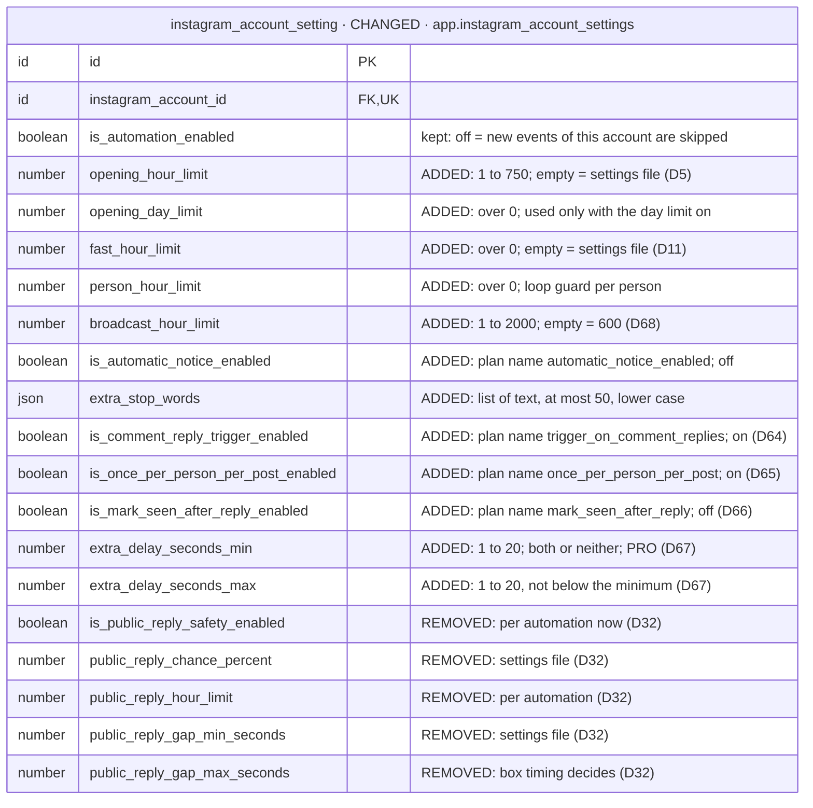

### instagram_account_token

- **Holds (before):** the account's long-lived Instagram Login token, encrypted, renewed daily before
  its 60 days ran out. Removed with the daily renewal, the Instagram Login client and its app secret
  (plan:L2938).
- **Table:** `app.instagram_account_tokens` (live) — removed
- **Sources:** plan:L2938, plan:L8458; current schema
  `src/domains/app/sub-domains/instagram-account/instagram-account-token.schema.ts`.
- **Added:** none.
- **Replaced:** → `meta_connection_token` (D24). No data moves: the Instagram Login code is replaced,
  not migrated (plan:L2924).
- **Open:** none.

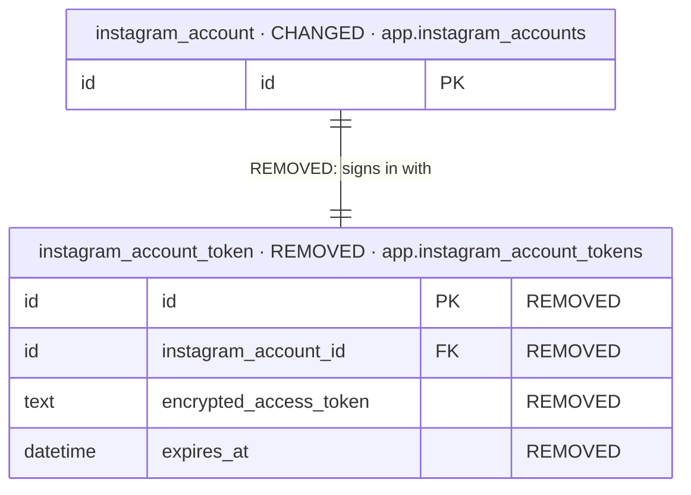

### instagram_media

- **Holds:** as at launch, the account's stored posts — plus the missed-comment watch (when the helper
  last read the post's comments, when it reads again — empty = not watched — and the newest comment
  known) and when a Live ended, so waiting Live private replies expire without a call (D40).
  `media_product_type` adds Meta's value for a Live; `ad` marks an ad's post (D41).
- **Table:** `app.instagram_media` (live)
- **Sources:** plan:L2946–L2958; current schema
  `src/domains/app/sub-domains/instagram-account/instagram-media/instagram-media.schema.ts`.
- **Added:** the four time fields below; the Live value.
- **Replaced:** none.
- **Open:** the exact Live value Meta sends — a Meta test (Q9, plan §43).

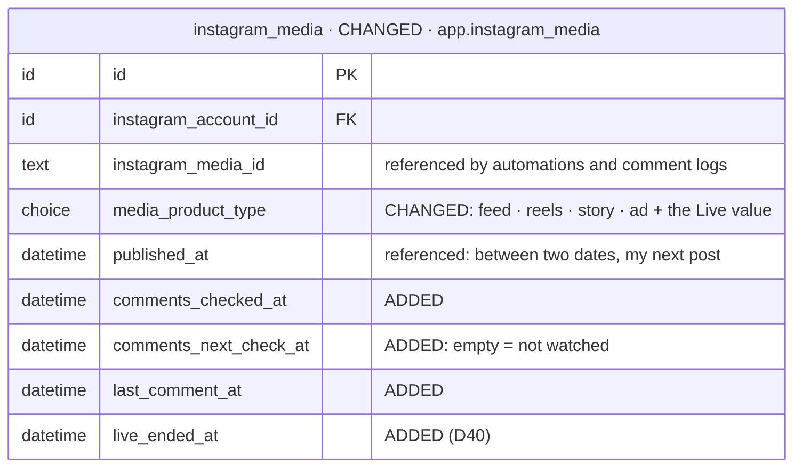

## Stage 2 — Audience and automations

Contacts and automations get the fields the 15 ways to start, the message list and the owner's
controls need; four small tables carry tag changes, all-time counts, public reply pacing and
past-comment runs.

### contact

- **Holds:** as at launch, one person who wrote to or commented on one account — plus the 24-hour
  private-reply rule (last opening message), the stop word (opted out), the channel (`instagram`,
  D27), the first automation that started a run for her ("via", set once) with how and from what ref
  she came in, the owner's private note (1–2,000), her first message time, the owner's "pause
  automations for this person" with who did it (D71), and her comment and story activity and last
  broadcast for segments (D68). The follow state keeps the launch's fields. Kept until the owner
  deletes it, Meta asks, or the workspace goes (D51). Erasing a contact also clears the last opening
  message, opted out and the note.
- **Table:** `app.contacts` (live)
- **Sources:** plan:L2960–L2993; D27, D45, D46, D49, D68, D71; current schema
  `src/domains/app/sub-domains/contact/contact.schema.ts`.
- **Added:** the 14 fields marked `ADDED`. The list and its sorts are per account (D26).
- **Replaced:** the email check: the launch refused plus addresses (Standing deviation "Email and
  phone checks") → accepted (A19, [P19](decisions.md)).
- **Open:** none.

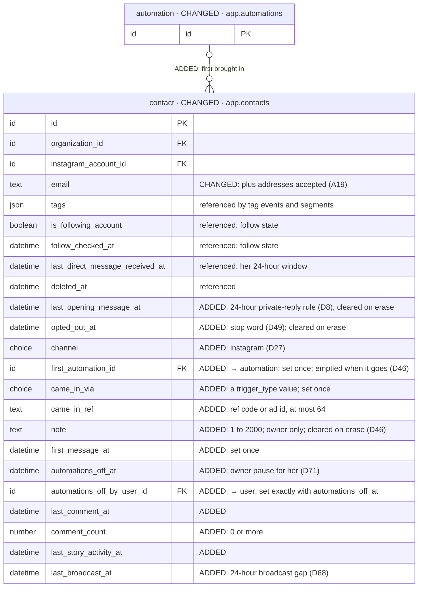

### contact_tag_event

- **Holds:** one row per tag added to or removed from a contact, written in the same commit as the
  change, so tag starts never lose one (D45). `kind`: `added` · `removed`; `source`: `automation` (a
  tag step) · `owner`. The chain number counts how many tag starts led to this change; intake starts
  nothing at 3 or more. Its id is part of the once key of a tag start. Kept 8 days. No public id.
- **Table:** `app.contact_tag_events` (proposed, pending Q11)
- **Sources:** plan:L3685–L3717; D45.
- **Added:** new.
- **Replaced:** none.
- **Open:** the table's place and name — *pending your answer (Q11)*.

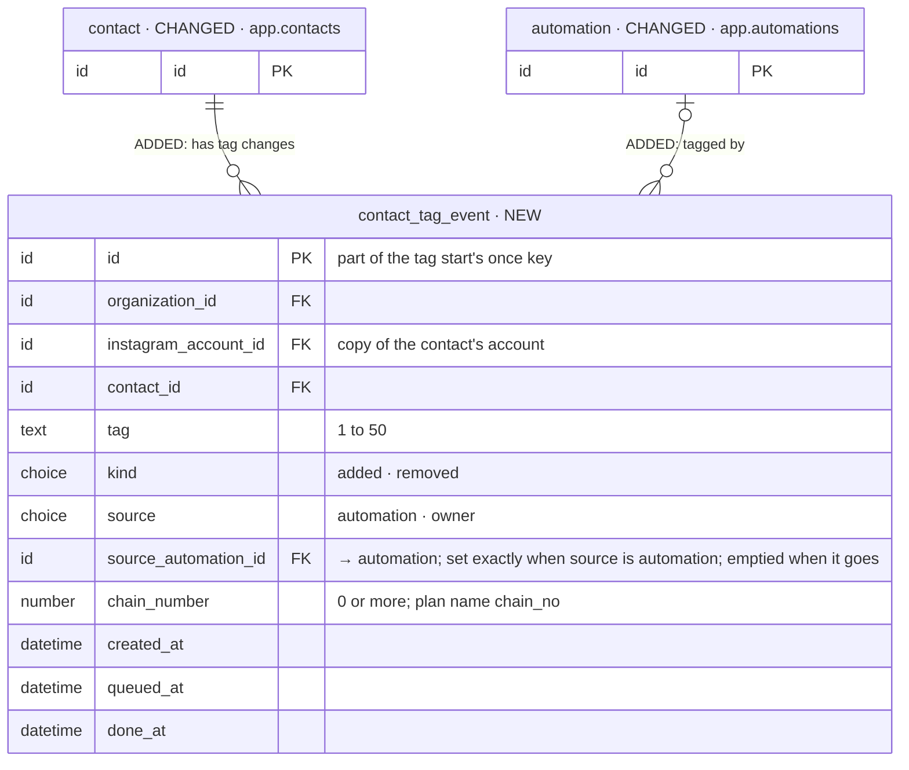

### automation

- **Holds:** as at launch, one automation of one account — now flat fields for how it starts and
  its public reply, and one `steps` object for everything it sends (hello, follow, email, phone, the
  message list, tags). A draft needs only a name (D28). `status`: `draft` · `live` · `paused`.
  `trigger_type`: `comment` · `live_comment` · `story_reply` · `story_mention` · `story_repost` ·
  `dm_keyword` · `first_message` · `shared_post` · `starter_question` · `ref_link` · `default_reply` ·
  `ad_comment` · `ad_message` · `tag_added` · `tag_removed` (D37). `also_start_from`: `story_reply`,
  `dm`, at most 2 (D38). `target_scope`: `any` · `specific` · `next` · `between` (D39).
  `next_post_status`: `waiting` · `linked` — a "next post" never expires (A12,
  [P12](decisions.md)). `default_reply_mode`: `once_a_day` · `every_time` (D44). `stopped_reason`:
  `bad_text` · `post_deleted` — a plan change never stops an automation (D57). Soft delete stays; the
  delete reason becomes optional, `other` still needs a note (A11, [P11](decisions.md)). Files in steps
  are referred to by upload public id, same workspace, scanned clean (plan:L3094).
- **Table:** `app.automations` (live)
- **Sources:** plan:L2995–L3145; D28–D45, D52, D57, D59, D63; current schema
  `src/domains/app/sub-domains/automation/automation.schema.ts`.
- **Added:** the fields marked `ADDED`; the go-live checks of §5.1 plus the "next step" button rule
  (A2, [P2](decisions.md)).
- **Replaced:**
  - The launch's message fields (opening message, follow, email, phone, final message and their
    switches) → `steps` (D29–D31).
  - `is_dm_keyword_trigger_enabled` → `also_start_from` (D38).
  - `next_post_starts_at` / `next_post_ends_at` → `target_starts_at` / `target_ends_at` (D39).
  - `tags` → `steps.tags` (D45).
  - `completed_run_count` → `automation_count` (D36).
  - `is_public_reply_enabled` stays as it is; the plan renames it `public_reply_enabled`, which the
    repository's true/false rule does not allow (N1).
- **Open:**
  - Which ways to start may go live before their Meta test (`story_repost`, `live_comment`,
    `ad_comment`, quick replies and cards) — *pending your answer (Q9)*.
  - True/false field names (N1).

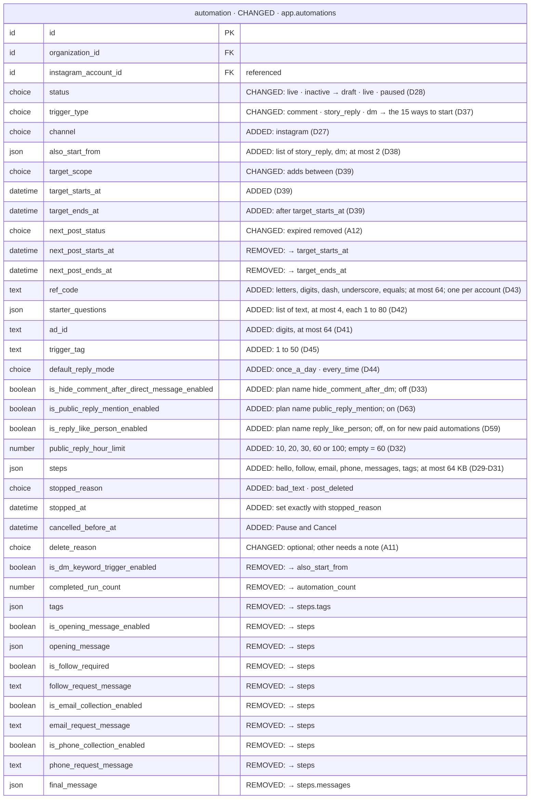

### automation_count

- **Holds:** an automation's all-time counters — runs started, taps, typed answers, and the same per
  step version (for example `hello.1`) — split over 16 slots so busy automations do not wait on one
  row (D36). Survives the 90-day run delete. No public id. Goes away with its automation.
- **Table:** `app.automation_counts` (proposed, pending Q11)
- **Sources:** plan:L3576–L3599; D36, D61.
- **Added:** new.
- **Replaced:** `automation.completed_run_count` (removed).
- **Open:** the table's place and name — *pending your answer (Q11)*.

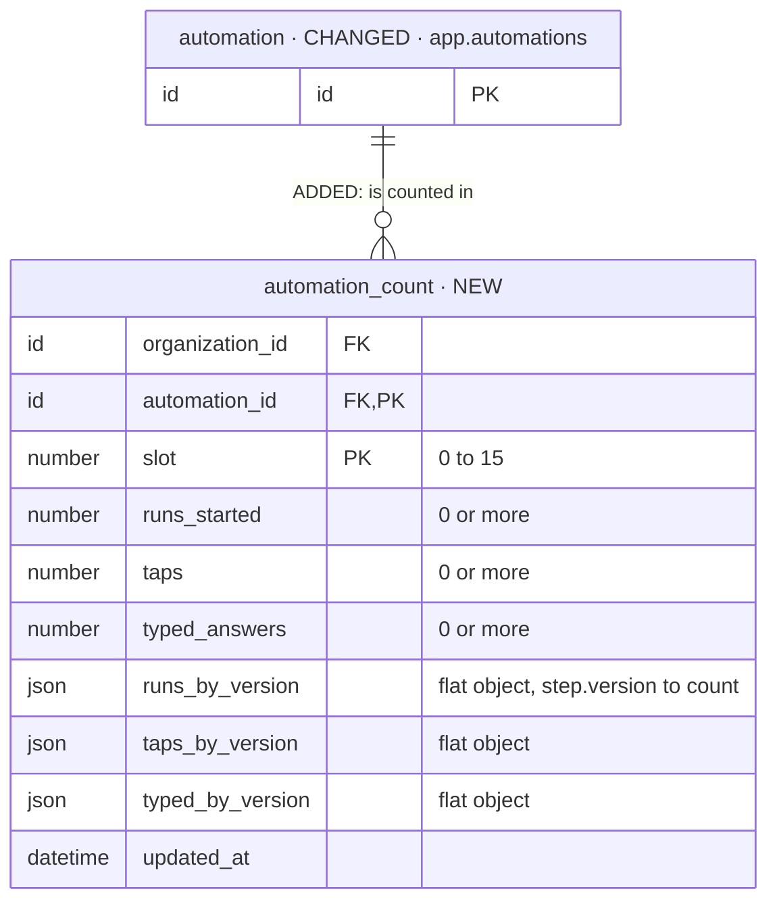

### automation_reply_state

- **Holds:** the "Reply like a person" pacing of one automation's public replies: the current random
  box, the last reply line used, and how many replies wait (D32). One per automation, made at its
  first public reply. No public id.
- **Table:** `app.automation_reply_states` (proposed, pending Q11; the plan names it in the singular,
  `app.automation_reply_state` — the repository's tables are plural)
- **Sources:** plan:L3601–L3621; D32, D52.
- **Added:** new — replaces the account-wide reply safety of the launch (D32).
- **Replaced:** none.
- **Open:** the table's place and name — *pending your answer (Q11)*.

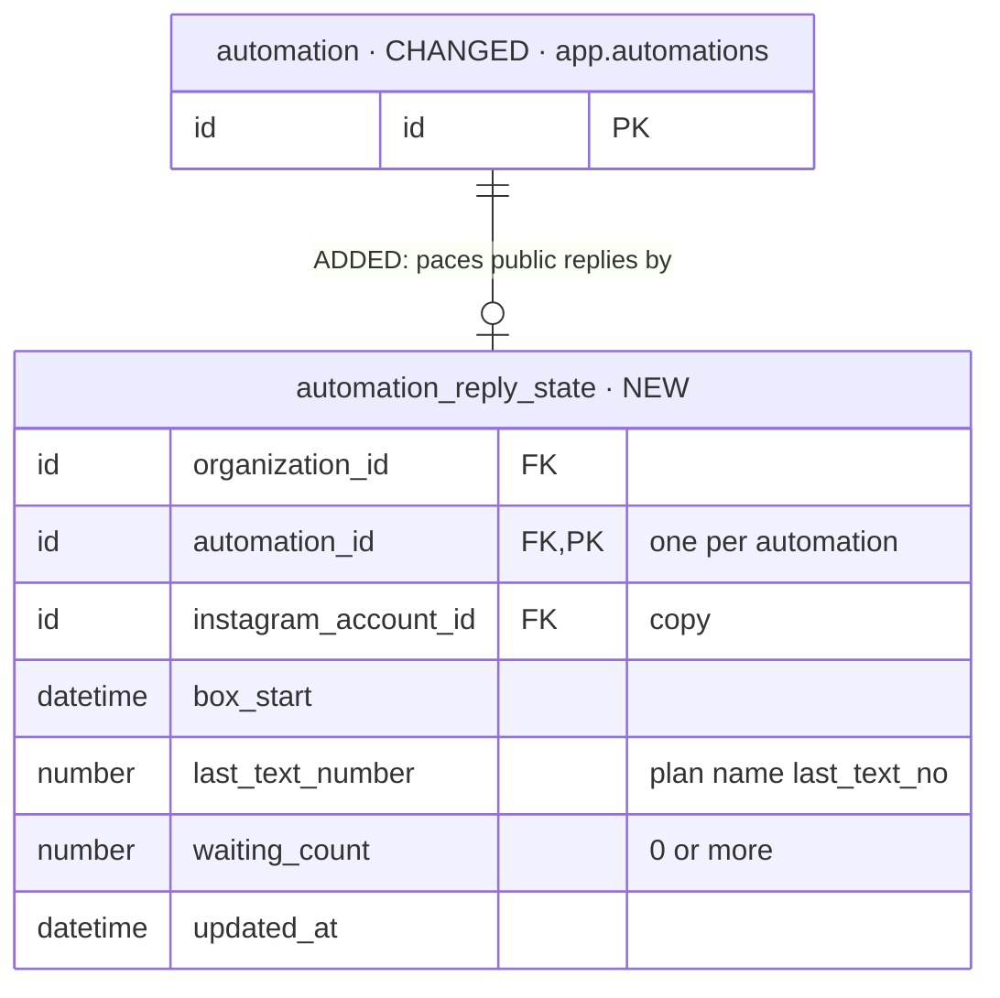

### automation_backfill

- **Holds:** one "also answer comments from the last N days" run of a live comment or ad-comment
  automation (D69, PRO): the days (1–7), its status, posts read, comments found, matched and opening
  DMs queued, why it failed and the error codes (never Meta's text), who asked and when. `status`:
  `queued` · `reading` · `done` · `failed`; `fail_reason`: `meta_error` · `plan_feature_off`. One
  queued or reading per automation; a new press after a failure makes a new row. Has a public id
  (prefix not named by the plan).
- **Table:** `app.automation_backfills` (proposed, pending Q11)
- **Sources:** plan:L3818–L3844, plan:L4109–L4120; D69.
- **Added:** new.
- **Replaced:** none.
- **Open:**
  - The table's place and name — *pending your answer (Q11)*.
  - Public id prefix (N2).

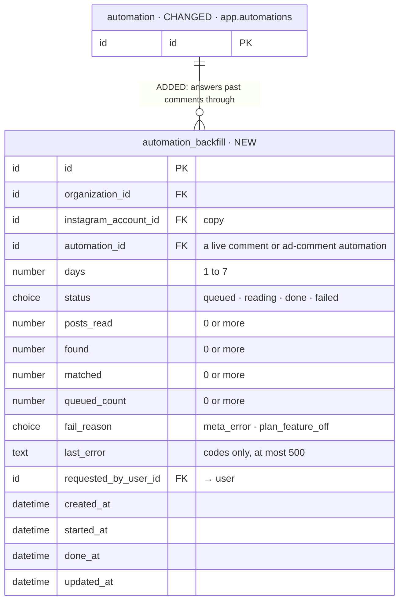

## Stage 3 — Runs and logs

A run now carries its once key, the 7-day clock and which step versions it used; the claim of a send
moves to the message row (Stage 6). Runs, run events and comment logs keep 90 days, not 180 (D16).

### automation_run

- **Holds:** as at launch, one person going through one automation — plus when the event that started
  it happened (the 7-day clock, D9), its once key (D13), when its first DM was sent, the highest list
  message sent (read by segments after message rows are gone) and which version of each step it used.
  `trigger_type` is how this run started (the 15 kinds; may differ from the automation's through
  "also start from"). `current_step`: `keyword_match` · `comment_reply` · `follow_check` ·
  `email_collect` · `phone_collect` · `messages`. `waiting_for` adds `any`. `cancel_reason` adds
  `expired` · `opted_out` · `window_closed` · `contact_excluded`. Her own free text is never kept
  (D46). Kept about 90 days after it ends (D16; launch 180).
- **Table:** `app.automation_runs` (live)
- **Sources:** plan:L3147–L3173, plan:L3893–L3924; D9, D13, D16, D29–D31, D46; current schema
  `src/domains/app/sub-domains/automation/automation-run/automation-run.schema.ts`.
- **Added:** the fields marked `ADDED`.
- **Replaced:**
  - The send claim (`sending_message_kind`, `sending_started_at`) → the message row's status
    (`instagram_message`).
  - "One open run per automation and person" (launch) → one open run per automation, person and once
    key, held in `automation_run_open_key` (plan:L3465–L3480).
- **Open:**
  - One open run per automation and person, or per once key — *pending your answer (Q8)*.
  - Split by month of `started_at` (plan) — *pending your answer (Q6)*.

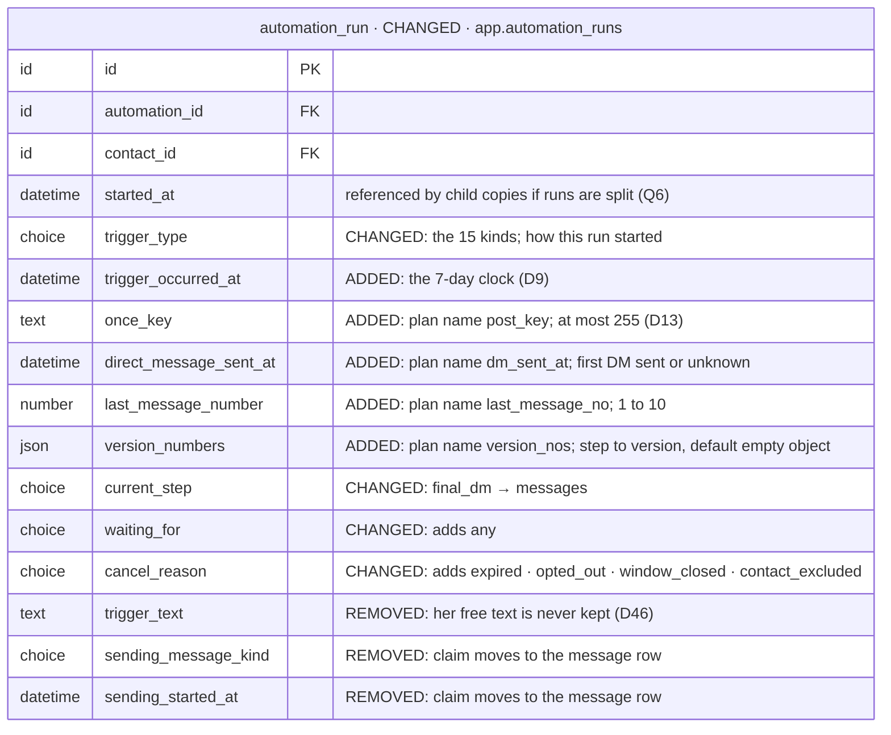

### automation_run_event

- **Holds:** as at launch, the append-only history of a run — `event_type` adds `hello_tapped` and
  `follow_tapped` (the tap counts of D61). If runs are split, each event also carries its run's start
  time. Kept with its run.
- **Table:** `app.automation_run_events` (live)
- **Sources:** plan:L3175–L3182; current schema
  `src/domains/app/sub-domains/automation/automation-run/automation-run-event.schema.ts`.
- **Added:** `automation_run_started_at`; two event types.
- **Replaced:** none.
- **Open:** `automation_run_started_at` is needed only if runs are split — *pending your answer
  (Q6)*.

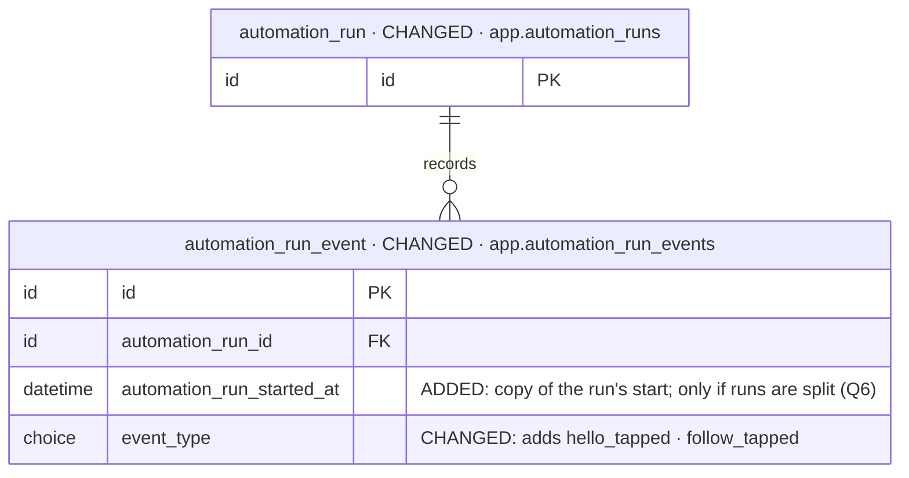

### automation_comment_log

- **Holds:** as at launch, one row per comment an automation saw, with each step's status — plus the
  comment's time, the hide step (status and when) and the run's start time if runs are split. The
  final DM step becomes the message list (`messages_status`, `messages_at`). Step statuses add
  `expired` · `unknown`; `current_step` / `failed_step` rename `final_dm` → `messages` and add
  `hide_comment`; `waiting_for` adds `any`. `ignored_reason`: `previous_run_final` → `once_per_post`,
  adds `thread_reply_off` · `own_comment` · `contact_excluded`, keeps `run_in_progress` and
  `comment_already_answered`. `public_reply_skip_reason`: `duplicate` · `random` · `hour_limit` ·
  `deleted_comment` (`gap` removed). Live and ad comments get logs; a Live's reply and hide stay
  `off`. Kept 90 days (D16; launch 180).
- **Table:** `app.automation_comment_logs` (live)
- **Sources:** plan:L3184–L3205; D16, D32, D33, D64; current schema
  `src/domains/app/sub-domains/automation/automation-run/automation-comment-log.schema.ts`.
- **Added:** the fields marked `ADDED`.
- **Replaced:** `final_dm_status` / `final_dm_at` → `messages_status` / `messages_at`.
- **Open:**
  - The plan does not say what happens to the launch's ignored reasons `waiting_for_other_email` and
    `already_waiting` — new question (N3); kept here.
  - `automation_run_started_at` and the split by month — *pending your answer (Q6)*.
  - The launch's `opening_dm_status` / `opening_dm_at` keep `dm` (as built); A6 renames only new
    names.

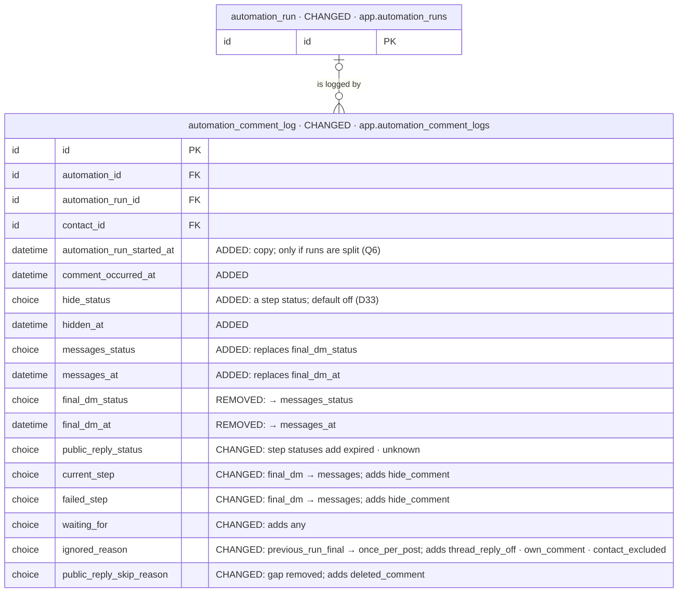

### automation_run_open_key

- **Holds:** one row per open run: the automation, the person and the once key — added when a run
  opens and deleted when it ends, in the same commit (D13). With "every time" on (once per person per
  post off) the key is the fixed `every_time`, so one automation has at most one open run per person
  (D65). Small: only open runs have a row. No public id.
- **Table:** `app.automation_run_open_keys` (proposed, pending Q11)
- **Sources:** plan:L3465–L3480; D13, D65.
- **Added:** new — replaces the launch's "one open run per automation and person" rule on the runs.
- **Replaced:** none.
- **Open:**
  - Whether the once key belongs in the rule at all — *pending your answer (Q8)*: answered "always one
    open run per automation and person", this table is not needed and the launch's rule on the runs
    stays.
  - The table's place and name — *pending your answer (Q11)*.

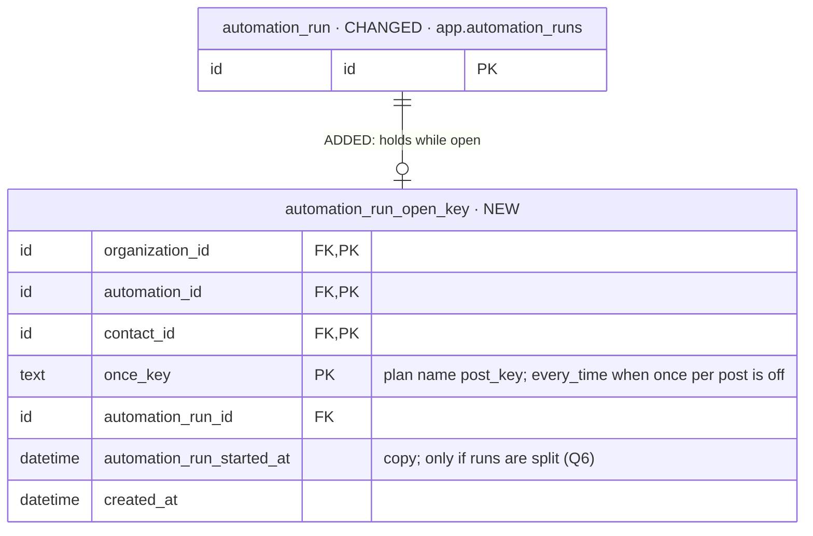

## Stage 4 — Received content

Meta's events keep their table, kept 8 days instead of 30 and emptied once handled; their dedupe keys
move to a table of their own.

### instagram_webhook_event

- **Holds:** as at launch, one event Meta sent for a connected account — plus when a failed event is
  tried again (hourly, while the comment is under 7 days old). `event_kind` adds `live_comment` ·
  `story_mention` · `shared_post` · `referral` · `ice_breaker` and drops `read`; `skip_reason` drops
  `read_receipt` and adds `own_comment` (D64). The body is emptied once the event is processed or
  skipped; read receipts, our own "sent" notices and tag events are never saved; echoes of the
  owner's hand-typed messages are saved only to start her quiet time (D15). Kept 8 days (D15; launch
  30).
- **Table:** `app.instagram_webhook_events` (live)
- **Sources:** plan:L3207–L3225, plan:L3926–L3941; D15, D64; current schema
  `src/domains/app/sub-domains/instagram-webhook/instagram-webhook-event/instagram-webhook-event.schema.ts`.
- **Added:** `next_attempt_at`; five event kinds; `own_comment`.
- **Replaced:**
  - The dedupe key on this table → `instagram_webhook_event_key`.
  - A failed event was final after 5 tries (launch) → retried hourly up to 7 days.
  - The launch's debugging list of events shows 8 days instead of 30.
- **Open:**
  - The launch records an own comment as `echo`; the plan adds `own_comment` — which one stays is a
    new question (N4).
  - Events held in Redis while Postgres is down (plan's buffer) — *pending your answer (Q5)*.
  - Split by day (plan) — *pending your answer (Q6)*.

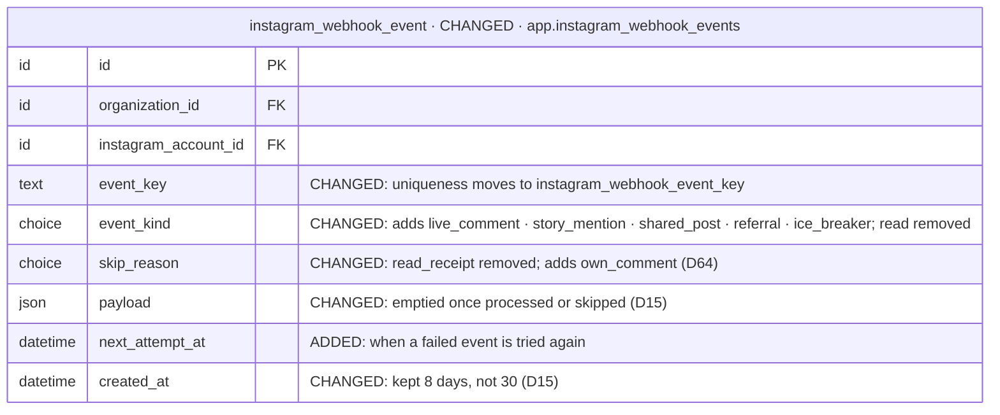

### instagram_webhook_event_key

- **Holds:** the key of every event received per account, so the same event arriving twice saves
  nothing more. Kept 8 days. No public id.
- **Table:** `app.instagram_webhook_event_keys` (proposed, pending Q11)
- **Sources:** plan:L3453–L3461; D15.
- **Added:** new — the launch kept this key on the events, which now go after 8 days in whole days.
- **Replaced:** the event's own key uniqueness.
- **Open:**
  - The table's place and name — *pending your answer (Q11)*.
  - Split by account (plan) — *pending your answer (Q6)*.

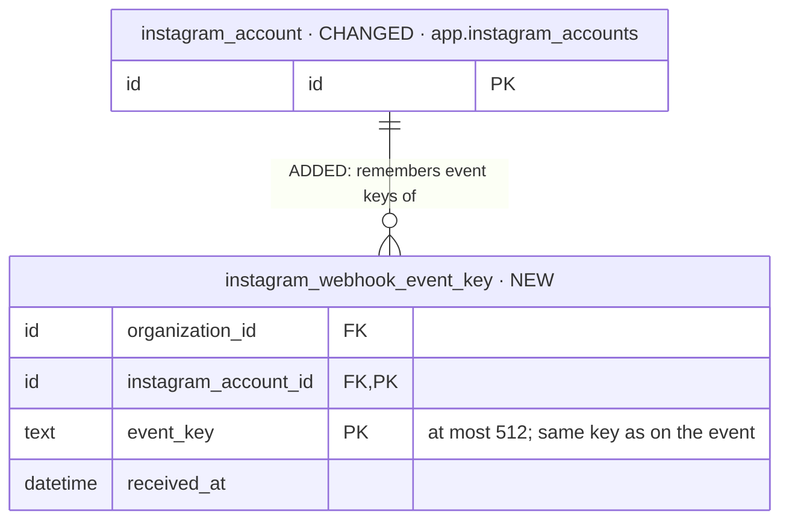

## Stage 5 — Broadcasts

Saved audiences and the message sets sent to them, only to people whose chat window is open (D68,
PRO). Segments and broadcasts are soft-deleted and purged later (A9, [P9](decisions.md)).

### segment

- **Holds:** a saved audience of one account: a name and its conditions in AND / OR groups (at most 2
  levels, 20 conditions) on tags, the automation she came through, how she came in, comments, activity,
  her details, story activity and "no broadcast in N days" (D68). Used again by many broadcasts. Has a
  public id (prefix not named by the plan). Soft delete (A9).
- **Table:** `app.segments` (proposed, pending Q11)
- **Sources:** plan:L3719–L3750; D68.
- **Added:** `deleted_at` — the plan hard-deletes; A9 keeps the repository's soft delete.
- **Replaced:** none.
- **Open:**
  - The table's place and name — *pending your answer (Q11)*.
  - Public id prefix (N2).

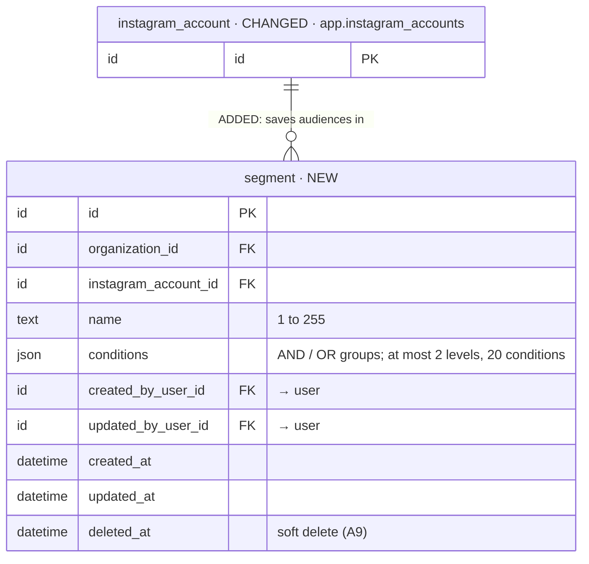

### broadcast

- **Holds:** one message set (1–3 messages, the same shape as the automation's message list, with
  versions) sent to the people of a segment or a one-off audience — a copy of the conditions is kept
  when it starts. `status`: `draft` · `scheduled` · `sending` · `waiting_for_chats` · `done` ·
  `cancelled`; `mode`: `now` · `scheduled` · `when_chat_opens` (1–7 days); `cancel_reason`: `owner` ·
  `plan_feature_off`. Counts of matched, sent, skipped, failed, replies and taps. Has a public id
  (prefix not named; it goes in the messages' button payload). Soft delete (A9).
- **Table:** `app.broadcasts` (proposed, pending Q11)
- **Sources:** plan:L3752–L3791, plan:L4070–L4087; D57, D68.
- **Added:** `deleted_at` (A9).
- **Replaced:** none.
- **Open:**
  - The table's place and name — *pending your answer (Q11)*.
  - Public id prefix (N2).

```mermaid
erDiagram
  broadcast["broadcast · NEW"] {
    id id PK
    id organization_id FK
    id instagram_account_id FK
    text name "1 to 255"
    choice status "draft · scheduled · sending · waiting_for_chats · done · cancelled"
    choice mode "now · scheduled · when_chat_opens"
    id segment_id FK "emptied when the segment goes; empty for a one-off audience"
    json conditions "one-off conditions, and the copy taken at start"
    json messages "1 to 3 messages with versions"
    datetime scheduled_at "set exactly for scheduled"
    datetime ends_at "set exactly for when_chat_opens; 1 to 7 days after start"
    datetime started_at
    datetime finished_at
    datetime cancelled_at
    choice cancel_reason "owner · plan_feature_off; set exactly when cancelled"
    number matched "0 or more"
    number sent "0 or more"
    number skipped "0 or more"
    number failed "0 or more"
    number replies "0 or more; once per recipient"
    number taps "0 or more"
    id created_by_user_id FK "→ user"
    id updated_by_user_id FK "→ user"
    datetime created_at
    datetime updated_at
    datetime deleted_at "soft delete (A9)"
  }
  segment["segment · NEW"] {
    id id PK
  }
  segment |o--o{ broadcast : "ADDED: is the audience of"
```

### broadcast_recipient

- **Holds:** one person a broadcast goes to: status, reason, which version she got, when it was sent
  and when she first replied. `status`: `waiting` · `sent` · `skipped` · `failed` · `unknown`;
  `reason`: `recent_broadcast` · `owner_chat` · `window_closed` · `opted_out` · `contact_excluded` ·
  `broadcast_cancelled` · `plan_feature_off` · `contact_deleted`, plus the message reasons. One
  broadcast per person per 24 hours. Kept 90 days. No public id.
- **Table:** `app.broadcast_recipients` (proposed, pending Q11)
- **Sources:** plan:L3793–L3816, plan:L4089–L4107; D68.
- **Added:** new.
- **Replaced:** none.
- **Open:**
  - The table's place and name — *pending your answer (Q11)*.
  - Split by month (plan) — *pending your answer (Q6)*.

```mermaid
erDiagram
  broadcast_recipient["broadcast_recipient · NEW"] {
    id id PK
    id organization_id FK
    id instagram_account_id FK
    id broadcast_id FK
    id contact_id FK
    choice status "waiting · sent · skipped · failed · unknown"
    choice reason "recent_broadcast · owner_chat · window_closed · opted_out · contact_excluded · broadcast_cancelled · plan_feature_off · contact_deleted, plus the message reasons"
    number version_number "plan name version_no"
    datetime created_at
    datetime sent_at
    datetime replied_at
    datetime updated_at
  }
  broadcast["broadcast · NEW"] {
    id id PK
  }
  contact["contact · CHANGED · app.contacts"] {
    id id PK
  }
  broadcast ||--o{ broadcast_recipient : "ADDED: goes to"
  contact ||--o{ broadcast_recipient : "ADDED: receives"
```

## Stage 6 — Sending engine

The paced sender: four lanes per account, one row per message, the attempts, the minute and month
counts, the stop history, the two global rows and the Meta file ids. Intake never sends; the lanes do
(plan:L3226–L3640, D3, D4, D18).

### instagram_send_lane

- **Holds:** one row per account and lane — `slow` (opening DMs as private replies, one at a time),
  `reply` (public replies and hides), `fast` (every other DM), `broadcast` — made at connect (D25).
  `state`: `ready` · `working` · `sleeping` · `stopped` (fast uses `ready` and `stopped` only).
  `wait_reason`: `box` · `gap` · `hour_limit` · `day_limit` · `not_before` · `stop` · `test`. Holds the
  ticket turn, the lease, the random box, the last send, half speed, the day count, the owner's pause,
  the team's suspend (A18, [P18](decisions.md)), the current stop (`stop_reason`: `too_fast` ·
  `blocked` · `account_flagged` · `login_expired` · `account_not_shared` · `access_off` ·
  `app_not_approved` · `app_limit` · `plan_limit` · `plan_ended` · `plan_downgrade`), the account's
  one test claim and the fast lane's sends on their way. No public id.
- **Table:** `app.instagram_send_lanes` (proposed, pending Q11)
- **Sources:** plan:L3385–L3419, plan:L3943–L3970; D3, D4, D5, D11, D19, D34, D35, D57, D62.
- **Added:** new.
- **Replaced:** none.
- **Open:** the table's place and name — *pending your answer (Q11)*.

```mermaid
erDiagram
  instagram_send_lane["instagram_send_lane · NEW"] {
    id id PK
    id organization_id FK
    id instagram_account_id FK "one row per account and lane"
    choice lane "slow · reply · fast · broadcast"
    choice state "ready · working · sleeping · stopped"
    datetime next_run_at
    choice wait_reason "box · gap · hour_limit · day_limit · not_before · stop · test"
    number turn_number "plan name turn_no"
    number working_turn
    datetime lease_until
    number pick_count "slow: place 1 to 5 in the new : old mix"
    datetime box_start
    datetime last_sent_at
    datetime half_speed_until
    date day_date "slow, day limit only"
    number day_count "slow, day limit only"
    datetime paused_at "owner pause"
    datetime suspended_at "team suspend or a suspended workspace (A18)"
    choice stop_reason "a stop group or plan_limit · plan_ended · plan_downgrade"
    datetime stop_until "empty = the owner must act"
    number stop_count
    number stop_error_code
    number stop_error_subcode
    datetime stop_cleared_at
    choice testing_lane "slow row only: slow · reply · fast · broadcast"
    datetime testing_until "slow row only"
    number sending_count "fast row only"
    datetime updated_at
  }
  instagram_account["instagram_account · CHANGED · app.instagram_accounts"] {
    id id PK
  }
  instagram_account ||--|{ instagram_send_lane : "ADDED: sends through 4 lanes"
```

### instagram_message

- **Holds:** one message we send or plan to send — of a run or of a broadcast: its type
  (`opening_message` · `nudge` · `public_reply` · `hide_comment` · `follow_check` · `follow_request` ·
  `email_question` · `invalid_email` · `phone_question` · `message` · `broadcast`), list number, kind
  (`text` · `image` · `cards` · `quick_replies` · `audio` · `file` · `post`), version and wording,
  lane, channel (`private_reply` · `direct` · `comment_reply` · `comment_hide`), whether it counts as a
  DM, its status (`waiting` · `sending` · `sent` · `unknown` · `failed` · `skipped` · `cancelled` ·
  `expired`) and reason (about 30 values, plan:L3287–L3317), not-before time, tries and asks, the
  Instagram message id, error codes and the owner's one retry (D72). Moving lanes changes the same
  row while it waits. Copies of the account, automation and contact are kept without a reference.
  Kept 30 days (D50). Has a public id (prefix not named by the plan).
- **Table:** `app.instagram_messages` (proposed, pending Q11)
- **Sources:** plan:L3234–L3355, plan:L3850–L3891; D8, D9, D13, D17, D29–D33, D50, D68, D72.
- **Added:** new — the launch claimed a send on the run and sent inline (Standing deviation "Sending
  again on a retry"); an `unknown` send now may go once more on her next action (D17).
- **Replaced:** the run's send claim.
- **Open:**
  - The table's place and name — *pending your answer (Q11)*.
  - Split by week of the run start; a broadcast row uses its recipient's creation time in the same
    field — *pending your answer (Q6)*.
  - Public id prefix (N2).

```mermaid
erDiagram
  instagram_message["instagram_message · NEW"] {
    id id PK
    id organization_id FK
    id instagram_account_id "copy, no reference"
    id automation_id "copy, no reference; empty only for a broadcast"
    id automation_run_id FK "empty only for a broadcast"
    id broadcast_id FK "set exactly for a broadcast message"
    datetime automation_run_started_at "the run's start, or the recipient's creation for a broadcast"
    id contact_id "copy, no reference"
    choice message_type "opening_message · nudge · public_reply · hide_comment · follow_check · follow_request · email_question · invalid_email · phone_question · message · broadcast"
    number message_number "plan name message_no; 1 to 10, broadcast 1 to 3"
    choice message_kind "text · image · cards · quick_replies · audio · file · post"
    number version_number "plan name version_no; 1 to 3"
    number wording_number "plan name wording_no; 1 to 10"
    choice lane "slow · reply · fast · broadcast"
    choice channel "private_reply · direct · comment_reply · comment_hide; empty only for follow_check"
    boolean is_counted_as_direct_message "plan name counts_as_dm"
    choice status "waiting · sending · sent · unknown · failed · skipped · cancelled · expired"
    choice reason "about 30 values, plan L3287-L3317"
    datetime not_before
    datetime trigger_occurred_at
    number tries
    number asks
    number text_number "plan name text_no"
    text instagram_message_id "at most 128"
    datetime sending_at "set when sending"
    datetime sent_at "set when sent"
    number error_code
    number error_subcode
    datetime owner_retry_at "the owner's one retry (D72)"
    datetime created_at
    datetime updated_at
  }
  automation_run["automation_run · CHANGED · app.automation_runs"] {
    id id PK
  }
  broadcast["broadcast · NEW"] {
    id id PK
  }
  automation_run |o--o{ instagram_message : "ADDED: sends"
  broadcast |o--o{ instagram_message : "ADDED: sends"
```

### instagram_send_attempt

- **Holds:** one call to Meta for a message: lane, count group (`open` · `reply` · `fast` ·
  `broadcast` · `none`), when it started, its result group (`sent`, the error and stop groups of §33,
  for example `too_fast`, `bad_text`, `no_answer`), HTTP status, error codes and how long it took.
  Feeds the "in a row" and "30% bad" rules. The message, automation and contact are copies without a
  reference. Kept 8 days (D16). No public id.
- **Table:** `app.instagram_send_attempts` (proposed, pending Q11)
- **Sources:** plan:L3357–L3383, plan:L5915–L5943; D16, D19.
- **Added:** new.
- **Replaced:** the launch's error fields on the comment log stay; this is the engine's own record.
- **Open:**
  - The table's place and name — *pending your answer (Q11)*.
  - Split by day (plan) — *pending your answer (Q6)*.

```mermaid
erDiagram
  instagram_send_attempt["instagram_send_attempt · NEW"] {
    id id PK
    id organization_id FK
    id instagram_account_id "copy, no reference"
    choice lane "slow · reply · fast · broadcast"
    id instagram_message_id "copy, no reference; plan name message_id"
    id automation_id "copy; empty for a broadcast"
    id contact_id "copy"
    choice count_group "open · reply · fast · broadcast · none"
    datetime started_at
    choice result_group "sent or an error group of plan section 33; empty while the call runs"
    number http_status
    number error_code
    number error_subcode
    number duration_milliseconds "plan name duration_ms"
  }
  instagram_message["instagram_message · NEW"] {
    id id PK
  }
  instagram_message ||--o{ instagram_send_attempt : "ADDED: is tried by (no reference)"
```

### instagram_send_minute_count

- **Holds:** messages sent per account, count group (`open` · `reply` · `fast` · `broadcast`) and
  minute — gate 2, raised in the same commit that marks a message `sending` (D18). Kept 2 hours. No
  public id.
- **Table:** `app.instagram_send_minute_counts` (proposed, pending Q11)
- **Sources:** plan:L3421–L3451; D18.
- **Added:** new.
- **Replaced:** none.
- **Open:** the table's place and name — *pending your answer (Q11)*.

```mermaid
erDiagram
  instagram_send_minute_count["instagram_send_minute_count · NEW"] {
    id organization_id FK
    id instagram_account_id FK, PK
    choice count_group PK "open · reply · fast · broadcast"
    datetime minute_start PK "Postgres clock, to the minute"
    number count "0 or more"
  }
  instagram_account["instagram_account · CHANGED · app.instagram_accounts"] {
    id id PK
  }
  instagram_account ||--o{ instagram_send_minute_count : "ADDED: is counted per minute in"
```

### direct_message_month_count

- **Holds:** DMs sent this calendar month by one workspace, in its time zone, split into 16 slots by
  account so accounts never wait on each other (D34). Every message into her chat counts, broadcast
  ones too (D68). Feeds the month meter (A14, [P14](decisions.md)) and the `plan_limit` stop of the
  slow, fast and broadcast lanes (A3, [P3](decisions.md)). Kept 13 months. No public id.
- **Table:** `app.direct_message_month_counts` (proposed, pending Q11; plan name `app.dm_month_counts`,
  renamed under A6)
- **Sources:** plan:L3642–L3682; D34, D62, D68.
- **Added:** new.
- **Replaced:** none.
- **Open:** the table's place and name — *pending your answer (Q11)*.

```mermaid
erDiagram
  direct_message_month_count["direct_message_month_count · NEW"] {
    id organization_id FK, PK
    date month_start PK "the 1st of the month in the workspace's time zone"
    number slot PK "0 to 15, from the account"
    number count "0 or more"
    datetime updated_at
  }
```

### instagram_send_stop

- **Holds:** the history of every stop of an account's lane, or of all its lanes: lane (`slow` ·
  `reply` · `fast` · `broadcast` · `all`), reason (a stop group of §33, or `plan_limit` · `plan_ended`
  · `plan_downgrade`), error codes, when it started, its planned end, when it ended and by what
  (`time` · `test` · `owner` · `team`). Kept 90 days. No public id.
- **Table:** `app.instagram_send_stops` (proposed, pending Q11)
- **Sources:** plan:L3482–L3494; D19, D34, D35, D57.
- **Added:** new.
- **Replaced:** none.
- **Open:** the table's place and name — *pending your answer (Q11)*.

```mermaid
erDiagram
  instagram_send_stop["instagram_send_stop · NEW"] {
    id id PK
    id organization_id FK
    id instagram_account_id FK
    choice lane "slow · reply · fast · broadcast · all"
    choice reason "a stop group or plan_limit · plan_ended · plan_downgrade"
    number error_code
    number error_subcode
    datetime started_at
    datetime stop_until
    datetime ended_at
    choice ended_by "time · test · owner · team"
  }
  instagram_account["instagram_account · CHANGED · app.instagram_accounts"] {
    id id PK
  }
  instagram_account ||--o{ instagram_send_stop : "ADDED: has stop history"
```

### sending_state

- **Holds:** one row for the whole system: the environment id that must match the running servers (a
  restored copy can never send, D20), the newest settings version that started (D21), the stop for
  all accounts and its count, and the one test for all accounts after it. No organization — a
  documented exemption, maintenance login only (A16).
- **Table:** `app.sending_states` (proposed, pending Q11; the plan names it in the singular,
  `app.sending_state`)
- **Sources:** plan:L3496–L3505; D20, D21.
- **Added:** new.
- **Replaced:** none.
- **Open:** the table's place and name — *pending your answer (Q11)*.

```mermaid
erDiagram
  sending_state["sending_state · NEW"] {
    number id PK "always 1"
    text environment_id "must equal the servers' environment id (D20)"
    text settings_version "newest version that started (D21)"
    datetime settings_version_since
    datetime all_stop_until
    choice all_stop_reason "app_limit or Instagram down"
    number all_stop_count
    choice testing_lane "slow · reply · fast · broadcast"
    datetime testing_until
    datetime updated_at
  }
```

### sending_helper_slot

- **Holds:** 16 rows that share the every-minute helper's work between servers: each account belongs
  to one slot; a server leases its share. No organization — a documented exemption, maintenance login
  only (A16).
- **Table:** `app.sending_helper_slots` (proposed, pending Q11)
- **Sources:** plan:L3507–L3515.
- **Added:** new as the plan writes it.
- **Replaced:** none.
- **Open:**
  - The helper runs on the existing cron scheduler, one repeat job per rule group (A7,
    [P7](decisions.md)); a slot lease per server may then not be needed — settled in
    worker-changes.md.
  - The table's place and name — *pending your answer (Q11)*.

```mermaid
erDiagram
  sending_helper_slot["sending_helper_slot · NEW"] {
    number slot PK "0 to 15"
    text server_id "at most 128; empty = free"
    datetime lease_until
  }
```

### meta_attachment

- **Holds:** the id Meta gave an uploaded file for one account, so a file is uploaded to Meta once
  and reused; deleted when Meta says it is gone. One per account and upload. No public id.
- **Table:** `app.meta_attachments` (proposed, pending Q11)
- **Sources:** plan:L3623–L3640; D29, D58.
- **Added:** new — it points into the upload domain's table, a reference across domains.
- **Replaced:** none.
- **Open:**
  - Only files scanned clean may be used (D58) — the scan itself is *pending your answer (Q7)*.
  - The reference from `app` into `upload` needs a documented exception — new question (N5).
  - The table's place and name — *pending your answer (Q11)*.

```mermaid
erDiagram
  meta_attachment["meta_attachment · NEW"] {
    id id PK
    id organization_id FK
    id instagram_account_id FK "one per account and upload"
    id upload_id FK "→ upload; goes away with it"
    text attachment_id "Meta's id, at most 128"
    datetime created_at
    datetime updated_at
  }
  upload["upload · CHANGED · upload.uploads"] {
    id id PK
  }
  instagram_account["instagram_account · CHANGED · app.instagram_accounts"] {
    id id PK
  }
  instagram_account ||--o{ meta_attachment : "ADDED: has Meta file ids"
  upload ||--o{ meta_attachment : "ADDED: is uploaded to Meta as"
```

## Stage 7 — Plans and the platform pieces sending needs

The Part F pieces the sending engine reads (Q1 ★(a)): the plan rows and their limits, the move-down
pick of accounts, and the file scan. None of these is referenced by an `app` table, so the route
review can place them anywhere before go-live. Under Q1 (c) this stage leaves the iteration too —
*pending your answer (Q1)*.

### plan

- **Holds:** as today, a billing plan row — now Free, Creator and Studio, with `features` holding
  exactly four keys: DMs per month (`dm_month_limit` — 1,000 / 10,000 / 50,000), Instagram accounts
  (`instagram_accounts_max` — 1 / 3 / 10), PRO features (`pro_features`) and priority support
  (`priority_support`). Starter, Growth and Pro stay, turned off (billing rows are never deleted).
  Members are unlimited on every plan (`included_seats` empty, D55).
- **Table:** `billing.plans` (live)
- **Sources:** plan:L7932–L7949, plan:L8459 (feature names); D26, D34, D55, D57; current schema
  `src/domains/billing/sub-domains/plan/plan.schema.ts`.
- **Added:** the Creator and Studio rows; the four feature keys.
- **Replaced:** `features` free-form → exactly these four keys; `included_seats` → empty on every plan.
- **Open:**
  - The prices are placeholders ($29 / $23 yearly per month, $79 / $63) — *pending your answer
    (Q10)*.
  - The feature key `dm_month_limit` is a stored key name; whether A6 renames it to
    `direct_message_month_limit` is part of N1's naming answer.

```mermaid
erDiagram
  plan["plan · CHANGED · billing.plans"] {
    id id PK
    text name "CHANGED: Free updated; Creator, Studio added"
    json features "CHANGED: exactly dm_month_limit, instagram_accounts_max, pro_features, priority_support"
    number included_seats "CHANGED: empty on every plan (D55)"
    boolean is_active "CHANGED: Starter, Growth, Pro turned off"
    money price_monthly "CHANGED: placeholders (Q10)"
    money price_yearly "CHANGED: placeholders (Q10)"
  }
```

### subscription

- **Holds:** as today, the workspace's subscription — plus the owner's pick of which Instagram
  accounts stay active after a move down (accounts only), saved with the planned change and editable
  until the period end (D57).
- **Table:** `billing.subscriptions` (live)
- **Sources:** plan:L8012–L8024, plan:L8452 (`downgrade_keep`); D57; current schema
  `src/domains/billing/sub-domains/subscription/subscription.schema.ts`.
- **Added:** `downgrade_keep`.
- **Replaced:** none.
- **Open:** none beyond Q1.

```mermaid
erDiagram
  subscription["subscription · CHANGED · billing.subscriptions"] {
    id id PK
    id organization_id FK
    id plan_id FK
    json downgrade_keep "ADDED: list of the account public ids kept after a move down (D57)"
  }
  plan["plan · CHANGED · billing.plans"] {
    id id PK
  }
  plan ||--o{ subscription : "is paid through"
```

### upload

- **Holds:** as today, an uploaded file — plus its scan result, so a file not scanned clean can never
  be used in a message (D58). `scan_status`: `pending` · `clean` · `blocked` · `failed` (name to
  confirm). The new "message file" purpose (images to 8 MB, voice notes and PDF to 25 MB) is a code
  value, not a field (plan:L8445).
- **Table:** `upload.uploads` (live)
- **Sources:** plan:L8445–L8446, plan:L8457; D58; current schema
  `src/domains/upload/upload.schema.ts`.
- **Added:** `scan_status`.
- **Replaced:** none.
- **Open:** whether we scan now, with which scanner, or check type only for now — *pending your
  answer (Q7)*.

```mermaid
erDiagram
  upload["upload · CHANGED · upload.uploads"] {
    id id PK
    id organization_id FK
    choice scan_status "ADDED: pending · clean · blocked · failed (D58, Q7)"
  }
```

### Reference data (no new tables)

New rows in the existing tenancy tables (`tenancy.permissions`, `tenancy.roles`,
`tenancy.role_permissions`), not new tables — so the DB Viewer draws nothing for them:

- New permission code `contact:update` — note, tags and "pause automations for this person" (A20,
  [P20](decisions.md)). Broadcasts, segments and past comments reuse `automation:*` (D68, D69).
- The launch's locked **Member** role becomes **Editor** (adds `automation:delete`, `contact:update`,
  `upload:manage`), and a new locked **Viewer** role joins every team workspace (plan:L7861–L7889).
- Both rest on Q1 ★(a) — *pending your answer (Q1)*.

## Stage 8 — Product around sending (pending Q1)

The rest of Part F (plan §44–48, plan:L8436–L8475): new fields and tables in the platform domains
(auth, user, tenancy, billing). Under Q1 ★(a) this whole stage moves to a second `feat` iteration;
under (b) it stays here. Every table below is *pending your answer (Q1)*.

### user

- **Holds:** as today, a person — plus the Instagram handle and the goal asked at onboarding.
  `goal`: `capture_leads` · `drive_sales` · `grow_community`.
- **Table:** `auth.users` (live)
- **Sources:** plan:L7814–L7822; current schema under `src/domains/user/`.
- **Added:** `instagram_handle`, `goal`.
- **Replaced:** none.
- **Open:** *pending your answer (Q1)*.

```mermaid
erDiagram
  user["user · CHANGED · auth.users"] {
    id id PK
    text instagram_handle "ADDED: letters, digits, dot, underscore; at most 30; lower case, no @"
    choice goal "ADDED: capture_leads · drive_sales · grow_community"
  }
```

### user_setting

- **Holds:** as today, a person's settings — plus reduce motion, next to dark mode (off).
- **Table:** `auth.user_settings` (live)
- **Sources:** plan:L8201–L8205; current schema
  `src/domains/user/sub-domains/user-settings/user-settings.schema.ts`.
- **Added:** `is_reduce_motion_enabled` (plan name `reduce_motion`; the `is_` form matches
  `is_dark_mode_enabled`, N1).
- **Replaced:** none.
- **Open:** *pending your answer (Q1)*.

```mermaid
erDiagram
  user_setting["user_setting · CHANGED · auth.user_settings"] {
    id id PK
    id user_id FK
    boolean is_dark_mode_enabled "referenced: the neighbour it follows"
    boolean is_reduce_motion_enabled "ADDED: plan name reduce_motion; off"
  }
```

### session

- **Holds:** as today, a signed-in session — plus the city and country of its IP, looked up in a
  local file (the IP never leaves us); empty when not found.
- **Table:** `auth.sessions` (live)
- **Sources:** plan:L8194–L8199; current schema under `src/domains/auth/`.
- **Added:** `place_city`, `place_country`.
- **Replaced:** none.
- **Open:** *pending your answer (Q1)*; the IP-to-place file's licence and updates (plan §53).

```mermaid
erDiagram
  session["session · CHANGED · auth.sessions"] {
    id id PK
    id user_id FK
    text place_city "ADDED: empty when not found"
    text place_country "ADDED: empty when not found"
  }
```

### organization

- **Holds:** as today, a workspace — plus its tile colour: one of 5 tones (`sky` · `lavender` ·
  `sage` · `peach` · `slate`), picked from the name by default.
- **Table:** `tenancy.organizations` (live)
- **Sources:** plan:L7903–L7906; current schema
  `src/domains/tenancy/sub-domains/organization/organization.schema.ts`.
- **Added:** `logo_color`.
- **Replaced:** none.
- **Open:** *pending your answer (Q1)*; the plan's tone `lav` is written `lavender` here (full names)
  — names to match the design.

```mermaid
erDiagram
  organization["organization · CHANGED · tenancy.organizations"] {
    id id PK
    text timezone "referenced: the month count's month"
    choice status "referenced: SUSPENDED stops sending"
    choice logo_color "ADDED: sky · lavender · sage · peach · slate"
  }
```

### trusted_device

- **Holds:** a browser a person ticked "trust this device for 30 days" on, so sign-in skips the 2FA
  code there — never in a workspace that requires 2FA, never for a step-up (D56). Only the hash of
  its cookie is stored; at most 10 live per person; ends after 30 days, or early on 2FA off, "sign out
  everywhere else", or account deletion. Has a public id. A person reads only her own rows.
- **Table:** `auth.trusted_devices` (plan's proposal)
- **Sources:** plan:L7736–L7750; D56.
- **Added:** new.
- **Replaced:** none.
- **Open:** *pending your answer (Q1)*.

```mermaid
erDiagram
  trusted_device["trusted_device · NEW"] {
    id id PK
    id user_id FK
    text token_hash "hash of the cookie only"
    text user_agent
    datetime created_at
    datetime expires_at "30 days after the tick"
    datetime last_used_at
    datetime revoked_at
  }
  user["user · CHANGED · auth.users"] {
    id id PK
  }
  user ||--o{ trusted_device : "ADDED: trusts"
```

### trial_account

- **Holds:** every Instagram account that has had the 7-day no-card trial, in any workspace, so an
  account gets it only once (D73): the Instagram user id, the workspace, the plan and when it started.
- **Table:** `billing.trial_accounts` (plan's proposal)
- **Sources:** plan:L8095–L8110; D73.
- **Added:** new.
- **Replaced:** none.
- **Open:** *pending your answer (Q1)*.

```mermaid
erDiagram
  trial_account["trial_account · NEW"] {
    id id PK
    text instagram_user_id UK "one trial per Instagram account, ever"
    id organization_id FK
    id plan_id FK
    datetime started_at
  }
  organization["organization · CHANGED · tenancy.organizations"] {
    id id PK
  }
  plan["plan · CHANGED · billing.plans"] {
    id id PK
  }
  organization ||--o{ trial_account : "ADDED: has trialled with"
  plan ||--o{ trial_account : "ADDED: is trialled as"
```

### referral_link

- **Holds:** one referral link per person, made the first time Refer opens: an 8-character code and
  when it was turned off. Has a public id. A person reads only her own row.
- **Table:** `billing.referral_links` (plan's proposal)
- **Sources:** plan:L8258–L8270.
- **Added:** new.
- **Replaced:** none.
- **Open:** *pending your answer (Q1)*.

```mermaid
erDiagram
  referral_link["referral_link · NEW"] {
    id id PK
    id user_id FK, UK "one link per person"
    text code UK "8 letters and digits"
    datetime created_at
    datetime disabled_at
  }
  user["user · CHANGED · auth.users"] {
    id id PK
  }
  user ||--o| referral_link : "ADDED: refers with"
```

### referral

- **Holds:** one friend who came in through a referral link — one referrer per friend, for ever.
  `status`: `joined` · `paying` · `blocked`, with why it was blocked and the first payment. Has a public
  id.
- **Table:** `billing.referrals` (plan's proposal)
- **Sources:** plan:L8258–L8270.
- **Added:** new.
- **Replaced:** none.
- **Open:** *pending your answer (Q1)*.

```mermaid
erDiagram
  referral["referral · NEW"] {
    id id PK
    id referrer_user_id FK "→ user"
    id friend_user_id FK, UK "→ user; one referrer per friend"
    id referral_link_id FK
    datetime claimed_at
    choice status "joined · paying · blocked"
    text blocked_reason
    datetime first_paid_at
  }
  referral_link["referral_link · NEW"] {
    id id PK
  }
  referral_link ||--o{ referral : "ADDED: brings in"
```

### referral_earning

- **Holds:** one line per paid invoice of a referred workspace: the month, the amount paid minus tax,
  refunds, the tier's percent and the earning. `status`: `open` · `pending` · `approved` · `void`.
  Money in cents, in the plan currency (USD).
- **Table:** `billing.referral_earnings` (plan's proposal)
- **Sources:** plan:L8258–L8275.
- **Added:** new.
- **Replaced:** none.
- **Open:** *pending your answer (Q1)*.

```mermaid
erDiagram
  referral_earning["referral_earning · NEW"] {
    id id PK
    id referral_id FK
    id referrer_user_id FK "→ user"
    id organization_id FK
    text stripe_invoice_id UK "one line per paid invoice"
    date month_start
    money amount "plan name amount_cents; paid minus tax"
    money refunded "plan name refunded_cents"
    number percent
    money earning "plan name earning_cents"
    choice status "open · pending · approved · void"
    datetime created_at
  }
  referral["referral · NEW"] {
    id id PK
  }
  referral ||--o{ referral_earning : "ADDED: earns"
```

### referral_payout

- **Holds:** one payout our team made to a referrer: amount, currency, method, reference, when, who
  recorded it and a note. Written by our team only. Has a public id. Minimum payout $50 (D53).
- **Table:** `billing.referral_payouts` (plan's proposal)
- **Sources:** plan:L8258–L8270; D53.
- **Added:** new.
- **Replaced:** none.
- **Open:** *pending your answer (Q1)*; how payouts are made and for how long — *pending your answer
  (Q12)*.

```mermaid
erDiagram
  referral_payout["referral_payout · NEW"] {
    id id PK
    id referrer_user_id FK "→ user"
    money amount "plan name amount_cents"
    text currency
    choice method "pending Q12"
    text reference
    datetime paid_at
    id recorded_by_user_id FK "→ user"
    text note
  }
  user["user · CHANGED · auth.users"] {
    id id PK
  }
  user ||--o{ referral_payout : "ADDED: is paid"
```

## Before → after

One row per `CHANGED` or `REMOVED` table. Plan decisions are `D<n>`; this plan's are `P<n>`.

| Table | Before (launch / today) | After | Why |
| --- | --- | --- | --- |
| `app.instagram_accounts` | One not-revoked account per organization; Instagram Login ids, scopes and token end on the account; status `connected` · `expired` · `error` · `revoked` | Many per organization up to the plan limit, each under a Meta connection; app-scoped id, scopes and token end removed; `expired` gone; starter-question send time added | D24, D25, D26, D42 |
| `app.instagram_account_settings` | Master switch + five public reply safety settings | Master switch + owner limits (opening hour/day, fast, person, broadcast), stop words, notice, three account behaviours, extra delay; reply safety moved per automation | D5, D11, D22, D32, D64–D68 |
| `app.instagram_account_tokens` | One encrypted Instagram Login token per account, renewed daily | Removed; one system-user token per Meta connection | D24 |
| `app.instagram_media` | Stored posts | + missed-comment watch times, Live end, the Live product type | D40, D41 |
| `app.contacts` | Person per account; plus addresses refused | + 24-hour rule, opted out, channel, "via" automation and how she came in, note, first message, owner pause, comment and story activity, last broadcast; plus addresses accepted | D8, D27, D45, D46, D49, D68, D71, P19 |
| `app.automations` | `live` · `inactive`; 3 trigger types; message fields as columns; DM keyword switch; run counter; next-post window that expires | `draft` · `live` · `paused`; 15 ways to start; `steps` object; also start from; between dates; ref link, starter questions, ad, tag, default reply; per-automation public reply pacing and mention; hide comment; automatic stop; counters moved out | D28–D45, D52, D57, D59, D63, P11, P12 |
| `app.automation_runs` | Send claim on the run; free trigger text kept; one open run per automation and person; 180 days | Once key, 7-day clock, first DM time, last list message, step versions; send claim on the message; free text never kept; open runs by once key (Q8); 90 days | D9, D13, D16, D46 |
| `app.automation_run_events` | History of a run | + two tap events; run start copy only if split (Q6) | D16, D61 |
| `app.automation_comment_logs` | Final DM step; 180 days | Message list step, hide step, comment time; more step statuses and reasons; 90 days | D16, D32, D33, D64 |
| `app.instagram_webhook_events` | Kept 30 days with their dedupe key and body; failed final after 5 tries; `read` events | Kept 8 days, body emptied when done; key in its own table; failed retried hourly up to 7 days; five new kinds, `read` gone, `own_comment` | D15, D64 |
| `billing.plans` | Free, Starter, Growth, Pro; free-form features; seats | Free, Creator, Studio (old rows off); exactly four feature keys; unlimited members | D26, D34, D55, D57 |
| `billing.subscriptions` | Planned change only | + the accounts kept after a move down | D57 |
| `upload.uploads` | No scan | + scan result; only clean files usable (Q7) | D58 |
| `auth.users` (Stage 8, Q1) | — | + Instagram handle, goal | plan §45.2 |
| `auth.user_settings` (Stage 8, Q1) | Dark mode | + reduce motion | plan §47.6 |
| `auth.sessions` (Stage 8, Q1) | — | + place city and country | plan §47.5 |
| `tenancy.organizations` (Stage 8, Q1) | — | + tile colour | plan §45.7 |

## Data questions found while writing this file

Not in the Step 4 batch; to ask with the next one.

- **N1 — true/false names.** The repository's SQL guide asks every true/false field to start with
  `is_` or `has_`; the plan's new ones do not (`reply_like_person`, `hide_comment_after_dm`,
  `once_per_person_per_post`, `counts_as_dm`, `reduce_motion`, …) and it renames the launch's
  `is_public_reply_enabled` away from it. This file proposes the `is_` forms.
- **N2 — public id prefixes.** The plan names none for `meta_connection`, `segment`, `broadcast`,
  `automation_backfill`, `instagram_message` (button payloads) and the Part F tables.
- **N3 — comment log ignored reasons.** The plan is silent on the launch's `waiting_for_other_email`
  and `already_waiting`; kept here.
- **N4 — own comment.** The launch skips an own comment as `echo`; the plan adds `own_comment`.
- **N5 — reference across domains.** `meta_attachment` points at `upload.uploads`; the repository
  allows another domain's schema for joins only, so the reference needs a documented exception.
