# Database changes — feat-instagram-dm-sending-2026-11-23-oxak

| Field | Value |
| --- | --- |
| Iteration | `feat-instagram-dm-sending-2026-11-23-oxak` |
| Mode | initial (Baseline none) |
| Intake mode | brief (from scratch) |
| Intake hash | `e2875698ea64` |
| Date | 2026-11-23 |
| Stage | Step 5 — matched to the route review (`routes-final.md` §§ 1–12, rev 1), then the owner's channel split ([P40](decisions.md)–[P47](decisions.md)) applied, then room for WhatsApp and TikTok ([P48](decisions.md)–[P51](decisions.md); P48 supersedes P44): common channel tables, the product data shared across channels, the Instagram adapter tables named `instagram_*`; then the route review's answers [P54](decisions.md)–[P89](decisions.md), every sub-domain confirmed ([P90](decisions.md), 2026-11-24): the helper slots dropped (P73), one switch per plan feature (P83), retired plans held to Free's (P80), the shared account codes `channel-account:*` (P59), organization for workspace (P72); then the scale review and the alignment check ([P91](decisions.md)–[P99](decisions.md), 2026-11-24): four more tables split by time (P96), the clean-ups hourly within a time budget (P92), the minimum compatible settings version (P95), routes-final's column names (P99); then routes-final rev 5's open-run key table (P100). Each table section names the route-review section that owns its columns, keys and indexes |

The iteration's data model, kept current at every planning step. WHAT must be true, never HOW: logical
types only, no SQL, no indexes, no constraints — the column types, keys and indexes are the route review's
(`routes-final.md`, section 3 of each sub-domain); this file names one only where it changes a rule. `pnpm db:viewer` draws this file in plan mode. Sources
are cited as `plan:L<line>` — lines of `intake-files/Instagram-DM-Sending-Plan-v8.md`. The plan's own
decisions are `D1`–`D73` (plan:L210–L284, locked); this plan's are `P<n>` in
[decisions.md](decisions.md): `P1`–`P27` are the AMBER defaults A1–A27 (`P21`–`P25` are this file's
former data questions N1–N5), `P28`–`P39` the owner's Step 4 answers (RED), `P40`–`P47` the owner's
channel split (P47 its derived defaults, AMBER), `P48`–`P51` the room for WhatsApp and TikTok (RED; P48
supersedes P44), `P52`–`P53` the asset list and the per-object webhook path, `P54`–`P90` the owner's route-review
answers (RED; P79 the one AMBER default), `P91`–`P99` the scale review's fixes and defaults and the alignment check's
settlement, `P100` the open-run key table ([`reviews/scale-review-2026-11-24.md`](reviews/scale-review-2026-11-24.md), S1–S29;
[`reviews/alignment-check-2026-11-24.md`](reviews/alignment-check-2026-11-24.md)).

**Scope (P28, P39).** Track A (the sending engine, plan §4–43) and Part F (plan §44–47) are both in this
iteration; only the referral program (plan §48) moves to a later iteration — see **Out of scope (P39)**
at the end.

**Stated against the launch.** The launch iteration (`launch-2026-11-20-ujai`, frozen, not yet merged)
built the 10 `app` tables marked `EXISTING`, `CHANGED` or `REMOVED` here. Per plan D1 (plan:L212,
plan:L2888) this plan states every change against those tables, before → after. It ships in one PR on
`feat/instagram-automation` with the frozen launch: the 7 `app` migrations change in place (D1,
[P29](decisions.md)) — the four launch product tables (`app.contacts`, `app.automations`,
`app.automation_runs` with its events, `app.automation_comment_logs`) keep their names and are
`CHANGED` in place: shared across channels, no rename (P48 supersedes P44's `instagram_` rename); Part F's
changes to the platform domains are new migrations only (D48, [P38](decisions.md)).

| Change | Count | Entities |
| --- | --- | --- |
| NEW | 22 | **Common, Stages 1 and 6 (5):** channel_connection, channel_connection_token, channel_account (**Built R5**: `app.channel_accounts` — `public_id` `cha_`, `channel`, `channel_connection_id`, `provider_account_id`, `display_name`, `connection_status`, `is_automation_enabled`, `paused_at`, `paused_by_user_id`, `suspended_at`, `plan_stop_reason`, `plan_stopped_at`, `connected_by_user_id`, `connected_at`, `disconnected_at`; `app.instagram_accounts.channel_account_id` added, its `channel_connection_id` moved here — [AS-BUILT](../AS-BUILT.md), [P116](decisions.md), [P117](decisions.md)), message_month_count, sending_state (`sending_helper_slot` dropped — P73) · **Shared product data, Stages 2, 3 and 5 (8, P48):** contact_tag_event, automation_count, automation_reply_state, automation_backfill, automation_run_open_key (P100), segment, broadcast, broadcast_recipient · **Instagram, Stages 4 and 6 (7):** instagram_webhook_event_key, instagram_send_lane, instagram_message, instagram_send_attempt, instagram_send_minute_count, instagram_send_stop, instagram_attachment · **Stage 8 (2):** trusted_device, trial_account |
| CHANGED | 15 | **app (9):** instagram_account (now the Instagram extension of channel_account), instagram_account_setting, instagram_media, contact, automation, automation_run, automation_run_event, automation_comment_log (the four launch product tables, shared and keyed by `channel_account_id`, no rename — P48), instagram_webhook_event · **Stage 7 (2):** plan, subscription · **Stage 8 (4):** organization, user, user_setting, session |
| REMOVED | 1 | instagram_account_token |
| EXISTING | 1 | upload — context only: not changed this iteration (no `scan_status`, P34); `instagram_attachment` names an upload by its public id. **Built R12** ([AS-BUILT](../AS-BUILT.md)): `upload.uploads` unchanged, no migration; the `message-media` purpose is recorded in the object key prefix `message-media/<organization public id>/` (the table has no purpose column, [P201](decisions.md)) |

Since the last version (routes-final rev 5, [P100](decisions.md), 2026-11-24): **one table is added**, so NEW
21 → **22** and the counts are **22 / 15 / 1 / 1**. `automation_run_open_key` (`app.automation_run_open_keys`,
Stage 3) — one row per open run, its key the organization, automation and person, pointing at the run by its id
and start month; written with the run in one commit, deleted in the commit that ends the run or replaces it
(P35's swap in the same commit), leftovers removed by a repair duty; RLS forced. It reverses P71 (AUQ4): with
runs split by month (P96) the launch's partial unique index holds only inside one part. Columns from routes-final
§ 4, 4.B.3 (AU37). Also synced to 4.B.3: `automation_comment_log` gains `automation_run_started_at`, a copy of its
run's start, and its run pointer has no database reference (AU36).

Before that (the scale review and the alignment check, [P91](decisions.md)–[P99](decisions.md),
2026-11-24): no table was added or removed, so the counts stood at **21 / 15 / 1 / 1**. **Four more tables
are split by time** ([P96](decisions.md), supersedes P33's plain list): `automation_runs` and
`automation_run_events` by month of the run's start (run events gain `automation_run_started_at`, a copy of
the run's start), `automation_comment_logs` by month of when the comment was logged, and
`instagram_webhook_event_keys` by Meta's event day (the key gains `event_day`; the dedupe rule is kept and the
missed-comment and past-comment reads use the same day) — beside the three already split (webhook events, send
attempts, messages); expiry drops a whole part. `broadcast_recipients` stays plain (about 120 M rows at
target, revisited with S24). **Clean-ups** ([P92](decisions.md)): every batch-delete clean-up runs hourly
until a time budget (about 10 minutes) is spent, capped per table at the plan's rows a day × 2, with a gauge
"oldest row past its keep time" per table that alerts after 1 day. **Settings version**
([P95](decisions.md)): `sending_state` gains `minimum_compatible_settings_version` — raised only by a release
that is actually incompatible; a server older than it takes no tickets, so a rollback keeps sending.
**Names follow routes-final** ([P99](decisions.md)): `channel_connection.usage_read_at` (was
`usage_checked_at`); `channel_account.connection_status` (was `status`), with no status time — the launch's
`connection_status_changed_at` is dropped, not moved, as routes-final § 1B.3 keeps none — and
`paused_by_user_id` added; the plan's switches sit in `features.feature_switches` (P83). **Design follows the
decisions** (P99): the plan stop stays on `channel_account` (P42) — `plan_limit` holds the slow, fast and
broadcast lanes while the reply lane goes on (D62), `plan_ended` and `plan_downgrade` hold all four. The
retired-plan notice is the plan-state check's (WC-59, P80), read on the plan-access read
(`is_plan_choice_required`). **P59's wording:** only the Instagram settings and media routes keep
`instagram-account:*`; the webhook receiver is public and its debugging list uses
`instagram-webhook-event:read`. **Not drawn here** ([P97](decisions.md)): the scale review's kickoff defaults
that add data — a narrow 1:1 `contact_activities` table (S5), a `contact_tag_counts` table (S7), a per-account,
per-day sending-status counter (S8), Meta usage per (connection, asset, type) and the app-level usage on
`sending_states` (S13), the stored waiting estimate (S29) — are built at kickoff as the review's Fix column
says, recorded in `AS-BUILT.md` and synced back into this file then.

Before that (the route review's answers, [P54](decisions.md)–[P89](decisions.md), every
sub-domain confirmed — [P90](decisions.md), 2026-11-24): **`sending_helper_slot` is dropped** (P73 — the
repair runs as scheduler repeat jobs, P7), so NEW 22 → 21; it was a proposal never built, so it is no
REMOVED row. **Plan features (P83, supersedes D35's PRO bundle and BL12's `is_pro_enabled`):**
`billing.plans.features` holds the two limits (`channel_accounts_max`, `message_month_limit`),
`has_priority_support` and **one on / off switch per feature key** of the capability list (in
`feature_switches`, P99) — no
`is_pro_enabled` and no `pro_features`; "PRO" is only a label for the switches Free lacks. **The
switched-off Starter, Growth and Pro rows carry Free's features and limits** (P80, replaces BLQ4's
mapping up). **Reference data:** the shared connection and account routes take `channel-account:read` /
`channel-account:manage` (P59), a tenancy migration renames their grants; the password rows go (P84);
notification preferences stay one row per type, saved per kind (P87); an email's dedupe key is the
caller's, in the mail outbox as built (P88). **Built R36** ([AS-BUILT](../AS-BUILT.md), [P301](decisions.md)): no table or column; `auth.user_notification_preferences` rows keyed `(user_id, notification_type, channel)` written per kind by upsert; migration `20261124100553_user_resolve_notification_choices.sql` adds the SECURITY DEFINER reader `auth.resolve_notification_choices_by_user_ids(user_ids, notification_types)` the dispatch uses; the email key is `auth.mail_outbox.dedupe_key` = `notification:<type>:<dedupe_key>:<user_public_id>`. **Opens answered:** one live account per provider account
held on `channel_account` (P60); Meta's callbacks match `provider_account_id`, else
`client_business_id` (P56); a reconnect moves an account's row at the callback (P54) and the pick
re-reads Meta (P55); our own echoes and the flood guard are read from Postgres (P62, P63); no open-run
key table (P71 — reversed by P100, rev 5); segments and broadcasts purged 90 days after delete (P75), segments PRO only (P76); the
Stripe schedule mirrored on `subscription` (P77); `lavender` (P81); the session place from DB-IP "IP to
City Lite" (P86). **Workspace = organization (P72):** the plan's "workspace" is written "organization"
in every name and in this file (`app_member_organization_counts`). CHANGED, REMOVED and EXISTING stand
at 15 / 1 / 1.

Earlier (room for WhatsApp and TikTok, [P48](decisions.md)–[P51](decisions.md)): the
product data is **shared again** (P48 supersedes P44) — `contact`, `contact_tag_event`, `automation`,
`automation_count`, `automation_reply_state`, `automation_backfill`, `automation_run`,
`automation_run_event`, `automation_comment_log`, `segment`, `broadcast` and `broadcast_recipient` lose
the `instagram_` prefix and are keyed by `channel_account_id`, with a `channel` column where the row
needs it (contact, automation, broadcast); the four launch tables keep their launch names, changed in
place. `channel_connection_token` gains an encrypted refresh token (empty for Meta) and `token_type`
`system_user` · `oauth_user` (P49). One shared feature check reads the connection's granted
permissions — no new table (P50). Meta's usage is kept per connection: `channel_connection` gains
`usage_percent`, `usage_read_at` (named `usage_checked_at` then; P99) and `usage_wait_until`, and no Instagram lane keeps a usage of its
own (P51). The account extension, its settings, media, the sending tables,
`instagram_attachment` and the webhook tables stay Instagram's (P43, P45). No table is added or removed,
so the counts stand.

Earlier still (the channel split, [P40](decisions.md)–[P47](decisions.md)): the Meta login is
the common `channel_connection` + `channel_connection_token` (was `meta_connection*`, P41 — provider
`meta`, one Unified Login for Instagram, Facebook and ads; ad accounts are read through it); the new
common `channel_account` holds what every channel's account has — channel, connection, status, display
name, the owner's pause, the team's suspend, the plan stop and the automation switch (P42), which leave
`instagram_account` (its connection fields), `instagram_account_setting` (the switch) and
`instagram_send_lane` (pause, suspend, plan stop); `instagram_account` becomes its 1:1 Instagram
extension (P42); every `instagram_account_id` on the product and sending tables becomes
`channel_account_id` → `channel_accounts` (P47); the product tables took the `instagram_` prefix (P44,
superseded by P48 above), `meta_attachment` becomes `instagram_attachment` (P43) and the month count `message_month_count`
(P43); the plan features are `channel_accounts_max` and `message_month_limit` (P47).
`sending_helper_slot` stayed then; it is now dropped (SNQ1 → [P73](decisions.md)).

**Where the tables live (P38, P40–P43, P48).** Every new or changed sending table stays in the `app` schema
(plan:L2800, plan:L8481), and its label carries that `domain.table`. **Common** — any channel's:
`app.channel_connections`, `app.channel_connection_tokens`, `app.channel_accounts` (sub-domains
`channel-connection/`, `channel-account/`), `app.message_month_counts` (the plan limit spans channels)
and `app.sending_states` (the global send switch). **Shared product data** (P48) — any channel's,
keyed by `channel_account_id`: `app.contacts`, `app.contact_tag_events`, `app.automations`,
`app.automation_runs`, `app.automation_run_events`, `app.automation_comment_logs`,
`app.automation_counts`, `app.automation_reply_states`, `app.automation_backfills`, `app.segments`,
`app.broadcasts`, `app.broadcast_recipients` (sub-domains `contact/`, `automation/` with
`automation-run/` and `automation-backfill/`, `broadcast/` with `broadcast-segment/` and
`broadcast-recipient/`). **Instagram** — the adapter: `app.instagram_accounts` (the extension),
`app.instagram_account_settings`, `app.instagram_media`, the sending tables, `app.instagram_attachments`
and the webhook tables (sub-domains `instagram-account/`, `instagram-sending/`, `instagram-webhook/`); a
later WhatsApp, TikTok or Facebook channel adds its own adapter tables beside them and reuses the shared
ones (P45, P48). The shared run engine hands every send to the channel's sending sub-domain through one
interface — save a waiting message (P48).

**Per-channel capability list and the one feature check (P48, P50).** Which ways to start, steps and
message kinds a channel offers is a **code constant**, one entry per channel — Instagram the only entry
now; no table and no column; a later channel adds its entry. One shared check, "can this channel
account use feature X", asks four things — the channel's capability list supports X, the connection's
granted permissions (`channel_connection.scopes`) include X's permission, the organization's plan has X's
switch on (one switch per feature, [P83](decisions.md); D57), and X's Meta test has passed (P36's code list) — and replaces the separate checks.
Go-live (RC-31), the settings (RC-12), saving a live automation (RC-29), sending a broadcast (RC-52) and
the engine all call it; it reads existing rows only — **no new table or column** (P50). Part F's new tables go in their merged domains' schemas (`auth.trusted_devices`,
`billing.trial_accounts`; plan:L8467); the plan rows stay in `billing`.

**Names.** The plan's identifiers are rewritten to full names (A6, [P6](decisions.md)): `dm_month_counts`
→ `message_month_counts` (A6, then P43), the plan feature `dm_month_limit` → `message_month_limit`
(BLQ3, P47), `instagram_accounts_max` → `channel_accounts_max` (P47), `post_key` → `once_key`,
`turn_no` → `turn_number`, `dm_sent_at` →
`direct_message_sent_at`, and the same for every `_no`, `_nos`, `_ms` and `dm` the plan uses
(`message_number`, `version_number`, `wording_number`, `text_number`, `chain_number`,
`version_numbers`, `duration_milliseconds`). New true/false fields take the `is_` form the repository's
SQL guide asks for (be-sql-design-guard rule 5, like the launch's `is_automation_enabled`); the plan's
name is in each field's comment ([P21](decisions.md), AMBER). Reference fields name the shared tables
directly — `contact_id`, `automation_id`, `automation_run_id`, `broadcast_id`, `segment_id` — as the
route params do (`{contact_id}`, `{automation_id}` …; P47, P48).

**Rules every new table follows** (plan:L2800, plan:L4223–L4298):

- Every row belongs to one organization and goes away with it; a child row never points at another
  organization's row. Exceptions: the global sending table (`sending_state`) has no
  organization (the plan's second one, `sending_helper_slot`, is dropped — [P73](decisions.md)) — a documented exemption, read and written only by the
  maintenance login (A16, [P16](decisions.md)); and `billing.trial_accounts` outlives its organization —
  its organization and subscription are emptied when they go, so an Instagram account that trialled in
  a deleted organization never trials again (D73, routes-final § 8, 8.B.3).
- **One account id (P42, P47).** Every product and sending table names its account by
  `channel_account_id` → `channel_accounts`; `instagram_accounts` adds only Instagram's own fields, one
  row per channel account, with no id of its own in the API.
- A session sees and writes only its active organization's rows; background work runs in one
  organization's context at a time. The token table is readable only in its organization's own
  context — no clean-up across organizations reads it (plan:L4236–L4251).
- Instagram and Meta ids are digit strings, so they are `text`.
- Lists of values (scopes, keywords, stop words, starter questions) are `json` "list of text".
- Postgres holds every row; Redis holds nothing Postgres does not have — no webhook buffer and no
  save-result jobs ([P32](decisions.md)).

**How long rows stay** (plan §21, plan:L4124–L4217; [P33](decisions.md), [P96](decisions.md),
[P92](decisions.md)). **Seven high-volume tables are split by time** and expiry drops a whole part:
`instagram_webhook_events` (by day, 8 days), `instagram_send_attempts` (by day, 8 days) and
`instagram_messages` (by week of the run start, about 30 days, P13) — P33's three — and, since P96 (made
while they are empty), `automation_runs` and `automation_run_events` (by month of the run's start; a month
part goes once every run in it ended over 90 days ago), `automation_comment_logs` (by month of when the
comment was logged, 90 days) and `instagram_webhook_event_keys` (by Meta's event day, 8 days).
`broadcast_recipients` stays plain (about 120 M rows at target, revisited with S24) and, with the stop
history, tag events, month counts and the purges, is emptied by batch deletes that run **hourly until a time
budget (about 10 minutes) is spent**, capped per table at the plan's rows a day × 2; each table has a gauge
"oldest row past its keep time" that alerts after 1 day (P92). Partition upkeep runs under a maintenance
scope, never the migration login; it makes parts at least 14 days ahead (alert below 7), drops with a short
lock timeout, and each split table has an explicit DEFAULT part whose any row alerts (S17, P97). This file
records only how long each table keeps its rows (in each table's **Holds**) — no physical design.

## Overview

```mermaid
erDiagram
  organization["organization · CHANGED · tenancy.organizations"]
  user["user · CHANGED · auth.users"]
  plan["plan · CHANGED · billing.plans"]
  subscription["subscription · CHANGED · billing.subscriptions"]
  upload["upload · EXISTING · upload.uploads"]
  channel_connection["channel_connection · NEW · app.channel_connections"]
  channel_connection_token["channel_connection_token · NEW · app.channel_connection_tokens"]
  channel_account["channel_account · NEW · app.channel_accounts"]
  instagram_account["instagram_account · CHANGED · app.instagram_accounts"]
  instagram_account_setting["instagram_account_setting · CHANGED · app.instagram_account_settings"]
  instagram_account_token["instagram_account_token · REMOVED · app.instagram_account_tokens"]
  instagram_media["instagram_media · CHANGED · app.instagram_media"]
  contact["contact · CHANGED · app.contacts"]
  contact_tag_event["contact_tag_event · NEW · app.contact_tag_events"]
  automation["automation · CHANGED · app.automations"]
  automation_count["automation_count · NEW · app.automation_counts"]
  automation_reply_state["automation_reply_state · NEW · app.automation_reply_states"]
  automation_backfill["automation_backfill · NEW · app.automation_backfills"]
  automation_run["automation_run · CHANGED · app.automation_runs"]
  automation_run_event["automation_run_event · CHANGED · app.automation_run_events"]
  automation_comment_log["automation_comment_log · CHANGED · app.automation_comment_logs"]
  automation_run_open_key["automation_run_open_key · NEW · app.automation_run_open_keys"]
  instagram_webhook_event["instagram_webhook_event · CHANGED · app.instagram_webhook_events"]
  instagram_webhook_event_key["instagram_webhook_event_key · NEW · app.instagram_webhook_event_keys"]
  segment["segment · NEW · app.segments"]
  broadcast["broadcast · NEW · app.broadcasts"]
  broadcast_recipient["broadcast_recipient · NEW · app.broadcast_recipients"]
  instagram_send_lane["instagram_send_lane · NEW · app.instagram_send_lanes"]
  instagram_message["instagram_message · NEW · app.instagram_messages"]
  instagram_send_attempt["instagram_send_attempt · NEW · app.instagram_send_attempts"]
  instagram_send_minute_count["instagram_send_minute_count · NEW · app.instagram_send_minute_counts"]
  message_month_count["message_month_count · NEW · app.message_month_counts"]
  instagram_send_stop["instagram_send_stop · NEW · app.instagram_send_stops"]
  sending_state["sending_state · NEW · app.sending_states"]
  instagram_attachment["instagram_attachment · NEW · app.instagram_attachments"]
  user_setting["user_setting · CHANGED · auth.user_settings"]
  session["session · CHANGED · auth.sessions"]
  trusted_device["trusted_device · NEW · auth.trusted_devices"]
  trial_account["trial_account · NEW · billing.trial_accounts"]

  organization ||--o{ channel_connection : "ADDED: logs in to a provider through"
  channel_connection ||--|| channel_connection_token : "ADDED: signs in with"
  channel_connection ||--o{ channel_account : "ADDED: brings in"
  organization ||--o{ channel_account : "ADDED: connects (many, D26)"
  user |o--o{ channel_account : "ADDED: connected"
  user |o--o{ channel_account : "ADDED: paused"
  channel_account ||--|| instagram_account : "ADDED: is extended on Instagram by"
  channel_account ||--|| instagram_account_setting : "is set up by"
  instagram_account ||--|| instagram_account_token : "REMOVED: signs in with"
  channel_account ||--o{ instagram_media : "stores the posts of"
  channel_account ||--o{ contact : "brings in"
  contact ||--o{ contact_tag_event : "ADDED: has tag changes"
  automation |o--o{ contact_tag_event : "ADDED: tagged by"
  automation |o--o{ contact : "ADDED: first brought in"
  user |o--o{ contact : "ADDED: paused automations for"
  channel_account ||--o{ automation : "runs"
  automation ||--o{ automation_count : "ADDED: is counted in"
  automation ||--o| automation_reply_state : "ADDED: paces public replies by"
  automation ||--o{ automation_backfill : "ADDED: answers past comments through"
  automation ||--o{ automation_run : "starts"
  contact ||--o{ automation_run : "goes through"
  automation_run ||--o{ automation_run_event : "records"
  automation_run ||--o| automation_run_open_key : "ADDED: is held open by"
  automation ||--o{ automation_run_open_key : "ADDED: has one per person in"
  contact ||--o{ automation_run_open_key : "ADDED: has one per automation in"
  automation ||--o{ automation_comment_log : "logs"
  automation_run |o--o{ automation_comment_log : "is logged by"
  contact ||--o{ automation_comment_log : "is logged by"
  channel_account ||--o{ instagram_webhook_event : "receives events for"
  channel_account ||--o{ instagram_webhook_event_key : "ADDED: remembers event keys of"
  channel_account ||--o{ segment : "ADDED: saves audiences in"
  segment |o--o{ broadcast : "ADDED: is the audience of"
  channel_account ||--o{ broadcast : "ADDED: sends"
  broadcast ||--o{ broadcast_recipient : "ADDED: goes to"
  contact ||--o{ broadcast_recipient : "ADDED: receives"
  channel_account ||--|{ instagram_send_lane : "ADDED: sends through 4 lanes"
  automation_run |o--o{ instagram_message : "ADDED: sends"
  broadcast |o--o{ instagram_message : "ADDED: sends"
  instagram_message ||--o{ instagram_send_attempt : "ADDED: is tried by (no reference)"
  channel_account ||--o{ instagram_send_minute_count : "ADDED: is counted per minute in"
  organization ||--o{ message_month_count : "ADDED: is counted per month in"
  channel_account ||--o{ instagram_send_stop : "ADDED: has stop history"
  channel_account ||--o{ instagram_attachment : "ADDED: has Meta file ids"
  upload ||--o{ instagram_attachment : "ADDED: is uploaded to Meta as (public id, no reference)"
  plan ||--o{ subscription : "is paid through"
  plan |o--o{ subscription : "ADDED: is scheduled for"
  organization ||--o| subscription : "pays for"
  user ||--|| user_setting : "is set up by"
  user ||--o{ session : "signs in through"
  user ||--o{ trusted_device : "ADDED: trusts"
  organization |o--o{ trial_account : "ADDED: has trialled with (emptied when it goes)"
  subscription |o--o{ trial_account : "ADDED: started the trial of (emptied when it goes)"
  plan ||--o{ trial_account : "ADDED: is trialled as"
```

**Split by time — seven tables (P33, [P96](decisions.md)).** `instagram_webhook_event` and
`instagram_send_attempt` by day, `instagram_message` by week of its run's start (P33);
`automation_run` and `automation_run_event` by month of the run's start, `automation_comment_log` by month,
`instagram_webhook_event_key` by Meta's event day (P96, made while the tables are empty). Expiry drops a
part; `broadcast_recipient` and the small tables stay plain, emptied hourly within a time budget
([P92](decisions.md)). The diagrams draw records, not parts: a split table is one entity.

## Stage 1 — Channel connections and accounts

Everything hangs off a connected account, and every account now hangs off a provider login — the
common core of the channel split ([P40](decisions.md)–[P42](decisions.md)). Meta's Unified Login is the
only login (D24) and one login serves Instagram, Facebook and ads (P41); an organization connects several
accounts (D26); the token moves from the account to the connection (plan:L2922–L2944,
plan:L3517–L3574). The common account (`channel_account`) holds what every channel has; Instagram's own
fields stay in `instagram_account`, its 1:1 extension (P42).

### channel_connection

- **Holds:** one provider login of an organization — for Meta (`provider` `meta`), one organization and one
  client business portfolio (D25, D27): the business id, the login configuration, the login type, its
  status, the granted scopes, who connected it and when, the last daily token check and its error codes
  (never Meta's text), and when it was disconnected. **One Meta login for Instagram, Facebook and ads**
  (Unified Login, P41): the connection holds the granted scopes and reaches its assets — the Instagram
  accounts now (`channel_account`), Facebook Pages later (D27); the ad accounts and their ads are read
  live through it for the ads picker, never stored. Meta's deauthorize and data-deletion callbacks
  belong to the connection: it resolves which accounts and people they reach (P46) — the signed id
  matched against `channel_account.provider_account_id` first, else against `client_business_id`
  (every account of that connection); an unmatched id still gets its confirmation code and the team
  an email ([P56](decisions.md); revisited when the §43 test shows whose id Meta sends). One row per
  organization, provider and business: a reconnect reuses the row, a `revoked` one included. No soft
  delete — `revoked` stands in; rows stay until the organization is deleted. Has a public id (prefix
  not named by the plan). `status`: `connected` · `error` · `revoked` (plan §20.6) — `connected` to
  `error` on a token error, `revoked` on a disconnect or Meta's deauthorize request, back to
  `connected` by logging in with the same business again. `login_type`: `unified` only (room for a
  Facebook Pages login later, D27). Its granted `scopes` feed the one feature check (P50: a feature
  whose permission was not granted is refused `permission_not_granted`; reconnecting asks for it).
  **Meta's usage, per business (P51):** the shared Meta client reads `X-Business-Use-Case-Usage` (and
  the app-level usage) after every call and keeps the highest here — `usage_percent`, when it was read,
  and until when calls wait — so every channel of that business shares one limit; every channel's engine
  reads it before a call (80 % or more slows, 95 % or more waits the time Meta gives or 15 minutes,
  plan:L2353–L2360). Postgres holds it; a short Redis copy serves gate 1 (P32).
  **R2 ([AS-BUILT](../AS-BUILT.md), [P107](decisions.md)):** the client parses the usage per (asset id,
  type) as S13 asks, behind `ChannelConnectionUsageStore`; R3 builds its Postgres store (recommended a child
  table `app.channel_connection_usages` instead of these three columns) and the Redis copy
  `app:meta_usage:<organization>:<connection>` is built (60 s, tombstoned).
- **Built R3 ([AS-BUILT](../AS-BUILT.md), [P112](decisions.md)):** `app.channel_connections` (`public_id` prefix
  `chc`; `provider`, `client_business_id`, `config_id`, `login_type`, `status`, `status_changed_at`, `scopes`,
  `connected_by_user_id`, `connected_at`, `last_checked_at`, `last_check_error`, `disconnected_at`) — no
  `usage_*` columns: the usage is the child table **`app.channel_connection_usages`** (`channel_connection_id`,
  `asset_id`, `usage_type`, `usage_percent`, `wait_until`, `read_at`; unique per connection, asset and type, the newer
  `read_at` wins; organization-arm RLS). Both in the account migration `20261121064529_app_instagram_account.sql`,
  changed in place (P29). Until R5, `app.instagram_accounts.channel_connection_id` (composite FK, RESTRICT) is the
  account → connection link ([P111](decisions.md)).
- **Table:** `app.channel_connections` ([P41](decisions.md); was `app.meta_connections`, P38)
- **Sources:** plan:L3517–L3553 (columns, rules), plan:L3998–L4013 (status), plan:L4528–L4575 (connect),
  plan:L876–L880 (ads picker), plan:L4695–L4705 (Meta's callbacks).
- **Added:** new — replaces the account-level login of the launch (Instagram Login, D24). The
  connect's plan check (accounts per plan, D26) locks the organization's connection rows (plan:L3553).
  `provider` (P41): `meta` only today. `usage_percent`, `usage_read_at`, `usage_wait_until` (P51; the read
  time takes routes-final's name, P99 — was `usage_checked_at`) —
  the plan kept the usage per account in Redis only (`usage:{account}`, plan:L4333).
- **Replaced:** the launch's per-account `scopes` move here (from `instagram_account`). The Graph API
  version is a code constant (`META_GRAPH_VERSION`), not a column or an environment variable (MC2).
  `meta_connection` → `channel_connection` (P41).
- **Open:**
  - Public id prefix not named by the plan — chosen at kickoff by `generatePublicId`, recorded in
    AS-BUILT (P22, AMBER).
  - Columns, keys and the daily-check index: routes-final § 1, 1.3.

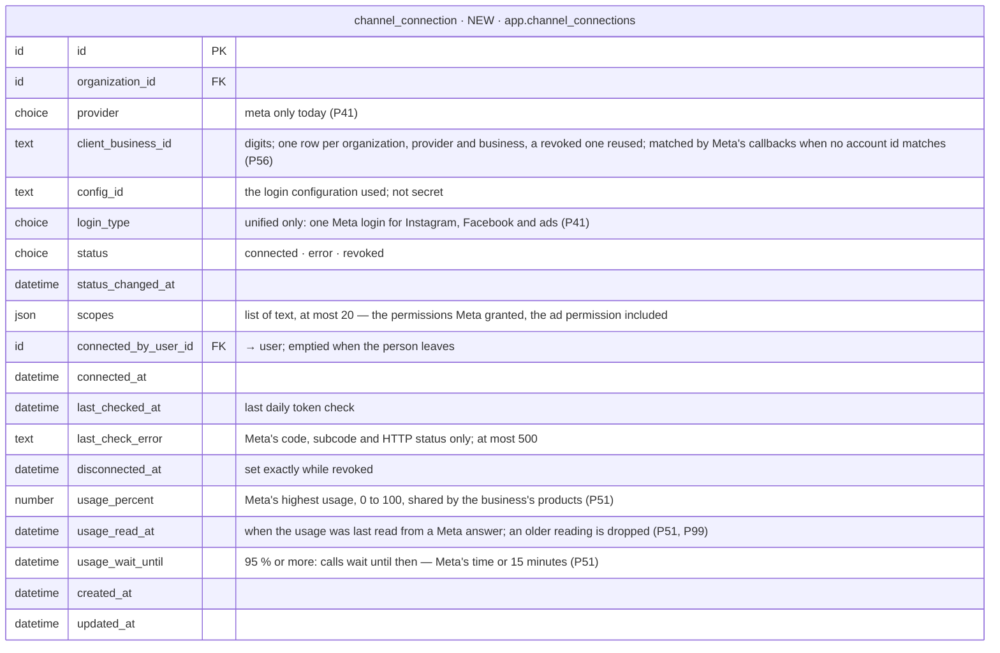

### channel_connection_token

- **Holds:** the connection's access token, stored encrypted, its type and when it ends (empty =
  never, the default for a system-user token, D24) — plus an encrypted refresh token for a provider
  whose tokens expire (a later WhatsApp or TikTok login), empty for Meta ([P49](decisions.md)).
  `token_type`: `system_user` (Meta today) · `oauth_user` (P49). One per connection; deleted only when the
  connection is `revoked`. Read only on the provider client's path — never in a cache, a log or a job
  payload. No public id. Goes away with its connection.
- **Built R3 ([AS-BUILT](../AS-BUILT.md)):** `app.channel_connection_tokens` as designed (`channel_connection_id`,
  `encrypted_access_token`, `token_type` `system_user` · `oauth_user`, `encrypted_refresh_token`, `expires_at`);
  organization-arm RLS only; the secrets-key rotation walks both encrypted columns.
- **Table:** `app.channel_connection_tokens` ([P41](decisions.md); was `app.meta_connection_tokens`,
  P38)
- **Sources:** plan:L3555–L3574; plan:L4577 (connect writes it), plan:L4236–L4251 (organization
  context only).
- **Added:** new — the one token path (D24). Unlike the launch's account token it has no renewal: the
  daily check — the connection's own scheduled work (P47) — only tests it and sets the connection to
  `error` when Meta rejects it.
- **Replaced:** `instagram_account_token` (removed below) — one token per account → one per
  connection. `meta_connection_token` → `channel_connection_token` (P41). `encrypted_refresh_token` and
  the `oauth_user` token type added now, so an expiring provider needs no table change (P49).
- **Open:** none.

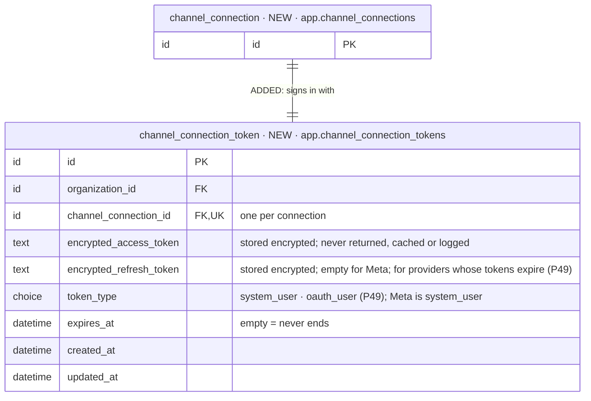

### channel_account

- **Holds:** one connected account of an organization on one channel — an Instagram professional account
  today (`channel` `instagram`, D27), a Facebook Page later — with what every channel's account has
  (P42): its channel, the connection it came from, its connection status, its display name, who connected it and
  when, the owner's pause (and who paused it), the team's suspend, the plan stop and the automation switch. Its public id
  is **the one account id** the API knows: the Instagram routes take `{channel_account_id}`, the product
  and sending tables point here (P47). Many per organization (Free 1, Creator 3, Studio 10 by the plan's
  `channel_accounts_max`, D26, P47), counted across channels. `connection_status`: `connected` · `error` ·
  `revoked` (the launch's `expired` was the 60-day token's end, D24; routes-final's name, [P99](decisions.md)).
  **The owner's pause** stops every lane of the account; comments and taps are still saved (RC-10,
  RC-11); `paused_by_user_id` names who paused it, only while paused (P99). **The team's suspend** (A18,
  [P18](decisions.md)) — the column now, the platform-admin route later; a suspended organization stops
  them the same way. **The plan stop** lives here, once per account ([P42](decisions.md), kept by
  [P99](decisions.md)): `plan_limit` holds the slow, fast and broadcast lanes while the reply lane goes on
  (D62, [P3](decisions.md)); `plan_ended` and `plan_downgrade` hold all four; `plan_downgrade` marks an
  account "not in your plan" after a move down (D57), cleared by "choose active accounts" (RC-60). **The automation switch** — off,
  new events of this account are skipped (the launch's `is_automation_enabled`, moved from the
  Instagram settings). No soft delete — `revoked` stands in, and a reconnect of the same Instagram
  account reuses the row (its settings return); a reconnect from the portfolio an account moved to
  moves its row to that connection at the callback ([P54](decisions.md)), and a pick re-reads the
  assigned accounts from Meta ([P55](decisions.md)). Has a public id (prefix not named by the plan).
- **Table:** `app.channel_accounts` ([P42](decisions.md))
- **Sources:** plan:L2922–L2944 (the account), plan:L3385–L3419 (pause, suspend, plan stop, then on the
  lanes), plan:L4590–L4604 (connect, plan limit), plan:L2599–L2600, L2631 (pause, resume, activate);
  routes-final § 1B, 1B.3.
- **Added:** new (P42) — the common part of the launch's `instagram_accounts` (status, connection,
  who connected, when) and of the plan's lane and settings fields that are not Instagram's own.
  "At most one not-revoked account per provider account across organizations" is held on this table:
  `provider_account_id` unique per channel while not revoked, written with the extension's
  `instagram_user_id` ([P60](decisions.md), CAQ1).
- **Replaced:**
  - `instagram_account.connection_status`, `connected_by_user_id`, `connected_at`, `disconnected_at`,
    `name` → here (the same names, `name` as `display_name`). The launch's `connection_status_changed_at`
    is dropped, not moved: routes-final § 1B.3 keeps no status time ([P99](decisions.md)).
  - `instagram_account_setting.is_automation_enabled` → `is_automation_enabled` here.
  - The plan's lane fields `paused_at`, `suspended_at`, `plan_stop_reason`, `plan_stopped_at` → here,
    once per account instead of on each of its four lanes; the lane keeps only its error stop, so the
    two stops of SN12 still hold at once (the plan stop here, the error stop on the lane). Settled by
    [P99](decisions.md): routes-final's lane `plan_stop_reason` follows this table.
- **Open:** public id prefix — chosen at kickoff (P22, AMBER).

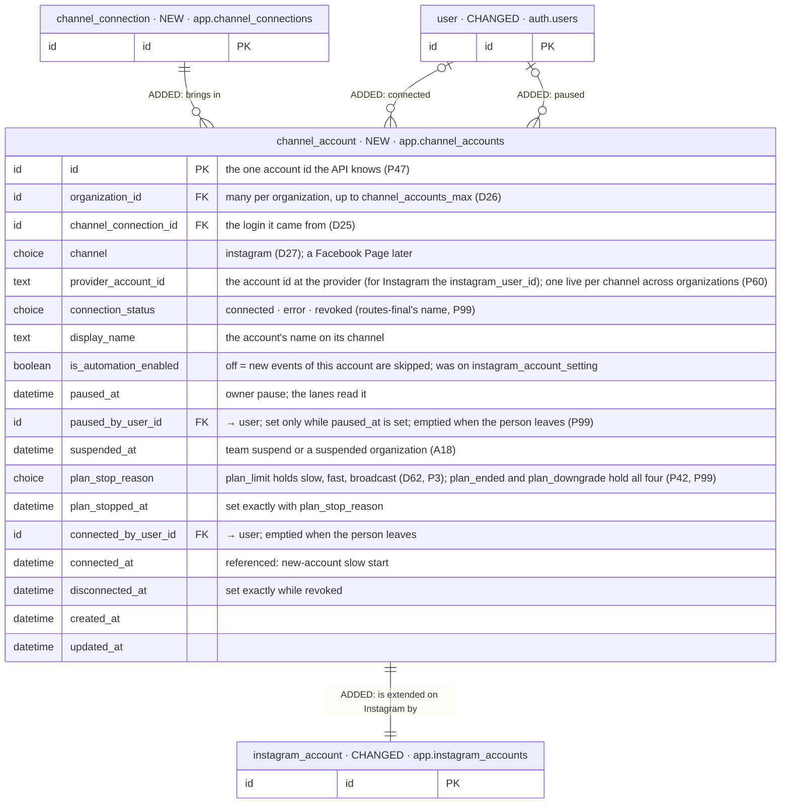

### instagram_account

- **Holds:** as at launch, an Instagram professional account an organization connected — now **the 1:1
  Instagram extension of its `channel_account`** (P42): only what is Instagram's own — the Instagram
  user id, the username, the account type, the private flag, the followers, the profile picture, the
  webhook subscription and when its starter questions were last set. Its status, connection, who
  connected it and when, its pause, suspend and plan stop are the channel account's. It has no id of
  its own in the API: the account is named by its `channel_account_id` (P47). One organization per
  Instagram account stays: at most one row not `revoked` per Instagram account across organizations.
  The Instagram user id now comes from the connection's assigned-accounts list and is used for API
  paths and webhook routing. The daily check's profile refresh stays, inside the connection's token
  check (A17, [P17](decisions.md), P47).
- **Table:** `app.instagram_accounts` (live)
- **Sources:** plan:L2922–L2944; plan:L4590–L4604 (connect, plan limit); current schema
  `src/domains/app/sub-domains/instagram-account/instagram-account.schema.ts`.
- **Added:**
  - `channel_account_id` — the channel account it extends, one to one (P42); required.
  - `account_type` and `is_private` — the account's type and private flag (P42; a private account is
    a go-live warning, RC-31).
  - `starter_questions_set_at` — the last time this account's starter questions were sent to Meta;
    emptied when a starter-question automation goes live, pauses or changes its questions (D42).
- **Replaced:**
  - Accounts per organization: at most one not revoked (launch D5) → many, up to the plan's limit,
    checked at connect (D26), counted on `channel_account`.
  - `connection_status`, `connected_by_user_id`, `connected_at`, `disconnected_at`, `name` →
    `channel_account` (P42; `name` as `display_name`); `expired` is gone from the status (D24);
    `connection_status_changed_at` is dropped — the channel account keeps no status time (routes-final
    § 1B.3, [P99](decisions.md)).
  - `public_id` → the channel account's (P47: one account id).
  - `instagram_app_user_id`, `scopes`, `token_expires_at` removed: Unified Login has no app-scoped
    id, the scopes move to `channel_connection`, the token ends on the connection (or never).
  - The launch's one-live-account-per-organization rule (`idx_instagram_accounts_organization_live`)
    and the app-scoped id lookup are dropped; "the accounts of a connection" is looked up on
    `channel_account` (organization, connection) — routes-final § 1B, 1B.3.
  - Meta's data-deletion and deauthorize requests reach the accounts through their connection and the
    Instagram user id, by a resolver that replaces the app-scoped one (IA19, P46).
- **Open:**
  - The launch's `access_expires_at` API field goes with `token_expires_at` (route-changes.md).

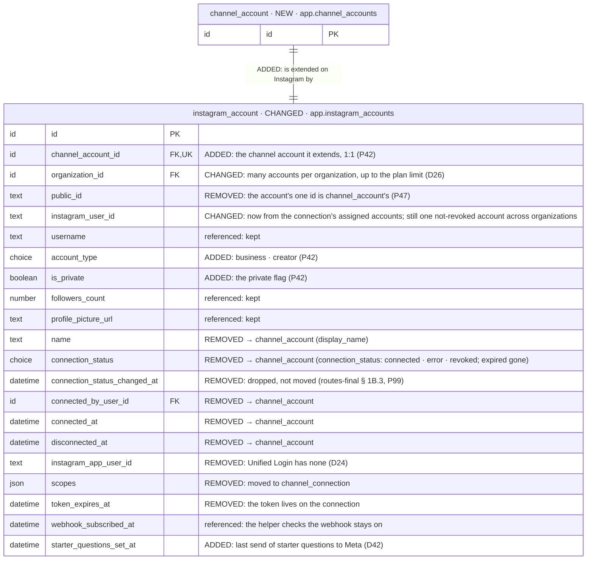

### instagram_account_setting

- **Holds:** as at launch, the Instagram account's own settings — the owner's sending limits and
  account-wide behaviour; the automation master switch moves to `channel_account` (P42), and the row
  now names its account by `channel_account_id` (P47). It stays Instagram's (P42). Every new number is optional: empty means the value in the settings file
  (D22). The public reply safety moves to each automation (D32), so its five columns go. New:
  opening DMs per hour (1–750; the API stops at 700) and per day (used only when the day limit is on),
  fast messages per hour, messages per person per hour, broadcast messages per hour (1–2,000; empty =
  600), the "this is an automatic message" notice, the owner's extra stop words (at most 50, lower
  case), whether replies under comments start comment automations (on), once per person per post
  (on), mark as seen after a reply (off), and the extra random delay before each answer (1–20
  seconds, both ends or neither; PRO).
- **Table:** `app.instagram_account_settings` (live)
- **Sources:** plan:L2895–L2920; D5, D11, D22, D32, D64–D68; current schema
  `src/domains/app/sub-domains/instagram-account/instagram-account-settings/instagram-account-settings.schema.ts`.
- **Added:** the 13 fields marked `ADDED` below.
- **Replaced:** the 5 public reply safety fields → per automation (`automation.is_reply_like_person_enabled`,
  `public_reply_hour_limit`) and the settings file (D32); `is_automation_enabled` → `channel_account`
  (P42); `instagram_account_id` → `channel_account_id` (P47).
- **Open:** none — true/false names take the `is_` form (P21, AMBER).

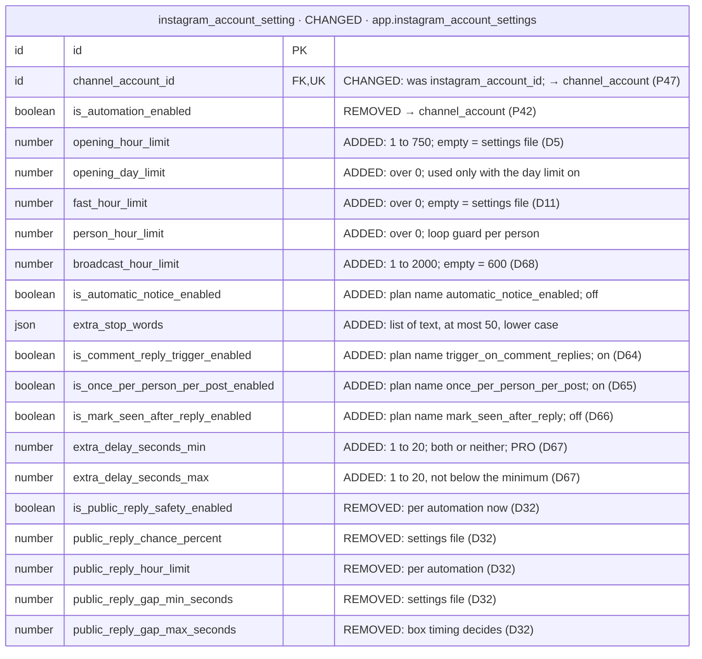

### instagram_account_token

- **Holds (before):** the account's long-lived Instagram Login token, encrypted, renewed daily before
  its 60 days ran out. Removed with the daily renewal, the Instagram Login client and its app secret
  (plan:L2938).
- **Table:** `app.instagram_account_tokens` (live) — removed (**built R3**: dropped from the account migration in
  place, with its schema, repository, service and tests)
- **Sources:** plan:L2938, plan:L8458; current schema
  `src/domains/app/sub-domains/instagram-account/instagram-account-token.schema.ts`.
- **Added:** none.
- **Replaced:** → `channel_connection_token` (D24). No data moves: the Instagram Login code is replaced,
  not migrated (plan:L2924).
- **Open:** none.

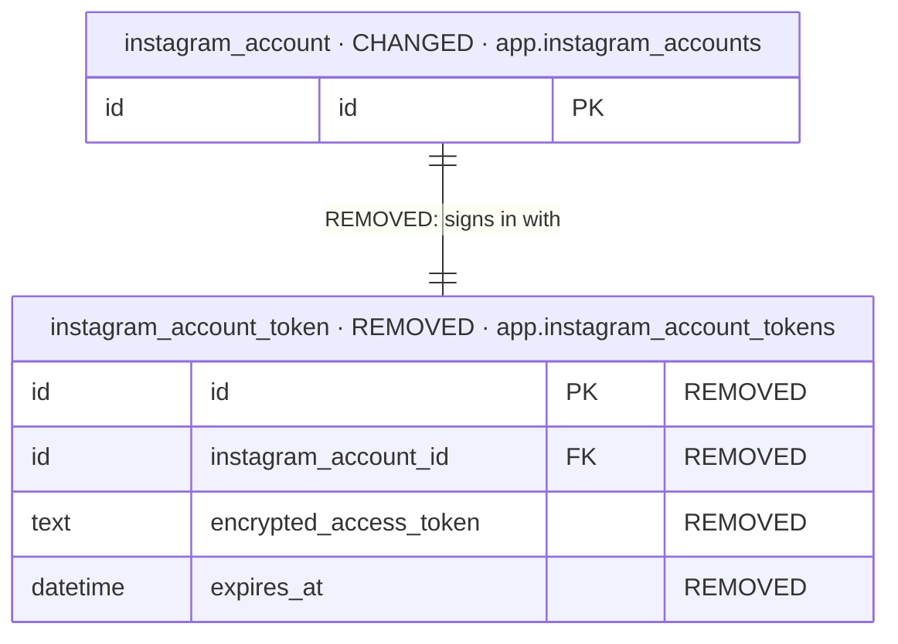

### instagram_media

- **Holds:** as at launch, the account's stored posts — plus the missed-comment watch (when the helper
  last read the post's comments, when it reads again — empty = not watched — and the newest comment
  known) and when a Live ended, so waiting Live private replies expire without a call (D40).
  `media_product_type` adds Meta's value for a Live; `ad` marks an ad's post (D41). Stays Instagram's
  (P48); names its account by `channel_account_id` (P47).
- **Table:** `app.instagram_media` (live)
- **Sources:** plan:L2946–L2958; current schema
  `src/domains/app/sub-domains/instagram-account/instagram-media/instagram-media.schema.ts`.
- **Added:** the four time fields below; the Live value.
- **Replaced:** `instagram_account_id` → `channel_account_id` (P47).
- **Open:** the exact Live value Meta sends — a Meta test (plan §43). Live comments are refused at
  go-live until that test passes ([P36](decisions.md)).

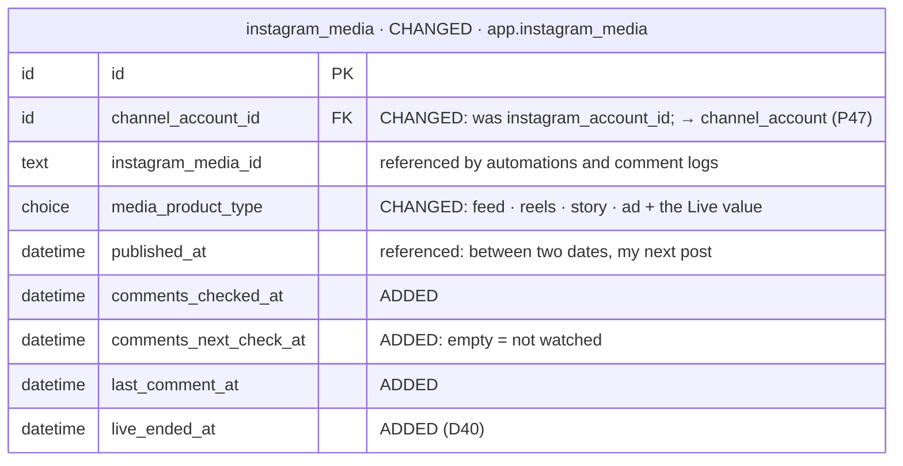

## Stage 2 — Audience and automations

Contacts and automations get the fields the 15 ways to start, the message list and the owner's
controls need; four small tables carry tag changes, all-time counts, public reply pacing and
past-comment runs. All of them are **shared across channels** ([P48](decisions.md)): keyed by
`channel_account_id`, the channel's own rules held by its capability list, not by its own tables.

### contact

- **Holds:** as at launch, one person who wrote to or commented on one account — plus the 24-hour
  private-reply rule (last opening message), the stop word (opted out), the channel (`instagram`,
  D27), the first automation that started a run for her ("via", set once) with how and from what ref
  she came in, the owner's private note (1–2,000), her first message time, the owner's "pause
  automations for this person" with who did it (D71), and her comment and story activity and last
  broadcast for segments (D68). The follow state keeps the launch's fields. Tags are 1–50 characters
  each (launch 1–255), at most 50 per contact (CT9). Kept until the owner deletes it, Meta asks, or the
  organization goes (D51). Erasing a contact also clears her note, opted out, last opening message,
  automations pause (when and by whom), came-in ref, first message, last comment, last story activity
  and last broadcast, and sets her comment count to 0 — her activity is personal data too; the
  "via" automation, how she came in and the channel stay (CT11).
- **Table:** `app.contacts` (live; shared across channels, no rename — [P48](decisions.md); the launch migration changes in place, P29)
- **Sources:** plan:L2960–L2993; D27, D45, D46, D49, D68, D71; current schema
  `src/domains/app/sub-domains/contact/contact.schema.ts`.
- **Added:** the 14 fields marked `ADDED`. The list and its sorts are per account (D26). The reference
  from `first_automation_id` to the automation is added by the automations migration (automations build
  after contacts). Broadcasts' "can get it now" reads her account, her open window and her exclusions
  through one index the contact writer adds (BC13, routes-final § 7).
- **Replaced:** the email check: the launch refused plus addresses (Standing deviation "Email and
  phone checks") → accepted (A19, [P19](decisions.md)); tags 1–255 → 1–50 (CT9); `instagram_account_id`
  → `channel_account_id` (P47). The table keeps its launch name — P44's rename to
  `app.instagram_contacts` is withdrawn (P48).
- **Open:** none — columns and checks: routes-final § 3, 3.A.3.

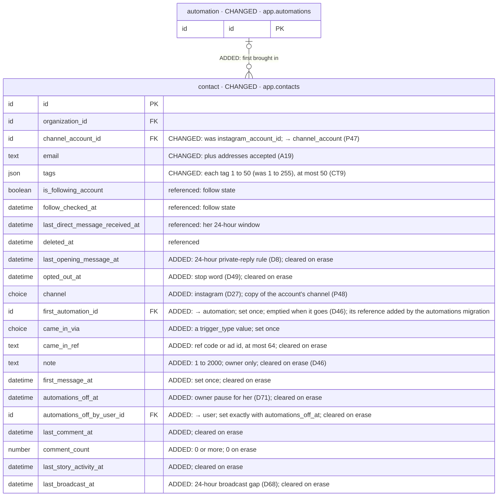

### contact_tag_event

- **Holds:** one row per tag added to or removed from a contact, written in the same commit as the
  change, so tag starts never lose one (D45). `kind`: `added` · `removed`; `source`: `automation` (a
  tag step) · `owner`. The chain number counts how many tag starts led to this change; intake starts
  nothing at 3 or more. Its id is part of the once key of a tag start. Kept 8 days — a plain table,
  emptied hourly within a time budget ([P92](decisions.md)). No public id.
  Goes with its contact; a deleted automation only empties `source_automation_id` (that reference is
  added by the automations migration, which builds after contacts).
- **Table:** `app.contact_tag_events` (the plan's name; shared, [P48](decisions.md))
- **Sources:** plan:L3685–L3717; D45; routes-final § 3, 3.B.3.
- **Added:** new.
- **Replaced:** none.
- **Open:** none.

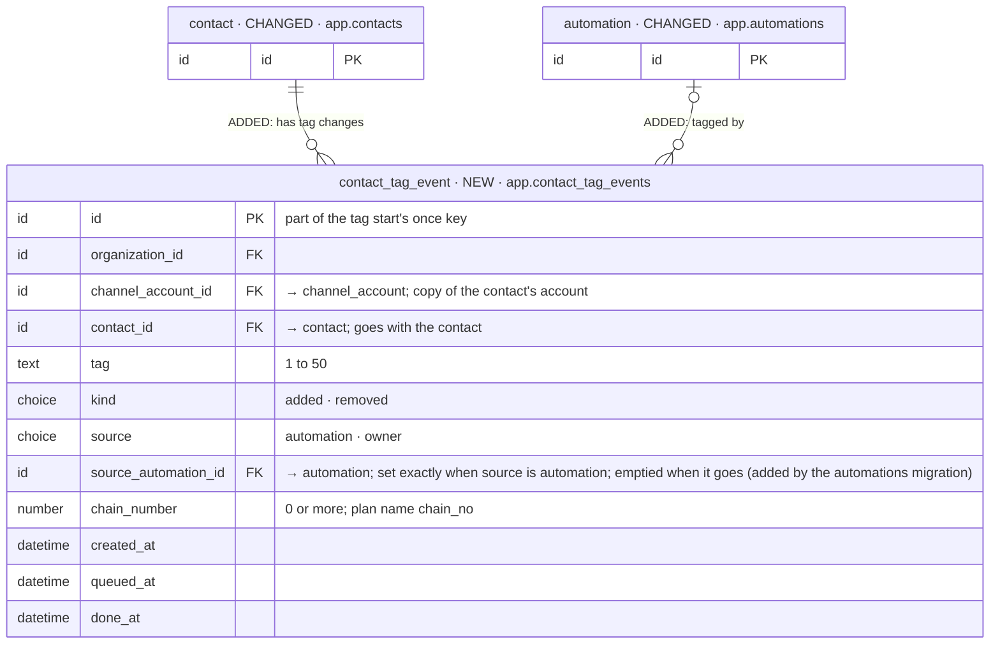

### automation

- **Holds:** as at launch, one automation of one account — now flat fields for how it starts and
  its public reply, and one `steps` object for everything it sends (hello, follow, email, phone, the
  message list, tags). A draft needs only a name (D28). `status`: `draft` · `live` · `paused`.
  `trigger_type`: `comment` · `live_comment` · `story_reply` · `story_mention` · `story_repost` ·
  `dm_keyword` · `first_message` · `shared_post` · `starter_question` · `ref_link` · `default_reply` ·
  `ad_comment` · `ad_message` · `tag_added` · `tag_removed` (D37). `also_start_from`: `story_reply`,
  `dm`, at most 2 (D38). `target_scope`: `any` · `specific` · `next` · `between` (D39).
  `next_post_status`: `waiting` · `linked` — a "next post" never expires (A12,
  [P12](decisions.md)). `default_reply_mode`: `once_a_day` · `every_time` (D44). `stopped_reason`:
  `bad_text` · `post_deleted` — a plan change never stops an automation (D57). Soft delete stays; the
  delete reason becomes optional, `other` still needs a note (A11, [P11](decisions.md)). Files in steps
  are referred to by upload public id, same organization, checked by file type and content (magic bytes)
  — the malware scan comes in a later iteration (plan:L3094; [P34](decisions.md), a D58 deviation).
- **Table:** `app.automations` (live; shared across channels, no rename — [P48](decisions.md), P29)
- **Sources:** plan:L2995–L3145; D28–D45, D52, D57, D59, D63; current schema
  `src/domains/app/sub-domains/automation/automation.schema.ts`.
- **Added:** the fields marked `ADDED`; the go-live checks of §5.1 plus the "next step" button rule
  (A2, [P2](decisions.md)).
- **Replaced:**
  - The launch's message fields (opening message, follow, email, phone, final message and their
    switches) → `steps` (D29–D31).
  - `is_dm_keyword_trigger_enabled` → `also_start_from` (D38).
  - `next_post_starts_at` / `next_post_ends_at` → `target_starts_at` / `target_ends_at` (D39).
  - `tags` → `steps.tags` (D45).
  - `completed_run_count` → `automation_count` (D36).
  - `is_public_reply_enabled` stays as it is; the plan renames it `public_reply_enabled`, which the
    repository's true/false rule does not allow ([P21](decisions.md)).
  - `instagram_account_id` → `channel_account_id` (P47). The table keeps its launch name — P44's
    rename is withdrawn (P48).
- **Open:** none (columns, keys and checks: routes-final § 4, 4.A.3). Every way to start is built; the ones that need a Meta test (`story_repost`,
  `live_comment`, `ad_comment`, the 7-day ad window, quick replies and cards on Unified Login) are
  refused at go-live by a code list of offered ways to start and features until their plan §43 test
  passes — a code list, no column ([P36](decisions.md)). Ways to start, steps and message kinds are
  checked against the channel's capability list (a code constant, Instagram the only entry; P48).

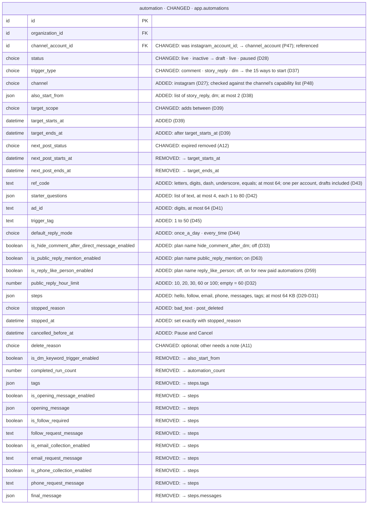

### automation_count

- **Holds:** an automation's all-time counters — runs started, taps, typed answers, and the same per
  step version (for example `hello.1`) — split over 16 slots so busy automations do not wait on one
  row (D36). Survives the 90-day run delete. No public id. Goes away with its automation.
- **Table:** `app.automation_counts` (the plan's name; shared, [P48](decisions.md))
- **Sources:** plan:L3576–L3599; D36, D61.
- **Added:** new.
- **Replaced:** `automation.completed_run_count` (removed).
- **Open:** none.

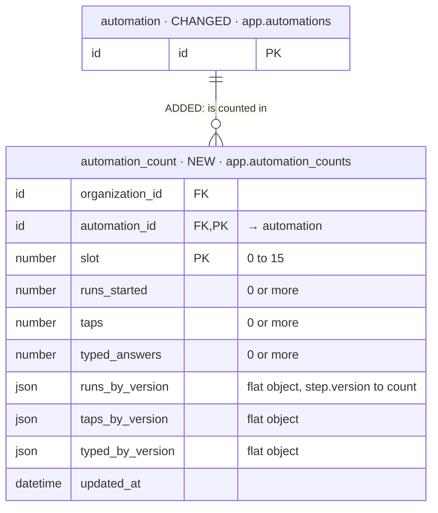

### automation_reply_state

- **Holds:** the "Reply like a person" pacing of one automation's public replies: the current random
  box, the last reply line used, and how many replies wait (D32). One per automation, made at its
  first public reply. No public id.
- **Table:** `app.automation_reply_states` (shared, [P48](decisions.md); the plan names it in the singular,
  `app.automation_reply_state` — the repository's tables are plural)
- **Sources:** plan:L3601–L3621; D32, D52.
- **Added:** new — replaces the account-wide reply safety of the launch (D32).
- **Replaced:** none.
- **Open:** none.

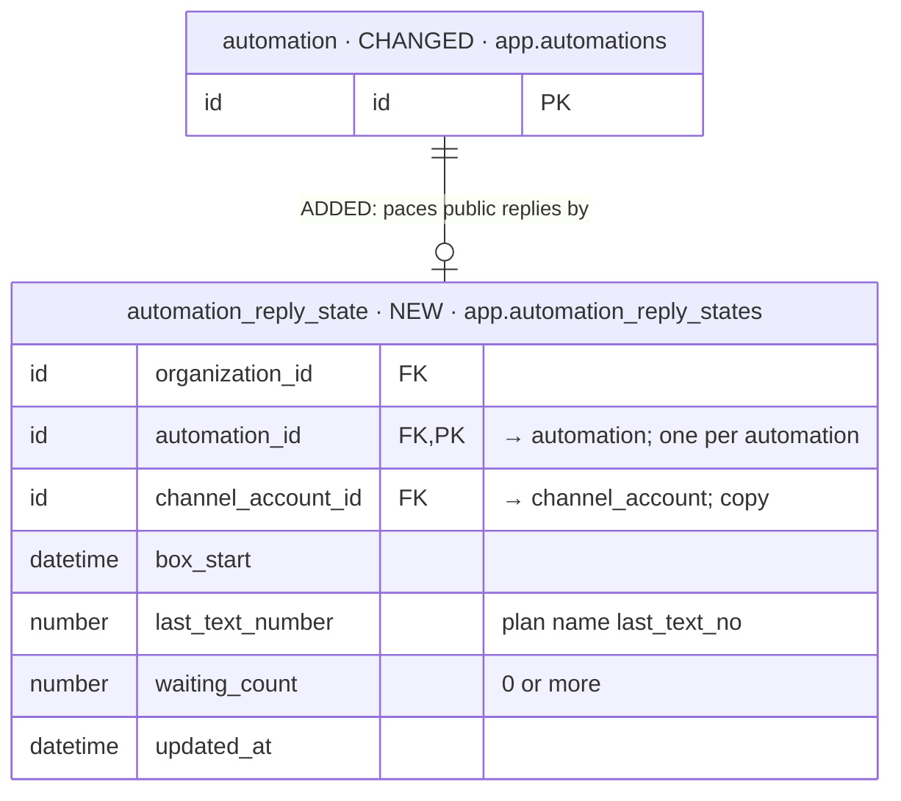

### automation_backfill

- **Holds:** one "also answer comments from the last N days" run of a live comment or ad-comment
  automation (D69, PRO): the days (1–7), its status, posts read, comments found, matched and opening
  DMs queued, why it failed and the error codes (never Meta's text), who asked and when. `status`:
  `queued` · `reading` · `done` · `failed`; `fail_reason`: `meta_error` · `plan_feature_off`. One
  queued or reading per automation; a new press after a failure makes a new row. Has a public id
  (prefix not named by the plan).
- **Table:** `app.automation_backfills` (the plan's name; shared, [P48](decisions.md))
- **Sources:** plan:L3818–L3844, plan:L4109–L4120; D69.
- **Added:** new.
- **Replaced:** none.
- **Open:**
  - Public id prefix — chosen at kickoff (P22, AMBER).

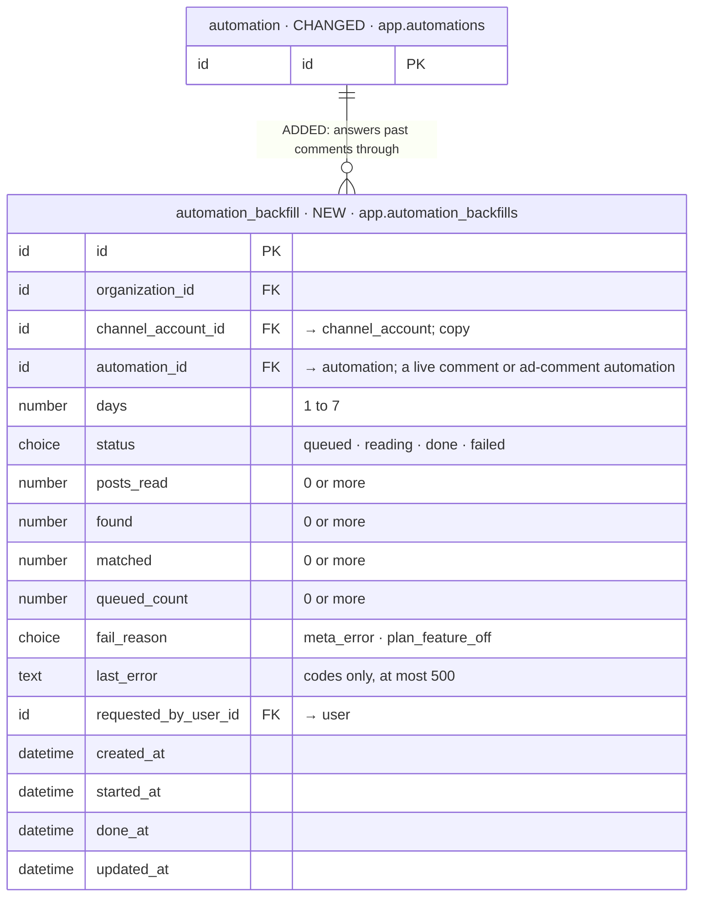

## Stage 3 — Runs and logs

A run now carries its once key, the 7-day clock and which step versions it used; the claim of a send
moves to the message row (Stage 6). Runs, run events and comment logs keep 90 days, not 180 (D16) —
now split by month, so expiry drops a whole part ([P96](decisions.md), made while the tables are empty;
supersedes P33's plain tables): runs and run events by month of the run's start, comment logs by month of
when the comment was logged. At most one open run per automation and
person; a new comment that may start a run replaces the open one ([P35](decisions.md)). Since the split, that
rule is a small key table of its own, `automation_run_open_key` ([P100](decisions.md), reverses P71) — a unique
rule on a split table holds only inside one part.

### automation_run

- **Holds:** as at launch, one person going through one automation — plus when the event that started
  it happened (the 7-day clock, D9), its once key (D13), when its first DM was sent, the highest list
  message sent (read by segments after message rows are gone) and which version of each step it used.
  `trigger_type` is how this run started (the 15 kinds; may differ from the automation's through
  "also start from"). `current_step`: `keyword_match` · `comment_reply` · `follow_check` ·
  `email_collect` · `phone_collect` · `messages`. `waiting_for` adds `any`. `cancel_reason` adds
  `expired` · `opted_out` · `window_closed` · `contact_excluded` · `replaced`. Her own free text is never
  kept (D46). Kept about 90 days after it ends (D16; launch 180) — **split by month of `started_at`**
  ([P96](decisions.md)): a month part is dropped once every run in it ended over 90 days ago (a run waits
  at most 7 days, WC-45), so a run goes 90 days or a little more after it ends, never sooner.
  **One open run per automation and person (P35):** when a comment may start a new run (a different
  post, or "every time" mode — D13 / D65 still decide), her open run of that automation is cancelled
  with `replaced` (its waiting messages too) and the new run starts. A second comment on the same post
  with "once" on is still ignored (`once_per_post`); every other way to start is ignored while her run
  is open (`run_in_progress`).
- **Table:** `app.automation_runs` (live; shared across channels, no rename — [P48](decisions.md), P29)
- **Sources:** plan:L3147–L3173, plan:L3893–L3924; D9, D13, D16, D29–D31, D46; current schema
  `src/domains/app/sub-domains/automation/automation-run/automation-run.schema.ts`.
- **Added:** the fields marked `ADDED`.
- **Replaced:**
  - The send claim (`sending_message_kind`, `sending_started_at`) → the message row's status
    (`instagram_message`).
  - The launch's one-open-run rule (the partial unique index across the one plain table) → the key table
    `automation_run_open_key` ([P100](decisions.md), AU37 — reverses [P71](decisions.md) / AUQ4, which had
    dropped the plan's `automation_run_open_key`, plan:L3465–L3480): one row per open run, written in the
    run's commit and deleted in the commit that ends it; a new start replaces the open run (`replaced`, P35)
    and swaps the key in the same commit. The launch's index stays as a look-up in each part. The once key
    stays on the run, for the `once_per_post` check (D13); WC-45 now deletes the run's key when it ends a
    wait.
  - Plain table, batch deletes (P33) → month parts by the run's start (P96).
- **Open:** none — columns and keys: routes-final § 4, 4.B (AU23, AU36, AU37). **Follows from P96:** a unique
  rule on a split table must hold the split key, so "one open run per automation and person" can no longer be
  one partial unique index across months — it is the key table below ([P100](decisions.md); rev 5's first
  draft, a check under the contact lock alone, gave no database guarantee).

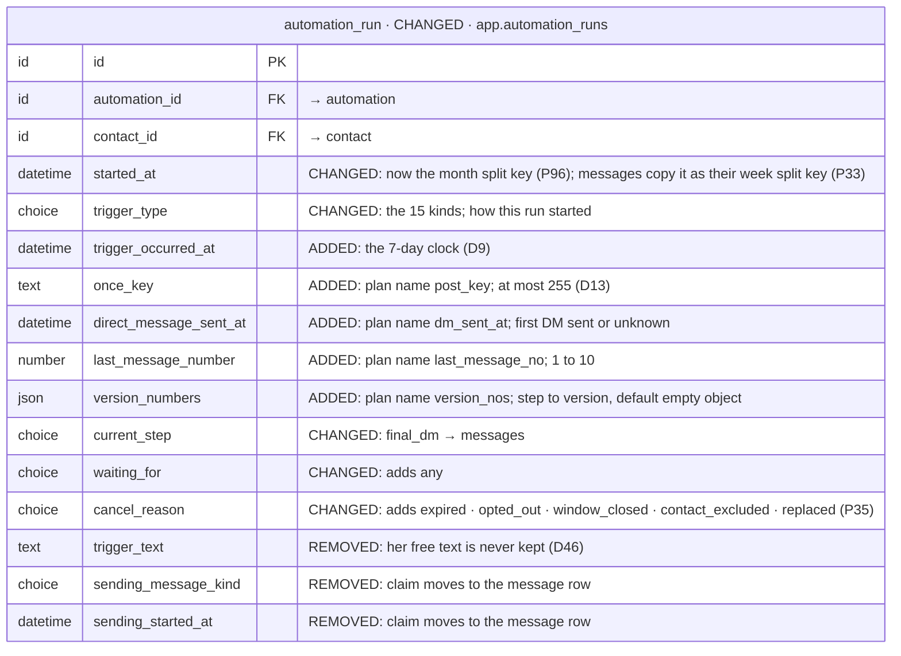

### automation_run_open_key

- **Holds:** one row per **open** run (`running` or `waiting`) — the rule "one open run per automation and
  person" now that runs are split by month ([P100](decisions.md), AU37). Its key is the organization, the
  automation and the person, so a second start meets the conflict and is ignored (`run_in_progress`) or, for a
  comment that may start a new run, replaces the open one (P35). It points at its run by the run's id and start
  (the run's month part). The new run and its key are written **in one commit**; the key is **deleted in the
  commit that ends the run** — `completed`, `failed`, `cancelled` (`replaced`, `wait_expired`, the person erased
  or opted out, …); P35's replacement deletes the old key and inserts the new one in the same commit. A repair
  duty removes a key whose run has ended, so a missed delete never blocks her for good (`worker-changes.md`).
  No public id, no `updated_at`; RLS enabled and forced like every tenant table.
- **Table:** `app.automation_run_open_keys` (the plan's table, plural — plan:L3465–L3480; shared,
  [P48](decisions.md))
- **Sources:** plan:L3465–L3480; [P35](decisions.md), [P100](decisions.md); routes-final § 4, 4.B.3 and AU37
  (columns, keys, the RLS policy).
- **Added:** new (rev 5) — reverses [P71](decisions.md) / AUQ4, which had dropped the plan's table while runs
  were one plain table.
- **Replaced:** the launch's partial unique index `idx_automation_runs_one_open` as the rule (it stays a
  look-up in each month part).
- **Open:** none.

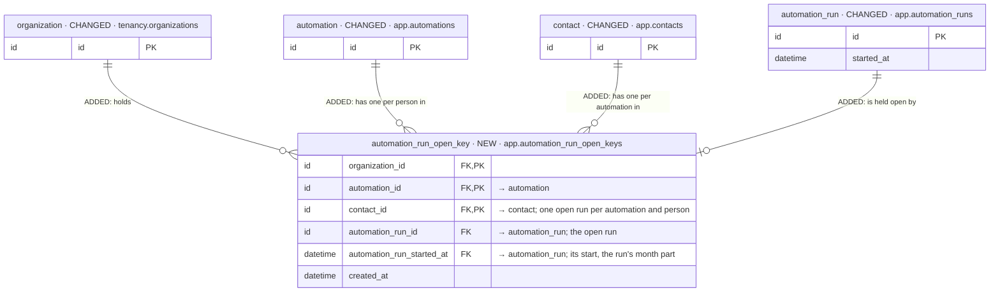

### automation_run_event

- **Holds:** as at launch, the append-only history of a run — `event_type` adds `hello_tapped` and
  `follow_tapped` (the tap counts of D61). Kept with its run — **split by month of its run's start**
  ([P96](decisions.md)), so a copy of the run's start (`automation_run_started_at`) is its split key and its
  part is dropped with the run's.
- **Table:** `app.automation_run_events` (live; shared across channels, no rename — [P48](decisions.md), P29)
- **Sources:** plan:L3175–L3182; current schema
  `src/domains/app/sub-domains/automation/automation-run/automation-run-event.schema.ts`.
- **Added:** two event types; `automation_run_started_at`, the plan's copy of the run's start (plan:L4182),
  now that runs are split (P96).
- **Replaced:** plain table, batch deletes (P33) → month parts by the run's start (P96).
- **Open:** none.

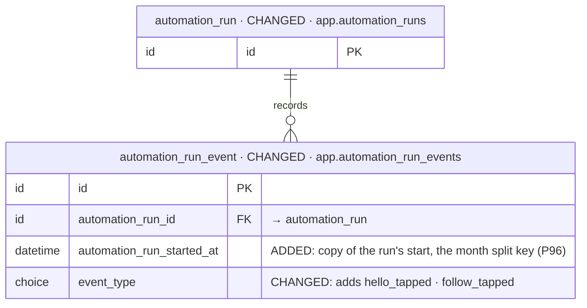

### automation_comment_log

- **Holds:** as at launch, one row per comment an automation saw, with each step's status — plus the
  comment's time and the hide step (status and when). The
  final DM step becomes the message list (`messages_status`, `messages_at`). Step statuses add
  `expired` · `unknown`; `current_step` / `failed_step` rename `final_dm` → `messages` and add
  `hide_comment`; `waiting_for` adds `any`. `ignored_reason`: `previous_run_final` → `once_per_post`,
  adds `thread_reply_off` · `own_comment` · `contact_excluded`, keeps `run_in_progress` and
  `comment_already_answered`. `public_reply_skip_reason`: `duplicate` · `random` · `hour_limit` ·
  `deleted_comment` (`gap` removed). Live and ad comments get logs; a Live's reply and hide stay
  `off`. Kept 90 days (D16; launch 180) — **split by month of when the comment was logged**
  ([P96](decisions.md)): an ignored comment has no run, so the log keeps its own month, not the run's; "one
  log per comment and automation" is checked in the last two month parts under the contact lock (AU28,
  plan:L4182–L4192).
- **Table:** `app.automation_comment_logs` (live; shared across channels, no rename — [P48](decisions.md), P29)
- **Sources:** plan:L3184–L3205; D16, D32, D33, D64; current schema
  `src/domains/app/sub-domains/automation/automation-run/automation-comment-log.schema.ts`.
- **Added:** the fields marked `ADDED`.
- **Replaced:** `final_dm_status` / `final_dm_at` → `messages_status` / `messages_at`; plain table,
  batch deletes (P33) → month parts (P96).
- **Open:**
  - The launch's ignored reasons `waiting_for_other_email` and `already_waiting` are kept — the plan
    is silent ([P23](decisions.md), AMBER).
  - The plan's `automation_run_started_at` copy **is** added (routes-final 4.B.3, AU36): the log is split by
    its own month (P96), and its run pointer is the run's id + start, with no reference (its parts drop on
    their own clock, like the messages' copies).
  - The launch's `opening_dm_status` / `opening_dm_at` keep `dm` (as built); A6 renames only new
    names.

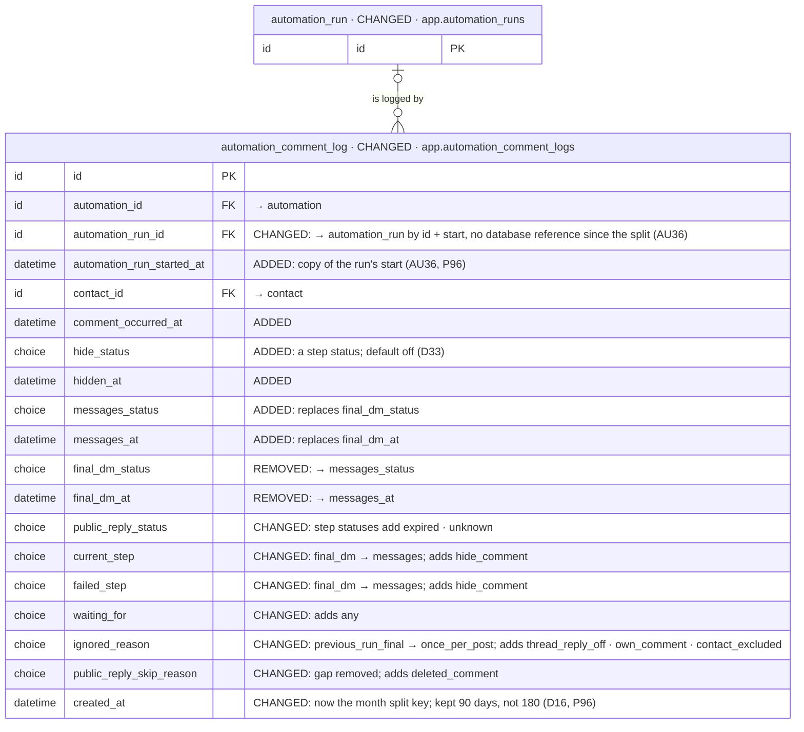

## Stage 4 — Received content

Meta's events keep their table, kept 8 days instead of 30 and emptied once handled; their dedupe keys
move to a table of their own.

### instagram_webhook_event

- **Holds:** as at launch, one event Meta sent for a connected account — plus when a failed event is
  tried again (hourly, while the comment is under 7 days old). `event_kind` adds `live_comment` ·
  `story_mention` · `shared_post` · `referral` · `ice_breaker` and drops `read`; `skip_reason` drops
  `read_receipt`, `echo` and `reaction` and adds `own_comment` (D64) and `flood` (more than 20 of her
  message events in a minute, WH16). Echoes of the owner's hand-typed messages and reactions are saved
  `received` and taken in (an echo starts her quiet time, WH10); our own echoes are dropped before
  saving, found by a Postgres lookup of the echo's id in `instagram_message`; an early echo is saved and
  matched by intake within 10 minutes ([P62](decisions.md), WHQ1). The flood guard counts her saved
  events at intake in Postgres, with an index ([P63](decisions.md), WHQ2). The body is **null** once the event is processed or skipped, and a row born skipped
  stores none (WH22); read receipts, our own "sent" notices and tag events are never saved. Each
  event's intake group (messages, Live, comments) is worked out from its kind and stored (WH11). Kept 8
  days (D15; launch 30) — split by day (P33), one of the seven split tables (P96).
- **Table:** `app.instagram_webhook_events` (live) — **Built R16** ([AS-BUILT](../AS-BUILT.md)): partitioned
  by `created_at` (UTC day parts via `app.fn_create_daily_partitions`, 8 back to 14 ahead, plus
  `instagram_webhook_events_default`), primary key `(id, created_at)`, unique `(public_id, created_at)`,
  `channel_account_id` → `app.channel_accounts` (`instagram_webhook_events_channel_account_fk`),
  `intake_group` generated, `next_attempt_at`, `payload` nullable with `chk_instagram_webhook_events_body`
  and `chk_instagram_webhook_events_next_attempt`; indexes of 5.B.3 (`..._organization_account_created_at`,
  `..._pending` by group, `..._next_attempt_at`, `..._flood`).
- **Sources:** plan:L3207–L3225, plan:L3926–L3941; D15, D64; current schema
  `src/domains/app/sub-domains/instagram-webhook/instagram-webhook-event/instagram-webhook-event.schema.ts`.
- **Added:** `next_attempt_at`; `intake_group`; five event kinds; `own_comment`, `flood`.
- **Replaced:**
  - The dedupe key on this table → `instagram_webhook_event_key`.
  - A failed event was final after 5 tries (launch) → retried hourly up to 7 days.
  - The launch's debugging list of events shows 8 days instead of 30.
  - A DM echo was skipped `echo` (launch) → saved `received` (WH10); `own_comment` is the skip of an
    own comment ([P24](decisions.md)).
  - `instagram_account_id` → `channel_account_id` (P47); the table keeps its Instagram name (P45).
- **Open:** none — columns, the split and its indexes: routes-final § 5, 5.B.3.

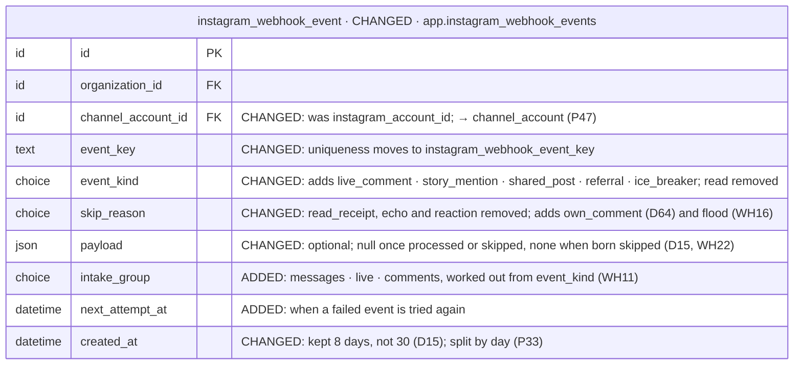

### instagram_webhook_event_key

- **Holds:** the key of every event received per account, so the same event arriving twice saves
  nothing more. Kept 8 days — **split by Meta's event day** ([P96](decisions.md), supersedes P33's plain
  table): the key carries that day; a redelivery carries the same time, so the dedupe rule holds, and the
  missed-comment and past-comment reads write the same day the webhook would. Expiry drops a day part. No
  public id.
- **Table:** `app.instagram_webhook_event_keys` (P38; Instagram's, [P45](decisions.md)) — **Built R16**
  ([AS-BUILT](../AS-BUILT.md)): `organization_id`, `channel_account_id`, `event_key`, `event_day` (date),
  `received_at`; primary key `instagram_webhook_event_keys_pkey` `(organization_id, channel_account_id,
  event_key, event_day)`; partitioned by `event_day` (day parts + `instagram_webhook_event_keys_default`);
  FORCE RLS with the sweep arm in `USING`; the app roles hold `SELECT, INSERT` only. **R17**: no schema change —
  the receiver writes both tables through the store function (`recordReceivedEvents`) in a unit capped at 3 s;
  `instagram_accounts` is no longer read by the stuck-event pick-up (it reads `channel_accounts.public_id`).
- **Sources:** plan:L3453–L3461; D15.
- **Added:** new — the launch kept this key on the events, which now go after 8 days in whole days.
- **Replaced:** the event's own key uniqueness.
- **Open:** none — the plan's split by account is not used (P33); the split is by Meta's event day (P96).
  Its key leads with the organization: organization, account, event key, event day (routes-final § 5,
  5.B.3).

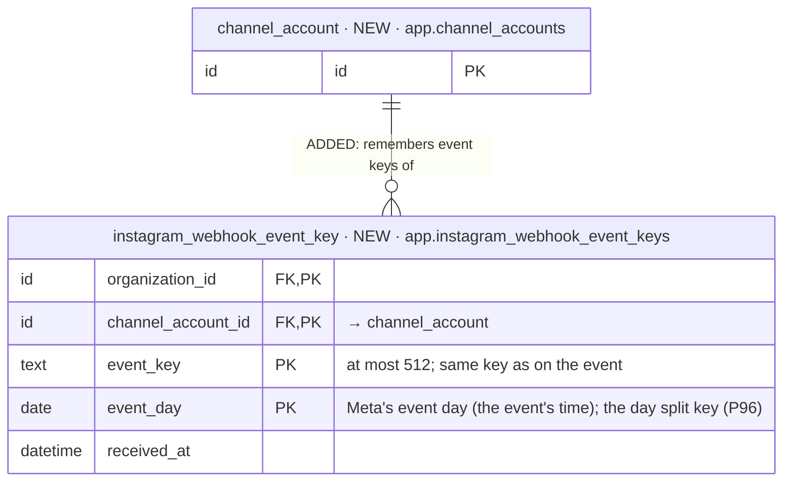

## Stage 5 — Broadcasts

Saved audiences and the message sets sent to them, only to people whose chat window is open (D68,
PRO — segments too: a Free organization's segment routes are refused, and segments made during a trial
stay saved, unusable until an upgrade, [P76](decisions.md)). Segments and broadcasts are soft-deleted and purged later (A9, [P9](decisions.md)).

### segment

- **Holds:** a saved audience of one account: a name and its conditions in AND / OR groups (at most 2
  levels, 20 conditions) on tags, the automation she came through, how she came in, comments, activity,
  her details, story activity and "no broadcast in N days" (D68). Used again by many broadcasts. Has a
  public id (prefix not named by the plan). Soft delete (A9); purged 90 days after its delete, once no
  live broadcast points at it (BC4, [P75](decisions.md)).
- **Table:** `app.segments` (the plan's name; shared, [P48](decisions.md))
- **Sources:** plan:L3719–L3750; D68.
- **Added:** `deleted_at` — the plan hard-deletes; A9 keeps the repository's soft delete.
- **Replaced:** none.
- **Open:**
  - Public id prefix — chosen at kickoff (P22, AMBER).

```mermaid
erDiagram
  segment["segment · NEW · app.segments"] {
    id id PK
    id organization_id FK
    id channel_account_id FK "→ channel_account"
    text name "1 to 255"
    json conditions "AND / OR groups; at most 2 levels, 20 conditions"
    id created_by_user_id FK "→ user"
    id updated_by_user_id FK "→ user"
    datetime created_at
    datetime updated_at
    datetime deleted_at "soft delete (A9)"
  }
  channel_account["channel_account · NEW · app.channel_accounts"] {
    id id PK
  }
  channel_account ||--o{ segment : "ADDED: saves audiences in"
```

### broadcast

- **Holds:** one message set (1–3 messages, the same shape as the automation's message list, with
  versions) sent to the people of a segment or a one-off audience — a copy of the conditions is kept
  when it starts. `status`: `draft` · `scheduled` · `sending` · `waiting_for_chats` · `done` ·
  `cancelled`; `mode`: `now` · `scheduled` · `when_chat_opens`, chosen **at send** — with the send's
  `scheduled_at` or its open wait of 1–7 days, which is a send input, not a column (`ends_at` holds its
  end; BC10); `cancel_reason`: `owner` · `plan_feature_off`. Counts of matched, sent, skipped, failed,
  replies and taps. Has a public id (prefix not named; it goes in the messages' button payload). Soft
  delete (A9); purged 90 days after its delete, its recipients and messages with it (BC4, BCQ1). Only a
  `draft`, `done` or `cancelled` broadcast may be deleted (BC11). Shared across channels (P48): it
  carries its account's `channel`, and its message kinds are checked against that channel's capability
  list at send; its waiting messages go to the channel's sending tables (Instagram: `instagram_message`).
- **Table:** `app.broadcasts` (the plan's name; shared, [P48](decisions.md))
- **Sources:** plan:L3752–L3791, plan:L4070–L4087; D57, D68.
- **Added:** `deleted_at` (A9).
- **Replaced:** none.
- **Open:**
  - Public id prefix — chosen at kickoff (P22, AMBER).
  - Columns and keys: routes-final § 7, 7.A.3.

```mermaid
erDiagram
  broadcast["broadcast · NEW · app.broadcasts"] {
    id id PK
    id organization_id FK
    id channel_account_id FK "→ channel_account"
    choice channel "copy of the account's channel; message kinds checked against its capability list (P48)"
    text name "1 to 255"
    choice status "draft · scheduled · sending · waiting_for_chats · done · cancelled"
    choice mode "now · scheduled · when_chat_opens; set at send (BC10)"
    id segment_id FK "→ segment; emptied when the segment goes; empty for a one-off audience"
    json conditions "one-off conditions, and the copy taken at start"
    json messages "1 to 3 messages with versions"
    datetime scheduled_at "set exactly for scheduled"
    datetime ends_at "set exactly for when_chat_opens; 1 to 7 days after start (the send's open wait)"
    datetime started_at
    datetime finished_at
    datetime cancelled_at
    choice cancel_reason "owner · plan_feature_off; set exactly when cancelled"
    number matched "0 or more"
    number sent "0 or more"
    number skipped "0 or more"
    number failed "0 or more"
    number replies "0 or more; once per recipient"
    number taps "0 or more"
    id created_by_user_id FK "→ user"
    id updated_by_user_id FK "→ user"
    datetime created_at
    datetime updated_at
    datetime deleted_at "soft delete (A9)"
  }
  segment["segment · NEW · app.segments"] {
    id id PK
  }
  segment |o--o{ broadcast : "ADDED: is the audience of"
```

### broadcast_recipient

- **Holds:** one person a broadcast goes to: status, reason, which version she got, when it was sent
  and when she first replied. `status`: `waiting` · `sent` · `skipped` · `failed` · `unknown`;
  `reason`: `recent_broadcast` · `owner_chat` · `window_closed` · `opted_out` · `contact_excluded` ·
  `broadcast_cancelled` · `plan_feature_off` · `contact_deleted`, plus the message reasons. At most
  one row per broadcast and contact — unique (organization, broadcast, contact); a `skipped · owner_chat`
  row goes back to `waiting` instead of a second one (BC16). One broadcast per person per 24 hours. Its
  account is a copy of the broadcast's, with no reference of its own. Kept 90 days — **stays a plain
  table** (about 120 M rows at target; revisited with S24, [P96](decisions.md)), emptied by the hourly
  clean-up within its time budget ([P92](decisions.md)). No public id.
- **Table:** `app.broadcast_recipients` (the plan's name; shared, [P48](decisions.md))
- **Sources:** plan:L3793–L3816, plan:L4089–L4107; D68.
- **Added:** new.
- **Replaced:** none.
- **Open:** none — the plan's split by month is not used (P33, kept by P96); routes-final § 7, 7.C.

```mermaid
erDiagram
  broadcast_recipient["broadcast_recipient · NEW · app.broadcast_recipients"] {
    id id PK
    id organization_id FK
    id channel_account_id "→ channel_account; copy of the broadcast's account, no reference (BC16)"
    id broadcast_id FK "→ broadcast; unique with contact_id per organization (BC16)"
    id contact_id FK "→ contact"
    choice status "waiting · sent · skipped · failed · unknown"
    choice reason "recent_broadcast · owner_chat · window_closed · opted_out · contact_excluded · broadcast_cancelled · plan_feature_off · contact_deleted, plus the message reasons"
    number version_number "plan name version_no"
    datetime created_at
    datetime sent_at
    datetime replied_at
    datetime updated_at
  }
  broadcast["broadcast · NEW · app.broadcasts"] {
    id id PK
  }
  contact["contact · CHANGED · app.contacts"] {
    id id PK
  }
  broadcast ||--o{ broadcast_recipient : "ADDED: goes to"
  contact ||--o{ broadcast_recipient : "ADDED: receives"
```

## Stage 6 — Sending engine

The paced sender: four lanes per account, one row per message, the attempts, the minute and month
counts, the stop history, the two global rows and the Meta file ids. Intake never sends; the lanes do
(plan:L3226–L3640, D3, D4, D18).

### instagram_send_lane

- **Holds:** one row per account and lane — `slow` (opening DMs as private replies, one at a time),
  `reply` (public replies and hides), `fast` (every other DM), `broadcast` — made at connect (D25).
  `state`: `ready` · `working` · `sleeping` · `stopped` (fast uses `ready` and `stopped` only).
  `wait_reason`: `box` · `gap` · `hour_limit` · `day_limit` · `not_before` · `stop` · `test`. Holds the
  ticket turn, the lease, the random box, the last send, half speed, the day count, the current
  **error stop** (`stop_reason`: `too_fast` · `blocked` · `account_flagged` · `login_expired` ·
  `account_not_shared` · `access_off` · `app_not_approved` · `app_limit`), the account's one test
  claim and the fast lane's sends on their way. The owner's pause, the team's suspend and the **plan
  stop** are the account's, on `channel_account` ([P42](decisions.md)), read by every lane — so the
  error stop here and the plan stop there still hold at once (SN12). No public id.
- **Table:** `app.instagram_send_lanes` (P38; Instagram's, [P43](decisions.md))
- **Sources:** plan:L3385–L3419, plan:L3943–L3970; D3, D4, D5, D11, D19, D34, D35, D57, D62;
  routes-final § 6, 6.A.3.
- **Added:** new.
- **Replaced:** the plan's one stop for errors and plan states → an error stop and a plan stop (SN12,
  plan §33.2 rule 4); the pause, suspend and plan stop move from each lane to the account's
  `channel_account` row ([P42](decisions.md)); `instagram_account_id` → `channel_account_id` (P47).
  Meta's usage is not kept per account or lane: the plan's `usage:{account}` copy (plan:L4333) → the
  connection's `usage_*` fields ([P51](decisions.md)); the lane keeps only its own error stop.
- **Open:** none.

```mermaid
erDiagram
  instagram_send_lane["instagram_send_lane · NEW · app.instagram_send_lanes"] {
    id id PK
    id organization_id FK
    id channel_account_id FK "→ channel_account; one row per account and lane"
    choice lane "slow · reply · fast · broadcast"
    choice state "ready · working · sleeping · stopped"
    datetime next_run_at
    choice wait_reason "box · gap · hour_limit · day_limit · not_before · stop · test"
    number turn_number "plan name turn_no"
    number working_turn
    datetime lease_until
    number pick_count "slow: place 1 to 5 in the new : old mix"
    datetime box_start
    datetime last_sent_at
    datetime half_speed_until
    date day_date "slow, day limit only"
    number day_count "slow, day limit only"
    choice stop_reason "an error stop group only (SN12)"
    datetime stop_until "empty = the owner must act"
    number stop_count
    number stop_error_code
    number stop_error_subcode
    datetime stop_cleared_at
    choice testing_lane "slow row only: slow · reply · fast · broadcast"
    datetime testing_until "slow row only"
    number sending_count "fast row only"
    datetime updated_at
  }
  channel_account["channel_account · NEW · app.channel_accounts"] {
    id id PK
  }
  channel_account ||--|{ instagram_send_lane : "ADDED: sends through 4 lanes"
```

### instagram_message

- **Holds:** one message we send or plan to send — of a run or of a broadcast: its type
  (`opening_message` · `nudge` · `public_reply` · `hide_comment` · `follow_check` · `follow_request` ·
  `email_question` · `invalid_email` · `phone_question` · `message` · `broadcast`), list number, kind
  (`text` · `image` · `cards` · `quick_replies` · `audio` · `file` · `post`), version and wording,
  lane, channel (`private_reply` · `direct` · `comment_reply` · `comment_hide`), whether it counts as a
  DM, its status (`waiting` · `sending` · `sent` · `unknown` · `failed` · `skipped` · `cancelled` ·
  `expired`) and reason (about 30 values, plan:L3287–L3317, plus `replaced` for the waiting messages
  of a replaced run, P35), not-before time, tries and asks, the
  Instagram message id, error codes and the owner's one retry (D72). Moving lanes changes the same
  row while it waits. Copies of the account, automation and contact are kept without a reference.
  Kept 30 days (D50) — split by week of the run start (P33, P13), one of the seven split tables (P96). Has a public
  id (prefix not named by the plan).
- **Table:** `app.instagram_messages` (P38; Instagram's, [P43](decisions.md))
- **Sources:** plan:L3234–L3355, plan:L3850–L3891; D8, D9, D13, D17, D29–D33, D50, D68, D72.
- **Added:** new — the launch claimed a send on the run and sent inline (Standing deviation "Sending
  again on a retry"); an `unknown` send now may go once more on her next action (D17).
- **Replaced:** the run's send claim.
- **Open:**
  - `automation_run_started_at` is the week split key and also names the month part of its run (P96);
    the link to the run stays `automation_run_id` alone — no reference into a split table that drops
    parts (plan:L4182); a broadcast row puts its recipient's creation time in the same field.
  - Public id prefix — chosen at kickoff (P22, AMBER).

```mermaid
erDiagram
  instagram_message["instagram_message · NEW · app.instagram_messages"] {
    id id PK
    id organization_id FK
    id channel_account_id "→ channel_account; copy, no reference"
    id automation_id "copy, no reference; empty only for a broadcast"
    id automation_run_id FK "→ automation_run; empty only for a broadcast"
    id broadcast_id FK "→ broadcast; set exactly for a broadcast message"
    datetime automation_run_started_at "split key only (P33): the run's start, or the recipient's creation for a broadcast"
    id contact_id "copy, no reference"
    choice message_type "opening_message · nudge · public_reply · hide_comment · follow_check · follow_request · email_question · invalid_email · phone_question · message · broadcast"
    number message_number "plan name message_no; 1 to 10, broadcast 1 to 3"
    choice message_kind "text · image · cards · quick_replies · audio · file · post"
    number version_number "plan name version_no; 1 to 3"
    number wording_number "plan name wording_no; 1 to 10"
    choice lane "slow · reply · fast · broadcast"
    choice channel "private_reply · direct · comment_reply · comment_hide; empty only for follow_check"
    boolean is_counted_as_direct_message "plan name counts_as_dm"
    choice status "waiting · sending · sent · unknown · failed · skipped · cancelled · expired"
    choice reason "about 30 values, plan L3287-L3317, plus replaced (P35)"
    datetime not_before
    datetime trigger_occurred_at
    number tries
    number asks
    number text_number "plan name text_no"
    text instagram_message_id "at most 128"
    datetime sending_at "set when sending"
    datetime sent_at "set when sent"
    number error_code
    number error_subcode
    datetime owner_retry_at "the owner's one retry (D72)"
    datetime created_at
    datetime updated_at
  }
  automation_run["automation_run · CHANGED · app.automation_runs"] {
    id id PK
  }
  broadcast["broadcast · NEW · app.broadcasts"] {
    id id PK
  }
  automation_run |o--o{ instagram_message : "ADDED: sends"
  broadcast |o--o{ instagram_message : "ADDED: sends"
```

### instagram_send_attempt

- **Holds:** one call to Meta for a message: lane, count group (`open` · `reply` · `fast` ·
  `broadcast` · `none`), when it started, its result group (`sent`, the error and stop groups of §33,
  for example `too_fast`, `bad_text`, `no_answer`), HTTP status, error codes and how long it took.
  Feeds the "in a row" and "30% bad" rules. The message, automation and contact are copies without a
  reference. Kept 8 days (D16) — split by day (P33), one of the seven split tables (P96). No public id.
- **Table:** `app.instagram_send_attempts` (P38; Instagram's, [P43](decisions.md))
- **Sources:** plan:L3357–L3383, plan:L5915–L5943; D16, D19.
- **Added:** new.
- **Replaced:** the launch's error fields on the comment log stay; this is the engine's own record.
- **Open:** none.

```mermaid
erDiagram
  instagram_send_attempt["instagram_send_attempt · NEW · app.instagram_send_attempts"] {
    id id PK
    id organization_id FK
    id channel_account_id "→ channel_account; copy, no reference"
    choice lane "slow · reply · fast · broadcast"
    id instagram_message_id "copy, no reference; plan name message_id"
    id automation_id "copy; empty for a broadcast"
    id contact_id "copy"
    choice count_group "open · reply · fast · broadcast · none"
    datetime started_at
    choice result_group "sent or an error group of plan section 33; empty while the call runs"
    number http_status
    number error_code
    number error_subcode
    number duration_milliseconds "plan name duration_ms"
  }
  instagram_message["instagram_message · NEW · app.instagram_messages"] {
    id id PK
  }
  instagram_message ||--o{ instagram_send_attempt : "ADDED: is tried by (no reference)"
```

### instagram_send_minute_count

- **Holds:** messages sent per account, count group (`open` · `reply` · `fast` · `broadcast`) and
  minute — gate 2, raised in the same commit that marks a message `sending` (D18). Kept 2 hours. No
  public id.
- **Table:** `app.instagram_send_minute_counts` (P38; Instagram's, [P43](decisions.md))
- **Sources:** plan:L3421–L3451; D18.
- **Added:** new.
- **Replaced:** none.
- **Open:** none.

```mermaid
erDiagram
  instagram_send_minute_count["instagram_send_minute_count · NEW · app.instagram_send_minute_counts"] {
    id organization_id FK
    id channel_account_id FK, PK "→ channel_account"
    choice count_group PK "open · reply · fast · broadcast"
    datetime minute_start PK "Postgres clock, to the minute"
    number count "0 or more"
  }
  channel_account["channel_account · NEW · app.channel_accounts"] {
    id id PK
  }
  channel_account ||--o{ instagram_send_minute_count : "ADDED: is counted per minute in"
```

### message_month_count

- **Holds:** messages sent this calendar month by one organization, in its time zone, across all its
  channels — the plan's `message_month_limit` spans channels ([P43](decisions.md), P47) — split into 16
  slots by channel account so accounts never wait on each other (D34). Every message into her chat
  counts, broadcast ones too (D68). Feeds the month meter (A14, [P14](decisions.md)) and the `plan_limit` stop of the
  slow, fast and broadcast lanes (A3, [P3](decisions.md)). Kept 13 months. No public id.
- **Table:** `app.message_month_counts` (common, [P43](decisions.md): the plan limit spans channels;
  plan name `app.dm_month_counts`, `app.direct_message_month_counts` under A6)
- **Sources:** plan:L3642–L3682; D34, D62, D68.
- **Added:** new.
- **Replaced:** none.
- **Open:** none.

```mermaid
erDiagram
  message_month_count["message_month_count · NEW · app.message_month_counts"] {
    id organization_id FK, PK
    date month_start PK "the 1st of the month in the organization's time zone"
    number slot PK "0 to 15, from the channel account"
    number count "0 or more"
    datetime updated_at
  }
```

### instagram_send_stop

- **Holds:** the history of every stop of an account's lane, or of all its lanes: lane (`slow` ·
  `reply` · `fast` · `broadcast` · `all`), reason (a stop group of §33, or `plan_limit` · `plan_ended`
  · `plan_downgrade`), error codes, when it started, its planned end, when it ended and by what
  (`time` · `test` · `owner` · `team`). A plan stop is recorded here with lane `all`, though it now
  sits on `channel_account` ([P42](decisions.md)). Kept 90 days — a plain table, emptied hourly within a
  time budget ([P92](decisions.md)). No public id.
- **Table:** `app.instagram_send_stops` (P38; Instagram's, [P43](decisions.md))
- **Sources:** plan:L3482–L3494; D19, D34, D35, D57.
- **Added:** new.
- **Replaced:** none.
- **Open:** none.

```mermaid
erDiagram
  instagram_send_stop["instagram_send_stop · NEW · app.instagram_send_stops"] {
    id id PK
    id organization_id FK
    id channel_account_id FK "→ channel_account"
    choice lane "slow · reply · fast · broadcast · all"
    choice reason "a stop group or plan_limit · plan_ended · plan_downgrade"
    number error_code
    number error_subcode
    datetime started_at
    datetime stop_until
    datetime ended_at
    choice ended_by "time · test · owner · team"
  }
  channel_account["channel_account · NEW · app.channel_accounts"] {
    id id PK
  }
  channel_account ||--o{ instagram_send_stop : "ADDED: has stop history"
```

### sending_state

- **Holds:** one row for the whole system: the environment id that must match the running servers (a
  restored copy can never send, D20), the newest settings version that started (D21), the **minimum
  compatible settings version** — written by each release and raised only by a release that is actually
  incompatible; a server older than it takes no tickets, an older but compatible one does, so a rollback
  keeps sending ([P95](decisions.md), S16) — the stop for all accounts and its count, and the one test for
  all accounts after it. No organization — a
  documented exemption, maintenance login only (A16).
- **Table:** `app.sending_states` (common, [P43](decisions.md): the global send switch; the plan names
  it in the singular, `app.sending_state`)
- **Sources:** plan:L3496–L3505, plan:L6980–L6994; D20, D21; [P95](decisions.md).
- **Added:** new; `minimum_compatible_settings_version` (P95 — the plan refused any server older than the
  newest version, which stopped sending on a rollback).
- **Replaced:** none.
- **Open:** none.

```mermaid
erDiagram
  sending_state["sending_state · NEW · app.sending_states"] {
    number id PK "always 1"
    text environment_id "must equal the servers' environment id (D20)"
    text settings_version "newest version that started (D21)"
    datetime settings_version_since
    text minimum_compatible_settings_version "a server older than this takes no tickets; raised only by an incompatible release (P95)"
    datetime all_stop_until
    choice all_stop_reason "app_limit or Instagram down"
    number all_stop_count
    choice testing_lane "slow · reply · fast · broadcast"
    datetime testing_until
    datetime updated_at
  }
```

### instagram_attachment

- **Holds:** the id Meta gave an uploaded file for one account, so a file is uploaded to Meta once
  and reused; deleted when Meta says it is gone. One per account and upload. No public id.
- **Table:** `app.instagram_attachments` ([P43](decisions.md); was `app.meta_attachments`)
- **Sources:** plan:L3623–L3640; D29, D58.
- **Added:** new — it names an upload by its public id only (`upload_public_id`, SN20), read through
  the upload service; no reference across domains ([P25](decisions.md), AMBER).
- **Replaced:** `meta_attachment` → `instagram_attachment` — Meta's file ids are per Instagram account
  ([P43](decisions.md)).
- **Open:** none. D58 deviation ([P34](decisions.md)): this iteration checks a file's type and
  content (magic bytes) only; the malware scan, and with it "only files scanned clean", comes in a
  later iteration — recorded in AS-BUILT.

```mermaid
erDiagram
  instagram_attachment["instagram_attachment · NEW · app.instagram_attachments"] {
    id id PK
    id organization_id FK
    id channel_account_id FK "→ channel_account; one per account and upload"
    text upload_public_id "the upload's public id only, no reference (P25, SN20)"
    text attachment_id "Meta's id, at most 128"
    datetime created_at
    datetime updated_at
  }
  upload["upload · EXISTING · upload.uploads"] {
    id id PK
  }
  channel_account["channel_account · NEW · app.channel_accounts"] {
    id id PK
  }
  channel_account ||--o{ instagram_attachment : "ADDED: has Meta file ids"
  upload ||--o{ instagram_attachment : "ADDED: is uploaded to Meta as (public id, no reference)"
```

## Stage 7 — Plans and the platform pieces sending needs

The Part F pieces the sending engine reads (in scope, [P28](decisions.md)): the plan rows and their
limits and the move-down pick of accounts. None of these is referenced by an `app` table, so the route
review can place them anywhere before go-live. The file scan of D58 is not built this iteration — the
upload table does not change ([P34](decisions.md)).

### plan

- **Holds:** as today, a billing plan row — now Free, Creator and Studio, with typed `features`,
  checked on every write and read ([P83](decisions.md), supersedes D35's PRO bundle and BL12's
  `is_pro_enabled`): the two limits — messages per month (`message_month_limit` — 1,000 / 10,000 /
  50,000, every channel together; BLQ3, P47, [P79](decisions.md)) and connected accounts
  (`channel_accounts_max` — 1 / 3 / 10, every channel together; P47) — priority support
  (`has_priority_support`, plan name `priority_support`; P21), and **one on / off switch per feature
  key** of the capability list (P50), inside `feature_switches` (routes-final's name, [P99](decisions.md)) — four
  top-level keys in all. The PRO switches are: email ask, phone ask, reply like a person,
  more than one public reply line, message versions, broadcasts, segments ([P76](decisions.md)), past
  comments and extra delay — each its own key, named after its feature key at kickoff. Seeded so
  today's plans behave as D35 says: **Free** — every non-PRO switch on, the PRO ones off; **Creator**
  and **Studio** — every switch on; **Studio** — priority support. "PRO" is a label for the switches a
  plan turns on, not a field. The one feature check (P50) reads the exact switch; a move down (D57)
  turns off exactly the switches the new plan lacks; a new or changed plan is a new or changed row, no
  code change. **Starter, Growth and Pro stay, turned off** (billing rows are never deleted) and carry
  **Free's features and limits** — 1 account, 1,000 messages a month, every PRO switch off — so an
  organization still on one of them is held to Free's until it picks Creator or Studio; its Stripe
  subscription is not touched; the plan-state check (WC-59) emails it once to choose a plan, and the
  plan-access read carries `is_plan_choice_required` for the notice ([P80](decisions.md), replaces BLQ4's
  mapping up; P99). The plan's `limits` leaves the API — it is not a
  column. Members are unlimited on every plan (`included_seats` empty, D55).
- **Table:** `billing.plans` (live)
- **Sources:** plan:L7932–L7949, plan:L8459 (feature names); D26, D34, D55, D57; current schema
  `src/domains/billing/sub-domains/plan/plan.schema.ts`.
- **Added:** the Creator and Studio rows; the typed features — two limits, priority support and one
  switch per feature key (P83). The plan rows are seeded with placeholder prices — Creator $29 a month
  ($23 yearly), Studio $79 ($63 yearly); ops creates the real Stripe products at go-live
  ([P37](decisions.md)).
- **Replaced:** `features` free-form → the typed features above, the switches in `feature_switches` (no
  `is_pro_enabled`, no `pro_features` bundle — P83, P99); `included_seats` → empty on every plan; Starter, Growth and Pro's
  features → Free's (P80; was mapped up to Creator's and Studio's, BLQ4).
- **Open:** none — the feature keys are `message_month_limit` and `channel_accounts_max` (BLQ3, full
  names P6, the channel split P47, P79); the switches one per feature (P83); the old rows Free's
  (P80); routes-final § 8, 8.A.
- **Built (R1, [AS-BUILT](../AS-BUILT.md)):** `billing.plans` by migration
  `20261124060244_billing_flowdm_plans.sql` — `features` = `{ message_month_limit, channel_accounts_max,
  has_priority_support, feature_switches }`, the switches the eleven keys of `PLAN_FEATURE_KEYS`
  ([P103](decisions.md)); `chk_plans_features`; the `features` default dropped; `included_seats` null on
  every row; Free, Creator, Studio active; every other row off with Free's features ([P105](decisions.md)).
  No new column, no new table, no new public-id prefix (plans keep `pln_`).

```mermaid
erDiagram
  plan["plan · CHANGED · billing.plans"] {
    id id PK
    text name "CHANGED: Free updated; Creator, Studio added"
    json features "CHANGED: message_month_limit, channel_accounts_max, has_priority_support and feature_switches — one on / off switch per feature key (P83, P99); no is_pro_enabled bundle"
    number included_seats "CHANGED: empty on every plan (D55)"
    boolean is_active "CHANGED: Starter, Growth, Pro turned off, holding Free's features and limits (P80)"
    money price_monthly "CHANGED: seeded placeholders (P37)"
    money price_yearly "CHANGED: seeded placeholders (P37)"
  }
```

### subscription

- **Holds:** as today, the organization's subscription — plus a move down that waits for the period end:
  the plan it moves to and when (`scheduled_plan_id`, `scheduled_change_at` — mirrors of a Stripe
  subscription schedule, so the billing screen shows the change without a Stripe call; [P77](decisions.md), BLQ1), and the
  owner's pick of which accounts stay active after it (`downgrade_keep`, a list of channel account
  public ids — the one account id, P47 — set only with a scheduled change, editable until the period end; D57). A move up stays
  immediate and clears any scheduled change. Today there is no planned-change column at all.
- **Table:** `billing.subscriptions` (live)
- **Sources:** plan:L8012–L8024, plan:L8452 (`downgrade_keep`); D57; current schema
  `src/domains/billing/sub-domains/subscription/subscription.schema.ts`; routes-final § 8, 8.B.3.
- **Added:** `scheduled_plan_id`, `scheduled_change_at` (BLQ1), `downgrade_keep`.
- **Replaced:** none.
- **Open:** none.

```mermaid
erDiagram
  subscription["subscription · CHANGED · billing.subscriptions"] {
    id id PK
    id organization_id FK
    id plan_id FK
    id scheduled_plan_id FK "ADDED: → plan; the plan a move down goes to at the period end (BLQ1)"
    datetime scheduled_change_at "ADDED: set exactly with scheduled_plan_id (BLQ1)"
    json downgrade_keep "ADDED: list of the channel account public ids kept after a move down (P47); set only with a scheduled change (D57)"
    datetime trial_end "referenced: also the organization had a trial mark (BL7)"
  }
  plan["plan · CHANGED · billing.plans"] {
    id id PK
  }
  plan ||--o{ subscription : "is paid through"
  plan |o--o{ subscription : "ADDED: is scheduled for"
```

### upload

- **Holds:** as today, an uploaded file — **not changed this iteration** ([P34](decisions.md)): no
  `scan_status`. A file used in a message is checked by type and content (magic bytes) only; the
  malware scan comes in a later iteration — a D58 deviation, recorded in AS-BUILT. The new "message
  file" purpose (images to 8 MB, voice notes and PDF to 25 MB) is a code value, not a field
  (plan:L8445). Context only: `instagram_attachment` names an upload by its public id (P25).
- **Table:** `upload.uploads` (live, unchanged)
- **Sources:** plan:L8445–L8446, plan:L8457; D58; current schema
  `src/domains/upload/upload.schema.ts`.
- **Added:** none (the plan's scan result is not added, P34).
- **Replaced:** none.
- **Open:** none.

```mermaid
erDiagram
  upload["upload · EXISTING · upload.uploads"] {
    id id PK
    id organization_id FK
  }
```

### Reference data (no new tables)

New rows in the existing tenancy tables (`tenancy.permissions`, `tenancy.roles`,
`tenancy.role_permissions`), not new tables — so the DB Viewer draws nothing for them:

- New permission code `contact:update` — note, tags and "pause automations for this person" (A20,
  [P20](decisions.md)). Broadcasts, segments and past comments reuse `automation:*` (D68, D69).
- **The shared account codes ([P59](decisions.md)):** the common connection and account routes (RC-1–RC-5,
  RC-7–RC-11, RC-15, RC-60, RC-112–RC-114) take `channel-account:read` / `channel-account:manage`
  instead of `instagram-account:read` / `instagram-account:manage`. A tenancy migration renames them
  for those routes: it adds the two `channel-account` codes and gives them to every role that holds the
  matching `instagram-account` code (Owner, Admin manage; Editor, Viewer read) — the same roles as
  today. `instagram-account:read` / `manage` stay only for the Instagram settings and media routes (and
  `instagram-account:read` for the sending status); the webhook receiver is public (Meta's signature) and
  its debugging list uses `instagram-webhook-event:read` (P59's wording corrected, [P99](decisions.md)).
- The launch's locked **Member** role becomes **Editor** — the same row renamed, adding three codes:
  `automation:delete`, `contact:update`, `upload:manage` (and `channel-account:read` by the rename above)
  — and a new locked **Viewer** role joins every team organization with five codes:
  `organization:read`, `channel-account:read`, `instagram-account:read`, `automation:read`,
  `contact:read` (plan:L7861–L7889; TN1, TN2, P59, routes-final § 9).
  **Built R28** ([AS-BUILT](../AS-BUILT.md), [P203](decisions.md)): `20261124072815_tenancy_permission_contact_update.sql`
  (the `tenancy.permissions` row `contact:update`, category `contacts`; granted to the system Owner, Admin and
  Member/Editor of every live team) and `20261124072816_tenancy_roles_editor_viewer.sql` (a clashing custom
  `Editor` / `Viewer` moved to "<name> (custom)"; `tenancy.roles` Member → Editor in place, description "Makes and runs
  automations and keeps contacts tidy."; Editor + `automation:delete`, `contact:update`, `upload:manage`; a locked
  `Viewer` row, tone `sky`, with `organization:read`, `instagram-account:read`, `automation:read`, `contact:read`).
  Viewer's `channel-account:read` and Editor's come with R3's `channel-account:*` codes (TN12), granted through
  `APP_PERMISSION_DEFAULT_TEAM_GRANTS` and the default-role reconcile.
- The invitation page's read (routes-final § 9.C.3, TN11): no table or column change.
  **Built R29** ([AS-BUILT](../AS-BUILT.md), [P204](decisions.md)): `20261124091500_tenancy_membership_invitation_preview.sql`
  — the SECURITY DEFINER `tenancy.resolve_membership_invitation_preview(invitation_public_id, token_hash)` over
  `tenancy.membership_invitations`, `tenancy.memberships`, `tenancy.roles`, `tenancy.organizations` and `auth.users`
  (`state`, `organization_name`, `organization_logo_color`, `role_name`, `inviter_first_name`, `expires_at`,
  `invitee_email`); EXECUTE for `meepzo_be_app` and `meepzo_be_maintenance` only.
- The shared chip tone `lav` → `lavender` everywhere — the roles' and memberships' `tone` rows and
  checks and the organization's `logo_color` — so one tone list serves them ([P81](decisions.md), TNQ1;
  a tenancy migration; meepzo-fe follows).
  **Built R27**: `20261124062834_tenancy_chip_tone_lavender.sql` rewrote `tenancy.roles.tone` and
  `tenancy.memberships.tone`, replaced `chk_roles_tone` / `chk_memberships_tone`, and keeps a `lav` the previous
  release writes as `lavender` (trigger `trg_roles_tone_lavender`, `trg_memberships_tone_lavender`, [P202](decisions.md)).
- `billing.plans`: the three switched-off rows take Free's features and limits ([P80](decisions.md));
  every row's features rewritten to the typed shape of P83 (Stage 7, `plan`).
- `auth.auth_methods`: every `PASSWORD` row revoked, and every `auth.users.password_hash` emptied, by the
  passwords-off migration; the column stays ([P84](decisions.md), AT1, ATQ1; routes-final § 10).
  **Built R30** ([AS-BUILT](../AS-BUILT.md), [P205](decisions.md)): `20261124100000_auth_passwords_off.sql`
  (`auth.users.password_hash` → NULL, live `auth.auth_methods` `PASSWORD` rows `revoked_at = now()`; NO FORCE /
  FORCE bracket). No column change; `failed_login_count` / `account_locked_until` stay with no writer.
  `PASSWORD_RESET` is gone from `VerificationTokenType` (existing rows untouched); the per-email wrong-code day
  counter lives in Redis only.
- `auth.verification_tokens`: a new token type `EMAIL_CONFIRM` (the email confirm link); `PASSWORD_RESET`
  goes with the password routes (UN6, UN7, P84; routes-final § 11).
  **Built R35** ([AS-BUILT](../AS-BUILT.md), [P302](decisions.md)): no migration — `auth.verification_tokens.token_type`
  takes `EMAIL_CONFIRM` (`VERIFICATION_TOKEN_TYPE` in `auth-method.constants.ts`; the column keeps no CHECK); the row
  holds the SHA-256 of a 32-byte link token, `expires_at` = now + 24 h; `auth.users.is_email_verified` is the field set.
- Notification preferences keep their stored form — one row per type — and the routes speak kinds:
  saving a kind writes one row per type of that kind ([P87](decisions.md), UNQ1); no new table or column.
- An email whose in-app notice is off still has its once rule: the caller's `dedupe_key` names the mail
  outbox row (the outbox's existing `dedupe_key`), and the in-app row is written only when in-app is on
  ([P88](decisions.md), UNQ2); no new column.
- In scope with Part F ([P28](decisions.md)).

## Stage 8 — Product around sending

The rest of Part F (plan §44–47, plan:L8436–L8475): new fields and tables in the platform domains
(auth, user, tenancy, billing), in this iteration ([P28](decisions.md)) as new migrations in their own
domains (D48, [P38](decisions.md)). The referral program (§48) is out of scope ([P39](decisions.md)).
One new **app** migration rides with them, `app_member_organization_counts` (the plan's "workspace" is the
organization, [P72](decisions.md)): a read-only function the
organization chooser calls for its counts (members, accounts, live automations per organization; UN5,
routes-final § 11) — no table and no column.

### user

- **Holds:** as today, a person — plus the Instagram handle and the goal asked at onboarding.
  `goal`: `capture_leads` · `drive_sales` · `grow_community`. Passwords are off everywhere: every
  `password_hash` is emptied by the passwords-off migration; the column stays (AT1, ATQ1).
- **Table:** `auth.users` (live)
- **Sources:** plan:L7814–L7822, plan:L7613; current schema under `src/domains/user/`; routes-final
  § 10 (AT1), § 11.
- **Added:** `instagram_handle`, `goal`.
- **Replaced:** `password_hash` set → empty for every person (column kept).
- **Open:** none.

```mermaid
erDiagram
  user["user · CHANGED · auth.users"] {
    id id PK
    text instagram_handle "ADDED: letters, digits, dot, underscore; at most 30; lower case, no @"
    choice goal "ADDED: capture_leads · drive_sales · grow_community"
    text password_hash "CHANGED: emptied for every person, column kept (AT1)"
  }
```

### user_setting

- **Holds:** as today, a person's settings — plus reduce motion, next to dark mode (off).
- **Table:** `auth.user_settings` (live)
- **Sources:** plan:L8201–L8205; current schema
  `src/domains/user/sub-domains/user-settings/user-settings.schema.ts`.
- **Added:** `is_reduce_motion_enabled` (plan name `reduce_motion`; the `is_` form matches
  `is_dark_mode_enabled`, P21).
- **Replaced:** none.
- **Open:** none.

```mermaid
erDiagram
  user_setting["user_setting · CHANGED · auth.user_settings"] {
    id id PK
    id user_id FK
    boolean is_dark_mode_enabled "referenced: the neighbour it follows"
    boolean is_reduce_motion_enabled "ADDED: plan name reduce_motion; off"
  }
```

### session

- **Holds:** as today, a signed-in session — plus the city and country of its IP, looked up in a
  local file (the IP never leaves us): DB-IP "IP to City Lite" (CC BY 4.0), refreshed with the monthly
  image build; a missing file or an IP not found leaves the place empty ([P86](decisions.md), ATQ3).
- **Table:** `auth.sessions` (live)
- **Sources:** plan:L8194–L8199; current schema under `src/domains/auth/`.
- **Added:** `place_city`, `place_country` (the ISO 3166-1 two-letter code; AT18, routes-final § 10).
- **Replaced:** none.
- **Open:** none — the IP-to-place file and its licence are DB-IP Lite (P86).

```mermaid
erDiagram
  session["session · CHANGED · auth.sessions"] {
    id id PK
    id user_id FK
    text place_city "ADDED: empty when not found"
    text place_country "ADDED: the ISO country code, 2 capital letters; empty when not found"
  }
```

### organization

- **Holds:** as today, an organization — plus its tile colour: one of 5 tones (`sky` · `lavender` ·
  `sage` · `peach` · `slate`), always set — picked from the name at create, and the rows that exist
  are backfilled from their names before it becomes required (routes-final § 9, 9.A.3).
- **Table:** `tenancy.organizations` (live)
- **Sources:** plan:L7903–L7906; current schema
  `src/domains/tenancy/sub-domains/organization/organization.schema.ts`.
- **Added:** `logo_color`.
- **Replaced:** none.
- **Open:** none — the plan's tone `lav` is `lavender`, and the shared chip tones follow
  ([P81](decisions.md), TNQ1; see Reference data).
- **Built R27** ([AS-BUILT](../AS-BUILT.md)): `tenancy.organizations.logo_color` `varchar(10)` NOT NULL,
  `chk_organizations_logo_color`; the name's colour is `tenancy.fn_organization_logo_color(name)`, filled for a row
  written without one by the trigger `trg_organizations_logo_color` (migration
  `20261124062835_tenancy_organizations_logo_color.sql`, [P202](decisions.md)).

```mermaid
erDiagram
  organization["organization · CHANGED · tenancy.organizations"] {
    id id PK
    text timezone "referenced: the month count's month"
    choice status "referenced: SUSPENDED stops sending"
    choice logo_color "ADDED: required; sky · lavender · sage · peach · slate; backfilled from the name"
  }
```

### trusted_device

- **Holds:** a browser a person ticked "trust this device for 30 days" on, so sign-in skips the 2FA
  code there — never in an organization that requires 2FA, never for a step-up (D56). Only the hash of
  its cookie is stored; at most 10 live per person; ends after 30 days, or early on 2FA off, "sign out
  everywhere else", or account deletion. Has a public id. A person reads only her own rows.
- **Table:** `auth.trusted_devices` (P38)
- **Sources:** plan:L7736–L7750; D56.
- **Added:** new.
- **Replaced:** none.
- **Open:** public id prefix — chosen at kickoff (P22, AMBER).

```mermaid
erDiagram
  trusted_device["trusted_device · NEW · auth.trusted_devices"] {
    id id PK
    id user_id FK
    text token_hash "hash of the cookie only"
    text user_agent
    datetime created_at
    datetime expires_at "30 days after the tick"
    datetime last_used_at
    datetime revoked_at
  }
  user["user · CHANGED · auth.users"] {
    id id PK
  }
  user ||--o{ trusted_device : "ADDED: trusts"
```

### trial_account

- **Holds:** every Instagram account that has had the 7-day no-card trial, in any organization, so an
  account gets it only once (D73): the Instagram user id, the organization, the subscription it came
  with, the plan and when it started. Append-only. The row outlives its organization: the organization
  and the subscription are emptied when they go (an exception to "every row goes with its
  organization"), so such a row is seen by no organization — only a read-only resolver answers "had a
  trial" for a list of Instagram ids, never which organization (BL18).
- **Table:** `billing.trial_accounts` (P38)
- **Sources:** plan:L8095–L8110; D73; routes-final § 8, 8.B.3.
- **Added:** new.
- **Replaced:** none.
- **Open:** public id prefix — chosen at kickoff (P22, AMBER).

```mermaid
erDiagram
  trial_account["trial_account · NEW · billing.trial_accounts"] {
    id id PK
    text instagram_user_id UK "one trial per Instagram account, ever"
    id organization_id FK "optional; emptied when the organization goes (D73)"
    id subscription_id FK "optional; the trial's subscription; emptied when it goes"
    id plan_id FK
    datetime started_at
  }
  organization["organization · CHANGED · tenancy.organizations"] {
    id id PK
  }
  subscription["subscription · CHANGED · billing.subscriptions"] {
    id id PK
  }
  plan["plan · CHANGED · billing.plans"] {
    id id PK
  }
  organization |o--o{ trial_account : "ADDED: has trialled with (emptied when it goes)"
  subscription |o--o{ trial_account : "ADDED: started the trial of (emptied when it goes)"
  plan ||--o{ trial_account : "ADDED: is trialled as"
```

## Before → after

One row per `CHANGED` or `REMOVED` table. Plan decisions are `D<n>`; this plan's are `P<n>`.

| Table | Before (launch / today) | After | Why |
| --- | --- | --- | --- |
| `app.instagram_accounts` | The whole account: one not-revoked account per organization; its own public id, status `connected` · `expired` · `error` · `revoked`, name, who connected it and when; Instagram Login ids, scopes and token end on the account; Meta's callbacks find it by the app-scoped id | The 1:1 Instagram extension of `app.channel_accounts` (`channel_account_id`): Instagram user id, username, account type and private flag (added), followers, picture, webhook subscription, starter-question send time (added); `connection_status` (without `expired`), name, connection, who and when → `channel_account`; the status change time dropped (P99); own public id, app-scoped id, scopes and token end removed; many per organization up to the plan limit; Meta's callbacks reach it through its connection and the Instagram user id | D24, D25, D26, D42, IA19, P42, P46, P47, P99 |
| `app.instagram_account_settings` | Master switch + five public reply safety settings; keyed by the Instagram account | Owner limits (opening hour/day, fast, person, broadcast), stop words, notice, three account behaviours, extra delay; reply safety moved per automation; the master switch moved to `channel_account`; keyed by `channel_account_id` | D5, D11, D22, D32, D64–D68, P42, P47 |
| `app.instagram_account_tokens` | One encrypted Instagram Login token per account, renewed daily | Removed; one system-user token per channel connection (`app.channel_connection_tokens`) | D24, P41 |
| `app.instagram_media` | Stored posts of an Instagram account | + missed-comment watch times, Live end, the Live product type; points at `channel_account_id` | D40, D41, P47 |
| `app.contacts` | Person per account; plus addresses refused; tags 1–255; erase clears her personal columns | Shared across channels, same name (no rename, P48); points at `channel_account_id`; + 24-hour rule, opted out, channel, "via" automation and how she came in, note, first message, owner pause, comment and story activity, last broadcast; plus addresses accepted; tags 1–50; erase also clears her activity columns | D8, D27, D45, D46, D49, D68, D71, P19, P47, P48, CT9, CT11 |
| `app.automations` | `live` · `inactive`; 3 trigger types; message fields as columns; DM keyword switch; run counter; next-post window that expires | Shared across channels, same name (no rename, P48); points at `channel_account_id`; a `channel` checked against the channel's capability list; `draft` · `live` · `paused`; 15 ways to start; `steps` object; also start from; between dates; ref link, starter questions, ad, tag, default reply; per-automation public reply pacing and mention; hide comment; automatic stop; counters moved out | D28–D45, D52, D57, D59, D63, P11, P12, P47, P48 |
| `app.automation_runs` | Send claim on the run; free trigger text kept; one open run per automation and person; 180 days | Shared, same name (P48); once key, 7-day clock, first DM time, last list message, step versions; send claim on the message; free text never kept; still one open run per automation and person, and a new start replaces it (`replaced`); the rule moves from the partial unique index to the new key table `app.automation_run_open_keys` (P100, reverses P71 — a unique index holds only inside one part), the index kept as a look-up; 90 days, split by month of the run's start, a part dropped once every run in it ended over 90 days ago | D9, D13, D16, D46, P35, P48, P96, P100 |
| `app.automation_run_events` | History of a run | Shared, same name (P48); + two tap events; + a copy of the run's start, split by its month, dropped with the run's part | D16, D61, P48, P96 |
| `app.automation_comment_logs` | Final DM step; 180 days | Shared, same name (P48); message list step, hide step, comment time; more step statuses and reasons; 90 days, split by month of when it was logged; + a copy of its run's start, the run pointer with no database reference (AU36) | D16, D32, D33, D64, P48, P96 |
| `app.instagram_webhook_events` | Kept 30 days with their dedupe key and body; failed final after 5 tries; `read` events; echoes and reactions skipped; points at the Instagram account | Kept 8 days, split by day, body null when done (none when born skipped); key in its own table, led by the organization and split by Meta's event day (P96); failed retried hourly up to 7 days; five new kinds, `read` gone; echoes and reactions saved `received`; our own echoes found by a Postgres lookup (P62); skip reasons `own_comment`, `flood` (counted in Postgres, P63) added and `echo`, `reaction` gone; a stored intake group; no Redis buffer; points at `channel_account_id`, stays Instagram's | D15, D64, P24, P32, P33, P45, P47, P62, P63, P96, WH10, WH16, WH22 |
| `billing.plans` | Free, Starter, Growth, Pro; free-form features; seats | Free, Creator, Studio with seeded placeholder prices; typed features — the limits `message_month_limit` and `channel_accounts_max` (both across channels), `has_priority_support`, and `feature_switches`, one on / off switch per feature key (no `is_pro_enabled` bundle); Starter, Growth, Pro off and holding Free's features and limits; unlimited members | D26, D34, D55, D57, P37, P47, P79, P80, P83, P99, BL12, BLQ3 |
| `billing.subscriptions` | Every plan change applied at once; no planned-change column | + a scheduled move down (`scheduled_plan_id`, `scheduled_change_at`) and the channel accounts kept after it (a Stripe subscription schedule, mirrored) | D57, P47, P77 |
| `auth.users` (Stage 8) | Password hash kept | + Instagram handle, goal; every password hash emptied (column kept), the password routes gone | plan §45.2, P28, P84, AT1 |
| `auth.user_settings` (Stage 8) | Dark mode | + reduce motion (`is_reduce_motion_enabled`) | plan §47.6, P28 |
| `auth.sessions` (Stage 8) | — | + place city and country (the ISO two-letter country code), from DB-IP Lite | plan §47.5, P28, P86, AT18 |
| `tenancy.organizations` (Stage 8) | — | + tile colour, required, backfilled from the name; tone `lavender` | plan §45.7, P28, P81 |

`upload.uploads` is not in the table: it does not change this iteration (no scan result — P34, a D58
deviation). The common NEW tables (`app.channel_connections`, `app.channel_connection_tokens`,
`app.channel_accounts`, `app.message_month_counts`) are not in it either — they are new, not changed
(`app.channel_connection_tokens` takes its refresh token and `oauth_user` type as new, P49;
`app.channel_accounts` takes routes-final's `connection_status` and `paused_by_user_id`, P99); the new
`app.instagram_webhook_event_keys` is split by Meta's event day and `app.sending_states` holds the minimum
compatible settings version (P95, P96) — new too, as is `app.automation_run_open_keys`, the open-run key of
each automation and person (P100); the
plan's `meta_connections`, `meta_connection_tokens`, `direct_message_month_counts` and `meta_attachments`
were never built, so their new names (P41, P43) are renames of a proposal only.

## Out of scope (P39)

The referral program (plan §48, D53) moves to a later iteration ([P39](decisions.md)), with its routes
and the month-close worker. Its four tables leave this file:

- `billing.referral_links` — one referral link per person.
- `billing.referrals` — one friend who came in through a link.
- `billing.referral_earnings` — one line per paid invoice of a referred organization.
- `billing.referral_payouts` — one payout our team made to a referrer.

## Data questions found while writing this file

All five are answered with safe defaults, now **AMBER rows [P21](decisions.md)–[P25](decisions.md)** in
decisions.md (still open to the owner's change) and applied above:

- **N1 → P21 — true/false names:** the `is_` / `has_` forms (`is_reply_like_person_enabled`,
  `is_counted_as_direct_message`, …); the launch's `is_public_reply_enabled` keeps its name.
- **N2 → P22 — public id prefixes:** chosen at kickoff by `generatePublicId`, recorded in AS-BUILT.
- **N3 → P23 — comment log ignored reasons:** `waiting_for_other_email` and `already_waiting` kept.
- **N4 → P24 — own comment:** `own_comment` for comments; `echo` stays for DM echoes.
- **N5 → P25 — reference across domains:** `instagram_attachment` keeps the upload public id only, read
  through the upload service — no cross-domain reference.

From the scale review ([P96](decisions.md)), settled here: splitting `automation_runs` by month means a
unique rule must carry the split key, so the launch's one partial unique index can no longer hold "one open
run per automation and person" across months. First settled as a check under the contact lock in this and
last month's parts; then **settled by [P100](decisions.md)** (routes-final rev 5, AU37): the key table
`automation_run_open_key` holds the rule (see its section, Stage 3). No open question remains.
