# Database changes — feat-instagram-dm-sending-2026-11-23-oxak

| Field | Value |
| --- | --- |
| Iteration | `feat-instagram-dm-sending-2026-11-23-oxak` |
| Mode | initial (Baseline none) |
| Intake mode | brief (from scratch) |
| Intake hash | `e2875698ea64` |
| Date | 2026-11-23 |
| Stage | Step 5 — matched to the route review (`routes-final.md` §§ 1–12, rev 1, awaiting the owner's OK): each table section names the route-review section that owns its columns, keys and indexes |

The iteration's data model, kept current at every planning step. WHAT must be true, never HOW: logical
types only, no SQL, no indexes, no constraints — the column types, keys and indexes are the route review's
(`routes-final.md`, section 3 of each sub-domain); this file names one only where it changes a rule. `pnpm db:viewer` draws this file in plan mode. Sources
are cited as `plan:L<line>` — lines of `intake-files/Instagram-DM-Sending-Plan-v8.md`. The plan's own
decisions are `D1`–`D73` (plan:L210–L284, locked); this plan's are `P<n>` in
[decisions.md](decisions.md): `P1`–`P27` are the AMBER defaults A1–A27 (`P21`–`P25` are this file's
former data questions N1–N5), `P28`–`P39` the owner's Step 4 answers (RED).

**Scope (P28, P39).** Track A (the sending engine, plan §4–43) and Part F (plan §44–47) are both in this
iteration; only the referral program (plan §48) moves to a later iteration — see **Out of scope (P39)**
at the end.

**Stated against the launch.** The launch iteration (`launch-2026-11-20-ujai`, frozen, not yet merged)
built the 10 `app` tables marked `EXISTING`, `CHANGED` or `REMOVED` here. Per plan D1 (plan:L212,
plan:L2888) this plan states every change against those tables, before → after. It ships in one PR on
`feat/instagram-automation` with the frozen launch: the 7 `app` migrations change in place (D1,
[P29](decisions.md)); Part F's changes to the platform domains are new migrations only (D48,
[P38](decisions.md)).

| Change | Count | Entities |
| --- | --- | --- |
| NEW | 21 | **Stages 1–6 (19):** meta_connection, meta_connection_token, contact_tag_event, automation_count, automation_reply_state, automation_backfill, instagram_webhook_event_key, segment, broadcast, broadcast_recipient, instagram_send_lane, instagram_message, instagram_send_attempt, instagram_send_minute_count, direct_message_month_count, instagram_send_stop, sending_state, sending_helper_slot, meta_attachment · **Stage 8 (2):** trusted_device, trial_account |
| CHANGED | 15 | **app (9):** instagram_account, instagram_account_setting, instagram_media, contact, automation, automation_run, automation_run_event, automation_comment_log, instagram_webhook_event · **Stage 7 (2):** plan, subscription · **Stage 8 (4):** organization, user, user_setting, session |
| REMOVED | 1 | instagram_account_token |
| EXISTING | 1 | upload — context only: not changed this iteration (no `scan_status`, P34); `meta_attachment` names an upload by its public id |

Since the last version (the route review, Step 5): the drop of `automation_run_open_key` is confirmed
(AUQ4, WH14 — no open-run key table); `meta_attachment` names its upload as `upload_public_id` (SN20);
webhook events lose the `echo` and `reaction` skip reasons and gain `flood`, keep no body once done
(WH16, WH22); the event key leads with the organization; the lane's plan stop sits beside its error stop
(SN12); broadcast recipients are unique per broadcast and contact (BC16); contact tags are 1–50 (CT9);
`subscription` gains its scheduled change (BLQ1); `trial_account` outlives its workspace (D73); the
organization's `logo_color` is required; the plan feature is `direct_message_month_limit` (BLQ3).
`sending_helper_slot` stays until SNQ1 is answered (the route review recommends dropping it).

**Where the tables live (P38).** The plan's names: every new sending table goes in the `app` schema
with its plural snake_case name (plan:L2800, plan:L8481), and its label carries that `domain.table`.
Changed tables carry the label of the live table they change. Part F's new tables go in their merged
domains' schemas (`auth.trusted_devices`, `billing.trial_accounts`; plan:L8467); the plan rows stay in
`billing`.

**Names.** The plan's identifiers are rewritten to full names (A6, [P6](decisions.md)): `dm_month_counts`
→ `direct_message_month_counts`, the plan feature `dm_month_limit` → `direct_message_month_limit`
(BLQ3), `post_key` → `once_key`, `turn_no` → `turn_number`, `dm_sent_at` →
`direct_message_sent_at`, and the same for every `_no`, `_nos`, `_ms` and `dm` the plan uses
(`message_number`, `version_number`, `wording_number`, `text_number`, `chain_number`,
`version_numbers`, `duration_milliseconds`). New true/false fields take the `is_` form the repository's
SQL guide asks for (be-sql-design-guard rule 5, like the launch's `is_automation_enabled`); the plan's
name is in each field's comment ([P21](decisions.md), AMBER).

**Rules every new table follows** (plan:L2800, plan:L4223–L4298):

- Every row belongs to one organization and goes away with it; a child row never points at another
  organization's row. Exceptions: the two global sending tables (`sending_state`,
  `sending_helper_slot`) have no organization — a documented exemption, read and written only by the
  maintenance login (A16, [P16](decisions.md)); and `billing.trial_accounts` outlives its workspace —
  its organization and subscription are emptied when they go, so an Instagram account that trialled in
  a deleted workspace never trials again (D73, routes-final § 8, 8.B.3).
- A session sees and writes only its active organization's rows; background work runs in one
  organization's context at a time. The token table is readable only in its organization's own
  context — no clean-up across organizations reads it (plan:L4236–L4251).
- Instagram and Meta ids are digit strings, so they are `text`.
- Lists of values (scopes, keywords, stop words, starter questions) are `json` "list of text".
- Postgres holds every row; Redis holds nothing Postgres does not have — no webhook buffer and no
  save-result jobs ([P32](decisions.md)).

**How long rows stay** (plan §21, plan:L4124–L4217; [P33](decisions.md)). Only the three high-volume
tables are split by time and drop old parts: `instagram_webhook_events` (by day, 8 days),
`instagram_send_attempts` (by day, 8 days) and `instagram_messages` (by week of the run start, about 30
days, P13). Runs, run events, comment logs, broadcast recipients and webhook event keys stay plain
tables, emptied by batch deletes. Partition upkeep runs under a maintenance scope, never the migration
login. This file records only how long each table keeps its rows (in each table's **Holds**) — no
physical design.

## Overview

```mermaid
erDiagram
  organization["organization · CHANGED · tenancy.organizations"]
  user["user · CHANGED · auth.users"]
  plan["plan · CHANGED · billing.plans"]
  subscription["subscription · CHANGED · billing.subscriptions"]
  upload["upload · EXISTING · upload.uploads"]
  meta_connection["meta_connection · NEW · app.meta_connections"]
  meta_connection_token["meta_connection_token · NEW · app.meta_connection_tokens"]
  instagram_account["instagram_account · CHANGED · app.instagram_accounts"]
  instagram_account_setting["instagram_account_setting · CHANGED · app.instagram_account_settings"]
  instagram_account_token["instagram_account_token · REMOVED · app.instagram_account_tokens"]
  instagram_media["instagram_media · CHANGED · app.instagram_media"]
  contact["contact · CHANGED · app.contacts"]
  contact_tag_event["contact_tag_event · NEW · app.contact_tag_events"]
  automation["automation · CHANGED · app.automations"]
  automation_count["automation_count · NEW · app.automation_counts"]
  automation_reply_state["automation_reply_state · NEW · app.automation_reply_states"]
  automation_backfill["automation_backfill · NEW · app.automation_backfills"]
  automation_run["automation_run · CHANGED · app.automation_runs"]
  automation_run_event["automation_run_event · CHANGED · app.automation_run_events"]
  automation_comment_log["automation_comment_log · CHANGED · app.automation_comment_logs"]
  instagram_webhook_event["instagram_webhook_event · CHANGED · app.instagram_webhook_events"]
  instagram_webhook_event_key["instagram_webhook_event_key · NEW · app.instagram_webhook_event_keys"]
  segment["segment · NEW · app.segments"]
  broadcast["broadcast · NEW · app.broadcasts"]
  broadcast_recipient["broadcast_recipient · NEW · app.broadcast_recipients"]
  instagram_send_lane["instagram_send_lane · NEW · app.instagram_send_lanes"]
  instagram_message["instagram_message · NEW · app.instagram_messages"]
  instagram_send_attempt["instagram_send_attempt · NEW · app.instagram_send_attempts"]
  instagram_send_minute_count["instagram_send_minute_count · NEW · app.instagram_send_minute_counts"]
  direct_message_month_count["direct_message_month_count · NEW · app.direct_message_month_counts"]
  instagram_send_stop["instagram_send_stop · NEW · app.instagram_send_stops"]
  sending_state["sending_state · NEW · app.sending_states"]
  sending_helper_slot["sending_helper_slot · NEW · app.sending_helper_slots"]
  meta_attachment["meta_attachment · NEW · app.meta_attachments"]
  user_setting["user_setting · CHANGED · auth.user_settings"]
  session["session · CHANGED · auth.sessions"]
  trusted_device["trusted_device · NEW · auth.trusted_devices"]
  trial_account["trial_account · NEW · billing.trial_accounts"]

  organization ||--o{ meta_connection : "ADDED: logs in to Meta through"
  meta_connection ||--|| meta_connection_token : "ADDED: signs in with"
  meta_connection ||--o{ instagram_account : "ADDED: brings in"
  organization ||--o{ instagram_account : "connects (many, D26)"
  instagram_account ||--|| instagram_account_setting : "is set up by"
  instagram_account ||--|| instagram_account_token : "REMOVED: signs in with"
  instagram_account ||--o{ instagram_media : "stores the posts of"
  instagram_account ||--o{ contact : "brings in"
  contact ||--o{ contact_tag_event : "ADDED: has tag changes"
  automation |o--o{ contact_tag_event : "ADDED: tagged by"
  automation |o--o{ contact : "ADDED: first brought in"
  user |o--o{ contact : "ADDED: paused automations for"
  instagram_account ||--o{ automation : "runs"
  automation ||--o{ automation_count : "ADDED: is counted in"
  automation ||--o| automation_reply_state : "ADDED: paces public replies by"
  automation ||--o{ automation_backfill : "ADDED: answers past comments through"
  automation ||--o{ automation_run : "starts"
  contact ||--o{ automation_run : "goes through"
  automation_run ||--o{ automation_run_event : "records"
  automation ||--o{ automation_comment_log : "logs"
  automation_run |o--o{ automation_comment_log : "is logged by"
  contact ||--o{ automation_comment_log : "is logged by"
  instagram_account ||--o{ instagram_webhook_event : "receives events for"
  instagram_account ||--o{ instagram_webhook_event_key : "ADDED: remembers event keys of"
  instagram_account ||--o{ segment : "ADDED: saves audiences in"
  segment |o--o{ broadcast : "ADDED: is the audience of"
  instagram_account ||--o{ broadcast : "ADDED: sends"
  broadcast ||--o{ broadcast_recipient : "ADDED: goes to"
  contact ||--o{ broadcast_recipient : "ADDED: receives"
  instagram_account ||--|{ instagram_send_lane : "ADDED: sends through 4 lanes"
  automation_run |o--o{ instagram_message : "ADDED: sends"
  broadcast |o--o{ instagram_message : "ADDED: sends"
  instagram_message ||--o{ instagram_send_attempt : "ADDED: is tried by (no reference)"
  instagram_account ||--o{ instagram_send_minute_count : "ADDED: is counted per minute in"
  organization ||--o{ direct_message_month_count : "ADDED: is counted per month in"
  instagram_account ||--o{ instagram_send_stop : "ADDED: has stop history"
  instagram_account ||--o{ meta_attachment : "ADDED: has Meta file ids"
  upload ||--o{ meta_attachment : "ADDED: is uploaded to Meta as (public id, no reference)"
  plan ||--o{ subscription : "is paid through"
  plan |o--o{ subscription : "ADDED: is scheduled for"
  organization ||--o| subscription : "pays for"
  user ||--|| user_setting : "is set up by"
  user ||--o{ session : "signs in through"
  user ||--o{ trusted_device : "ADDED: trusts"
  organization |o--o{ trial_account : "ADDED: has trialled with (emptied when it goes)"
  subscription |o--o{ trial_account : "ADDED: started the trial of (emptied when it goes)"
  plan ||--o{ trial_account : "ADDED: is trialled as"
```

## Stage 1 — Meta connection and accounts

Everything hangs off a connected account, and every account now hangs off a Meta login: Unified Login
is the only login (D24), a workspace connects several accounts (D26), and the token moves from the
account to the connection (plan:L2922–L2944, plan:L3517–L3574).

### meta_connection

- **Holds:** one Meta login of a workspace — one workspace and one client business portfolio (D25,
  D27): the business id, the login configuration, the login type, its status, the granted scopes, who
  connected it and when, the last daily token check and its error codes (never Meta's text), and when
  it was disconnected. One row per organization and business: a reconnect reuses the row, a `revoked`
  one included. No soft delete — `revoked` stands in; rows stay until the organization is deleted. Has
  a public id (prefix not named by the plan). `status`: `connected` · `error` · `revoked` (plan
  §20.6) — `connected` to `error` on a token error, `revoked` on a disconnect or Meta's deauthorize
  request, back to `connected` by logging in with the same business again. `login_type`: `unified`
  only (room for a Facebook Pages login later, D27).
- **Table:** `app.meta_connections` (P38)
- **Sources:** plan:L3517–L3553 (columns, rules), plan:L3998–L4013 (status), plan:L4528–L4575 (connect).
- **Added:** new — replaces the account-level login of the launch (Instagram Login, D24). The
  connect's plan check (accounts per plan, D26) locks the workspace's connection rows (plan:L3553).
- **Replaced:** the launch's per-account `scopes` move here (from `instagram_account`). The Graph API
  version is a code constant (`META_GRAPH_VERSION`), not a column or an environment variable (MC2).
- **Open:**
  - Public id prefix not named by the plan — chosen at kickoff by `generatePublicId`, recorded in
    AS-BUILT (P22, AMBER).
  - Columns, keys and the daily-check index: routes-final § 1, 1.3.

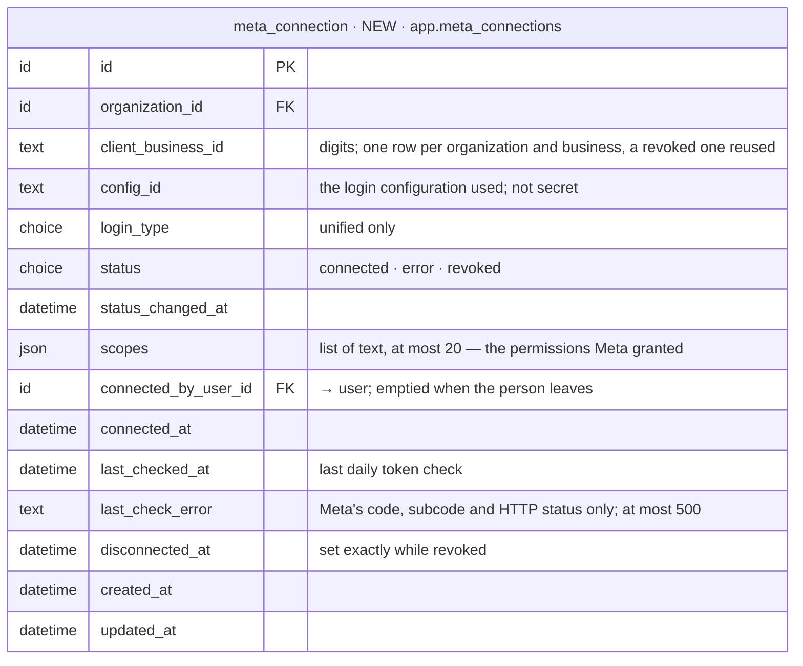

### meta_connection_token

- **Holds:** the connection's system-user access token, stored encrypted, its type and when it ends
  (empty = never, the default for a system-user token, D24). One per connection; deleted only when the
  connection is `revoked`. Read only on the Meta client's path — never in a cache, a log or a job
  payload. No public id. Goes away with its connection.
- **Table:** `app.meta_connection_tokens` (P38)
- **Sources:** plan:L3555–L3574; plan:L4577 (connect writes it), plan:L4236–L4251 (organization
  context only).
- **Added:** new — the one token path (D24). Unlike the launch's account token it has no renewal: the
  daily check only tests it and sets the connection to `error` when Meta rejects it.
- **Replaced:** `instagram_account_token` (removed below) — one token per account → one per
  connection.
- **Open:** none.

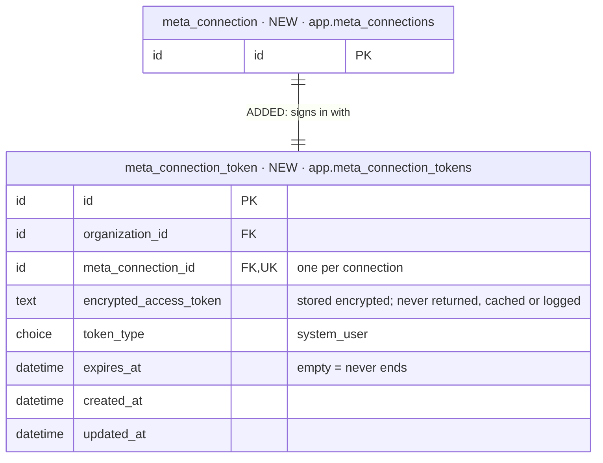

### instagram_account

- **Holds:** as at launch, an Instagram professional account a workspace connected — now reached
  through a Meta connection, and many per workspace (Free 1, Creator 3, Studio 10 by the plan's
  `instagram_accounts_max`, D26). One workspace per Instagram account stays: at most one row not
  `revoked` per Instagram account across organizations. The Instagram user id now comes from the
  connection's assigned-accounts list and is used for API paths and webhook routing. The daily check's
  profile refresh stays, inside the token check (A17, [P17](decisions.md)).
- **Table:** `app.instagram_accounts` (live)
- **Sources:** plan:L2922–L2944; plan:L4590–L4604 (connect, plan limit); current schema
  `src/domains/app/sub-domains/instagram-account/instagram-account.schema.ts`.
- **Added:**
  - `meta_connection_id` — the login this account came from (D25); required.
  - `starter_questions_set_at` — the last time this account's starter questions were sent to Meta;
    emptied when a starter-question automation goes live, pauses or changes its questions (D42).
- **Replaced:**
  - Accounts per organization: at most one not revoked (launch D5) → many, up to the plan's limit,
    checked at connect (D26).
  - `connection_status`: `connected` · `expired` · `error` · `revoked` → `connected` · `error` ·
    `revoked` — `expired` was the 60-day token's end (D24).
  - `instagram_app_user_id`, `scopes`, `token_expires_at` removed: Unified Login has no app-scoped
    id, the scopes move to `meta_connection`, the token ends on the connection (or never).
  - The launch's one-live-account-per-organization rule (`idx_instagram_accounts_organization_live`)
    and the app-scoped id lookup are dropped; "the accounts of a connection" is looked up by
    `idx_instagram_accounts_meta_connection` (organization, connection) — routes-final § 2, 2.A.3.
  - Meta's data-deletion and deauthorize requests find the accounts by `instagram_user_id` through a
    new resolver that replaces the app-scoped one (IA19, routes-final § 2, 2.D).
- **Open:**
  - The launch's `access_expires_at` API field goes with `token_expires_at` (route-changes.md).

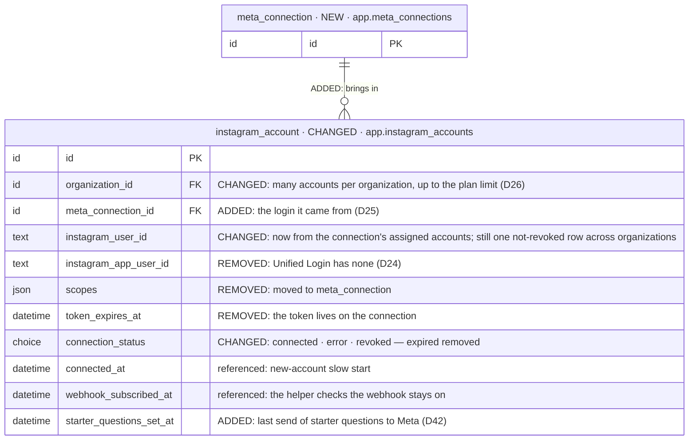

### instagram_account_setting

- **Holds:** as at launch, the account's automation master switch — plus the owner's sending limits
  and account-wide behaviour. Every new number is optional: empty means the value in the settings file
  (D22). The public reply safety moves to each automation (D32), so its five columns go. New:
  opening DMs per hour (1–750; the API stops at 700) and per day (used only when the day limit is on),
  fast messages per hour, messages per person per hour, broadcast messages per hour (1–2,000; empty =
  600), the "this is an automatic message" notice, the owner's extra stop words (at most 50, lower
  case), whether replies under comments start comment automations (on), once per person per post
  (on), mark as seen after a reply (off), and the extra random delay before each answer (1–20
  seconds, both ends or neither; PRO).
- **Table:** `app.instagram_account_settings` (live)
- **Sources:** plan:L2895–L2920; D5, D11, D22, D32, D64–D68; current schema
  `src/domains/app/sub-domains/instagram-account/instagram-account-settings/instagram-account-settings.schema.ts`.
- **Added:** the 13 fields marked `ADDED` below.
- **Replaced:** the 5 public reply safety fields → per automation (`automation.is_reply_like_person_enabled`,
  `public_reply_hour_limit`) and the settings file (D32).
- **Open:** none — true/false names take the `is_` form (P21, AMBER).

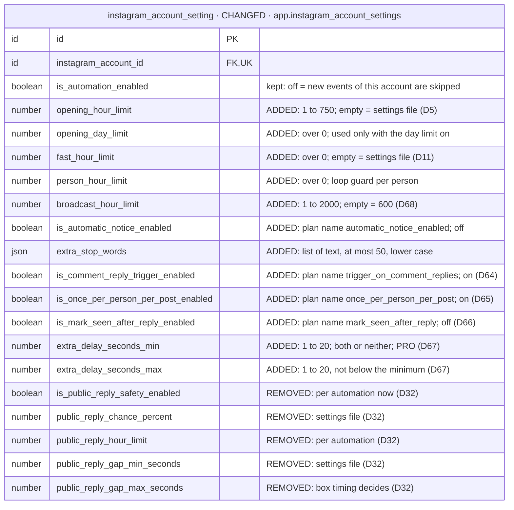

### instagram_account_token

- **Holds (before):** the account's long-lived Instagram Login token, encrypted, renewed daily before
  its 60 days ran out. Removed with the daily renewal, the Instagram Login client and its app secret
  (plan:L2938).
- **Table:** `app.instagram_account_tokens` (live) — removed
- **Sources:** plan:L2938, plan:L8458; current schema
  `src/domains/app/sub-domains/instagram-account/instagram-account-token.schema.ts`.
- **Added:** none.
- **Replaced:** → `meta_connection_token` (D24). No data moves: the Instagram Login code is replaced,
  not migrated (plan:L2924).
- **Open:** none.

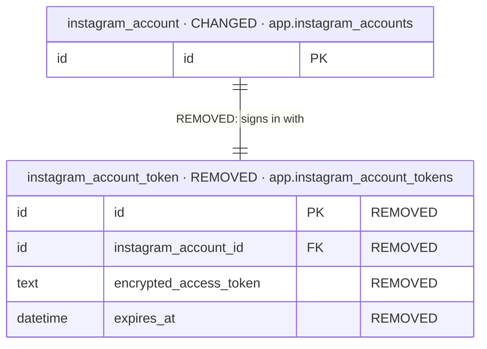

### instagram_media

- **Holds:** as at launch, the account's stored posts — plus the missed-comment watch (when the helper
  last read the post's comments, when it reads again — empty = not watched — and the newest comment
  known) and when a Live ended, so waiting Live private replies expire without a call (D40).
  `media_product_type` adds Meta's value for a Live; `ad` marks an ad's post (D41).
- **Table:** `app.instagram_media` (live)
- **Sources:** plan:L2946–L2958; current schema
  `src/domains/app/sub-domains/instagram-account/instagram-media/instagram-media.schema.ts`.
- **Added:** the four time fields below; the Live value.
- **Replaced:** none.
- **Open:** the exact Live value Meta sends — a Meta test (plan §43). Live comments are refused at
  go-live until that test passes ([P36](decisions.md)).

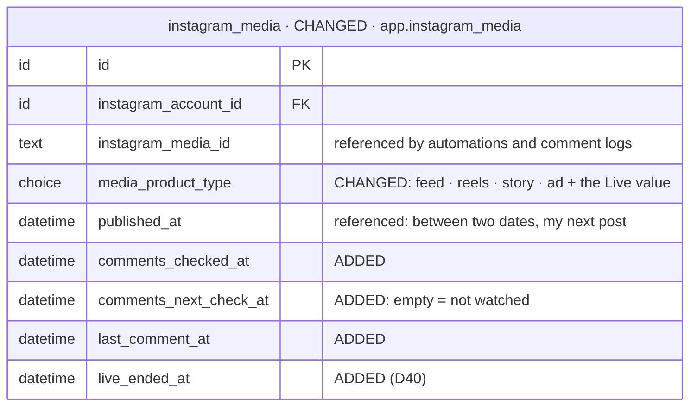

## Stage 2 — Audience and automations

Contacts and automations get the fields the 15 ways to start, the message list and the owner's
controls need; four small tables carry tag changes, all-time counts, public reply pacing and
past-comment runs.

### contact

- **Holds:** as at launch, one person who wrote to or commented on one account — plus the 24-hour
  private-reply rule (last opening message), the stop word (opted out), the channel (`instagram`,
  D27), the first automation that started a run for her ("via", set once) with how and from what ref
  she came in, the owner's private note (1–2,000), her first message time, the owner's "pause
  automations for this person" with who did it (D71), and her comment and story activity and last
  broadcast for segments (D68). The follow state keeps the launch's fields. Tags are 1–50 characters
  each (launch 1–255), at most 50 per contact (CT9). Kept until the owner deletes it, Meta asks, or the
  workspace goes (D51). Erasing a contact also clears her note, opted out, last opening message,
  automations pause (when and by whom), came-in ref, first message, last comment, last story activity
  and last broadcast, and sets her comment count to 0 — her activity is personal data too; the
  "via" automation, how she came in and the channel stay (CT11).
- **Table:** `app.contacts` (live)
- **Sources:** plan:L2960–L2993; D27, D45, D46, D49, D68, D71; current schema
  `src/domains/app/sub-domains/contact/contact.schema.ts`.
- **Added:** the 14 fields marked `ADDED`. The list and its sorts are per account (D26). The reference
  from `first_automation_id` to the automation is added by the automations migration (automations build
  after contacts). Broadcasts' "can get it now" reads her account, her open window and her exclusions
  through one index the contact writer adds (BC13, routes-final § 7).
- **Replaced:** the email check: the launch refused plus addresses (Standing deviation "Email and
  phone checks") → accepted (A19, [P19](decisions.md)); tags 1–255 → 1–50 (CT9).
- **Open:** none — columns and checks: routes-final § 3, 3.A.3.

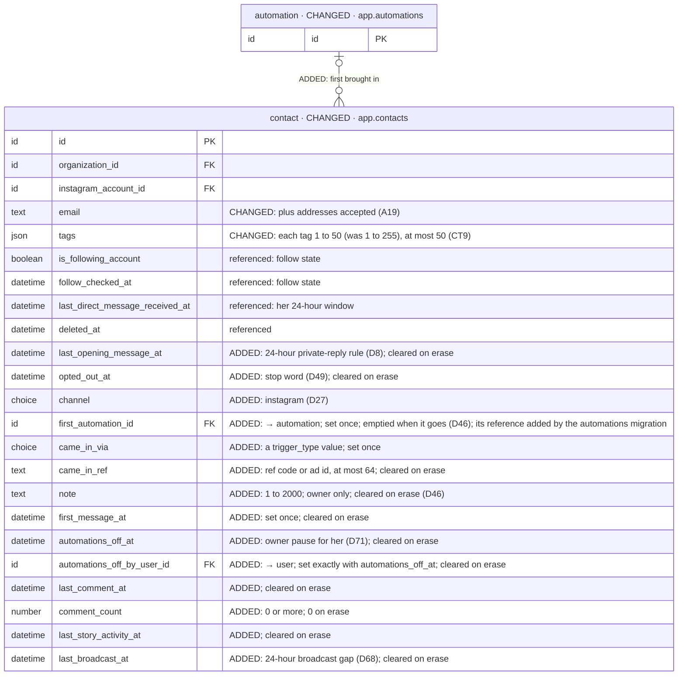

### contact_tag_event

- **Holds:** one row per tag added to or removed from a contact, written in the same commit as the
  change, so tag starts never lose one (D45). `kind`: `added` · `removed`; `source`: `automation` (a
  tag step) · `owner`. The chain number counts how many tag starts led to this change; intake starts
  nothing at 3 or more. Its id is part of the once key of a tag start. Kept 8 days. No public id.
  Goes with its contact; a deleted automation only empties `source_automation_id` (that reference is
  added by the automations migration, which builds after contacts).
- **Table:** `app.contact_tag_events` (P38)
- **Sources:** plan:L3685–L3717; D45; routes-final § 3, 3.B.3.
- **Added:** new.
- **Replaced:** none.
- **Open:** none.

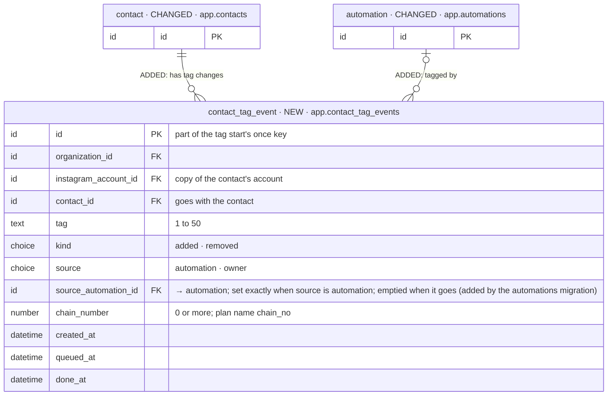

### automation

- **Holds:** as at launch, one automation of one account — now flat fields for how it starts and
  its public reply, and one `steps` object for everything it sends (hello, follow, email, phone, the
  message list, tags). A draft needs only a name (D28). `status`: `draft` · `live` · `paused`.
  `trigger_type`: `comment` · `live_comment` · `story_reply` · `story_mention` · `story_repost` ·
  `dm_keyword` · `first_message` · `shared_post` · `starter_question` · `ref_link` · `default_reply` ·
  `ad_comment` · `ad_message` · `tag_added` · `tag_removed` (D37). `also_start_from`: `story_reply`,
  `dm`, at most 2 (D38). `target_scope`: `any` · `specific` · `next` · `between` (D39).
  `next_post_status`: `waiting` · `linked` — a "next post" never expires (A12,
  [P12](decisions.md)). `default_reply_mode`: `once_a_day` · `every_time` (D44). `stopped_reason`:
  `bad_text` · `post_deleted` — a plan change never stops an automation (D57). Soft delete stays; the
  delete reason becomes optional, `other` still needs a note (A11, [P11](decisions.md)). Files in steps
  are referred to by upload public id, same workspace, checked by file type and content (magic bytes)
  — the malware scan comes in a later iteration (plan:L3094; [P34](decisions.md), a D58 deviation).
- **Table:** `app.automations` (live)
- **Sources:** plan:L2995–L3145; D28–D45, D52, D57, D59, D63; current schema
  `src/domains/app/sub-domains/automation/automation.schema.ts`.
- **Added:** the fields marked `ADDED`; the go-live checks of §5.1 plus the "next step" button rule
  (A2, [P2](decisions.md)).
- **Replaced:**
  - The launch's message fields (opening message, follow, email, phone, final message and their
    switches) → `steps` (D29–D31).
  - `is_dm_keyword_trigger_enabled` → `also_start_from` (D38).
  - `next_post_starts_at` / `next_post_ends_at` → `target_starts_at` / `target_ends_at` (D39).
  - `tags` → `steps.tags` (D45).
  - `completed_run_count` → `automation_count` (D36).
  - `is_public_reply_enabled` stays as it is; the plan renames it `public_reply_enabled`, which the
    repository's true/false rule does not allow ([P21](decisions.md)).
- **Open:** none (columns, keys and checks: routes-final § 4, 4.A.3). Every way to start is built; the ones that need a Meta test (`story_repost`,
  `live_comment`, `ad_comment`, the 7-day ad window, quick replies and cards on Unified Login) are
  refused at go-live by a code list of offered ways to start and features until their plan §43 test
  passes — a code list, no column ([P36](decisions.md)).

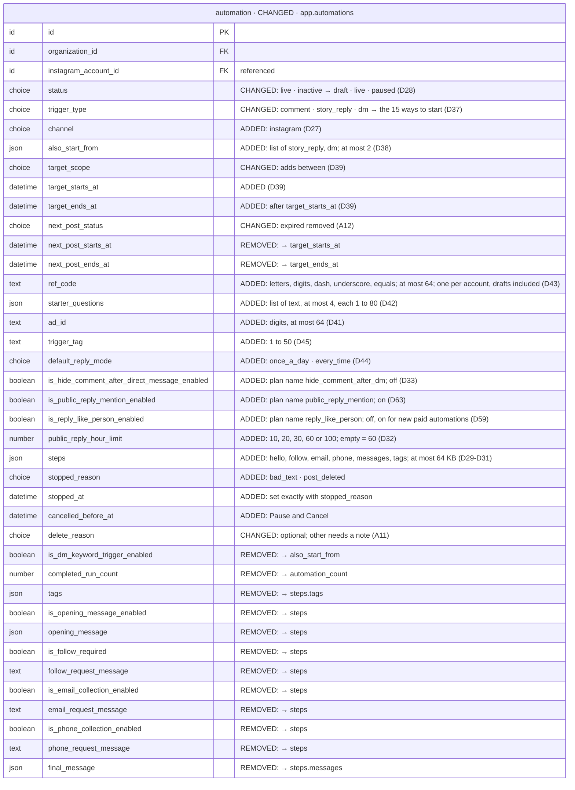

### automation_count

- **Holds:** an automation's all-time counters — runs started, taps, typed answers, and the same per
  step version (for example `hello.1`) — split over 16 slots so busy automations do not wait on one
  row (D36). Survives the 90-day run delete. No public id. Goes away with its automation.
- **Table:** `app.automation_counts` (P38)
- **Sources:** plan:L3576–L3599; D36, D61.
- **Added:** new.
- **Replaced:** `automation.completed_run_count` (removed).
- **Open:** none.

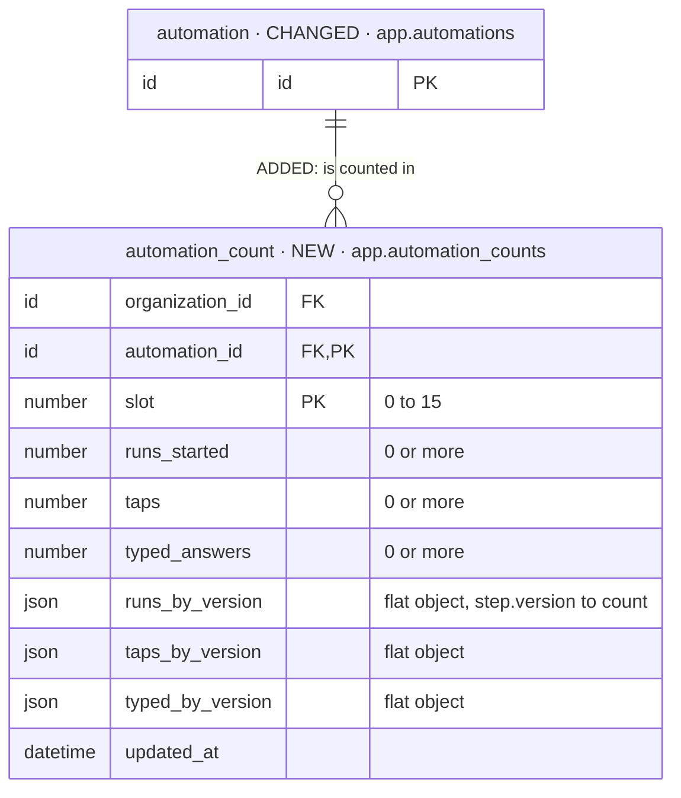

### automation_reply_state

- **Holds:** the "Reply like a person" pacing of one automation's public replies: the current random
  box, the last reply line used, and how many replies wait (D32). One per automation, made at its
  first public reply. No public id.
- **Table:** `app.automation_reply_states` (P38; the plan names it in the singular,
  `app.automation_reply_state` — the repository's tables are plural)
- **Sources:** plan:L3601–L3621; D32, D52.
- **Added:** new — replaces the account-wide reply safety of the launch (D32).
- **Replaced:** none.
- **Open:** none.

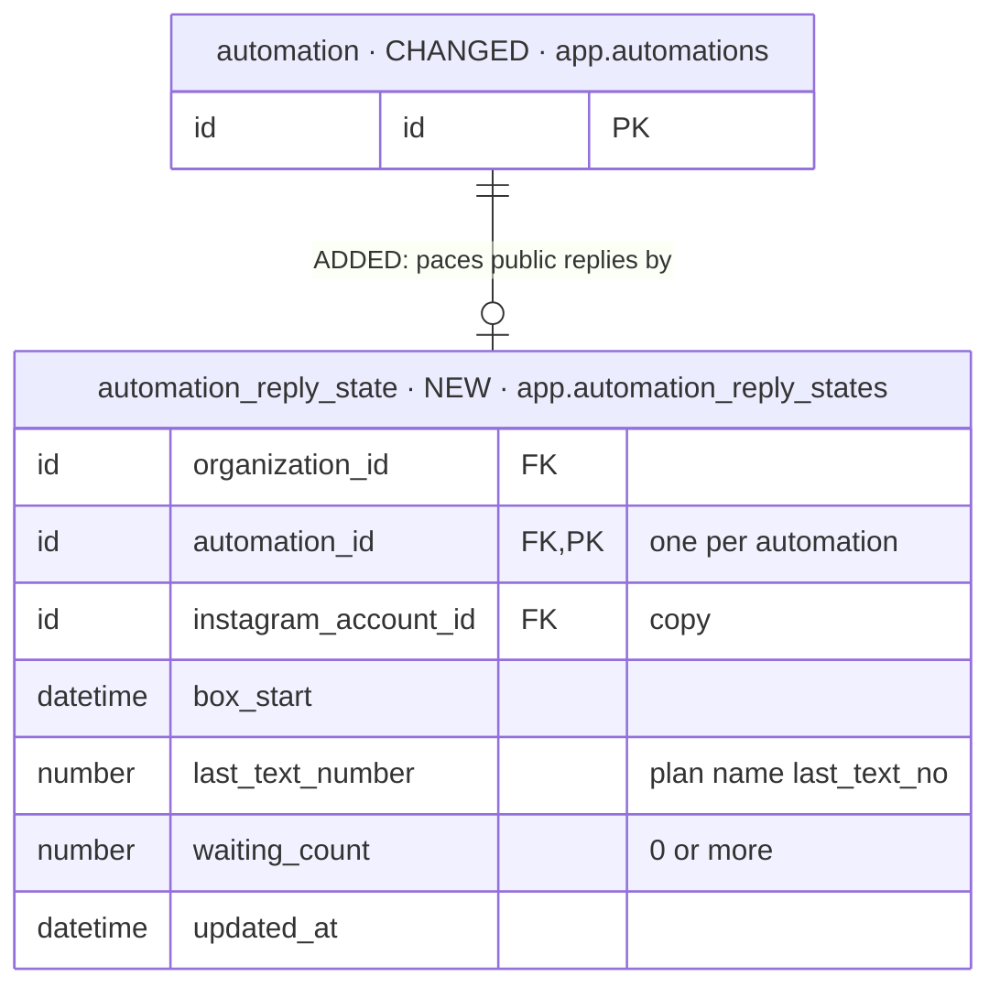

### automation_backfill

- **Holds:** one "also answer comments from the last N days" run of a live comment or ad-comment
  automation (D69, PRO): the days (1–7), its status, posts read, comments found, matched and opening
  DMs queued, why it failed and the error codes (never Meta's text), who asked and when. `status`:
  `queued` · `reading` · `done` · `failed`; `fail_reason`: `meta_error` · `plan_feature_off`. One
  queued or reading per automation; a new press after a failure makes a new row. Has a public id
  (prefix not named by the plan).
- **Table:** `app.automation_backfills` (P38)
- **Sources:** plan:L3818–L3844, plan:L4109–L4120; D69.
- **Added:** new.
- **Replaced:** none.
- **Open:**
  - Public id prefix — chosen at kickoff (P22, AMBER).

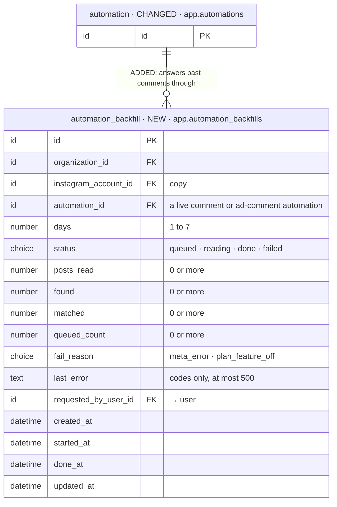

## Stage 3 — Runs and logs

A run now carries its once key, the 7-day clock and which step versions it used; the claim of a send
moves to the message row (Stage 6). Runs, run events and comment logs keep 90 days, not 180 (D16) —
plain tables emptied by batch deletes ([P33](decisions.md)). At most one open run per automation and
person; a new comment that may start a run replaces the open one ([P35](decisions.md)).

### automation_run

- **Holds:** as at launch, one person going through one automation — plus when the event that started
  it happened (the 7-day clock, D9), its once key (D13), when its first DM was sent, the highest list
  message sent (read by segments after message rows are gone) and which version of each step it used.
  `trigger_type` is how this run started (the 15 kinds; may differ from the automation's through
  "also start from"). `current_step`: `keyword_match` · `comment_reply` · `follow_check` ·
  `email_collect` · `phone_collect` · `messages`. `waiting_for` adds `any`. `cancel_reason` adds
  `expired` · `opted_out` · `window_closed` · `contact_excluded` · `replaced`. Her own free text is never
  kept (D46). Kept about 90 days after it ends (D16; launch 180) — a plain table, batch deletes (P33).
  **One open run per automation and person (P35):** when a comment may start a new run (a different
  post, or "every time" mode — D13 / D65 still decide), her open run of that automation is cancelled
  with `replaced` (its waiting messages too) and the new run starts. A second comment on the same post
  with "once" on is still ignored (`once_per_post`); every other way to start is ignored while her run
  is open (`run_in_progress`).
- **Table:** `app.automation_runs` (live)
- **Sources:** plan:L3147–L3173, plan:L3893–L3924; D9, D13, D16, D29–D31, D46; current schema
  `src/domains/app/sub-domains/automation/automation-run/automation-run.schema.ts`.
- **Added:** the fields marked `ADDED`.
- **Replaced:**
  - The send claim (`sending_message_kind`, `sending_started_at`) → the message row's status
    (`instagram_message`).
  - The plan's open-run keys (one open run per automation, person and once key, in
    `automation_run_open_key`, plan:L3465–L3480) → the launch's rule stays: one open run per
    automation and person, and a new start replaces it (`replaced`, P35). **No open-run key table** —
    confirmed by the route review (AUQ4, WH14): the new start cancels the open run in the same commit,
    so the launch's one-open-run rule is the whole rule. The once key stays on the run, for the
    `once_per_post` check (D13); WC-45 frees no key.
- **Open:** none — columns and keys: routes-final § 4, 4.B.

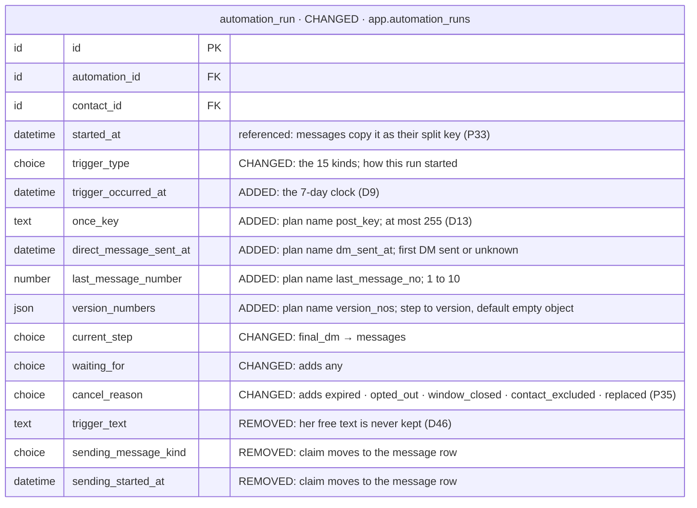

### automation_run_event

- **Holds:** as at launch, the append-only history of a run — `event_type` adds `hello_tapped` and
  `follow_tapped` (the tap counts of D61). Kept with its run — a plain table, batch deletes (P33).
- **Table:** `app.automation_run_events` (live)
- **Sources:** plan:L3175–L3182; current schema
  `src/domains/app/sub-domains/automation/automation-run/automation-run-event.schema.ts`.
- **Added:** two event types.
- **Replaced:** none.
- **Open:** none — the plan's `automation_run_started_at` copy is not added: runs are not split (P33).

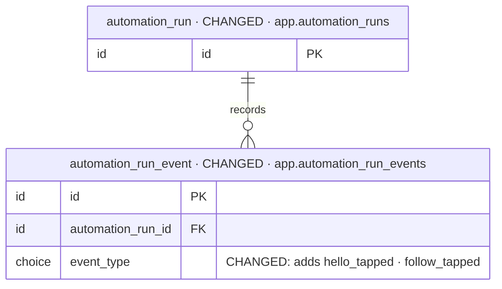

### automation_comment_log

- **Holds:** as at launch, one row per comment an automation saw, with each step's status — plus the
  comment's time and the hide step (status and when). The
  final DM step becomes the message list (`messages_status`, `messages_at`). Step statuses add
  `expired` · `unknown`; `current_step` / `failed_step` rename `final_dm` → `messages` and add
  `hide_comment`; `waiting_for` adds `any`. `ignored_reason`: `previous_run_final` → `once_per_post`,
  adds `thread_reply_off` · `own_comment` · `contact_excluded`, keeps `run_in_progress` and
  `comment_already_answered`. `public_reply_skip_reason`: `duplicate` · `random` · `hour_limit` ·
  `deleted_comment` (`gap` removed). Live and ad comments get logs; a Live's reply and hide stay
  `off`. Kept 90 days (D16; launch 180) — a plain table, batch deletes (P33).
- **Table:** `app.automation_comment_logs` (live)
- **Sources:** plan:L3184–L3205; D16, D32, D33, D64; current schema
  `src/domains/app/sub-domains/automation/automation-run/automation-comment-log.schema.ts`.
- **Added:** the fields marked `ADDED`.
- **Replaced:** `final_dm_status` / `final_dm_at` → `messages_status` / `messages_at`.
- **Open:**
  - The launch's ignored reasons `waiting_for_other_email` and `already_waiting` are kept — the plan
    is silent ([P23](decisions.md), AMBER).
  - The plan's `automation_run_started_at` copy is not added: runs are not split (P33).
  - The launch's `opening_dm_status` / `opening_dm_at` keep `dm` (as built); A6 renames only new
    names.

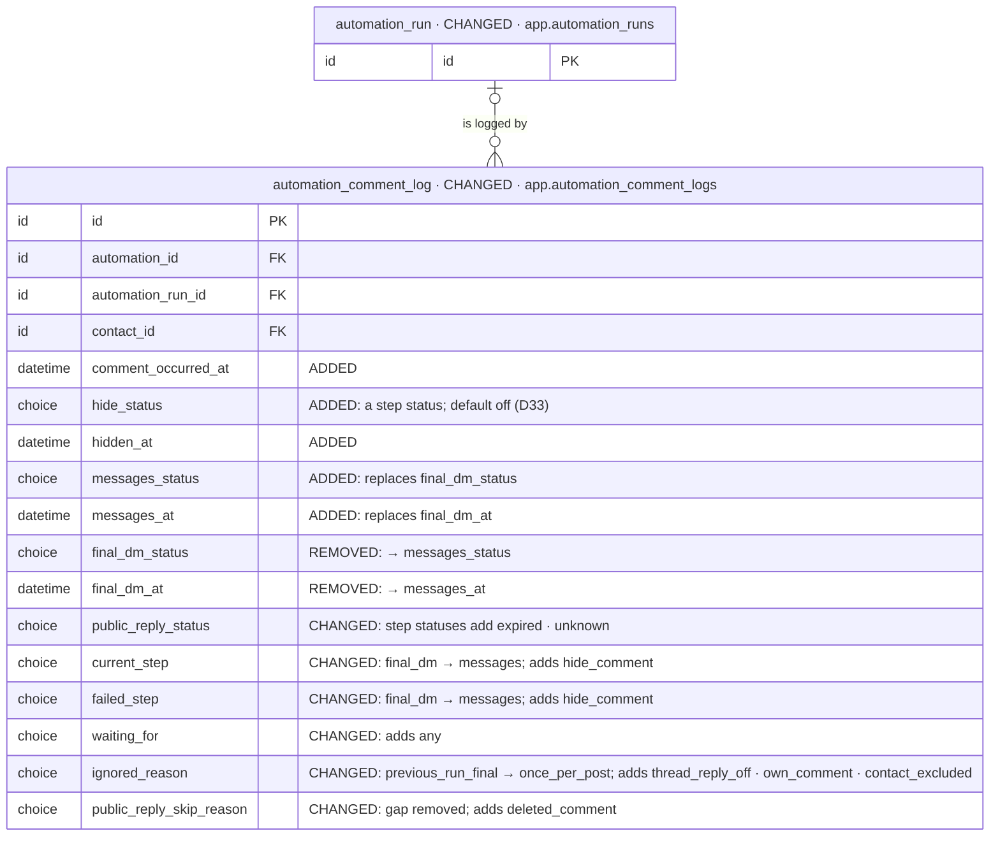

## Stage 4 — Received content

Meta's events keep their table, kept 8 days instead of 30 and emptied once handled; their dedupe keys
move to a table of their own.

### instagram_webhook_event

- **Holds:** as at launch, one event Meta sent for a connected account — plus when a failed event is
  tried again (hourly, while the comment is under 7 days old). `event_kind` adds `live_comment` ·
  `story_mention` · `shared_post` · `referral` · `ice_breaker` and drops `read`; `skip_reason` drops
  `read_receipt`, `echo` and `reaction` and adds `own_comment` (D64) and `flood` (more than 20 of her
  message events in a minute, WH16). Echoes of the owner's hand-typed messages and reactions are saved
  `received` and taken in (an echo starts her quiet time, WH10); our own echoes are dropped before
  saving (WHQ1). The body is **null** once the event is processed or skipped, and a row born skipped
  stores none (WH22); read receipts, our own "sent" notices and tag events are never saved. Each
  event's intake group (messages, Live, comments) is worked out from its kind and stored (WH11). Kept 8
  days (D15; launch 30) — one of the three split tables, by day (P33).
- **Table:** `app.instagram_webhook_events` (live)
- **Sources:** plan:L3207–L3225, plan:L3926–L3941; D15, D64; current schema
  `src/domains/app/sub-domains/instagram-webhook/instagram-webhook-event/instagram-webhook-event.schema.ts`.
- **Added:** `next_attempt_at`; `intake_group`; five event kinds; `own_comment`, `flood`.
- **Replaced:**
  - The dedupe key on this table → `instagram_webhook_event_key`.
  - A failed event was final after 5 tries (launch) → retried hourly up to 7 days.
  - The launch's debugging list of events shows 8 days instead of 30.
  - A DM echo was skipped `echo` (launch) → saved `received` (WH10); `own_comment` is the skip of an
    own comment ([P24](decisions.md)).
- **Open:** none — columns, the split and its indexes: routes-final § 5, 5.B.3.

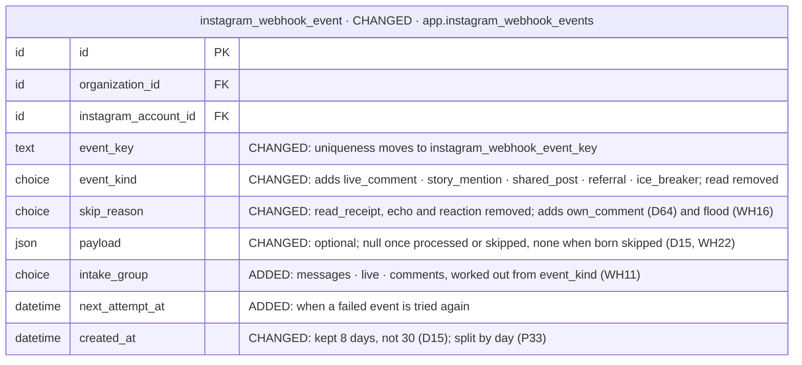

### instagram_webhook_event_key

- **Holds:** the key of every event received per account, so the same event arriving twice saves
  nothing more. Kept 8 days — a plain table, batch deletes (P33). No public id.
- **Table:** `app.instagram_webhook_event_keys` (P38)
- **Sources:** plan:L3453–L3461; D15.
- **Added:** new — the launch kept this key on the events, which now go after 8 days in whole days.
- **Replaced:** the event's own key uniqueness.
- **Open:** none — the plan's split by account is not used (P33). Its key leads with the
  organization: organization, account, event key (routes-final § 5, 5.B.3).

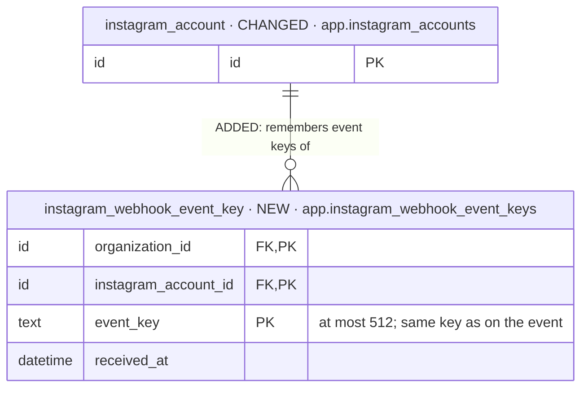

## Stage 5 — Broadcasts

Saved audiences and the message sets sent to them, only to people whose chat window is open (D68,
PRO). Segments and broadcasts are soft-deleted and purged later (A9, [P9](decisions.md)).

### segment

- **Holds:** a saved audience of one account: a name and its conditions in AND / OR groups (at most 2
  levels, 20 conditions) on tags, the automation she came through, how she came in, comments, activity,
  her details, story activity and "no broadcast in N days" (D68). Used again by many broadcasts. Has a
  public id (prefix not named by the plan). Soft delete (A9); purged 90 days after its delete, once no
  live broadcast points at it (BC4, BCQ1).
- **Table:** `app.segments` (P38)
- **Sources:** plan:L3719–L3750; D68.
- **Added:** `deleted_at` — the plan hard-deletes; A9 keeps the repository's soft delete.
- **Replaced:** none.
- **Open:**
  - Public id prefix — chosen at kickoff (P22, AMBER).

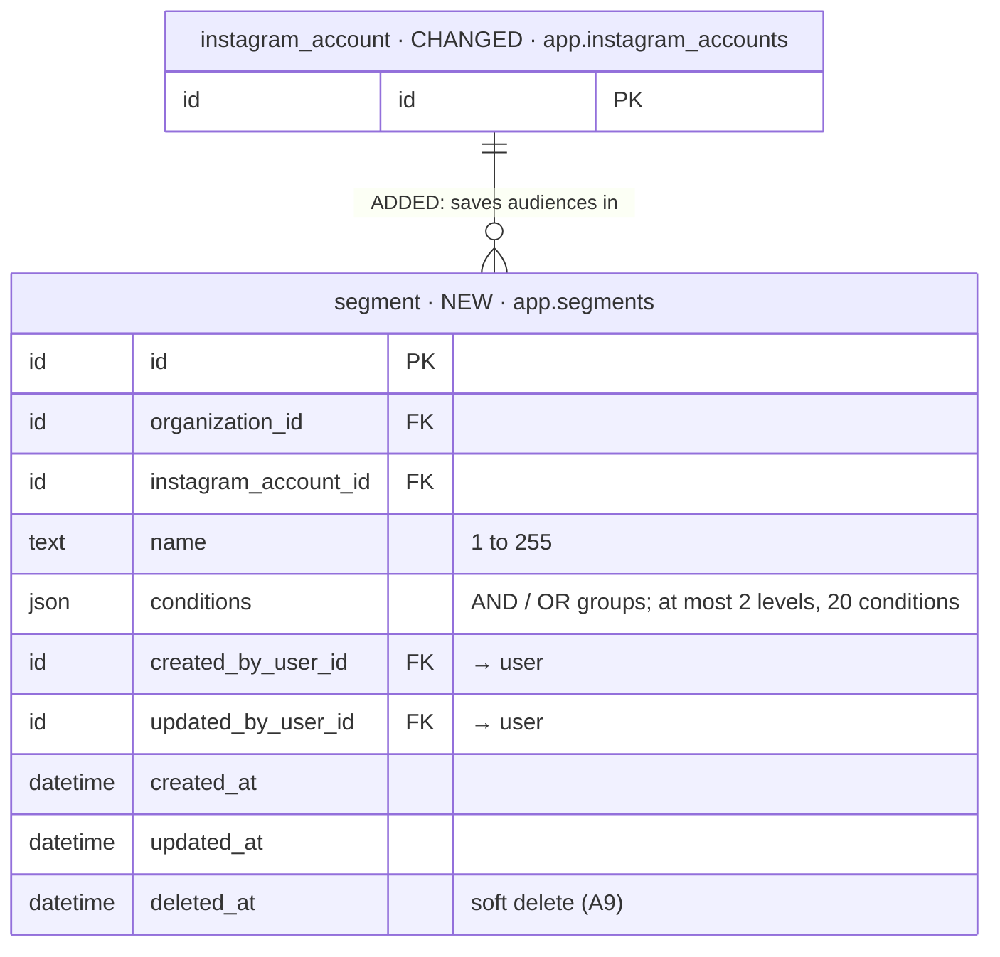

### broadcast

- **Holds:** one message set (1–3 messages, the same shape as the automation's message list, with
  versions) sent to the people of a segment or a one-off audience — a copy of the conditions is kept
  when it starts. `status`: `draft` · `scheduled` · `sending` · `waiting_for_chats` · `done` ·
  `cancelled`; `mode`: `now` · `scheduled` · `when_chat_opens`, chosen **at send** — with the send's
  `scheduled_at` or its open wait of 1–7 days, which is a send input, not a column (`ends_at` holds its
  end; BC10); `cancel_reason`: `owner` · `plan_feature_off`. Counts of matched, sent, skipped, failed,
  replies and taps. Has a public id (prefix not named; it goes in the messages' button payload). Soft
  delete (A9); purged 90 days after its delete, its recipients and messages with it (BC4, BCQ1). Only a
  `draft`, `done` or `cancelled` broadcast may be deleted (BC11).
- **Table:** `app.broadcasts` (P38)
- **Sources:** plan:L3752–L3791, plan:L4070–L4087; D57, D68.
- **Added:** `deleted_at` (A9).
- **Replaced:** none.
- **Open:**
  - Public id prefix — chosen at kickoff (P22, AMBER).
  - Columns and keys: routes-final § 7, 7.A.3.

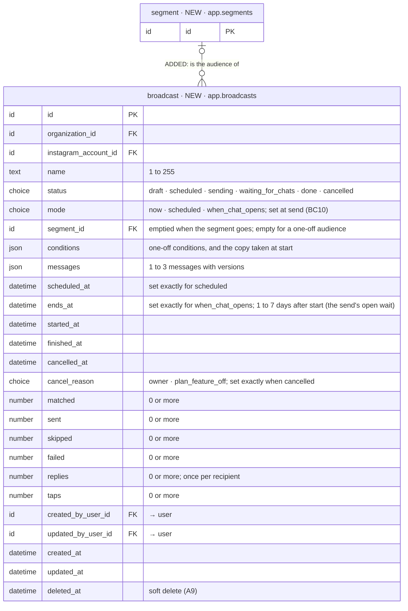

### broadcast_recipient

- **Holds:** one person a broadcast goes to: status, reason, which version she got, when it was sent
  and when she first replied. `status`: `waiting` · `sent` · `skipped` · `failed` · `unknown`;
  `reason`: `recent_broadcast` · `owner_chat` · `window_closed` · `opted_out` · `contact_excluded` ·
  `broadcast_cancelled` · `plan_feature_off` · `contact_deleted`, plus the message reasons. At most
  one row per broadcast and contact — unique (organization, broadcast, contact); a `skipped · owner_chat`
  row goes back to `waiting` instead of a second one (BC16). One broadcast per person per 24 hours. Its
  account is a copy of the broadcast's, with no reference of its own. Kept 90 days — a plain table,
  batch deletes (P33). No public id.
- **Table:** `app.broadcast_recipients` (P38)
- **Sources:** plan:L3793–L3816, plan:L4089–L4107; D68.
- **Added:** new.
- **Replaced:** none.
- **Open:** none — the plan's split by month is not used (P33); routes-final § 7, 7.C.

```mermaid
erDiagram
  broadcast_recipient["broadcast_recipient · NEW · app.broadcast_recipients"] {
    id id PK
    id organization_id FK
    id instagram_account_id "copy of the broadcast's account, no reference (BC16)"
    id broadcast_id FK "unique with contact_id per organization (BC16)"
    id contact_id FK
    choice status "waiting · sent · skipped · failed · unknown"
    choice reason "recent_broadcast · owner_chat · window_closed · opted_out · contact_excluded · broadcast_cancelled · plan_feature_off · contact_deleted, plus the message reasons"
    number version_number "plan name version_no"
    datetime created_at
    datetime sent_at
    datetime replied_at
    datetime updated_at
  }
  broadcast["broadcast · NEW · app.broadcasts"] {
    id id PK
  }
  contact["contact · CHANGED · app.contacts"] {
    id id PK
  }
  broadcast ||--o{ broadcast_recipient : "ADDED: goes to"
  contact ||--o{ broadcast_recipient : "ADDED: receives"
```

## Stage 6 — Sending engine

The paced sender: four lanes per account, one row per message, the attempts, the minute and month
counts, the stop history, the two global rows and the Meta file ids. Intake never sends; the lanes do
(plan:L3226–L3640, D3, D4, D18).

### instagram_send_lane

- **Holds:** one row per account and lane — `slow` (opening DMs as private replies, one at a time),
  `reply` (public replies and hides), `fast` (every other DM), `broadcast` — made at connect (D25).
  `state`: `ready` · `working` · `sleeping` · `stopped` (fast uses `ready` and `stopped` only).
  `wait_reason`: `box` · `gap` · `hour_limit` · `day_limit` · `not_before` · `stop` · `test`. Holds the
  ticket turn, the lease, the random box, the last send, half speed, the day count, the owner's pause,
  the team's suspend (A18, [P18](decisions.md)), the current **error stop** (`stop_reason`: `too_fast` ·
  `blocked` · `account_flagged` · `login_expired` · `account_not_shared` · `access_off` ·
  `app_not_approved` · `app_limit`) and, beside it, the **plan stop** (`plan_stop_reason`:
  `plan_limit` · `plan_ended` · `plan_downgrade`) — two separate stops, so both can hold at once (SN12),
  the account's one test claim and the fast lane's sends on their way. No public id.
- **Table:** `app.instagram_send_lanes` (P38)
- **Sources:** plan:L3385–L3419, plan:L3943–L3970; D3, D4, D5, D11, D19, D34, D35, D57, D62;
  routes-final § 6, 6.A.3.
- **Added:** new.
- **Replaced:** the plan's one stop for errors and plan states → an error stop and a plan stop (SN12,
  plan §33.2 rule 4).
- **Open:** none.

```mermaid
erDiagram
  instagram_send_lane["instagram_send_lane · NEW · app.instagram_send_lanes"] {
    id id PK
    id organization_id FK
    id instagram_account_id FK "one row per account and lane"
    choice lane "slow · reply · fast · broadcast"
    choice state "ready · working · sleeping · stopped"
    datetime next_run_at
    choice wait_reason "box · gap · hour_limit · day_limit · not_before · stop · test"
    number turn_number "plan name turn_no"
    number working_turn
    datetime lease_until
    number pick_count "slow: place 1 to 5 in the new : old mix"
    datetime box_start
    datetime last_sent_at
    datetime half_speed_until
    date day_date "slow, day limit only"
    number day_count "slow, day limit only"
    datetime paused_at "owner pause"
    datetime suspended_at "team suspend or a suspended workspace (A18)"
    choice stop_reason "an error stop group only (SN12)"
    datetime stop_until "empty = the owner must act"
    number stop_count
    number stop_error_code
    number stop_error_subcode
    datetime stop_cleared_at
    choice plan_stop_reason "plan_limit · plan_ended · plan_downgrade (SN12)"
    datetime plan_stopped_at "set exactly with plan_stop_reason"
    choice testing_lane "slow row only: slow · reply · fast · broadcast"
    datetime testing_until "slow row only"
    number sending_count "fast row only"
    datetime updated_at
  }
  instagram_account["instagram_account · CHANGED · app.instagram_accounts"] {
    id id PK
  }
  instagram_account ||--|{ instagram_send_lane : "ADDED: sends through 4 lanes"
```

### instagram_message

- **Holds:** one message we send or plan to send — of a run or of a broadcast: its type
  (`opening_message` · `nudge` · `public_reply` · `hide_comment` · `follow_check` · `follow_request` ·
  `email_question` · `invalid_email` · `phone_question` · `message` · `broadcast`), list number, kind
  (`text` · `image` · `cards` · `quick_replies` · `audio` · `file` · `post`), version and wording,
  lane, channel (`private_reply` · `direct` · `comment_reply` · `comment_hide`), whether it counts as a
  DM, its status (`waiting` · `sending` · `sent` · `unknown` · `failed` · `skipped` · `cancelled` ·
  `expired`) and reason (about 30 values, plan:L3287–L3317, plus `replaced` for the waiting messages
  of a replaced run, P35), not-before time, tries and asks, the
  Instagram message id, error codes and the owner's one retry (D72). Moving lanes changes the same
  row while it waits. Copies of the account, automation and contact are kept without a reference.
  Kept 30 days (D50) — one of the three split tables, by week of the run start (P33, P13). Has a public
  id (prefix not named by the plan).
- **Table:** `app.instagram_messages` (P38)
- **Sources:** plan:L3234–L3355, plan:L3850–L3891; D8, D9, D13, D17, D29–D33, D50, D68, D72.
- **Added:** new — the launch claimed a send on the run and sent inline (Standing deviation "Sending
  again on a retry"); an `unknown` send now may go once more on her next action (D17).
- **Replaced:** the run's send claim.
- **Open:**
  - `automation_run_started_at` stays only as the split key: runs are plain (P33), so the link to
    the run is `automation_run_id` alone; a broadcast row puts its recipient's creation time in the
    same field.
  - Public id prefix — chosen at kickoff (P22, AMBER).

```mermaid
erDiagram
  instagram_message["instagram_message · NEW · app.instagram_messages"] {
    id id PK
    id organization_id FK
    id instagram_account_id "copy, no reference"
    id automation_id "copy, no reference; empty only for a broadcast"
    id automation_run_id FK "empty only for a broadcast"
    id broadcast_id FK "set exactly for a broadcast message"
    datetime automation_run_started_at "split key only (P33): the run's start, or the recipient's creation for a broadcast"
    id contact_id "copy, no reference"
    choice message_type "opening_message · nudge · public_reply · hide_comment · follow_check · follow_request · email_question · invalid_email · phone_question · message · broadcast"
    number message_number "plan name message_no; 1 to 10, broadcast 1 to 3"
    choice message_kind "text · image · cards · quick_replies · audio · file · post"
    number version_number "plan name version_no; 1 to 3"
    number wording_number "plan name wording_no; 1 to 10"
    choice lane "slow · reply · fast · broadcast"
    choice channel "private_reply · direct · comment_reply · comment_hide; empty only for follow_check"
    boolean is_counted_as_direct_message "plan name counts_as_dm"
    choice status "waiting · sending · sent · unknown · failed · skipped · cancelled · expired"
    choice reason "about 30 values, plan L3287-L3317, plus replaced (P35)"
    datetime not_before
    datetime trigger_occurred_at
    number tries
    number asks
    number text_number "plan name text_no"
    text instagram_message_id "at most 128"
    datetime sending_at "set when sending"
    datetime sent_at "set when sent"
    number error_code
    number error_subcode
    datetime owner_retry_at "the owner's one retry (D72)"
    datetime created_at
    datetime updated_at
  }
  automation_run["automation_run · CHANGED · app.automation_runs"] {
    id id PK
  }
  broadcast["broadcast · NEW · app.broadcasts"] {
    id id PK
  }
  automation_run |o--o{ instagram_message : "ADDED: sends"
  broadcast |o--o{ instagram_message : "ADDED: sends"
```

### instagram_send_attempt

- **Holds:** one call to Meta for a message: lane, count group (`open` · `reply` · `fast` ·
  `broadcast` · `none`), when it started, its result group (`sent`, the error and stop groups of §33,
  for example `too_fast`, `bad_text`, `no_answer`), HTTP status, error codes and how long it took.
  Feeds the "in a row" and "30% bad" rules. The message, automation and contact are copies without a
  reference. Kept 8 days (D16) — one of the three split tables, by day (P33). No public id.
- **Table:** `app.instagram_send_attempts` (P38)
- **Sources:** plan:L3357–L3383, plan:L5915–L5943; D16, D19.
- **Added:** new.
- **Replaced:** the launch's error fields on the comment log stay; this is the engine's own record.
- **Open:** none.

```mermaid
erDiagram
  instagram_send_attempt["instagram_send_attempt · NEW · app.instagram_send_attempts"] {
    id id PK
    id organization_id FK
    id instagram_account_id "copy, no reference"
    choice lane "slow · reply · fast · broadcast"
    id instagram_message_id "copy, no reference; plan name message_id"
    id automation_id "copy; empty for a broadcast"
    id contact_id "copy"
    choice count_group "open · reply · fast · broadcast · none"
    datetime started_at
    choice result_group "sent or an error group of plan section 33; empty while the call runs"
    number http_status
    number error_code
    number error_subcode
    number duration_milliseconds "plan name duration_ms"
  }
  instagram_message["instagram_message · NEW · app.instagram_messages"] {
    id id PK
  }
  instagram_message ||--o{ instagram_send_attempt : "ADDED: is tried by (no reference)"
```

### instagram_send_minute_count

- **Holds:** messages sent per account, count group (`open` · `reply` · `fast` · `broadcast`) and
  minute — gate 2, raised in the same commit that marks a message `sending` (D18). Kept 2 hours. No
  public id.
- **Table:** `app.instagram_send_minute_counts` (P38)
- **Sources:** plan:L3421–L3451; D18.
- **Added:** new.
- **Replaced:** none.
- **Open:** none.

```mermaid
erDiagram
  instagram_send_minute_count["instagram_send_minute_count · NEW · app.instagram_send_minute_counts"] {
    id organization_id FK
    id instagram_account_id FK, PK
    choice count_group PK "open · reply · fast · broadcast"
    datetime minute_start PK "Postgres clock, to the minute"
    number count "0 or more"
  }
  instagram_account["instagram_account · CHANGED · app.instagram_accounts"] {
    id id PK
  }
  instagram_account ||--o{ instagram_send_minute_count : "ADDED: is counted per minute in"
```

### direct_message_month_count

- **Holds:** DMs sent this calendar month by one workspace, in its time zone, split into 16 slots by
  account so accounts never wait on each other (D34). Every message into her chat counts, broadcast
  ones too (D68). Feeds the month meter (A14, [P14](decisions.md)) and the `plan_limit` stop of the
  slow, fast and broadcast lanes (A3, [P3](decisions.md)). Kept 13 months. No public id.
- **Table:** `app.direct_message_month_counts` (P38; plan name `app.dm_month_counts`,
  renamed under A6)
- **Sources:** plan:L3642–L3682; D34, D62, D68.
- **Added:** new.
- **Replaced:** none.
- **Open:** none.

```mermaid
erDiagram
  direct_message_month_count["direct_message_month_count · NEW · app.direct_message_month_counts"] {
    id organization_id FK, PK
    date month_start PK "the 1st of the month in the workspace's time zone"
    number slot PK "0 to 15, from the account"
    number count "0 or more"
    datetime updated_at
  }
```

### instagram_send_stop

- **Holds:** the history of every stop of an account's lane, or of all its lanes: lane (`slow` ·
  `reply` · `fast` · `broadcast` · `all`), reason (a stop group of §33, or `plan_limit` · `plan_ended`
  · `plan_downgrade`), error codes, when it started, its planned end, when it ended and by what
  (`time` · `test` · `owner` · `team`). Kept 90 days. No public id.
- **Table:** `app.instagram_send_stops` (P38)
- **Sources:** plan:L3482–L3494; D19, D34, D35, D57.
- **Added:** new.
- **Replaced:** none.
- **Open:** none.

```mermaid
erDiagram
  instagram_send_stop["instagram_send_stop · NEW · app.instagram_send_stops"] {
    id id PK
    id organization_id FK
    id instagram_account_id FK
    choice lane "slow · reply · fast · broadcast · all"
    choice reason "a stop group or plan_limit · plan_ended · plan_downgrade"
    number error_code
    number error_subcode
    datetime started_at
    datetime stop_until
    datetime ended_at
    choice ended_by "time · test · owner · team"
  }
  instagram_account["instagram_account · CHANGED · app.instagram_accounts"] {
    id id PK
  }
  instagram_account ||--o{ instagram_send_stop : "ADDED: has stop history"
```

### sending_state

- **Holds:** one row for the whole system: the environment id that must match the running servers (a
  restored copy can never send, D20), the newest settings version that started (D21), the stop for
  all accounts and its count, and the one test for all accounts after it. No organization — a
  documented exemption, maintenance login only (A16).
- **Table:** `app.sending_states` (P38; the plan names it in the singular,
  `app.sending_state`)
- **Sources:** plan:L3496–L3505; D20, D21.
- **Added:** new.
- **Replaced:** none.
- **Open:** none.

```mermaid
erDiagram
  sending_state["sending_state · NEW · app.sending_states"] {
    number id PK "always 1"
    text environment_id "must equal the servers' environment id (D20)"
    text settings_version "newest version that started (D21)"
    datetime settings_version_since
    datetime all_stop_until
    choice all_stop_reason "app_limit or Instagram down"
    number all_stop_count
    choice testing_lane "slow · reply · fast · broadcast"
    datetime testing_until
    datetime updated_at
  }
```

### sending_helper_slot

- **Holds:** 16 rows that share the every-minute helper's work between servers: each account belongs
  to one slot; a server leases its share. No organization — a documented exemption, maintenance login
  only (A16).
- **Table:** `app.sending_helper_slots` (P38)
- **Sources:** plan:L3507–L3515.
- **Added:** new as the plan writes it.
- **Replaced:** none.
- **Open:**
  - **SNQ1 (routes-final § 6, 6.2) — recommended: drop this table.** The repair runs on the existing
    scheduler, one repeating piece per rule group, each tick given to one server (A7,
    [P7](decisions.md)); the two per-server duties (the clock check, the Redis watch) need no slot. The
    table leaves this file once SNQ1 is answered as recommended.

```mermaid
erDiagram
  sending_helper_slot["sending_helper_slot · NEW · app.sending_helper_slots"] {
    number slot PK "0 to 15"
    text server_id "at most 128; empty = free"
    datetime lease_until
  }
```

### meta_attachment

- **Holds:** the id Meta gave an uploaded file for one account, so a file is uploaded to Meta once
  and reused; deleted when Meta says it is gone. One per account and upload. No public id.
- **Table:** `app.meta_attachments` (P38)
- **Sources:** plan:L3623–L3640; D29, D58.
- **Added:** new — it names an upload by its public id only (`upload_public_id`, SN20), read through
  the upload service; no reference across domains ([P25](decisions.md), AMBER).
- **Replaced:** none.
- **Open:** none. D58 deviation ([P34](decisions.md)): this iteration checks a file's type and
  content (magic bytes) only; the malware scan, and with it "only files scanned clean", comes in a
  later iteration — recorded in AS-BUILT.

```mermaid
erDiagram
  meta_attachment["meta_attachment · NEW · app.meta_attachments"] {
    id id PK
    id organization_id FK
    id instagram_account_id FK "one per account and upload"
    text upload_public_id "the upload's public id only, no reference (P25, SN20)"
    text attachment_id "Meta's id, at most 128"
    datetime created_at
    datetime updated_at
  }
  upload["upload · EXISTING · upload.uploads"] {
    id id PK
  }
  instagram_account["instagram_account · CHANGED · app.instagram_accounts"] {
    id id PK
  }
  instagram_account ||--o{ meta_attachment : "ADDED: has Meta file ids"
  upload ||--o{ meta_attachment : "ADDED: is uploaded to Meta as (public id, no reference)"
```

## Stage 7 — Plans and the platform pieces sending needs

The Part F pieces the sending engine reads (in scope, [P28](decisions.md)): the plan rows and their
limits and the move-down pick of accounts. None of these is referenced by an `app` table, so the route
review can place them anywhere before go-live. The file scan of D58 is not built this iteration — the
upload table does not change ([P34](decisions.md)).

### plan

- **Holds:** as today, a billing plan row — now Free, Creator and Studio, with `features` holding
  exactly four keys, checked on every write and read: DMs per month (`direct_message_month_limit` —
  1,000 / 10,000 / 50,000; BLQ3), Instagram accounts (`instagram_accounts_max` — 1 / 3 / 10), PRO
  features (`is_pro_enabled`, plan name `pro_features`) and priority support (`has_priority_support`,
  plan name `priority_support`; P21, BL12). Starter, Growth and Pro stay, turned off (billing rows are
  never deleted); their features are mapped up — Starter to Creator's, Growth and Pro to Studio's
  (BLQ4). The plan's `limits` leaves the API — it is not a column. Members are unlimited on every
  plan (`included_seats` empty, D55).
- **Table:** `billing.plans` (live)
- **Sources:** plan:L7932–L7949, plan:L8459 (feature names); D26, D34, D55, D57; current schema
  `src/domains/billing/sub-domains/plan/plan.schema.ts`.
- **Added:** the Creator and Studio rows; the four feature keys. The plan rows are seeded with
  placeholder prices — Creator $29 a month ($23 yearly), Studio $79 ($63 yearly); ops creates the real
  Stripe products at go-live ([P37](decisions.md)).
- **Replaced:** `features` free-form → exactly these four keys; `included_seats` → empty on every plan.
- **Open:** none — the feature key is `direct_message_month_limit` (BLQ3, full names P6; routes-final
  § 8, 8.A).

```mermaid
erDiagram
  plan["plan · CHANGED · billing.plans"] {
    id id PK
    text name "CHANGED: Free updated; Creator, Studio added"
    json features "CHANGED: exactly direct_message_month_limit, instagram_accounts_max, is_pro_enabled, has_priority_support; old rows mapped up (BLQ4)"
    number included_seats "CHANGED: empty on every plan (D55)"
    boolean is_active "CHANGED: Starter, Growth, Pro turned off"
    money price_monthly "CHANGED: seeded placeholders (P37)"
    money price_yearly "CHANGED: seeded placeholders (P37)"
  }
```

### subscription

- **Holds:** as today, the workspace's subscription — plus a move down that waits for the period end:
  the plan it moves to and when (`scheduled_plan_id`, `scheduled_change_at` — mirrors of a Stripe
  subscription schedule, so the billing screen shows the change without a Stripe call; BLQ1), and the
  owner's pick of which Instagram accounts stay active after it (`downgrade_keep`, a list of account
  public ids, set only with a scheduled change, editable until the period end; D57). A move up stays
  immediate and clears any scheduled change. Today there is no planned-change column at all.
- **Table:** `billing.subscriptions` (live)
- **Sources:** plan:L8012–L8024, plan:L8452 (`downgrade_keep`); D57; current schema
  `src/domains/billing/sub-domains/subscription/subscription.schema.ts`; routes-final § 8, 8.B.3.
- **Added:** `scheduled_plan_id`, `scheduled_change_at` (BLQ1), `downgrade_keep`.
- **Replaced:** none.
- **Open:** none.

```mermaid
erDiagram
  subscription["subscription · CHANGED · billing.subscriptions"] {
    id id PK
    id organization_id FK
    id plan_id FK
    id scheduled_plan_id FK "ADDED: → plan; the plan a move down goes to at the period end (BLQ1)"
    datetime scheduled_change_at "ADDED: set exactly with scheduled_plan_id (BLQ1)"
    json downgrade_keep "ADDED: list of the account public ids kept after a move down; set only with a scheduled change (D57)"
    datetime trial_end "referenced: also the workspace had a trial mark (BL7)"
  }
  plan["plan · CHANGED · billing.plans"] {
    id id PK
  }
  plan ||--o{ subscription : "is paid through"
  plan |o--o{ subscription : "ADDED: is scheduled for"
```

### upload

- **Holds:** as today, an uploaded file — **not changed this iteration** ([P34](decisions.md)): no
  `scan_status`. A file used in a message is checked by type and content (magic bytes) only; the
  malware scan comes in a later iteration — a D58 deviation, recorded in AS-BUILT. The new "message
  file" purpose (images to 8 MB, voice notes and PDF to 25 MB) is a code value, not a field
  (plan:L8445). Context only: `meta_attachment` names an upload by its public id (P25).
- **Table:** `upload.uploads` (live, unchanged)
- **Sources:** plan:L8445–L8446, plan:L8457; D58; current schema
  `src/domains/upload/upload.schema.ts`.
- **Added:** none (the plan's scan result is not added, P34).
- **Replaced:** none.
- **Open:** none.

```mermaid
erDiagram
  upload["upload · EXISTING · upload.uploads"] {
    id id PK
    id organization_id FK
  }
```

### Reference data (no new tables)

New rows in the existing tenancy tables (`tenancy.permissions`, `tenancy.roles`,
`tenancy.role_permissions`), not new tables — so the DB Viewer draws nothing for them:

- New permission code `contact:update` — note, tags and "pause automations for this person" (A20,
  [P20](decisions.md)). Broadcasts, segments and past comments reuse `automation:*` (D68, D69).
- The launch's locked **Member** role becomes **Editor** — the same row renamed, adding three codes:
  `automation:delete`, `contact:update`, `upload:manage` — and a new locked **Viewer** role joins every
  team workspace with four codes: `organization:read`, `instagram-account:read`, `automation:read`,
  `contact:read` (plan:L7861–L7889; TN1, TN2, routes-final § 9).
- The shared chip tone `lav` → `lavender` in the roles' and memberships' `tone` rows and checks, so one
  tone list serves them and the organization's tile colour (TNQ1, recommended; a tenancy migration).
- `auth.auth_methods`: every `PASSWORD` row revoked, and every `auth.users.password_hash` emptied, by the
  passwords-off migration (AT1, ATQ1; routes-final § 10).
- `auth.verification_tokens`: a new token type `EMAIL_CONFIRM` (the email confirm link); `PASSWORD_RESET`
  goes with the password routes (UN6, UN7; routes-final § 11).
- In scope with Part F ([P28](decisions.md)).

## Stage 8 — Product around sending

The rest of Part F (plan §44–47, plan:L8436–L8475): new fields and tables in the platform domains
(auth, user, tenancy, billing), in this iteration ([P28](decisions.md)) as new migrations in their own
domains (D48, [P38](decisions.md)). The referral program (§48) is out of scope ([P39](decisions.md)).
One new **app** migration rides with them, `app_member_organization_counts`: a read-only function the
workspace chooser calls for its counts (members, accounts, live automations per workspace; UN5,
routes-final § 11) — no table and no column.

### user

- **Holds:** as today, a person — plus the Instagram handle and the goal asked at onboarding.
  `goal`: `capture_leads` · `drive_sales` · `grow_community`. Passwords are off everywhere: every
  `password_hash` is emptied by the passwords-off migration; the column stays (AT1, ATQ1).
- **Table:** `auth.users` (live)
- **Sources:** plan:L7814–L7822, plan:L7613; current schema under `src/domains/user/`; routes-final
  § 10 (AT1), § 11.
- **Added:** `instagram_handle`, `goal`.
- **Replaced:** `password_hash` set → empty for every person (column kept).
- **Open:** none.

```mermaid
erDiagram
  user["user · CHANGED · auth.users"] {
    id id PK
    text instagram_handle "ADDED: letters, digits, dot, underscore; at most 30; lower case, no @"
    choice goal "ADDED: capture_leads · drive_sales · grow_community"
    text password_hash "CHANGED: emptied for every person, column kept (AT1)"
  }
```

### user_setting

- **Holds:** as today, a person's settings — plus reduce motion, next to dark mode (off).
- **Table:** `auth.user_settings` (live)
- **Sources:** plan:L8201–L8205; current schema
  `src/domains/user/sub-domains/user-settings/user-settings.schema.ts`.
- **Added:** `is_reduce_motion_enabled` (plan name `reduce_motion`; the `is_` form matches
  `is_dark_mode_enabled`, P21).
- **Replaced:** none.
- **Open:** none.

```mermaid
erDiagram
  user_setting["user_setting · CHANGED · auth.user_settings"] {
    id id PK
    id user_id FK
    boolean is_dark_mode_enabled "referenced: the neighbour it follows"
    boolean is_reduce_motion_enabled "ADDED: plan name reduce_motion; off"
  }
```

### session

- **Holds:** as today, a signed-in session — plus the city and country of its IP, looked up in a
  local file (the IP never leaves us); empty when not found.
- **Table:** `auth.sessions` (live)
- **Sources:** plan:L8194–L8199; current schema under `src/domains/auth/`.
- **Added:** `place_city`, `place_country` (the ISO 3166-1 two-letter code; AT18, routes-final § 10).
- **Replaced:** none.
- **Open:** the IP-to-place file's licence and updates (plan §53).

```mermaid
erDiagram
  session["session · CHANGED · auth.sessions"] {
    id id PK
    id user_id FK
    text place_city "ADDED: empty when not found"
    text place_country "ADDED: the ISO country code, 2 capital letters; empty when not found"
  }
```

### organization

- **Holds:** as today, a workspace — plus its tile colour: one of 5 tones (`sky` · `lavender` ·
  `sage` · `peach` · `slate`), always set — picked from the name at create, and the rows that exist
  are backfilled from their names before it becomes required (routes-final § 9, 9.A.3).
- **Table:** `tenancy.organizations` (live)
- **Sources:** plan:L7903–L7906; current schema
  `src/domains/tenancy/sub-domains/organization/organization.schema.ts`.
- **Added:** `logo_color`.
- **Replaced:** none.
- **Open:** none — the plan's tone `lav` is `lavender` (full names; TNQ1 recommends the same rename
  in the shared chip tones, see Reference data).

```mermaid
erDiagram
  organization["organization · CHANGED · tenancy.organizations"] {
    id id PK
    text timezone "referenced: the month count's month"
    choice status "referenced: SUSPENDED stops sending"
    choice logo_color "ADDED: required; sky · lavender · sage · peach · slate; backfilled from the name"
  }
```

### trusted_device

- **Holds:** a browser a person ticked "trust this device for 30 days" on, so sign-in skips the 2FA
  code there — never in a workspace that requires 2FA, never for a step-up (D56). Only the hash of
  its cookie is stored; at most 10 live per person; ends after 30 days, or early on 2FA off, "sign out
  everywhere else", or account deletion. Has a public id. A person reads only her own rows.
- **Table:** `auth.trusted_devices` (P38)
- **Sources:** plan:L7736–L7750; D56.
- **Added:** new.
- **Replaced:** none.
- **Open:** public id prefix — chosen at kickoff (P22, AMBER).

```mermaid
erDiagram
  trusted_device["trusted_device · NEW · auth.trusted_devices"] {
    id id PK
    id user_id FK
    text token_hash "hash of the cookie only"
    text user_agent
    datetime created_at
    datetime expires_at "30 days after the tick"
    datetime last_used_at
    datetime revoked_at
  }
  user["user · CHANGED · auth.users"] {
    id id PK
  }
  user ||--o{ trusted_device : "ADDED: trusts"
```

### trial_account

- **Holds:** every Instagram account that has had the 7-day no-card trial, in any workspace, so an
  account gets it only once (D73): the Instagram user id, the workspace, the subscription it came
  with, the plan and when it started. Append-only. The row outlives its workspace: the organization
  and the subscription are emptied when they go (an exception to "every row goes with its
  organization"), so such a row is seen by no workspace — only a read-only resolver answers "had a
  trial" for a list of Instagram ids, never which workspace (BL18).
- **Table:** `billing.trial_accounts` (P38)
- **Sources:** plan:L8095–L8110; D73; routes-final § 8, 8.B.3.
- **Added:** new.
- **Replaced:** none.
- **Open:** public id prefix — chosen at kickoff (P22, AMBER).

```mermaid
erDiagram
  trial_account["trial_account · NEW · billing.trial_accounts"] {
    id id PK
    text instagram_user_id UK "one trial per Instagram account, ever"
    id organization_id FK "optional; emptied when the workspace goes (D73)"
    id subscription_id FK "optional; the trial's subscription; emptied when it goes"
    id plan_id FK
    datetime started_at
  }
  organization["organization · CHANGED · tenancy.organizations"] {
    id id PK
  }
  subscription["subscription · CHANGED · billing.subscriptions"] {
    id id PK
  }
  plan["plan · CHANGED · billing.plans"] {
    id id PK
  }
  organization |o--o{ trial_account : "ADDED: has trialled with (emptied when it goes)"
  subscription |o--o{ trial_account : "ADDED: started the trial of (emptied when it goes)"
  plan ||--o{ trial_account : "ADDED: is trialled as"
```

## Before → after

One row per `CHANGED` or `REMOVED` table. Plan decisions are `D<n>`; this plan's are `P<n>`.

| Table | Before (launch / today) | After | Why |
| --- | --- | --- | --- |
| `app.instagram_accounts` | One not-revoked account per organization; Instagram Login ids, scopes and token end on the account; status `connected` · `expired` · `error` · `revoked`; Meta's callbacks find it by the app-scoped id | Many per organization up to the plan limit, each under a Meta connection; app-scoped id, scopes and token end removed; `expired` gone; starter-question send time added; found by the Instagram user id | D24, D25, D26, D42, IA19 |
| `app.instagram_account_settings` | Master switch + five public reply safety settings | Master switch + owner limits (opening hour/day, fast, person, broadcast), stop words, notice, three account behaviours, extra delay; reply safety moved per automation | D5, D11, D22, D32, D64–D68 |
| `app.instagram_account_tokens` | One encrypted Instagram Login token per account, renewed daily | Removed; one system-user token per Meta connection | D24 |
| `app.instagram_media` | Stored posts | + missed-comment watch times, Live end, the Live product type | D40, D41 |
| `app.contacts` | Person per account; plus addresses refused; tags 1–255; erase clears her personal columns | + 24-hour rule, opted out, channel, "via" automation and how she came in, note, first message, owner pause, comment and story activity, last broadcast; plus addresses accepted; tags 1–50; erase also clears her activity columns | D8, D27, D45, D46, D49, D68, D71, P19, CT9, CT11 |
| `app.automations` | `live` · `inactive`; 3 trigger types; message fields as columns; DM keyword switch; run counter; next-post window that expires | `draft` · `live` · `paused`; 15 ways to start; `steps` object; also start from; between dates; ref link, starter questions, ad, tag, default reply; per-automation public reply pacing and mention; hide comment; automatic stop; counters moved out | D28–D45, D52, D57, D59, D63, P11, P12 |
| `app.automation_runs` | Send claim on the run; free trigger text kept; one open run per automation and person; 180 days | Once key, 7-day clock, first DM time, last list message, step versions; send claim on the message; free text never kept; still one open run per automation and person, and a new start replaces it (`replaced`); no open-run key table (confirmed, AUQ4); 90 days, plain table | D9, D13, D16, D46, P33, P35, AUQ4 |
| `app.automation_run_events` | History of a run | + two tap events; plain table, no run start copy | D16, D61, P33 |
| `app.automation_comment_logs` | Final DM step; 180 days | Message list step, hide step, comment time; more step statuses and reasons; 90 days, plain table, no run start copy | D16, D32, D33, D64, P33 |
| `app.instagram_webhook_events` | Kept 30 days with their dedupe key and body; failed final after 5 tries; `read` events; echoes and reactions skipped | Kept 8 days, split by day, body null when done (none when born skipped); key in its own (plain) table, led by the organization; failed retried hourly up to 7 days; five new kinds, `read` gone; echoes and reactions saved `received`; skip reasons `own_comment`, `flood` added and `echo`, `reaction` gone; a stored intake group; no Redis buffer | D15, D64, P24, P32, P33, WH10, WH16, WH22 |
| `billing.plans` | Free, Starter, Growth, Pro; free-form features; seats | Free, Creator, Studio (old rows off, their features mapped up) with seeded placeholder prices; exactly four feature keys (`direct_message_month_limit`, `instagram_accounts_max`, `is_pro_enabled`, `has_priority_support`); unlimited members | D26, D34, D55, D57, P37, BL12, BLQ3, BLQ4 |
| `billing.subscriptions` | Every plan change applied at once; no planned-change column | + a scheduled move down (`scheduled_plan_id`, `scheduled_change_at`) and the accounts kept after it | D57, BLQ1 |
| `auth.users` (Stage 8) | Password hash kept | + Instagram handle, goal; every password hash emptied (column kept) | plan §45.2, P28, AT1 |
| `auth.user_settings` (Stage 8) | Dark mode | + reduce motion (`is_reduce_motion_enabled`) | plan §47.6, P28 |
| `auth.sessions` (Stage 8) | — | + place city and country (the ISO two-letter country code) | plan §47.5, P28, AT18 |
| `tenancy.organizations` (Stage 8) | — | + tile colour, required, backfilled from the name | plan §45.7, P28, TNQ1 |

`upload.uploads` is not in the table: it does not change this iteration (no scan result — P34, a D58
deviation).

## Out of scope (P39)

The referral program (plan §48, D53) moves to a later iteration ([P39](decisions.md)), with its routes
and the month-close worker. Its four tables leave this file:

- `billing.referral_links` — one referral link per person.
- `billing.referrals` — one friend who came in through a link.
- `billing.referral_earnings` — one line per paid invoice of a referred workspace.
- `billing.referral_payouts` — one payout our team made to a referrer.

## Data questions found while writing this file

All five are answered with safe defaults, now **AMBER rows [P21](decisions.md)–[P25](decisions.md)** in
decisions.md (still open to the owner's change) and applied above:

- **N1 → P21 — true/false names:** the `is_` / `has_` forms (`is_reply_like_person_enabled`,
  `is_counted_as_direct_message`, …); the launch's `is_public_reply_enabled` keeps its name.
- **N2 → P22 — public id prefixes:** chosen at kickoff by `generatePublicId`, recorded in AS-BUILT.
- **N3 → P23 — comment log ignored reasons:** `waiting_for_other_email` and `already_waiting` kept.
- **N4 → P24 — own comment:** `own_comment` for comments; `echo` stays for DM echoes.
- **N5 → P25 — reference across domains:** `meta_attachment` keeps the upload public id only, read
  through the upload service — no cross-domain reference.
