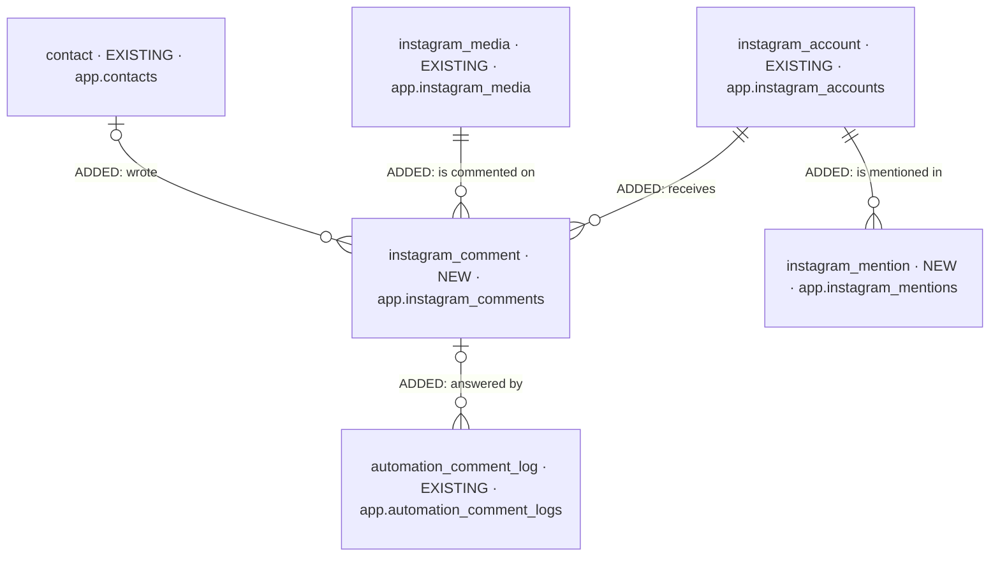
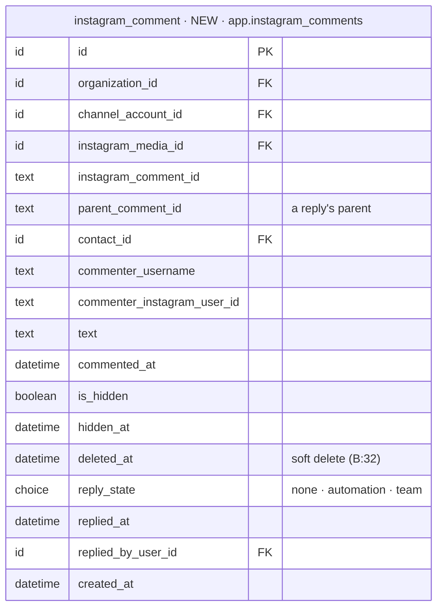
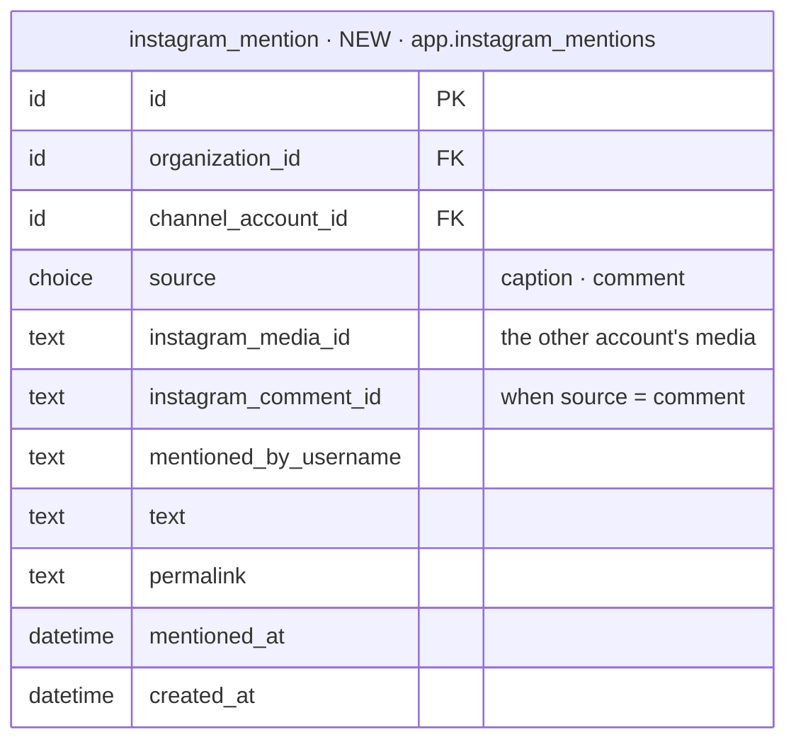

# DB changes — feat-instagram-engage-2026-11-26-suzw

Mode initial · Intake mode brief · 2026-11-26 · logical types only (the physical design is the route review's, Step 5).

## Overview

## Stage 1 — the comment

### instagram_comment

- **Holds** — one row per comment on the account's posts and reels (any automation or none), so the inbox lists them
  in one place; the team's reply, hide and delete state.
- **Table** — `app.instagram_comments` ([E-D5](decisions.md)).
- **Sources** — B:5-8, B:23, B:32-33, B:38, B:42.
- **Added / Replaced** — new; the per-automation comment log stays (E1).
- **Open** — none: every comment ([E-D2](decisions.md)), kept 90 days ([E-D3](decisions.md)).

## Stage 2 — the mention

### instagram_mention

- **Holds** — one row per @mention of the account in someone's caption or comment (B:9).
- **Table** — `app.instagram_mentions` ([E-D5](decisions.md)).
- **Sources** — B:9-10, B:23-24, B:36-37, B:45.
- **Added / Replaced** — new.
- **Open** — Meta's payload under Unified Login (E7, owner test EO1); kept 90 days ([E-D3](decisions.md)); both sources start the `mention` trigger ([E-D4](decisions.md)).

Tagged media (B:11) is read live from Meta — no table.
