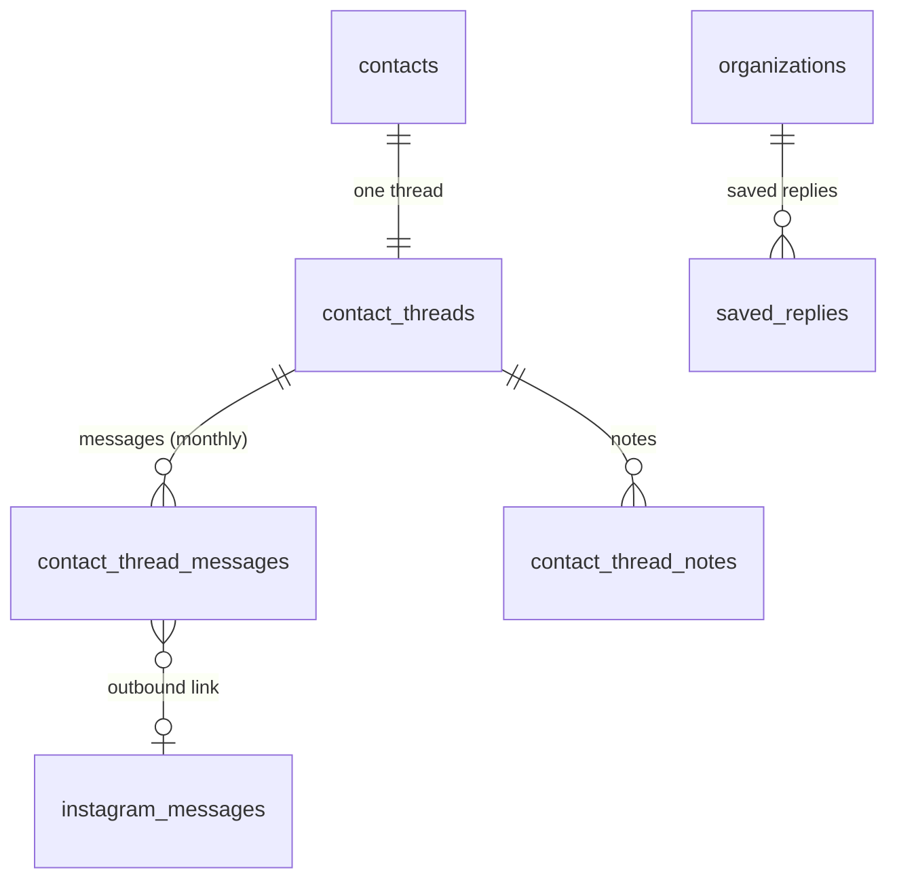

# Database changes — feat-instagram-inbox-2026-11-26-bcar

| Field | Value |
| --- | --- |
| Iteration | `feat-instagram-inbox-2026-11-26-bcar` |
| Mode | initial (Baseline none) |
| Intake mode | brief (from scratch) |
| Intake hash | `1082fd1734e6` |
| Date | 2026-11-26 |
| Stage | Steps 1–3 draft — names and domain pending Q1; retention Q4; team-send source Q8 |

WHAT must be true — logical types only. Proposed names follow "children carry the parent prefix" (pending Q1).

## Stage 1 — NEW tables

| # | Table (proposed) | Holds | Key facts |
| --- | --- | --- | --- |
| DB-1 | `app.contact_threads` | one per contact (1:1): `state` (`open` · `waiting_on_us` · `waiting_on_contact` · `closed`), `assignee` (a membership, or "Instagram app"), `snoozed_until`, `unread_count`, `last_read_at`, `last_message_at`, `last_message_preview`, `first_response_at`, `last_response_at`, `taken_at`, `channel`, Meta `conversation_id` (nullable, backfill only) | narrow, updated often; the 24-hour window is **derived** from `contact_activities` (rule 11), never stored |
| DB-2 | `app.contact_thread_messages` | every message both ways: `direction` (`in` · `out`), `source` (`contact` · `automation` · `broadcast` · `team` · `instagram_app`), `text`, attachments (type + upload ref or Meta URL), `reply_to` (a message), `reaction`, `meta_message_id` (unique per account), `is_edited`, `is_unsent`, `seen_at`, the outbound link (`instagram_message_id`), `sent_at`, `channel` | split by **month** of `sent_at`; keyset by (contact, `sent_at` desc); kept the retention time (Q4) |
| DB-3 | `app.contact_thread_notes` | internal notes on a thread: text, author membership, time | never sent; soft delete by the author |
| DB-4 | `app.saved_replies` | organization-wide saved replies: title, text, created by | the reply box inserts one |

## Stage 2 — CHANGED tables

| # | Table | Before | After |
| --- | --- | --- | --- |
| DB-5 | `app.instagram_messages` | a row is exactly one of an automation run or a broadcast | pending Q8: + a `team` source (a thread message), or unchanged with a team send path of its own |
| DB-6 | partition upkeep (`app.fn_manage_time_partitions`) | its CASE lists today's split tables | + `contact_thread_messages` (monthly) |
