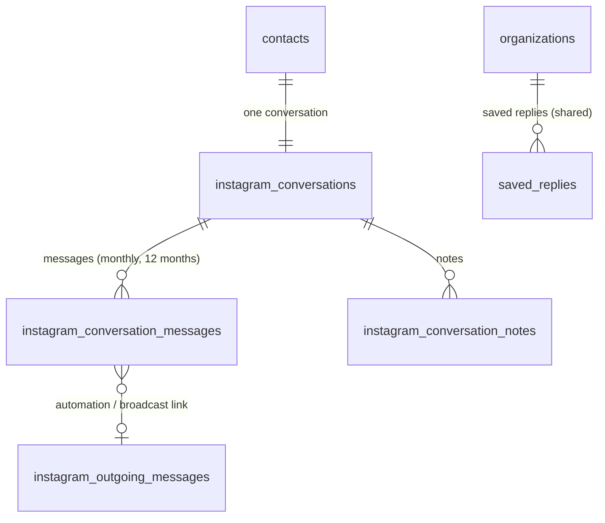

# Database changes — feat-instagram-inbox-2026-11-26-bcar

| Field | Value |
| --- | --- |
| Iteration | `feat-instagram-inbox-2026-11-26-bcar` |
| Mode | initial (Baseline none) |
| Intake mode | brief (from scratch) |
| Intake hash | `1082fd1734e6` |
| Date | 2026-11-26 |
| Stage | Step 5 — matched to `routes-final.md` § 2 (columns there, logical here) |

WHAT must be true — logical types only. Every Instagram table carries the `instagram_` prefix ([I-D1](decisions.md)).

## Stage 1 — NEW tables

| # | Table (proposed) | Holds | Key facts |
| --- | --- | --- | --- |
| DB-1 | `app.instagram_conversations` | one per contact (1:1): `state` (`open` · `waiting_on_us` · `waiting_on_contact` · `closed`), `taken_by` (`team_member` · `instagram_app`) with the holding member, `last_team_message_at` (the 24 h idle release), `snoozed_until`, `unread_count`, `last_read_at`, `last_message_at`, `last_message_preview`, `first_response_at`, `last_response_at`, `taken_at`, Meta `conversation_id` (nullable, backfill only) | narrow, updated often; the 24-hour window is **derived** from `contact_activities` (rule 11), never stored |
| DB-2 | `app.instagram_conversation_messages` | every message both ways: `sender_type` (`contact` · `automation` · `broadcast` · `team_member` · `instagram_app` — [I-D14](decisions.md); `contact` is inbound, the rest outbound) with its link (automation + run, broadcast, member), `kind` (`text` · `image` · `video` · `audio` · `file` · `story_reply` · `story_mention` · `shared_post` · `button_tap` · `reaction` · `referral`), `text`, attachments (type + upload ref or Meta URL), `reply_to` (a message), `reaction`, `meta_message_id` (unique per account), `is_edited`, `is_unsent`, `seen_at`, the automation / broadcast link (`instagram_message_id`), a team reply's send `status` (`sending` · `sent` · `failed`) and failure reason, `sent_by` member, `sent_at` | split by **month** of `sent_at`; keyset by (conversation, `sent_at` desc); kept **12 months** ([I-D5](decisions.md)); `team_member` replies live **only** here ([I-D9](decisions.md)) |
| DB-3 | `app.instagram_conversation_notes` | internal notes on a thread: text, author membership, time | never sent; soft delete by the author |
| DB-4 | `app.saved_replies` | organization-wide saved replies: title, text, created by | shared across channels ([I-D2](decisions.md)); the reply box inserts one |

## Stage 2 — CHANGED tables

| # | Table | Before | After |
| --- | --- | --- | --- |
| DB-5 | `app.instagram_messages` | the paced sender's ledger, named generically | **renamed `app.instagram_outgoing_messages`** ([I-D13](decisions.md)) — its parts, keys, checks, RLS policy, the partition upkeep entry and every reference move with it; behaviour unchanged; team replies do not go through it ([I-D9](decisions.md)) |
| DB-7 | upload purposes (`src/domains/upload/upload.constants.ts`) | `avatar` … `message-media` | + `instagram-inbound-media` for copied DM files, server-only ([I-D7](decisions.md); built R6) |
| DB-8 | `app.instagram_account_settings` | `is_mark_seen_after_reply_enabled` | + `is_mark_seen_on_open_enabled` (routes-final CV8) |
| DB-6 | partition upkeep (`app.fn_manage_time_partitions`) | its CASE lists today's split tables | + `instagram_conversation_messages` (monthly, dropped after 12 months) |
