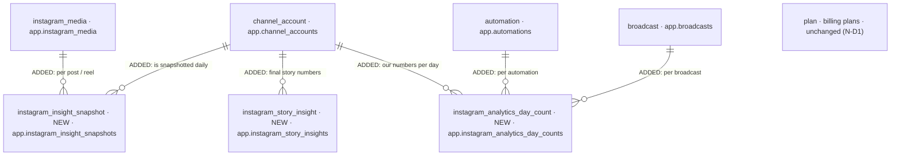
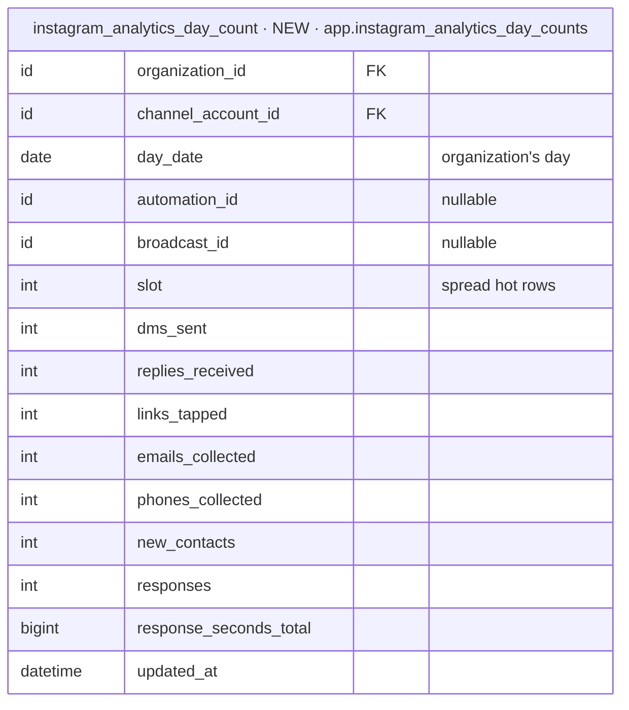
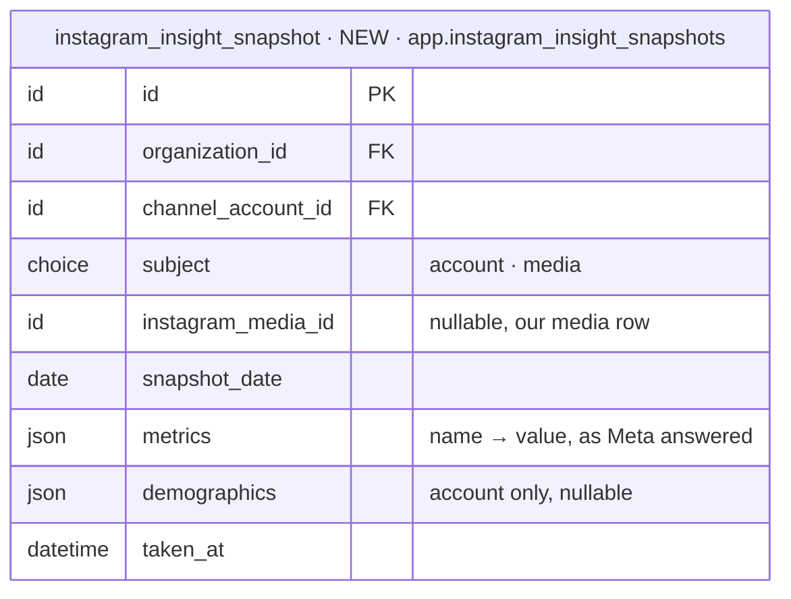
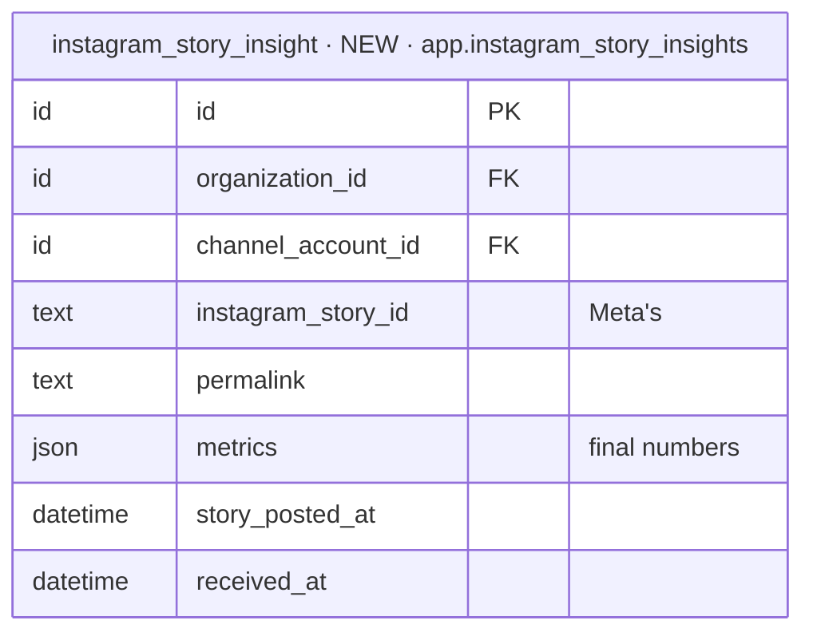

# DB changes — feat-instagram-insights-2026-11-26-cwae

Mode initial · Intake mode brief · 2026-11-27 (staged draft). Every table below is a proposal until the route review
confirms it; names follow the brief (B:23) and [N-D3](decisions.md).

| Change | Count |
| --- | --- |
| NEW | 3 |
| CHANGED | 1 |
| REMOVED | 0 |

## Overview

## Stage 1 — our own numbers

### instagram_analytics_day_count

- **Holds** — per account, day of the organization's time zone, and automation or broadcast (or neither): DMs sent,
  replies received, links tapped, emails and phones collected, new contacts, response count and total response
  seconds (B:5-7).
- **Table** — `app.instagram_analytics_day_counts` (name proposed, [N-D3](decisions.md)).
- **Sources** — B:5-7, B:24, B:33-34.
- **Added / Replaced** — new; raised in the commits that already write the source rows (WC-4), never by a scan.
- **Open** — the history at release ([N-D4](decisions.md)); response times follow the inbox (coverage N4).

## Stage 2 — Meta's numbers

### instagram_insight_snapshot

- **Holds** — one row per account (or per post / reel) per day: the metrics Meta answered that day (B:8-11, B:23).
- **Table** — `app.instagram_insight_snapshots` (the brief's name).
- **Sources** — B:8-11, B:23, B:32, B:36.
- **Added / Replaced** — new; written only by the daily snapshot (WC-1).
- **Open** — which media are snapshotted ([N-D5](decisions.md)); the metric names ⚠️ unverified (NO1); split by month,
  kept 13 months through the shared upkeep.

### instagram_story_insight

- **Holds** — one row per ended story: its final numbers from the `story_insights` webhook, kept after the story is
  gone (B:12-13).
- **Table** — `app.instagram_story_insights` (name proposed).
- **Sources** — B:12-13, B:23.
- **Added / Replaced** — new; written by the story-insight processing (WC-3).
- **Open** — the payload ⚠️ unverified (NO1); kept 13 months.

## Stage 3 — the plan

### plan features (billing)

- **Holds** — the plan switches and limits every plan carries.
- **Change** — **none** ([N-D1](decisions.md): analytics open on every plan, no history limit) — kept as a record.

| Field | Before | After |
| --- | --- | --- |
| plan feature keys | 11 Instagram feature switches (`channel-account-capabilities.constants.ts:16-28`) | unchanged (N-D1: open to all plans) | B:35 |
