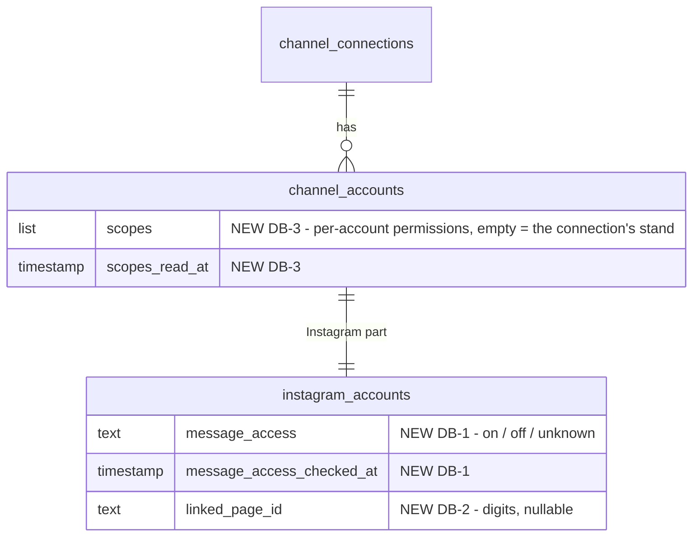

# Database changes — feat-meta-connect-flow-2026-11-26-bqmw

| Field | Value |
| --- | --- |
| Iteration | `feat-meta-connect-flow-2026-11-26-bqmw` |
| Mode | initial (Baseline none) |
| Intake mode | brief (from scratch) |
| Intake hash | `f1ff32a8eb81` |
| Date | 2026-11-26 |
| Stage | Steps 1–3 draft — pending Step 4 (Q3, Q6) |

WHAT must be true, never HOW: logical types only. No new table — three tables gain facts the frontend needs.

## Stage 1 — CHANGED tables

| # | Table | Before | After | Brief |
| --- | --- | --- | --- | --- |
| DB-1 | `app.instagram_accounts` | the "Allow access to messages" probe result is logged only | `message_access` (`on` · `off` · `unknown`, default `unknown`) and `message_access_checked_at` (nullable), written by the set-up probe and by an on-demand re-check | brief:L85 |
| DB-2 | `app.instagram_accounts` | linked Page not read | `linked_page_id` (digits, nullable), written by the profile read — source pending Q6 | brief:L87 |
| DB-3 | `app.channel_accounts` | permissions only on the connection (`scopes`) | `scopes` (list of permission names, nullable — `null` means the connection's scopes stand) and `scopes_read_at`; filled from `/debug_token` `granular_scopes` once owner test O1 passes | brief:L89 |

No change: `app.channel_connections` — a connection left with no account is found by its accounts (none not-revoked) and
its `connected_at`; no new column (pending Q3).
