# Database changes — launch-2026-11-20-ujai

| Field | Value |
| --- | --- |
| Iteration | `launch-2026-11-20-ujai` |
| Mode | initial (Baseline none) |
| Intake mode | full |
| Intake hash | `f91eaeb355eb` |
| Date | 2026-11-20 |

The iteration's data model, kept current at every planning step. WHAT must be true, never HOW: logical
types only, no SQL, no indexes, no constraints. `pnpm db:viewer` draws this file in plan mode.
Updated with the Step 4 answers ([decisions.md](decisions.md), D1–D23; D22 supersedes D6) and the
confirmed route review of sub-domain 1, Instagram account ([D24](decisions.md),
[routes-final.md § 1](routes-final.md)) — the four Stage 1 tables say what its tables 1.A.3, 1.B.3
and 1.C.3 say; its decision ids (IA…) and open-question ids (IQ…) are cited as they are there — and
the confirmed route review of sub-domain 2, Contacts ([D25](decisions.md),
[routes-final.md § 2](routes-final.md)) — `contact` says what its table 2.3 says, and the Stage 3
items its delete answers are closed; its decision ids (CT…) and open-question ids (CQ…) are cited
as they are there — and the confirmed route review of sub-domain 3, Automations ([D26](decisions.md),
[routes-final.md § 3](routes-final.md)) — `automation`, `automation_run`, `automation_run_event`
and `automation_comment_log` say what its tables 3.A.3 and 3.B.3 say; its decision ids (AU…) and
open-question ids (AQ…) are cited as they are there — and the confirmed route review of
sub-domain 4, Instagram webhook ([D28](decisions.md), [routes-final.md § 4](routes-final.md)) —
`instagram_webhook_event` says what its table 4.B.3 says; its decision ids (WH…) and
open-question ids (WQ…) are cited as they are there. **The route review is final**: every table
here matches its sub-domain's table, and the stages follow the route review's build order
(sub-domains 1 → 2 → 3 → 4).

| Change | Count | Entities |
| --- | --- | --- |
| NEW | 10 | instagram_account, instagram_account_setting, instagram_account_token, instagram_media, instagram_webhook_event, contact, automation, automation_run, automation_run_event, automation_comment_log |
| CHANGED | 0 | — |
| EXISTING | 2 | organization, user (context only) |
| REMOVED | 0 | — |

**Where the tables live.** All 10 tables live in the `app` domain — the Postgres schema `app`, as
the drop says (`schema-routes.md:682`) — with the drop's plural snake_case names
([D1](decisions.md)). Every label below carries its `app.<table>`; routes sit under `/api/v1/app/…`.

**Scope notes from Step 4:**

- The launch starts empty: nothing is imported from the legacy system ([D7](decisions.md)).
- No live updates: screens show new data on refresh, so no table needs a change feed
  ([D11](decisions.md)).
- No plan limits: nothing counts automations or contacts for billing ([D12](decisions.md)).

**Rules every table follows** (from the drop; its "workspace" is our organization):

- Every row belongs to one organization and goes away with it (`schema-routes.md:684`). The drop's
  one exception — a webhook event for an unknown account (`schema-routes.md:814`) — is gone: such
  events are not stored (WQ1, WH4, [D28](decisions.md)).
- A child row can never point at another organization's row (`schema-routes.md:685`).
- A session sees and writes only the rows of its active organization (`schema-routes.md:686`).
- Every table has `created_at` and `updated_at` (`schema-routes.md:687`).
- A reference to a person who leaves is emptied, the row stays (`schema-routes.md:688`).
- Only automations are soft-deleted, with a reason and a note (`schema-routes.md:689`, `:704`).
- Instagram and Meta ids are digit strings, so they are `text` (`schema-routes.md:170`).
- How long each table keeps its rows is set by [D8](decisions.md); each table's **Holds** says it.

## Overview

The drop's own tree is at `schema-routes.md:710-718`.

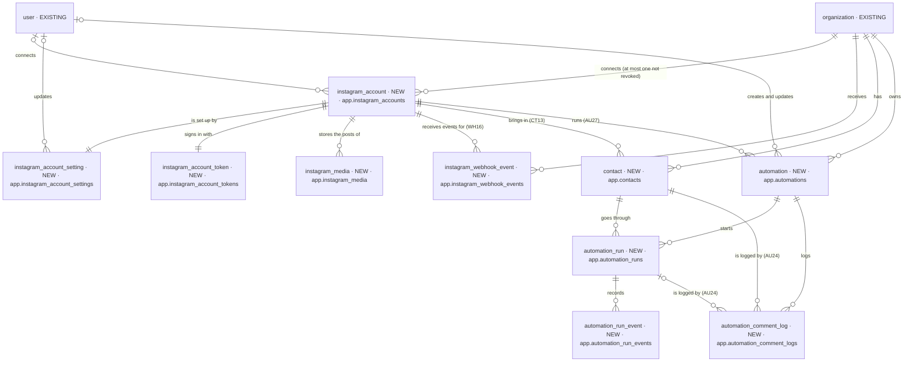

## Reference data (no new tables)

New rows in existing tenancy tables (`tenancy.permissions`, `tenancy.roles`,
`tenancy.role_permissions`), not new tables — so the DB Viewer draws nothing for them.

| Permission code | Owner | Admin | Member |
| --- | --- | --- | --- |
| `instagram-account:read` | yes | yes | yes |
| `instagram-account:manage` | yes | yes | — |
| `instagram-webhook-event:read` | yes | yes | — |
| `automation:read` | yes | yes | yes |
| `automation:create` | yes | yes | yes |
| `automation:update` | yes | yes | yes |
| `automation:delete` | yes | yes | — |
| `contact:read` | yes | yes | yes |
| `contact:delete` | yes | yes | — |

- Nine new permission codes, in kebab-case ([D20](decisions.md)). Instagram webhook events get their
  own code; `webhook:read` stays notify's only ([D4](decisions.md)).
- `contact:delete` is not in the drop: it lets a team delete one contact ([D22](decisions.md)), held
  by Owner and Admin, not Member — the same split as `automation:delete` ([D23](decisions.md)).
- Owner and Admin hold every new code ([D2](decisions.md)).
- **Member** is a new default role, locked like Admin: it cannot be edited or deleted. It holds the
  drop's Member grants — view Instagram content, view / create / edit automations, view contacts
  ([D2](decisions.md), [D3](decisions.md)) — plus the existing view-organization code ([D31](decisions.md)).
- Every team organization gets the Member role and the new grants, the ones that exist today
  included ([D3](decisions.md)).

## Existing context

Context only — nothing changes in these tables. Every new table points at `organization`; some point
at `user`.

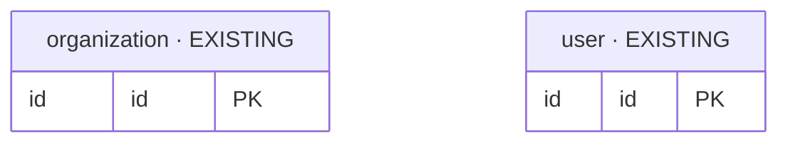

## Stage 1 — Instagram account

The connected account comes first: everything else hangs off an organization that has one. These
four tables are sub-domain 1 of the route review, confirmed ([routes-final.md § 1](routes-final.md),
[D24](decisions.md)) and built together. The stored posts moved here from the received-content
stage: they now belong to the account (IA17).

### instagram_account

- **Holds:** the Instagram professional account an organization connected — its two Instagram ids,
  its profile (name, picture, bio, counts), the scopes it granted, whether the connection still
  works, when its token ends and whether it gets webhook events. One row per organization and
  Instagram account: connecting the same account again reuses its row, a revoked one included, so
  its settings come back (IA11). At most one row per organization that is not revoked
  ([D5](decisions.md)), and one not-revoked row per Instagram account across all organizations. No
  soft delete: the connection status stands in; revoked rows stay until the organization is deleted
  ([D8](decisions.md)). Public id prefix `iga`. Goes away with its organization.
- **Table:** `app.instagram_accounts` ([D1](decisions.md))
- **Sources:** `schema-routes.md:720-742` (columns), `:699` (one per organization), `:160` (prefix),
  `:208-227` (the account object), `:453-456` (connect: new, reconnect, conflicts), `:1006`
  (statuses); `routes-final.md` § 1.A (IA11–IA14, the table at 1.A.3), § 1.D (IA19, IA20), IA5,
  IA6, IA8, IA9.
- **Added:**
  - One account per organization **that is not revoked** ([D5](decisions.md)). A disconnect sets
    `connection_status` to `revoked` and frees the organization to connect another account. The
    drop kept one account per organization for every status (`schema-routes.md:741`), so an
    organization could never switch accounts.
  - Meta's deauthorize request (the owner removed the app on Instagram) disconnects the account the
    same way ([D22](decisions.md), [D5](decisions.md); IA19).
  - Meta's data-deletion request names the person who logged in to the app — this account's owner,
    never a commenter. It disconnects the account the same way and erases its token, its profile
    (username, name, picture, follower, following and post counts, bio, website, scopes) and its
    stored posts, inside Meta's request ([D22](decisions.md); IA20, IQ4, [D24](decisions.md)).
    Both Meta requests find the account by its app-scoped id `instagram_app_user_id`, in every
    organization that has it, any status (IQ3, D24).
  - Five fields the drop does not have (IA11, [D24](decisions.md)):
    - `token_expires_at` — a copy of the token's end, saved together with the token, so reading
      the account and the daily account check never read the token (IA5). Empty once revoked.
    - `connection_status_changed_at` — set at every status change, so each break of the connection
      gets one reconnect notice (IA9).
    - `webhook_subscribed_at` — set when the webhook subscription succeeded. Empty means no events
      arrive: the daily account check tries again (IA8, IA12), and reading the account shows it as
      `is_webhook_subscribed` (IA13). Empty once revoked.
    - `disconnected_at` — set exactly while the account is revoked (IA14).
    - `profile_erased_at` — when Meta's data-deletion request erased the profile; only on a
      revoked row (IA20).
  - The status changes only by actions (IA9, IA11, [D24](decisions.md)): `connected` to `expired`
    or `error` in one guarded change (a token error, or a renewal Instagram refuses); `expired` or
    `error` back to `connected` by connecting again; any status to `revoked` by a disconnect or one
    of Meta's two requests; `revoked` to `connected` only by connecting the same Instagram account
    in the same organization again.
  - Every disconnect — the team's, Meta's deauthorize request or Meta's data-deletion request —
    erases the token and empties `token_expires_at` and `webhook_subscribed_at`; the settings stay,
    and the profile stays unless Meta's data-deletion request erased it (IA14, IA19, IA20). A
    disconnect cancels no run (IQ1, your call, [D24](decisions.md)): automations stay `live`;
    nothing runs while no account is connected; a waiting run goes on when the same account
    reconnects, else the 7-day limit ([D8](decisions.md)) cancels it.
- **Replaced:**
  - Which rows may exist: one per organization, any status (`schema-routes.md:741`) → one row per
    organization and Instagram account; at most one not revoked per organization
    ([D5](decisions.md)) and per Instagram account (IA11, [D24](decisions.md)).
  - `username`: always required (`schema-routes.md:729`) → required unless the account is
    revoked; empty only once Meta's data-deletion request erased the profile (IA11, IA20,
    [D24](decisions.md)).
  - `website`: capped at 500 characters (`schema-routes.md:732`) → no cap; it is Instagram's link,
    not ours to bound (1.A.3, [D24](decisions.md)).
  - `scopes`: no limit (`schema-routes.md:735`) → at most 20 (1.A.3, [D24](decisions.md)).
- **Open:**
  - ~~(Step 5) Does Meta's data-deletion request need a record of each request (a small new
    table)?~~ — answered: no table and no status route. The erase is done inside Meta's request,
    the audit entry is the record, and a frontend page shows the confirmation code (IQ2, IA20,
    [D24](decisions.md)).
  - ~~(Step 5) Which of this account's ids does Meta's request name?~~ — answered: the app-scoped
    id, `instagram_app_user_id` (IQ3, [D24](decisions.md)); checked with a test account before
    Meta's two routes ship.
  - ~~(kickoff, [D21](decisions.md)) One Instagram account is never in two organizations at once,
    revoked ones aside — a lookup across organizations~~ — answered in the route review: a narrow
    lookup returns only the other organization's public id, never its rows; all work then runs in
    one organization's own scope; a race is settled by the "one not revoked" rules (IA6,
    [D24](decisions.md)). Kickoff builds it.
  - ~~(kickoff, [D21](decisions.md)) The webhook finds the organization by the Instagram user id
    before any organization is known~~ — answered: the same narrow lookup, for not-revoked accounts
    (IA6, [D24](decisions.md)); sub-domain 4 uses it.
  - ~~Nothing sets `revoked`~~ — answered: a disconnect, Meta's deauthorize request and Meta's
    data-deletion request set it ([D5](decisions.md), [D22](decisions.md)).

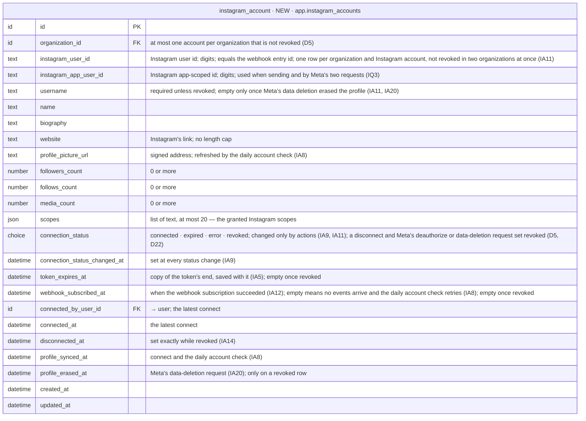

### instagram_account_setting

- **Holds:** the account's automation master switch and its public reply safety (chance, hourly
  limit, random gap) that event processing reads before it acts. One per account. Created with the
  defaults at the first connect; a disconnect keeps it and a reconnect of the same account brings it
  back (IA11, IA14). No public id. Goes away with its account.
- **Table:** `app.instagram_account_settings` ([D1](decisions.md))
- **Sources:** `schema-routes.md:744-762` (columns and defaults), `:700` (one per account), `:168`
  (no public id), `:198-206` (the settings object), `PRD.md:155-166` (reply safety rules);
  `routes-final.md` § 1.B (IA15, the table at 1.B.3).
- **Added:**
  - A route now changes these settings — the automation switch and public reply safety, with
    `instagram-account:manage` ([D5](decisions.md); IA15, [D24](decisions.md)). The drop had no
    such route (`schema-routes.md:198-206`), so `updated_by_user_id` now has a writer, and the
    settings object returns it.
  - A change also works while the account is `expired` or `error`, so the switch can be turned off
    while the team reconnects; a change made over a newer one is refused (IA15).
- **Replaced:** none — the columns, defaults and limits are the drop's (1.B.3).
- **Open:** none.

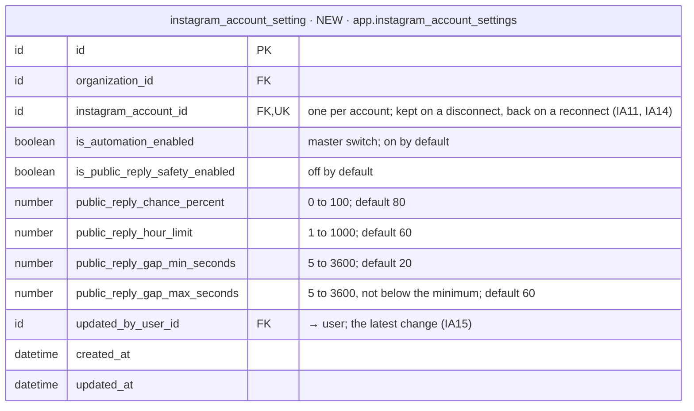

### instagram_account_token

- **Holds:** the account's long-lived Instagram access token, stored encrypted, with its expiry
  (about 60 days) and the result of the last renewal. One per account; renewed by the daily account
  check before it expires (IA8). Never returned by any route, and read only on the Instagram
  client's path (IA5). Erased on every disconnect (IA14). No public id. Goes away with its account.
- **Table:** `app.instagram_account_tokens` ([D1](decisions.md))
- **Sources:** `schema-routes.md:764-780` (columns), `:766` (never returned; only the Instagram
  client reads it), `:701` (renewed before it expires), `:168` (no public id), `:1007` (token type),
  `PRD.md:153`; `routes-final.md` § 1.A (the table at 1.A.3), IA5, IA8, IA14.
- **Added:**
  - Every disconnect erases the token — the team's ([D5](decisions.md)), Meta's deauthorize request
    and Meta's data-deletion request ([D22](decisions.md)) — because a revoked account has no use
    for it and a reconnect brings a new one (IA14, IA19, IA20, [D24](decisions.md)).
  - Only the Instagram client reads the token (IA5, [D24](decisions.md)): it is stored only
    encrypted; the plain token exists only inside the Instagram client; only the token's own service
    and the daily account check use this table; no clean-up across organizations reads it.
  - Its end is copied onto the account (`token_expires_at`) in the same change, so reading the
    account and the daily account check never read this table (IA5).
  - A renewal never overwrites a newer token that a reconnect saved in the meantime (IA8).
- **Replaced:**
  - `access_token_ciphertext` (`schema-routes.md:773`) → `encrypted_access_token`, the repository's
    name for an encrypted secret (IA5, [D24](decisions.md)).
  - `last_refresh_error`: no limit (`schema-routes.md:777`) → at most 500 characters, Instagram's
    code and message, never the token (1.A.3, [D24](decisions.md)).
- **Open:**
  - ~~(kickoff, [D21](decisions.md)) The token must be readable only by the Instagram client~~ —
    answered in the route review (IA5, [D24](decisions.md)), as **Added** says; kickoff may add a
    database-side guard on top.
  - ~~(kickoff, [D21](decisions.md)) Copy the expiry onto the account, or let the session read only
    that one value?~~ — answered: copied onto the account as `token_expires_at` (IA5,
    [D24](decisions.md)).
  - ~~(Step 5) Is the token erased on every disconnect, not only on Meta's data-deletion request?~~
    — answered: yes (IA14, [D24](decisions.md)).

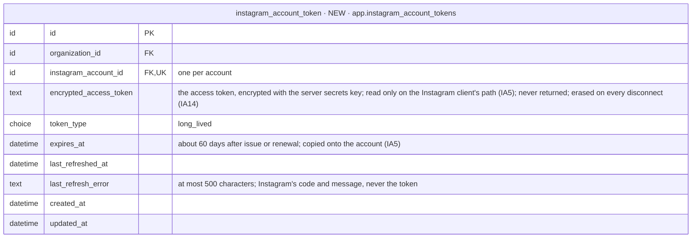

### instagram_media

- **Holds:** a post or reel an automation ran on, with the full Instagram object, belonging to the
  connected account that published it (IA17). Stored when a comment arrives on a post not stored
  yet, and when a next-post automation links to a post — always through the account's media
  service, never by another sub-domain directly (IA17). The post and story pickers read Instagram
  live and store nothing here. One row per organization and Instagram media id. No public id: it is
  addressed by its Instagram media id. Kept until its organization is deleted ([D8](decisions.md))
  or Meta's data-deletion request erases the account's stored posts (IQ4, IA20,
  [D24](decisions.md)). Goes away with its account.
- **Table:** `app.instagram_media` ([D1](decisions.md)) — the label names the table, so the DB
  Viewer draws `instagram_media`, not `instagram_medias`.
- **Sources:** `schema-routes.md:782-804` (columns; one per organization and media id at `:804`),
  `:702`, `:784` (when it is stored), `:475` (the picker stores nothing), `:168` (no public id),
  `:1008-1009` (media types), `:536` (comment handling), `PRD.md:90-92`; `routes-final.md` § 1.C
  (IA16, IA17, the table at 1.C.3), IA20.
- **Added:**
  - `instagram_account_id` — the account that published the post (IA17, [D24](decisions.md)), so
    Meta's data-deletion request can erase that account's posts and a second account's posts never
    mix with the first's. The drop keyed posts by organization only.
  - Meta's data-deletion request erases the account's stored posts, those of its revoked rows
    included — they are the owner's content from Meta (IQ4, IA20, [D24](decisions.md)).
- **Replaced:**
  - `owner_username` (`schema-routes.md:797`) → removed: it is the account's own username, one less
    copy to erase (IA17, [D24](decisions.md)).
- **Open:**
  - ~~Automations, runs and comment logs name a post by its Instagram media id, not by a reference
    to this table (`schema-routes.md:839`, `:923`, `:964`). Keep it that way?~~ — answered: keep
    it — they outlive an erased post (IA17, [D24](decisions.md)).
  - ~~(Step 5) Does Meta's data-deletion request erase the stored posts too?~~ — answered: yes
    (IQ4, [D24](decisions.md)).
  - ~~The plural is drawn as `instagram_medias`~~ — answered: the label names `app.instagram_media`
    ([D1](decisions.md)).
  - ~~How long is a stored post kept?~~ — answered ([D8](decisions.md); IQ4 adds Meta's
    data-deletion request).

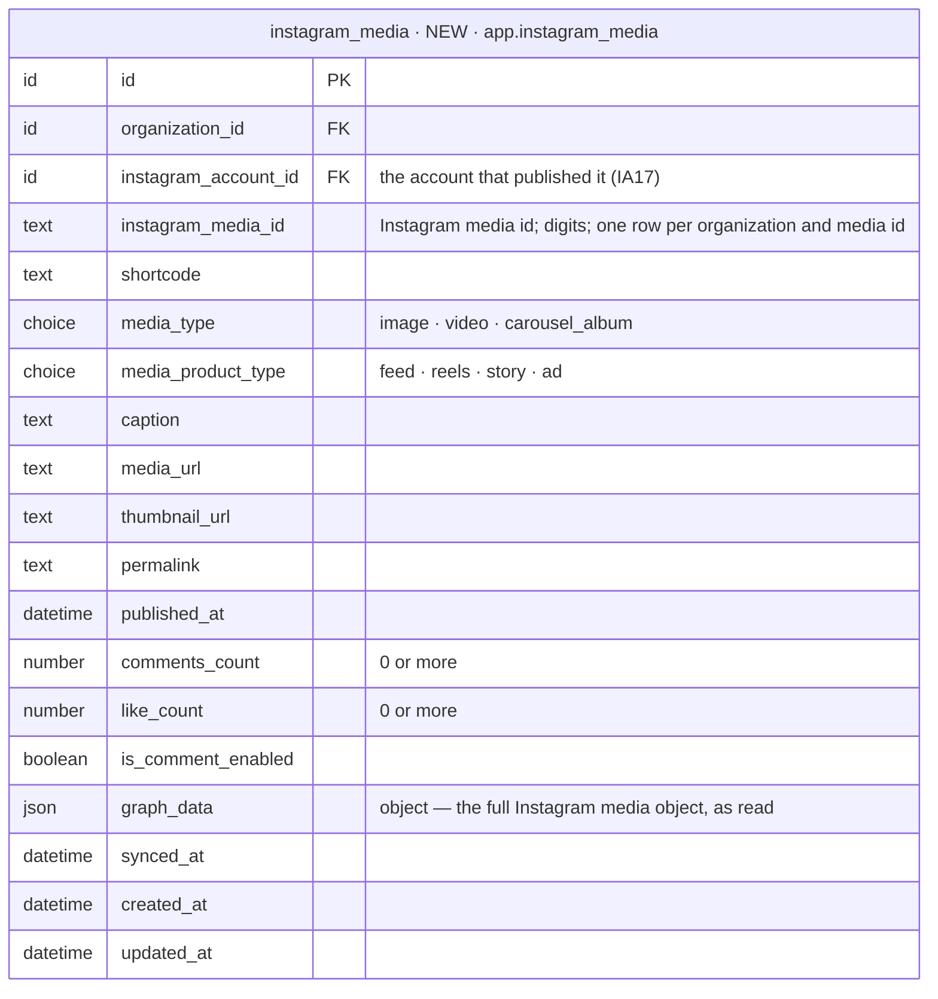

## Stage 2 — Audience and automations

The people who interact, and the automations an organization builds. Runs need both. A contact
also points at the Instagram account it came from (Stage 1, CT13), and an automation at the
Instagram account it belongs to (AU27), so this stage still follows Stage 1.

### contact

- **Holds:** an Instagram user who interacted with one of the organization's Instagram accounts —
  commented, sent a DM, replied to a story or clicked a button — with their profile details, whether
  they follow the account, the email and phone they shared, tags, and message times. Each contact
  belongs to the Instagram account it came from: one live contact per organization, Instagram account
  and Instagram user (CT13; CQ5, your call, [D25](decisions.md)). The last sent time and the last
  direct message time drive the 24-hour opening-DM rule. Only event processing creates and updates
  contacts (CT2); no route adds or edits one, and one route deletes one ([D22](decisions.md)).
  Public id prefix `con`. Kept until the organization is deleted or the team deletes the contact
  ([D8](decisions.md), [D22](decisions.md)); a deleted contact keeps its row, empty of personal data,
  while its runs point at it — no clean-up timer removes it (CT7, CT11, [D25](decisions.md)).
- **Table:** `app.contacts` ([D1](decisions.md))
- **Sources:** `schema-routes.md:888-911` (columns; one per organization and Instagram user at
  `:910`), `:705`, `:163` (prefix), `:384-402` (the contact object), `:646` (no route edits it),
  `:557` (tags added on completion), `PRD.md:131` (24-hour rule); `routes-final.md` § 2 (CT1–CT13,
  CQ1–CQ5, the table at 2.3), [D25](decisions.md).
- **Added:**
  - `instagram_account_id` — the Instagram account the contact came from (CT13; CQ5, your call,
    [D25](decisions.md)). Instagram gives one person a different id per professional account, so a
    contact is kept per account. Reconnecting the same account keeps its contacts (the same account
    row, IA11); another account starts its own. The contacts list filters by it
    (`route-changes.md` RC-12). The drop kept one contact per organization and Instagram user.
  - A team deletes one contact to honour that person's own request (`route-changes.md` RC-18,
    `contact:delete`, [D22](decisions.md), [D23](decisions.md)). The delete **wipes the personal data
    and keeps the row** (CT7, [D25](decisions.md)): `deleted_at` is set, and the Instagram user id,
    username, name, picture, follower count, follow status and its time, email and phone with their
    times, and tags are all emptied — so its runs stay, without personal data. No restore. A deleted
    contact is never listed, and every route on it answers not found; a new event from the same
    person starts a fresh contact (CT9).
  - The delete reaches every copy, in the same request and all-or-nothing (CT8,
    [D25](decisions.md)): sub-domain 3's erase step cancels the contact's open runs, empties the
    comment text saved on its runs and erases the comment-log copies (comment text, commenter id and
    username, email and phone received), found by `contact_id`. The person's webhook events are not
    erased: they expire after 30 days ([D8](decisions.md)), their payload masked in the list (CQ1,
    your call, [D25](decisions.md)).
  - `deleted_at` — when the team deleted the contact (CT7).
  - `follow_checked_at` — when the follow status was last checked; set exactly when
    `is_following_account` is, so an empty status means "never checked" (CT10).
  - `last_direct_message_received_at` — the time of the contact's latest DM, story reply or button
    click, the events that open Instagram's 24-hour messaging window; a comment never sets it.
    Sub-domain 3's opening-DM rule reads it (CT10, [D25](decisions.md)).
  - The name, picture and follower count come from reading the person's Instagram profile when the
    contact is new and at each follow check; a failed read saves the contact without them (CQ3,
    [D25](decisions.md)). The webhook carries only a commenter's username (`schema-routes.md:896`).
  - Meta's data-deletion request does not touch contacts: it names the connected account's owner,
    never a commenter ([D22](decisions.md), CT9).
- **Replaced:**
  - Which rows may exist: one per organization and Instagram user (`schema-routes.md:910`) → one
    live contact per organization, Instagram account and Instagram user; a deleted contact never
    blocks a fresh one for the same person (CT13, CT9, [D25](decisions.md)).
  - `instagram_user_id`: always required (`schema-routes.md:895`) → set while the contact is live,
    emptied when the team deletes it (CT7, [D25](decisions.md)).
  - `last_message_received_at`: could be empty (`schema-routes.md:907`) → always set — the time of
    the latest comment, DM, story reply or button click (a contact is only ever born from one),
    never moved back (CT10, [D25](decisions.md)).
  - `first_seen_at`: the time the row was saved (`schema-routes.md:906`) → the first event's own
    time (CT10).
  - `phone`: `+` and 10–15 digits (`schema-routes.md:903`) → an optional `+` and 10–15 digits, from
    any country, stored with spaces, dashes, dots and brackets removed (CT10).
  - `tags`: at most 50 (`schema-routes.md:911`) → at most 50, each 1–255 characters, a comma turned
    into a space; past 50 a new tag is dropped and the run still completes (CT10).
- **Open:**
  - ~~(Step 5) Comment logs copy the person's data for 180 days — commenter username, comment text,
    email received, phone received — and runs keep their history. What happens to them when the team
    deletes the contact?~~ — answered (CT7, CT8, [D25](decisions.md)): the row and its runs stay,
    without personal data; in the same request the comment-log copies are erased and the comment
    text saved on its runs is emptied — see **Added**, `automation_run` and
    `automation_comment_log`.
  - ~~Erase the person's webhook events too when the team deletes the contact?~~ — answered: no
    (CQ1, your call, [D25](decisions.md)); they expire after 30 days ([D8](decisions.md)), their
    payload masked in the list.
  - ~~One contact per organization, or per Instagram account?~~ — answered: per account (CQ5, your
    call, CT13, [D25](decisions.md)).
  - ~~Meta's request names a contact by an id~~ — answered: it names the connected account's owner,
    never a contact ([D22](decisions.md)); see `instagram_account`.
  - ~~Exporting a contact's data on request~~ — answered: not at launch (CQ4,
    [D25](decisions.md)); the contacts list shows everything stored about a person.
  - ~~How long is a contact kept?~~ — answered ([D8](decisions.md)); a deleted contact's row, empty
    of personal data, stays while runs point at it (CT11, [D25](decisions.md)).

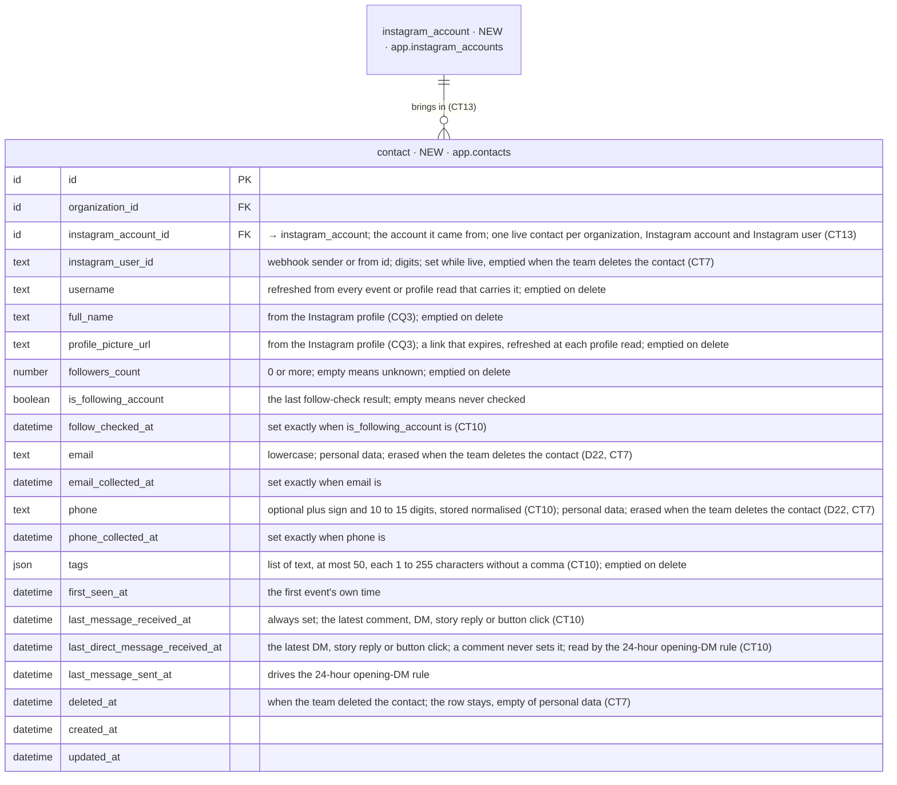

### automation

- **Holds:** an automation an organization builds for its Instagram account — its trigger (comment,
  story reply, DM), what it targets (any post, a specific post or story, or the next post inside a
  time window), keywords, tags, public reply texts, the message of each step (opening, follow
  request, email, phone, final), and its counters. Each automation belongs to the Instagram account
  that was connected when it was created, and answers only that account's events (AU27,
  [D26](decisions.md)). A comment is answered by one automation only (AQ1, your rule,
  [D26](decisions.md); see `automation_comment_log`). Soft-deleted with a reason; deleting it
  cancels its open runs, and its runs and comment logs stay; removed 180 days after its delete once
  nothing points at it (AQ7, [D26](decisions.md)). Public id prefix `aut`.
- **Table:** `app.automations` ([D1](decisions.md))
- **Sources:** `schema-routes.md:828-886` (columns and rules), `:704` (soft delete), `:162` (prefix),
  `:289-365` (the automation object and message shapes), `:598-614` (create rules), `:624-640` (edit
  and delete), `:1013-1017` (allowed values), `:1036-1042` (message shapes); `routes-final.md` § 3
  (AU7–AU15, AU27, AQ2, AQ4, AQ6, AQ7, AQ9, the table at 3.A.3), [D26](decisions.md).
- **Added:**
  - `instagram_account_id` — the Instagram account the automation belongs to (AU27,
    [D26](decisions.md)), as contacts are kept per account (CT13). The server sets it when the
    automation is created, from the organization's connected (not disconnected) account; creating
    one needs a connected account; an edit never changes it. Another account's automations never
    run; an automation of a disconnected account never runs, and its open runs wait for that account
    to reconnect or for the 7-day limit (IQ1, [D24](decisions.md)). The "next post" overlap check,
    "next post" linking and the matching of every event look at one account only. The automations
    list filters by it (`route-changes.md` RC-7). The drop kept automations organization-wide
    (`schema-routes.md:828-860`).
  - A `comment` automation whose opening message is on must give that message a button title (AQ2,
    [D26](decisions.md)): the opening message is then the private reply to the comment, and without
    a button the person has nothing to answer, so the next message would be refused.
  - A deleted automation is removed 180 days after its delete, once no run or comment log points at
    it any more; one still pointed at is tried again the next day (AQ7, [D26](decisions.md);
    `worker-changes.md` WC-15). The audit log keeps the delete.
- **Replaced:**
  - The final message is always required ([D19](decisions.md)). The drop's column and response
    could be empty (`schema-routes.md:857`, `:358`) though create required it (`:317`, `:606`).
  - Complete only when live (`schema-routes.md:628`) → every saved automation is complete, whatever
    its status: a step that is on has its message (AU8).
  - `is_dm_keyword_trigger_enabled`: could be off on any automation (`schema-routes.md:844`) → always
    on for a `dm` automation, which could otherwise never run (AU8).
  - The delete reason: optional, default `not_needed` (`schema-routes.md:321`, `:638`) → the team
    always picks it — `mistake`, `duplicate`, `not_needed` or `other`, with a note for `other` (AQ6,
    [D26](decisions.md)).
- **Open:**
  - ~~A soft-deleted automation is never removed, because runs and comment logs keep pointing at it
    (`schema-routes.md:640`, `:960`). Keep it forever, or remove it once its last run and log are
    gone?~~ — answered: removed 180 days after its delete, once nothing points at it (AQ7,
    [D26](decisions.md)), as **Added** says.
  - ~~One set of automations per organization, or per Instagram account?~~ — answered: per account
    (AU27, [D26](decisions.md)).

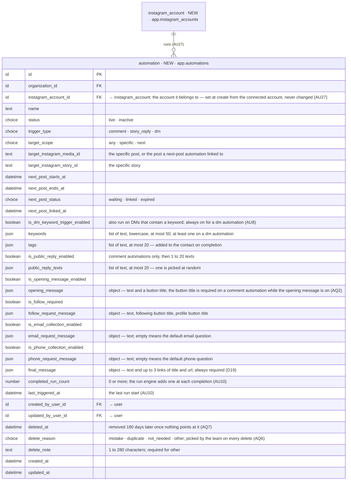

## Stage 3 — Runs and logs

What happens when an automation runs for a contact: the run, its history, and the per-comment log.

### automation_run

- **Holds:** one automation flow for one contact — what triggered it, its status, the current step,
  what it waits for, and the automations queued to start after the email arrives. One open run per
  automation and contact. Public id prefix `run`, used in DM button payloads. A run waits at most 7
  days, then it is cancelled. Kept 180 days after it ends (completed, failed or cancelled), with its
  run events ([D8](decisions.md)). A run belongs to its automation's Instagram account (AU27): only
  that account's events start or move it; a disconnect cancels none (IQ1, [D24](decisions.md)).
- **Table:** `app.automation_runs` ([D1](decisions.md))
- **Sources:** `schema-routes.md:913-934` (columns), `:706`, `:164` (prefix), `:425` (button payload),
  `:545` (one open run), `:553-557` (steps and waits), `:1018-1020` (allowed values),
  `:1043` (the `queued_automations` shape), `PRD.md:122-144`; `routes-final.md` § 3 (AU16–AU21,
  AU25, AU26, AQ3, AQ5, the table at 3.B.3), [D26](decisions.md).
- **Added:**
  - `last_instagram_event_key` — the key of the Instagram event that last moved the run, so a retry
    of that event goes on from the saved step instead of applying it twice (AU19).
  - `sending_message_kind` and `sending_started_at` — which message is being sent and since when,
    set before every send and cleared once its result is saved (AU19). A message is sent at most
    once: when a send's outcome is unknown (a timeout after it left, a crash), the step fails and
    nothing is sent again (AQ5, [D26](decisions.md)). Kinds: public reply, opening message, follow
    request, email question, wrong-email message, phone question, final message.
  - `cancel_reason` — why a run was cancelled: its automation was deleted, it waited more than 7
    days, or its contact was deleted (AU25, AU26). A disconnect cancels nothing (IQ1,
    [D24](decisions.md)), so there is no disconnect reason.
  - `ended_at` — worked out from the completed, failed or cancelled time; the 180-day clean-up
    counts from it ([D8](decisions.md), AU25).
  - `queued_automations` holds at most 100 entries, one per automation, named by public ids (AU21);
    when the email arrives each starts as its own run, in order, unless that automation is no longer
    live, was deleted or already has a run for the contact; a run cancelled for any reason starts
    none of them (AU21, AU25).
  - The opening message is sent on every trigger — a private reply to a comment, a normal DM after
    a DM or a story reply — so a DM or story-reply run may also wait for its button (AQ3,
    [D26](decisions.md)).
  - A failed DM or story-reply run keeps its error even when its step rolls back
    ([D16](decisions.md)); these runs have no comment log (`schema-routes.md:953`).
  - When the team deletes the run's contact ([D22](decisions.md)), the run and its history stay,
    without personal data, inside the delete's own request (CT7, CT8, [D25](decisions.md)): the
    contact's open (`running` or `waiting`) runs are cancelled, each with one status change in its
    history, and their queued automations emptied (they hold trigger text); `trigger_text` is emptied
    on all the contact's runs. Sub-domain 3's erase step does it.
- **Replaced:** none.
- **Open:**
  - ~~(Step 5) When the team deletes a contact ([D22](decisions.md)), what happens to its runs and
    their history?~~ — answered (CT7, CT8, [D25](decisions.md)): they stay, without personal data,
    as **Added** says.
  - ~~How long is a run kept?~~ — answered ([D8](decisions.md)).
  - ~~Align the run and comment-log step lists?~~ — answered: the step lists stay apart, they carry
    different detail; the button wait has one name, `opening_message_button`
    ([D19](decisions.md)).

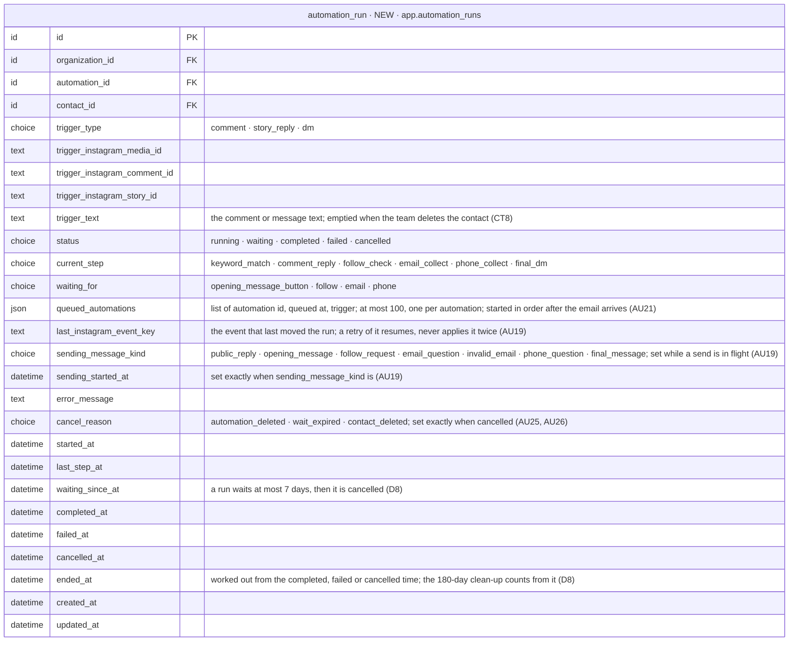

### automation_run_event

- **Holds:** the append-only history of a run — each status change, and each email or phone the run
  collected — written together with the run change. No public id. Goes away with its run: kept 180
  days after the run ends ([D8](decisions.md)).
- **Table:** `app.automation_run_events` ([D1](decisions.md))
- **Sources:** `schema-routes.md:936-949` (columns), `:707`, `:938` (append-only), `:558` (when rows
  are written), `:640` (cancel on delete), `:168` (no public id), `:1021` (event types);
  `routes-final.md` § 3 (AU23, the table at 3.B.3), [D26](decisions.md).
- **Added:** none.
- **Replaced:**
  - `occurred_at` → `created_at` — when it happened, under the repository's name for a row's time;
    still append-only, so no `updated_at` (AU23).
- **Open:**
  - ~~An `email_received` or `phone_received` row says a value arrived but does not hold it; the value
    lives on the contact. Confirm.~~ — confirmed (AU23, [D26](decisions.md)): the value lives on the
    contact only.
  - ~~How long is a run event kept?~~ — answered ([D8](decisions.md)).

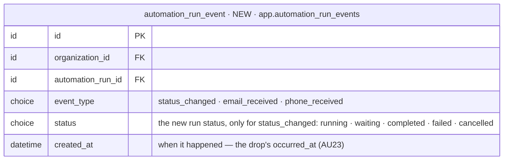

### automation_comment_log

- **Holds:** the step-by-step result of one comment × automation pair (comment triggers only, ignored
  comments included) — each step's status and time, what the contact sent back, why the comment was
  ignored, and the Instagram error details when a step fails. **One automation answers a comment**
  (AQ1, your rule, [D26](decisions.md)): of the commented post's Instagram account's live comment
  automations whose keywords match, the ones linked to that post (a specific one, or a linked "next
  post") come first and the oldest of them runs; only when none of them matches does the oldest
  matching "any post" automation run. Every other matching automation gets a log here marked
  `ignored` · `comment_already_answered` — never `failed`; automations of other posts and other
  accounts get none. Written in the same short transactions as the run, each failure in its own,
  so a failed step still leaves its log, and it references the run and the contact (AU19, AU24).
  One log per comment and automation. Public id prefix `acl`. Kept 180 days, as the drop says
  ([D8](decisions.md)).
- **Table:** `app.automation_comment_logs` ([D1](decisions.md))
- **Sources:** `schema-routes.md:951-998` (columns; no reference and 180 days at `:953`), `:708`,
  `:165` (prefix), `:536` (every matching comment automation runs), `:560-567` (ignored reasons),
  `:571` (error details), `:1022-1028` (allowed values), `PRD.md:144`; `routes-final.md` § 3 (AU16,
  AU17, AU20, AU24, AU26, AQ1, the table at 3.B.3), [D26](decisions.md).
- **Added:**
  - `ignored_reason` gains `comment_already_answered` — another automation answers this comment
    (AQ1, your rule, [D26](decisions.md); AU16).
  - `overall_status` gains `cancelled` — the log of a run cancelled by an automation delete, a 7-day
    wait or a contact delete (AU24).
  - `public_reply_skip_reason` is set exactly when the public reply was skipped (AU20).
  - When the team deletes the contact ([D22](decisions.md)), the copies of that person's data here —
    `comment_text`, `commenter_instagram_user_id`, `commenter_username`, `email_received`,
    `phone_received` — are erased in the delete's own request, found by `contact_id`, which every
    comment log carries (AU24); the Instagram ids of posts, stories and comments stay, for the
    duplicate-reply rule ([D17](decisions.md)) (CT8, [D25](decisions.md)). Sub-domain 3's erase step
    does it (AU26). Meta's data-deletion request does not touch them.
- **Replaced:**
  - Every matching live comment automation runs (`schema-routes.md:536`) → one runs: post-linked
    first, the oldest match; the others are logged `ignored` · `comment_already_answered` (AQ1, your
    rule, [D26](decisions.md)).
  - `automation_run_id` with no reference (`schema-routes.md:962`) → points at the run; empty for an
    ignored comment, and emptied when the run is removed after 180 days, the log staying (AU24,
    answers [D21](decisions.md)).
  - `contact_id` with no reference and possibly empty (`schema-routes.md:963`) → always set and
    points at the contact (AU24, answers [D21](decisions.md)); a deleted contact keeps its row, so
    the log keeps its contact (CT7).
  - `waiting_for` names the button wait `opening_message_button`, as the run does, instead of the
    drop's `button` (`schema-routes.md:987`, `:1026`) ([D19](decisions.md)). Its `current_step` and
    `failed_step` lists stay apart from the run's — they carry different detail
    ([D19](decisions.md)).
- **Open:**
  - ~~(kickoff, [D21](decisions.md)) The run and the contact are not referenced, because they may
    not be saved yet when the log is written (`schema-routes.md:953`).~~ — answered (AU24,
    [D26](decisions.md)): each send is saved in its own short transaction, so the contact and the
    run are saved before or with the log; both are referenced, as **Replaced** says.
  - ~~Several automations match one comment, but Instagram takes one private reply per comment~~ —
    answered: one automation answers it (AQ1, your rule, [D26](decisions.md)).
  - ~~(Step 5) The copies of personal data here — `commenter_username`, `comment_text`,
    `email_received`, `phone_received` — when the team deletes the contact~~ — answered: erased in
    the same request (CT8, [D25](decisions.md)), as **Added** says.
  - ~~Different step lists from the run~~ — answered ([D19](decisions.md)).

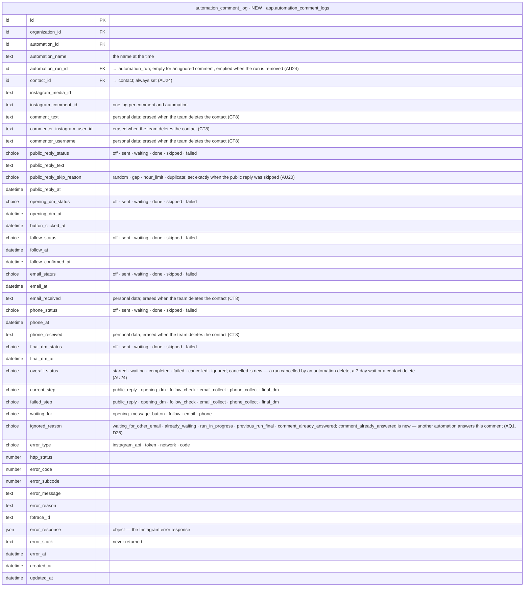

## Stage 4 — Received content

What arrives from Instagram: every webhook event of an Instagram account a team holds. Sub-domain 4
of the route review, confirmed ([routes-final.md § 4](routes-final.md), [D28](decisions.md)). It is
built last: its table points only at the account (Stage 1), but processing its events writes
contacts, runs and logs (Stages 2–3). (The stored posts moved to Stage 1 — they belong to the
account now, IA17.)

### instagram_webhook_event

- **Holds:** one event from a Meta webhook delivery, as received, with what happened to it — its
  processing status, the skip reason or the error, and how often processing tried it. Only events
  of an Instagram account a team holds are stored: each row belongs to one organization and one of
  its Instagram accounts (WQ1, WH4, [D28](decisions.md)). Every event kind has an event key, unique
  per Instagram account, so a repeated delivery is stored and run only once ([D15](decisions.md),
  WH9). Only Meta's delivery creates a row and only event processing changes it — no route writes
  one; the team reads them in the webhook-events list, the payload masked (WQ2, WH17). Public id
  prefix `iwe`. No soft delete: every event is deleted 30 days after it arrived, any status, by the
  daily clean-up ([D8](decisions.md), WH19); deleting a contact leaves that person's events to this
  clean-up (CQ1, your call, [D25](decisions.md); WH18). Goes away with its organization.
- **Table:** `app.instagram_webhook_events` ([D1](decisions.md))
- **Sources:** `schema-routes.md:806-826` (columns; 30 days at `:808`; no organization at `:814`;
  event key at `:817`; `received_at` at `:822`), `:703`, `:161` (prefix), `:265-283` (the list
  query and the event object), `:524-530` (receiving), `:582` (never listed without an
  organization), `:1010-1012` (kinds, statuses, skip reasons); `routes-final.md` § 4 (WH1–WH19,
  WQ1–WQ4, the table at 4.B.3), [D28](decisions.md).
- **Added:**
  - `instagram_account_id` — the Instagram account the event came for, inside the same organization
    (WH16, [D28](decisions.md)); the event key is unique per account. The drop named the account
    only by its Instagram user id.
  - `contact_instagram_user_id` — the person on the other side: the sender, or for an echo the
    recipient; empty when the event names nobody else (WH16).
  - `occurred_at` — Meta's own time for the event (the item's time, else the delivery entry's
    time), so a late delivery can be spotted (WH16). The drop left it inside the payload
    (`schema-routes.md:822`).
  - `attempt_count` and `last_attempted_at` — processing adds one attempt each time it takes the
    event and holds it for 5 minutes; the 5th failed attempt marks the event `failed` with
    `processing_attempts_exhausted` (WH12, WH14).
  - `request_id` — ties the row to the log line of the delivery that brought it (WH16).
  - Pairing rules (WH16): `skip_reason` is set exactly when the status is `skipped`;
    `error_message` exactly when it is `failed` — a code and a short reason, never payload text
    (WH14); `processed_at` exactly when the status is final (`processed`, `skipped` or `failed`).
  - A row is born `received`, or already `skipped` with its reason (WH10): its kind's own — `echo`
    (the account's own messages and its own comments, WH9), `read_receipt`, `reaction`, `edit`,
    `unsupported` — or `automation_disabled` when the account's switch is off, or
    `account_disconnected` when the account is `expired` or `error`. A DM the team sends by hand
    comes back as an echo, is skipped, and does not reset the 24-hour opening-DM rule at launch
    (WQ4, [D28](decisions.md)).
  - The webhook-events list shows the payload masked — message and comment text cut short, emails
    and phone numbers masked, media links hidden; the stored payload stays as received, because
    processing needs the real text (WQ2, WH17, [D28](decisions.md)).
- **Replaced:**
  - `organization_id`: empty when no organization has the Instagram account
    (`schema-routes.md:814`) → always set. An event of an Instagram account no team holds, or of a
    revoked one, is not stored — a log line and a metric only, and Meta still gets its success
    answer (WQ1, WH4, [D28](decisions.md)). So the table follows every rule above, with no
    exception.
  - Event key: defined only for comments, messages and button clicks, unique across all accounts
    (`schema-routes.md:817`, `:825`) → every event kind has a key, unique per Instagram account
    ([D15](decisions.md), WH9). A read receipt never collides with the message it read; a button
    click without a message id is keyed by sender, time and its payload; two connected accounts
    messaging each other give two keys, one per account (WH9).
  - Skip reasons: the receive steps' list (`schema-routes.md:528`) loses `unknown_account` — such
    events are not stored (WH4) — and gains `unsupported`, which the allowed values already had
    (`:1012`) ([D19](decisions.md)). Any unknown event is skipped as `unsupported`; a `messages`
    change is a DM ([D18](decisions.md)).
  - `received_at` and `created_at` (`schema-routes.md:822`, `:824`) → one time, `created_at`: an
    event is received when its row is created; the list still calls it `received_at` (WH16).
- **Open:**
  - ~~(kickoff, [D21](decisions.md)) An event for an unknown account has no organization. Under
    row-level security, whose row is it, and who may write and read it?~~ — answered: there are no
    such rows (WQ1, WH4, [D28](decisions.md)), so no rule for rows without an organization is
    needed. The webhook finds the organization through sub-domain 1's narrow lookup, which returns
    only that organization's public id, and stores the events inside that organization's own
    scope; processing and the list work inside one organization; the stuck-event pick-up and the
    clean-up look across organizations without opening any organization's data (WH3).
  - ~~The event key is unique across all organizations~~ — answered: unique per Instagram account
    ([D15](decisions.md)); the drop's three key collisions are closed (WH9, [D28](decisions.md)).
  - ~~When is `unsupported` used?~~ — answered ([D18](decisions.md), [D19](decisions.md)).
  - ~~What does the team see of the payload?~~ — answered: the payload, masked (WQ2,
    [D28](decisions.md)).
  - ~~Erase a deleted contact's events at once?~~ — answered: no — they expire with the rest after
    30 days (CQ1, your call, [D25](decisions.md); WH18).

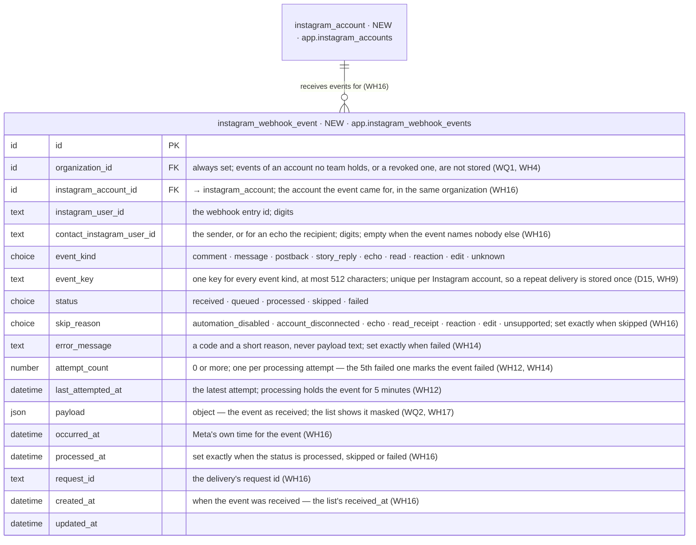
