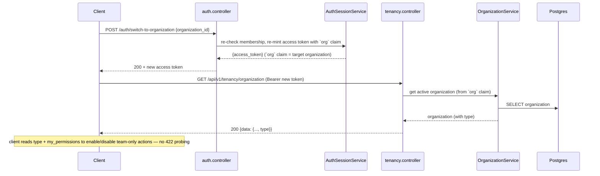
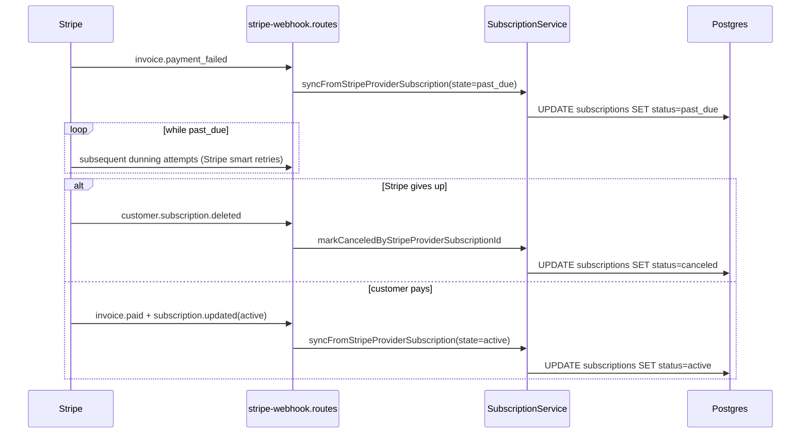
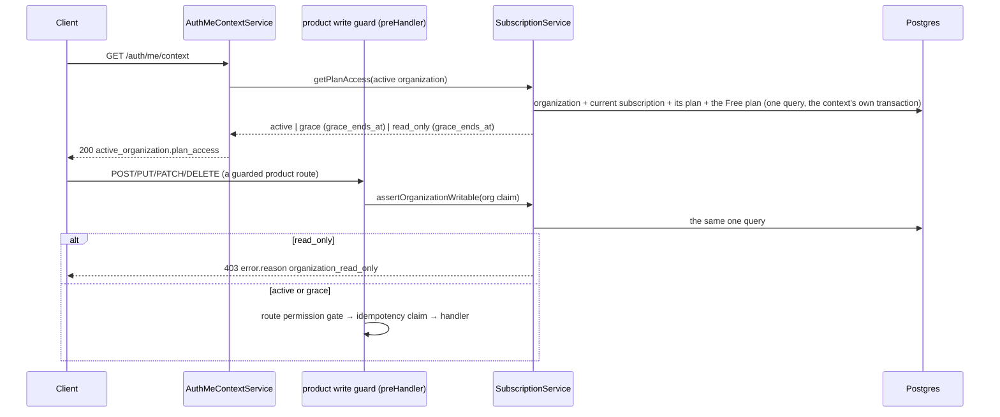
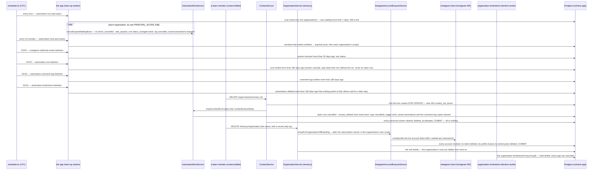
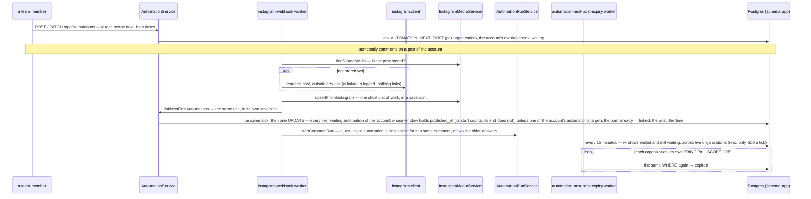

`src/`

# End-to-end feature flows

These are the multi-domain user journeys that touch more than one bounded context. Each flow lists the **trigger**, the **sequence** across domains, the **side effects** the platform produces, and the **failure modes** the platform tolerates.

When a domain `<folder>.overview.md` says **Cross-domain flows: signup-flow, subscription-change-flow**, it is asserting that the domain participates in the journeys documented here. Drift = bug.

> **Client-facing companion:** the sequences below show the **server internals** (services, DB, event bus, mail). For the **frontend** view of the auth journeys — the HTTP-only call sequence, the response body at each step, and how many calls each entry flow takes to land on the dashboard — see [docs/reference/api/frontend-auth-guide.md](docs/reference/api/frontend-auth-guide.md) (kept in step with `signup-flow`, `login-flow`, and the organization-switch flow below).

## signup-flow (unified email verification-code login)

### Trigger

Anonymous user submits an email at the unified login/sign-up form: `POST /api/v1/auth/email/send-code`.
There is no separate sign-up — an unknown email is auto-signed-up on first successful login.

### Sequence

```mermaid
sequenceDiagram
  participant Client
  participant Auth as auth.controller
  participant EL as EmailLoginService
  participant US as UserService
  participant DB as Postgres
  participant Bus as event-bus
  participant Mail as mail.processor
  participant Resend
  Client->>Auth: POST /auth/email/send-code {email}
  Auth->>EL: sendCode({email})
  Note over EL: claim the per-email 60 s send spacing (Redis SET NX) before any lookup — held → 429 code_resend_too_soon + retry_after_seconds
  EL->>US: findByEmail(email)
  US-->>EL: user | null
  alt user does not exist (auto-signup)
    EL->>DB: insert users (passwordless, is_email_verified=false) + auth_methods (EMAIL_CODE), atomic
    Note over EL: post-commit best-effort provisionPersonalOrganization (when enabled)
  end
  Note over EL: new and existing users converge on the same issue-code path
  EL->>DB: invalidateAllForUser (prior EMAIL_CODE codes) + insert verification_tokens (EMAIL_CODE, HMAC(pepper, type:user:code), expires_at = now + 15m)
  EL->>Bus: emit AUTH_EVENT.EMAIL_VERIFICATION_CODE_REQUESTED {email, verification_code, expires_in_minutes}
  Bus->>Mail: recordOutboxEmail (via event handler)
  EL-->>Auth: {messageKey: success:verificationCodeSent, resend_after_seconds: 60, expires_in_seconds: 900}
  Auth-->>Client: 200 (uniform — no account enumeration)
  Mail->>Resend: POST /emails (signed, 6-digit code)
  Resend-->>Mail: 200
  Client->>Auth: POST /auth/email/login {email, code}
  Auth->>EL: login({email, code})
  Note over EL: per-email day limit (20 wrong / 24 h → 429 code_day_limit) and per-code try cap (5, keyed by the email's hash) in Redis
  EL->>US: findByEmail(email) — unknown → 401 code_wrong + tries_left, like a wrong code
  EL->>DB: UPDATE verification_tokens SET used_at=NOW() WHERE user_id=$1 AND token_type='EMAIL_CODE' AND token_hash=$2 AND used_at IS NULL RETURNING *
  EL->>DB: invalidateAllForUser (single-use: redeeming one code kills the rest of the live set)
  EL->>DB: UPDATE users SET is_email_verified=true (when not already)
  EL->>DB: INSERT auth_sessions (or, when MFA enrolled, mint mfa_session_token instead — see /auth/mfa/login)
  Note over EL: post-commit best-effort provisionPersonalOrganization on FIRST login (claims a bare invited placeholder created without one; idempotent no-op for a brand-new user already provisioned at send)
  EL-->>Auth: {access_token, session_public_id} | {mfa_required, mfa_session_token}
  Auth-->>Client: 200 + Set-Cookie session_id
```

### Side effects

- `verification_tokens`: a single live code per user — each send invalidates the prior unused codes. Codes are stored only as a keyed, user-scoped HMAC (never plaintext, never bare SHA-256).
- `AUTH_EVENT.EMAIL_VERIFICATION_CODE_REQUESTED` event emitted on the in-process event bus.
- `mail_outbox` row inserted by the event handler (transactional outbox).
- Mail worker delivers via Resend (best-effort; retries via DLQ).
- On login: `auth_sessions` row + JWT issued (RS256, 15-minute access-token TTL); the user's other live codes are invalidated.

### Failure modes

- **Send under 60 s since this email's last code** → 429 `code_resend_too_soon` + `retry_after_seconds` (and `Retry-After`). The spacing is claimed before any user lookup, so it tells nothing about the email; the 200 answer is identical for known and unknown emails.
- **Disposable email domain** → 400 `errors:disposableEmail`. Not silent because the user can fix it.
- **Mail enqueue failure** → does not fail the HTTP request; mail outbox sweeper retries.
- **Code replay** → atomic `UPDATE ... RETURNING` consumes the code on the first login; the post-consume `invalidateAllForUser` invalidates any other live code, keeping login single-use. Two concurrent `/email/login` requests yield exactly one session.
- **Wrong code, unknown email, used code** → 401 `code_wrong` + `tries_left`; **this email's newest code over 15 minutes old** → 401 `code_expired`; **the code's 5th wrong try** → 401 `code_used_up`; **20 wrong tries for the email in 24 hours** → 429 `code_day_limit` + `retry_after_seconds` (cleared by a success).
- **MFA enrolled** → login returns `mfa_required` + `mfa_session_token`; the client completes via `POST /auth/mfa/login` — unless the browser's `trusted_device` cookie is a live trusted device of this person and none of their organizations requires 2FA and they are not a `super_admin` (AT17): then the session opens without the code (`mfa_verified_at` empty).

## login-flow

Passwords are off everywhere (feat-instagram-dm-sending P84): there is no `POST /auth/login`,
forgot, reset or change. A returning person signs in exactly as in the `signup-flow` above — the
email code (`POST /auth/email/send-code` then `POST /auth/email/login`) — or with Google/Apple OAuth
or a passkey. Every first factor ends in `completeFirstFactorAuth`: a session, or an
`mfa_required` challenge completed with `POST /auth/mfa/login`.

Apple (feat-instagram-dm-sending § 10.B): `GET /auth/oauth/apple` → Apple's page → Apple posts its
form to `POST /auth/oauth/apple/callback`, which signs nobody in — it checks the state, keeps the
first-time name next to it and answers `303` to the app's `/callback/apple?code&state` (the one
method→status exception, P85) → the app calls `GET /auth/oauth/apple/callback` with the nonce cookie.
An OAuth sign-in matches the person by the provider account first (Apple's later sign-ins may carry
no email), then by email. A signed-in person with a recent step-up links Google or Apple with
`GET /auth/oauth/{provider}?intent=link`; the callback then answers the linked way.

The 2FA step (feat-instagram-dm-sending § 10.C): `POST /auth/mfa/login` with the TOTP or recovery
code; `trust_device: true` on a right code also stores an `auth.trusted_devices` row (SHA-256 of the
cookie, 30 days, at most 10 live) and sets the `trusted_device` cookie, so the next first factor on
this browser skips the step. Step-up before a sensitive action: `POST /auth/step-up` with an email
code (strong for a person without settled 2FA — AT15), or `POST /auth/me/mfa/verify` with the 2FA
code.

### Failure modes

- **MFA challenge expired, already used, or burned by a wrong code** → 401 `mfa_session_invalid`; client must sign in again.
- **Wrong 2FA code** → 401 `mfa_code_wrong` + `tries_left`; **over 10 in 15 minutes** → 429 `mfa_locked` + `retry_after_seconds`.
- **Trusted-device cookie of another person, expired or revoked** → ignored; the 2FA step shows as without it.
- **Suspended, locked or deleted account** → 401 `account_not_active`; **the sign-in way turned off by the owner** → 403 `login_method_turned_off`.
- **OAuth state spent, expired or not this browser's** → 401 `oauth_expired`; **the provider refused or its answer did not verify** → 401 `oauth_failed`; **link mode, the account is someone else's** → 409 `provider_account_in_use`.

## organization-switch-and-capability-discovery-flow

### Trigger

A signed-in user switches which organization is active — `POST /api/v1/auth/switch-to-organization { organization_id }` (or back to their personal workspace via `POST /api/v1/auth/switch-to-personal`).

### Sequence



### Side effects

- A new access token is minted with the target organization in the `org` claim (the prior token's organization is replaced). No DB write to the organization itself.
- `switch-to-organization` then remembers the organization as the caller's login default (`auth.users.last_active_organization_id`, written only when it changes). It is best-effort — the session is already re-bound to the new token, so a failed write is logged, never returned. Every later login (password, email code, OAuth, passkey, MFA) mints its token for that organization while the membership is active, else the most recently joined team organization, else the personal organization — so the frontend lands on the organization, not the organization picker. `switch-to-personal` does not change it.
- An organization the person **pinned** (`PATCH /users/me/settings { default_organization_id }`, `auth.user_settings.default_organization_id`) comes before the remembered one at every login, while that membership and the organization are active; `null` returns to the automatic choice. The remembered organization keeps updating underneath, ready for when the pin is cleared.
- Both switch endpoints (`switch-to-organization` / `switch-to-personal`) return the **active-organization delta inline** — `{ access_token, active_organization, my_permissions, global_role }`, the organization carrying its `plan_access` as on `GET /auth/me/context` ([unpaid-organization-read-only-flow](#unpaid-organization-read-only-flow)) (`AuthMeContextService.getActiveOrganizationContext` post-gate read) — so the client repaints the dashboard for the new organization **without** a follow-up `GET /auth/me/context`. The omitted `user` / `organizations[]` are stable across a switch and reused from the client's initial context.
- Serialized organization responses (this `GET`, list, create, patch) carry the organization `type` (`PERSONAL` / `TEAM`) but **no** `capabilities` object. Clients derive team-only availability from `type` and gate the action on the caller's `my_permissions`. The personal-vs-team rule is enforced server-side by `assertTeamOrganization` in `src/domains/tenancy/sub-domains/organization/organization-capability.ts`.

### Failure modes

- **Not a member of the target organization** → switch is rejected (the token is not re-minted); the active organization is unchanged.
- **Client calls a team-only route on a personal organization** → the centralized guard `assertTeamOrganization` rejects with **422** (`unprocessable_entity`), not 409, because the organization `type` is immutable and retrying is futile. Clients hide/disable those actions up front from the organization `type` + permissions instead of probing for the 422. The team-only routes are the ones marked `team` in the `O` column of [docs/routes.txt](docs/routes.txt); the one that answers without the guard — membership restore — is noted under [ORGANIZATION_TYPE_CAPABILITY_MATRIX](src/POLICIES.md#organization_type_capability_matrix).

## organization-invitation-flow

### Trigger

Organization admin adds a teammate by email: `POST /api/v1/tenancy/organization/memberships {email, role_ids, expires_in_days?, …}` (REQ-1). That single call provisions/finds the user, creates the `INVITED` membership, and issues the invitation — there is no separate "create invitation" route.

### Sequence

```mermaid
sequenceDiagram
  participant Admin as Admin Client
  participant Mem as MembershipService
  participant Usr as UserService
  participant Inv as MembershipInvitationService
  participant DB as Postgres (RLS scoped to organization)
  participant Bus as event-bus
  participant Mail as mail.processor
  participant Invitee as Invitee Client
  participant Auth as auth (OAuth / email-code)
  Admin->>Mem: POST /organization/memberships {email, role_id}
  Mem->>Usr: findOrCreateInvitedByEmail(email)
  Usr->>DB: resolve by email (SECURITY DEFINER) — else INSERT auth.users (ACTIVE, is_email_verified=false, no auth method)
  Mem->>DB: BEGIN; SET LOCAL app.current_organization_public_id
  Mem->>DB: privilege-escalation guard; INSERT memberships (status=invited)
  Mem->>Inv: createForMembership(...)
  Inv->>DB: INSERT membership_invitations (token_hash, expires_at)
  Inv->>Bus: emitStrict MEMBERSHIP_INVITATION_EVENT.CREATED {email, raw_token, organization_name, ...}
  Mem->>DB: COMMIT
  Bus->>Mail: recordOutboxEmail (via event handler)
  Mail-->>Invitee: invitation email (raw_token in URL)

  Note over Invitee,Auth: invitee onboards (claims the pre-created user) via email verification-code login or OAuth — find-by-email reuses the row and email-code/OAuth set is_email_verified
  Invitee->>Inv: POST /tenancy/membership-invitations/:membership_invitation_id/accept {token} (authenticated)
  Inv->>Usr: requireUserRecordByPublicId(actingUser) — 403 if email unverified, 403 if email ≠ invitee
  Inv->>DB: BEGIN; SET LOCAL app.current_organization_public_id
  Inv->>DB: UPDATE membership_invitations SET accepted_at=NOW() WHERE token_hash=$1 (atomic, single-use)
  Inv->>DB: UPDATE memberships SET status=active, joined_at=NOW() (activateForInvitationAccept)
  Inv->>DB: COMMIT
  Inv-->>Invitee: 200 {invitation}
```

### Side effects

- New invitee → a bare ACTIVE `auth.users` row (`is_email_verified=false`, no auth method), claimed on first onboarding — **email verification-code login** or **OAuth**; an existing address resolves to that account.
- `invited` `memberships` row + `membership_invitations` row (hashed token; the raw token leaves the platform only via the email payload, parallel to the email verification code).
- `MEMBERSHIP_INVITATION_EVENT.CREATED` (emitStrict — a failed outbox write rolls back the whole organization transaction) → mail outbox → invitation email.
- Accept requires authentication, a **verified** email, and an email matching the invitee (sec-T4 + follow-up) — so a forwarded invite token alone, or a password-claim that has not yet verified, cannot join the organization. On accept the membership is activated (`status=ACTIVE`, `joined_at`) and the member's permission cache invalidated.
- On revoke (`DELETE /organization/memberships/:membership_id/invitation`): the invitation is revoked AND the auto-created `invited` membership is soft-deleted (no ghost invitee in the members table).

### Failure modes

- **Disposable email** → 400 `errors:disposableEmail`.
- **Already a member (active or live invited) for that email** → 409 `errors:membershipAlreadyExists`.
- **Personal organization** (single-member) → 422 (team-only route).
- **Token expired / invalid / revoked / already accepted** → `ValidationError` on accept.
- **Token reuse** → the atomic accept consumes the row on first accept; a second attempt fails validation.

## subscription-change-flow

### Trigger

Two paths:

- **Inbound (authoritative)**: Stripe sends `customer.subscription.updated` → `POST /api/v1/billing/webhook`.
- **User-initiated**: organization admin calls `POST /api/v1/billing/subscriptions/:subscription_id/change-plan` (active organization from the JWT `org` claim). The service calls Stripe; the inbound webhook lands shortly after and reconciles state.

A plan change or cancel writes the local row right after Stripe accepts the call (stamping `last_stripe_event_created_at` so an older webhook cannot roll it back); the webhook that follows is authoritative and reconciles anything that drifted. Plan changes to one subscription run one at a time (a Redis lock per subscription; a concurrent one gets `409 subscription_change_in_progress`), and a plan change never writes the billing period — that is Stripe's, synced by the webhook.

A new subscription bills every member the organization already has from its first invoice (Stripe `quantity` = ACTIVE + INVITED, at least 1). Only a failed local write cancels the just-created Stripe subscription; when the webhook's `.created` inserted the row first, the create returns that row instead.

### Sequence

```mermaid
sequenceDiagram
  participant Stripe
  participant Ingest as stripe-webhook (ingress + controller)
  participant SWS as StripeWebhookService
  participant Queue as stripe-webhook queue (BullMQ)
  participant Worker as stripe-webhook worker
  participant Sub as SubscriptionService
  participant DB as Postgres (RLS scoped to organization)

  Note over Stripe,Ingest: signature verified in the ingress plugin, before the handler
  Stripe->>Ingest: POST /api/v1/billing/webhook (Stripe-Signature)
  Ingest->>SWS: ingestEvent(event)
  SWS->>DB: insert stripe_webhook_events (status=processing) ON CONFLICT (event_id) DO NOTHING
  alt new event, or a redelivery still waiting for its run
    SWS->>Queue: enqueue stripe-webhook job (job id = event id)
  else already processed or abandoned
    Note over SWS: no enqueue; idempotent no-op
  end
  Note over SWS: the ingress records, never claims — the worker's first claim stays free
  Ingest-->>Stripe: 200

  Queue->>Worker: deliver job (async, separate process)
  Worker->>SWS: handleEvent → dispatchEvent
  SWS->>Sub: syncFromStripeProviderSubscription({ provider_subscription_id, data, stripe_event_created_at })
  Sub->>DB: BEGIN; SET LOCAL app.current_organization_public_id
  Sub->>DB: UPDATE subscriptions SET ... WHERE provider_subscription_id=$1
  Sub->>DB: COMMIT
  Worker->>DB: UPDATE stripe_webhook_events SET status=processed
```

### Side effects

- `stripe_webhook_events` row keyed by Stripe `event.id` (idempotent inbound).
- `subscriptions` table updated with the latest Stripe state.
- `subscription.updated` (or `subscription.cancelled` once the status is `CANCELED`) to the organization's subscribed webhooks — see `organization-resource-webhook-flow`.

### Failure modes

- **Invalid Stripe signature** → 400; Stripe retries.
- **Duplicate `event.id`** → silently no-op (unique constraint); Stripe retries are safe. A redelivery that arrives before the worker ran is re-enqueued (a no-op while the job exists) and leaves the claim to the worker — an ingress that claimed made the worker wait out the 15-minute lease.
- **`.deleted` that finds the row already cancelled or newer** → processed with a log line (`stripe.webhook.subscription_cancel_already_terminal_or_stale`), never retried into an alert.
- **Stripe API timeout or outage (user-initiated path)** → 503 `paymentProviderUnavailable`; nothing is written locally. If Stripe did apply the change, its webhook reconciles the row.
- **Worker crash mid-processing** → row stuck in `processing`; reclaim worker (`stripe-webhook-event-reclaim.processor`) restarts it after `STRIPE_WEBHOOK_STUCK_PROCESSING_LEASE_MINUTES` (15 min).
- **Event that keeps failing** → after `STRIPE_WEBHOOK_MAX_PROCESSING_ATTEMPTS` (25) handler attempts — or at once for a permanent failure — the row turns `abandoned` and one alert fires; the reclaim never selects it again.
- **Stale event** (timestamp older than current row) → service rejects the update so out-of-order webhooks don't roll state backwards.

## dunning-flow

### Trigger

Stripe sends a billing-failure webhook (`invoice.payment_failed`, `customer.subscription.updated` with `past_due`) → `POST /api/v1/billing/webhook`.

### Sequence

> Ingestion uses the same async claim → enqueue → worker path as `subscription-change-flow`; the diagram below collapses that plumbing to focus on the `subscriptions.status` state machine.



### Side effects

- `subscriptions.status` transitions: `active` → `past_due` (and back, or onward to `canceled`).
- Each transition is a `subscription.updated` (the final one a `subscription.cancelled`) to the organization's subscribed webhooks.
- **Losing the paid entitlement keeps the team.** Once a cancel, expiry, pause or never-paid status commits, `billing.entitlement_lost` is logged and no member is suspended (owner decision, 2026-10-17: suspending everyone past the Free allowance locked an organization's team out mid-day). The end of a dunning grace (`current_period_end + BILLING_DUNNING_GRACE_DAYS`) has no Stripe event, so the hourly `subscription-seat-reconcile` job on the seat-sync queue reports it (`subscription-seat-reconcile.entitlement_lapsed`), and re-enqueues a seat sync wherever Stripe bills a quantity other than the seats in use. Only an owner's own plan downgrade still suspends members past the new plan's ceiling.
- **Then read-only, not lock-out.** With `BILLING_READ_ONLY_ENFORCED` on, an organization whose entitlement has lapsed keeps writing until `current_period_end + BILLING_DUNNING_GRACE_DAYS`, then turns read-only — see [unpaid-organization-read-only-flow](#unpaid-organization-read-only-flow).

### Failure modes

- **All standard subscription-change-flow failure modes apply** (signature, duplicate event id, stale events, worker crash).
- **Customer ignores the dunning emails** → Stripe-driven cancellation eventually fires; the platform does not unilaterally cancel.

## unpaid-organization-read-only-flow

### Trigger

A TEAM organization's PAID plan lapsed (dunning past its grace) or was cancelled (past its period end) while `BILLING_READ_ONLY_ENFORCED` is on (owner decision D3, 2026-10-17; **on by default** since routes-final BL4 — Free never ends, so an organization that never paid is never read-only). `GET /api/v1/auth/me/context` (and both organization switches) report the organization's state; a product write guard checks it with `SubscriptionService.assertOrganizationWritable` — the app domain's `app-plan-access.ts` preHandler, on the automation writes only (`POST /app/automations`, `PATCH` and `DELETE /app/automations/{automation_id}`; launch D27).

### Sequence



### Side effects

- **Nothing is written.** The state is computed on every read from `tenancy.organizations` and `billing.subscriptions` (`resolvePlanAccess` in `subscription-entitlement.util.ts`) — no column, no job, so paying lifts read-only on the very next request.
- **The entitlement** (routes-final BL2): the state plus the plan whose features apply and its typed features — the one plan read every decision uses. **Free never ends:** no subscription, the Free plan, an unpaid row that never earned its plan (INCOMPLETE, PAUSED) or an expired checkout → `active` on Free. ACTIVE / TRIALING on a paid plan → `active` on it (`trial_ends_at` while TRIALING).
- **The grace:** a dunning paid subscription (PAST_DUE / UNPAID) — `grace` until `current_period_end + BILLING_DUNNING_GRACE_DAYS`, then `read_only` on Free's features; a cancelled paid plan — `active` until its `current_period_end`, then `read_only` with no grace ("plan ended"). `grace_ends_at` is the moment read-only began.
- **Only the guarded product writes close.** Reads stay open, and so do billing, auth, user, tenancy and upload — a read-only organization can still pay, sign in, manage its team and export its data. Nobody is suspended and no data is deleted. PERSONAL organizations are always `active`.
- The write guard runs before the route's permission gate and the idempotency claim, so a refused write holds no idempotency key.

### Failure modes

- **The plan access read fails** → the write fails with the error (no write goes through unchecked); `GET /auth/me/context` fails the same way.
- **`BILLING_READ_ONLY_ENFORCED` off** → every organization reads `active`; the plan and its features are still read (one query).
- **Switching the flag on** → every lapsed or cancelled paid plan already past its grace turns read-only at once; the grace counts from `current_period_end`, not from the day the flag was switched on.

## organization-resource-webhook-flow

### Trigger

A write changes one of the public resources the webhook catalog (`GET /api/v1/notify/webhook-events`) advertises:

| Event | Emitted by |
| ----- | ---------- |
| `organization.created` | `POST /tenancy/organizations` |
| `organization.updated` | `PATCH /tenancy/organization`, logo upload / delete |
| `membership.created` | `POST /tenancy/organization/memberships` (the INVITED membership) |
| `membership.updated` | membership PATCH (role, suspend, reactivate), invitation accept, downgrade auto-suspend |
| `membership.deleted` | membership DELETE, leave, invitation revoke |
| `subscription.created` | `POST /billing/subscriptions`, the Stripe `.created` fallback insert |
| `subscription.updated` | change-plan, cancel at period end, resume, a Stripe sync that changes a customer-visible field (status, cancel at period end, cancelled at, periods, plan) |
| `subscription.cancelled` | immediate cancel (`INCOMPLETE`), Stripe `.deleted` or a sync to `canceled` |

Creating or changing a webhook needs the permission the API needs to read each event's resource — for the events it will receive and, on a change, those it already receives (its pending attempts go to the URL it holds at delivery time): `membership:read` for `membership.*`, `subscription:read` for `subscription.*` (`organization.*` is readable by every member).

### Sequence

```mermaid
sequenceDiagram
  participant Service as Tenancy / billing service
  participant Bus as Event bus
  participant Notify as Webhook fan-out (notify)
  participant DB as Postgres
  participant Queue as webhook-delivery queue

  Service->>DB: BEGIN (organization context); write the resource
  Service->>Bus: emit <resource>.<verb> { organization_public_id, data: public JSON }
  Bus->>Notify: dispatchOrganizationWebhooks (reuses the transaction)
  Notify->>DB: SAVEPOINT
  Notify->>DB: list enabled webhooks subscribed to the type
  Notify->>DB: INSERT webhook_delivery_attempts (PENDING, envelope { id, type, created_at, data })
  Notify->>DB: RELEASE SAVEPOINT
  Service->>DB: COMMIT
  Notify->>Queue: enqueue one delivery job per attempt (after the commit)
```

### Side effects

- One PENDING `webhook_delivery_attempts` row per subscribed enabled webhook, committed with the write. Every endpoint gets the same envelope: `id` (`evt_…`, one per event), `type`, `created_at`, `data` (what the resource's serializer returns over the API).
- One `webhook-delivery` job per attempt, enqueued only once the transaction commits (`runInCommitUnit`): over HTTP by the request's `onResponse` flush, in a worker right after the commit. A unit that rolls back drops its jobs.

### Failure modes

- **The write rolls back** → the attempts roll back with it; nothing is delivered.
- **Fan-out fails** → the savepoint rolls back every attempt of that event (all or nothing) and the write still commits. Over HTTP the bus logs and alerts; in the Stripe webhook job the failure is rethrown (`emitStrict`), so the job retries the whole event — otherwise the watermark would let the retry emit nothing.
- **Redis refuses the enqueue, or the process dies after the commit** → the attempt stays PENDING and `webhook-delivery-reclaim` re-enqueues it.
- **A Stripe event replayed, or a sync that changes nothing customer-visible** (the same-second reconciliation after an HTTP mutation) → no event: the watermark refuses a replay, and a sync is compared with the row's state before it.
- **The organization is deleted** → organization offboarding emits no `subscription.cancelled` (nothing could deliver it); `webhook-delivery-reclaim` skips its pending attempts, and a delivery job already queued completes as skipped (`attempt_missing`).
- **`organization.created`** → cannot reach a webhook: the new organization has none yet. It is emitted for completeness.
- **Ownership transfer, organization settings, seat-quantity sync** → no event: the organization's public JSON does not change, settings are another resource, and Stripe's quantity update returns as a `customer.subscription.updated` that emits `subscription.updated`.

## instagram-account-connect-flow

### Trigger

A team member holding `instagram-account:manage` clicks "Connect Instagram" in the frontend, approves the Instagram app on Instagram's consent screen, and lands on the frontend's `/auth/instagram/callback` (the `INSTAGRAM_REDIRECT_URI`). The page drops a callback whose OAuth `state` differs from the one it sent (IQ6), then posts the code: `POST /api/v1/app/social/instagram/connect { code }` with `X-Idempotency-Key` (route 1). The same call reconnects an `expired` or `error` account, or a revoked one of the same organization. Built by ROUTE row R3 (`iterations/launch-2026-11-20-ujai/plans/routes-final.md` IA12).

### Sequence

```mermaid
sequenceDiagram
  participant Client as Frontend (/auth/instagram/callback)
  participant Gate as auth + tenancy (permission, team check)
  participant Service as InstagramAccountService
  participant Instagram as instagram.client (Instagram API)
  participant Resolver as app.resolve_organization_public_id_for_instagram_user
  participant DB as Postgres (organization scope)

  Client->>Gate: POST /app/social/instagram/connect {code} + X-Idempotency-Key
  Gate->>Service: instagram-account:manage held, team organization
  Service->>Instagram: exchange the code (trailing #_ stripped), then the long-lived token, then /me
  Instagram-->>Service: profile, granted scopes, token already encrypted, expires_at
  Service->>Service: refuse a personal Instagram account or a missing scope (422)
  Service->>Resolver: who holds this instagram_user_id (not revoked)?
  Resolver-->>Service: an organization public id, or none
  Service->>DB: BEGIN — upsert the account (connected, profile, scopes, token_expires_at)
  Service->>DB: default settings if none (InstagramAccountSettingsService)
  Service->>DB: store the encrypted token (InstagramAccountTokenService); read what the answer names; COMMIT
  Service->>Instagram: subscribe the webhook fields (only while webhook_subscribed_at is empty)
  Service->>DB: stamp webhook_subscribed_at (on success)
  Service->>DB: the controller stages the audit entry app.instagram_account.connect (after commit, best-effort)
  Service-->>Client: 200 { is_new_connection, instagram_account }
```

No Instagram call runs inside the database context: Instagram first, then one transaction, then the subscription.

### Side effects

- `app.instagram_accounts` — a new row, or this organization's existing row of the same Instagram account (any status, revoked included) set back to `connected`, with the profile, the granted scopes, `connected_at`, `connected_by_user_id` and the token's expiry copied to `token_expires_at`; `disconnected_at` and `profile_erased_at` cleared. `is_new_connection` is `false` when the organization had this account before.
- `app.instagram_account_settings` — the default row on a first connect; a reconnect keeps the team's settings.
- `app.instagram_account_tokens` — the long-lived token (about 60 days), stored only as `encryptFieldSecret` ciphertext; the plain token exists only inside the Instagram client (IA5).
- Audit `app.instagram_account.connect` (WARNING, resource type `instagram_account`), recorded after the connect commits, best-effort — an audit failure never fails the connect (audit-emission, D36).
- The account subscribed to the webhook fields `comments`, `messages` and `messaging_postbacks`, so its events start to arrive (sub-domain 4).
- The idempotency layer stores the answer: a repeated key replays the first response without calling Instagram again (no key in it names a token — the expiry is `access_expires_at`, D35).

### Failure modes

- **A bad, used or expired code, or another redirect address** → `422 instagram_code_invalid`; **a personal Instagram account** → `422 instagram_account_not_professional`; **a permission unticked on the consent screen** → `422 instagram_scopes_missing`. Nothing is stored.
- **This Instagram account is live in another organization** → `409 instagram_account_connected_elsewhere`; **this organization holds another account that is not revoked** → `409 organization_already_has_instagram_account`. Two organizations racing for one account are decided by the unique indexes, the loser gets the same 409s.
- **Instagram down, failing or throttling on the code exchange** → `503 instagram_unavailable` with `Retry-After`; **the Instagram app settings unset** → `503 instagram_not_configured`. Nothing is stored.
- **Instagram down, failing or throttling once the one-time code is spent** (the long-lived exchange or `/me`) → `409 instagram_connect_restart_required`, without `Retry-After`: the same code could only be refused, so the person starts "Connect Instagram" again (D56). Nothing is stored, and an account connected before stays as it is. **A read the answer needs fails** → the transaction rolls back and nothing is connected.
- **The webhook subscription fails after the commit** → logged (`app.instagram_account.webhook_subscription_failed`), never fails the connect; `webhook_subscribed_at` stays empty, route 2 shows `is_webhook_subscribed: false`, and the next connect (or the daily check, [instagram-account-health-flow](#instagram-account-health-flow)) retries it.
- **No `instagram-account:manage`** → `403 missing_permission`; **a personal organization** → `422` (a personal organization's Owner never holds the code, so the 403 comes first).
- **A missing or reused `X-Idempotency-Key`** → `422`; **the same key still running** → `409`.

## instagram-account-health-flow

### Trigger

Two background paths keep a connected Instagram account usable and tell the team when it is not. **The daily account check** (IA8, D9): the `instagram-account-daily-check` sweep at 04:00 UTC (`scheduler.ts`). **The reconnect notice** (IA9, D10): any caller of the account service's guarded change `markConnectionBroken` that wins — the daily check, the post and story pickers (routes 5–6), and the senders and follow check of the automations and the Instagram webhook on a token error. Built by ROUTE row R7 (`iterations/launch-2026-11-20-ujai/plans/routes-final.md` IA8, IA9).

### Sequence

```mermaid
sequenceDiagram
  participant Scheduler as scheduler (04:00 UTC)
  participant Check as instagram-account-daily-check worker
  participant DB as Postgres (retention sweep arm / organization job scope)
  participant Instagram as instagram.client (Instagram API)
  participant Account as InstagramAccountService
  participant Notice as instagram-reconnect-notice worker
  participant Tenancy as MembershipService / OrganizationSettingsService
  participant Notify as NotificationService → notification worker → mail outbox

  Scheduler->>Check: sweep job (sweep-connected-instagram-accounts)
  Check->>DB: page the connected accounts of live organizations (sweep arm, USING only)
  Check->>Check: add one check per account (job id = account + UTC day)
  Check->>DB: organization scope — the account and its encrypted token
  alt the token's end has passed
    Check->>Account: markConnectionBroken(expired) — no Instagram call
  else the token ends within 7 days
    Check->>Instagram: ig_refresh_token (outside any database context)
    Check->>DB: replace the token only if it is still the one renewed; copy the new end onto the account
  end
  Check->>Instagram: /me
  Check->>DB: profile, profile_synced_at
  Check->>Instagram: subscribed_apps (only while webhook_subscribed_at is empty)
  Check->>DB: stamp webhook_subscribed_at
  Account->>DB: connected → expired | error (WHERE connected), stamp connection_status_changed_at; COMMIT
  Account->>Notice: after commit — one job per account and break (job id = account + break time)
  Notice->>DB: organization scope — is the account still at that break?
  Notice->>Tenancy: active holders of instagram-account:manage; the organization's language
  Notice->>Notify: one notification each (type instagram.reconnect_required, in-app + email), once per break; COMMIT
  Notify->>Notify: after commit — a notification job each; the email through the mail outbox
```

No Instagram call runs inside a database context: every step reads, closes its unit of work, calls Instagram, then writes in a new one.

### Side effects

- `app.instagram_account_tokens` — a renewed token (about 60 days), stamped `last_refreshed_at`, its error cleared; or a failed renewal's `last_refresh_error` (Instagram's class, code, subcode and HTTP status — never its text, which can quote the token). A reconnect that saved a newer token while the renewal ran keeps it: the renewal writes only over the token it renewed.
- `app.instagram_accounts` — `token_expires_at` (the renewed token's end, same transaction, IA5), the profile and `profile_synced_at`, `webhook_subscribed_at`; on a break `connection_status` `expired` / `error` and `connection_status_changed_at`.
- `notify.notifications` — one `instagram.reconnect_required` notification per active `instagram-account:manage` holder, in the organization's language, linking to the frontend's Instagram page (`FRONTEND_URL` + `/instagram`), each also emailed through the mail outbox by the notification worker.

### Failure modes

- **Instagram down or busy** → the daily-check queue pauses on every replica while the `instagram` circuit is open (a throttle: for Instagram's wait), the parked check spends no attempt; a failed renewal keeps its error and the account stays `connected`; the next day tries again — seven tries before a token ends.
- **Instagram refuses the token** → `error` (`expired` for subcode 463) at once, and the notice. A code-10 "outside the messaging window" answer is a refusal of that one request, never a break (D32).
- **Two callers break the account at once** → the guarded update lets one win; only the winner enqueues a notice. A break inside a unit of work that rolls back enqueues nothing.
- **The notice job runs twice** (a stalled job) → the notifications carry the break's key, so nothing is sent twice; a break that is over by the time the job runs (reconnected, disconnected) is skipped.
- **Redis refuses the notice's enqueue** → logged (`app.instagram_account.reconnect_notice_enqueue_failed`); no row holds the notice, so it is not re-sent — the Instagram page still shows the reconnect card. A refused daily-check add is listed again by the next day's sweep.

## instagram-meta-callback-flow

### Trigger

The owner of a connected Instagram account removes the app in Instagram's settings, or asks Meta to delete their data. Meta posts a form with one field, `signed_request`, to the Instagram app's **Deauthorize callback URL** — `POST /api/v1/app/social/instagram/deauthorize` (route 7) — or its **Data deletion request URL** — `POST /api/v1/app/social/instagram/data-deletion` (route 8). Both PUBLIC: no sign-in, no idempotency key (K3). Built by ROUTE row R6 (`iterations/launch-2026-11-20-ujai/plans/routes-final.md` IA18–IA20).

### Sequence

```mermaid
sequenceDiagram
  participant Meta
  participant Ingress as Meta callback ingress plugin
  participant Controller as Meta callback controller
  participant Service as InstagramAccountMetaCallbackService
  participant Resolver as app.resolve_organization_public_ids_for_instagram_app_user
  participant Erasure as InstagramAccountErasureService
  participant Account as InstagramAccountService (+ token service)
  participant Media as InstagramMediaService
  participant DB as Postgres (each organization's VERIFIED scope)

  Meta->>Ingress: POST …/deauthorize or …/data-deletion (form: signed_request)
  Ingress->>Ingress: form body only (else 415); app secret set (else 503); HMAC-SHA256 of the payload, constant time; algorithm HMAC-SHA256; user_id digits (else 400)
  Ingress->>Controller: request.metaSignedRequest
  Controller->>Service: the signed user_id (the app-scoped id, IQ3) and issued_at
  Service->>Service: data deletion: the confirmation code = HMAC(app secret, user_id, issued_at), 21 [a-z0-9]
  Service->>Resolver: which organizations hold a row of this app-scoped id (any status)?
  Resolver-->>Service: organization public ids only
  loop each organization, one transaction in its PRINCIPAL_SCOPE.VERIFIED scope
    Service->>Erasure: eraseForMeta (the app-scoped id, issued_at)
    Erasure->>Account: disconnectForMeta — lock the accounts, leave out one connected after issued_at (D53), revoke (unless revoked), erase the token; data deletion: erase the profile (once)
    Erasure->>Media: data deletion: delete the accounts' stored posts
    Erasure->>DB: COMMIT (this organization's changes together)
  end
  Service-->>Controller: the organizations changed (and route 8's answer)
  Controller->>DB: one audit entry per organization changed (anonymous actor, source meta) — after commit, best-effort
  Controller-->>Meta: 200 { data: null, meta } — or, route 8, { url, confirmation_code } outside the envelope
```

No Instagram call: the app is already removed, so the disconnect skips the unsubscribe route 4 makes.

### Side effects

- `app.instagram_accounts` — every row of that app-scoped id connected before Meta signed the request (`issued_at`; a request without it means every row, D53), in every organization: `revoked`, `disconnected_at`, `token_expires_at` and `webhook_subscribed_at` emptied (rows already revoked stay as they are). Data deletion also erases the profile — `username`, `name`, `biography`, `website`, `profile_picture_url` emptied, counts 0, `scopes` empty, `profile_erased_at` stamped — revoked rows of the same person too.
- `app.instagram_account_tokens` — the token row deleted.
- `app.instagram_media` — data deletion: the account's stored posts deleted (IQ4); automations, runs and comment logs keep naming a post by its Instagram media id.
- Settings, contacts and webhook events stay (D22: a contact's own request is route 10). No automation run is cancelled and automations stay `live` (IQ1, D24).
- Audit `app.instagram_account.deauthorize` / `app.instagram_account.data_deletion` (WARNING, anonymous actor, `metadata.source = 'meta'`, the accounts' public ids; on a data deletion the confirmation code — the request's only record, IQ2 — and the erased post count), one per organization changed.
- Route 8's link opens the frontend's `/instagram/data-deletion?code=…` page (meepzo-fe), which says the data is deleted and shows the code — no status route, no request table (IQ2).

### Failure modes

- **A missing, doubled, malformed or wrongly signed `signed_request`, another algorithm, or no `user_id`** → `400 instagram_signed_request_invalid`; nothing changes. **A body over 16 KB** → `413`; **one that is not form-encoded** → `415`. **No `INSTAGRAM_APP_SECRET`** → `503 instagram_not_configured`. **Over the webhook rate limit** → `429`.
- **A person we never stored, or whose organization was deleted** (its delete erased the account, D54) → still `200` (route 8 with its code), so Meta does not retry; no audit entry.
- **Meta repeats a request** → nothing is left to do: `200` again, the same confirmation code, no new audit entry. **The account was connected again in between** → that connection is newer than the request and is left alone (D53); the same `200`, no new audit entry. A reconnect that races the request waits for its row lock and connects on top.
- **A database failure in one organization** → the request fails and Meta retries it; the organizations already done find nothing left to do the second time.

## instagram-retention-erasure-flow

### Trigger

How Instagram, contact, automation and webhook-event data leaves (`iterations/launch-2026-11-20-ujai/plans/routes-final.md` § 2 CT7–CT9, § 3.B AU25–AU26, § 4.B WH18–WH19; proved end to end by ROUTE row R18, `src/domains/app/__tests__/e2e/instagram-retention-erasure.e2e.test.ts`). Four triggers: **the timers** (`scheduler.ts`, UTC); **a contact delete** — `DELETE /api/v1/app/contacts/{contact_id}` (route 10), the team honouring the person's own request (D22); **Meta's data deletion** (route 8, [instagram-meta-callback-flow](#instagram-meta-callback-flow)) — the account owner's data, never a contact's; **an organization delete** — `DELETE /api/v1/tenancy/organization`, which erases its Instagram account at once (D54), then its purge after `TOMBSTONE_RETENTION_DAYS`.

### Sequence



A contact erase and a running automation meet on the contact's row: both lock it first — the erase `FOR UPDATE`, every unit of the engine `FOR KEY SHARE` (`lockLiveContact`) — so an erase either waits for the unit and clears what it wrote, or comes first and nothing is written or sent; the two never block each other. Both then lock the automations of the contact's open runs (`FOR KEY SHARE`) before those runs, and an automation delete (route 15) locks the automation (`FOR UPDATE`) before its runs: one order — contact, automation, runs — for all three (AU12, D47).

### Side effects

- **Timers** — rows removed or runs cancelled as above, across organizations under the retention sweep arm (deletes) or each organization's own scope (changes); contacts, stored posts and the account have no timer (D8). Log lines carry counts and public ids only.
- **Contact delete** — the contact row stays without personal data (its runs point at it); runs and comment logs stay without the person's text, username, Instagram id, email and phone; the Instagram ids of posts, stories and comments stay (reply safety's duplicate rule). Audit `app.contact.delete` (the contact's public id only), after commit. The person's webhook events stay, their payload masked in route 18, until the 30-day clean-up (CQ1); one still waiting is processed like any new interaction and starts a fresh contact (CT9).
- **Meta's data deletion** — the account's token, profile and stored posts; contacts, runs, logs, events and settings stay, and no run is cancelled (D22, D24).
- **Organization delete** — its Instagram accounts revoked and erased (token, profile, stored posts) just before it is hidden (D54), so the Instagram account connects elsewhere at once; the accounts are named on the `tenancy.organization.delete` audit entry. Automations, runs, logs, contacts, settings and events stay hidden until the purge removes every `app` row with the organization (`ON DELETE CASCADE`), whatever the `RESTRICT` links between them.
- No log line carries a contact's email, phone, name, username or picture, or a message's text — request logs name the route or the path, never the query; a database failure is reduced to its code; and the personal keys are redacted (`sensitive-redaction.util.ts`).

### Failure modes

- **Any part of a contact delete fails** → the whole erase rolls back: no run cancelled, no copy cleared, no audit entry; the team tries again. A repeat after success is `404 contact_not_found`.
- **The answer arrives just before the 7-day check** → the cancel re-checks the wait in its update, so the run goes on. **One organization's cancel fails** → counted, logged and sent to Sentry; its runs stay due for the next hour.
- **A deleted automation is still pointed at** → skipped (`blockedCount`) and tried again the next day.
- **A night is skipped, or a clean-up runs twice** → the next one catches up; a repeat removes nothing. A run stopped at its batch cap leaves the rest to the next day.
- **The unsubscribe of an organization delete fails** → logged (`app.instagram_account.webhook_unsubscription_failed`), never blocks it. **Its erase fails** → the delete stops before the soft delete and `organization-offboarding-reconcile` runs it again, safely.
- **A deleted organization's waiting runs and windows** are not listed (its rows wait for the purge), so they never take a place in a batch.

## instagram-webhook-intake-flow

### Trigger

Meta calls the Instagram webhook's two public routes (`iterations/launch-2026-11-20-ujai/plans/routes-final.md` § 4.A, built by ROUTE row R13): **the subscription check** — `GET /api/v1/app/social/instagram/webhook` when the webhook is saved in the Meta App Dashboard — and **every delivery** — `POST` on the same path with comments, DMs, story replies and button clicks of a connected account. Processing the stored events (dispatch per kind, order per account, retries, the stuck-event pick-up) is the [instagram-webhook-processing-flow](#instagram-webhook-processing-flow) below (ROUTE row R14).

### Sequence

```mermaid
sequenceDiagram
  participant Meta as Meta (Instagram webhook)
  participant Parser as JSON parser + raw-body registry
  participant Plugin as instagramWebhookIngressPlugin
  participant Receiver as InstagramWebhookService
  participant Account as InstagramAccountService
  participant Resolver as app.resolve_organization_public_id_for_instagram_user
  participant Events as InstagramWebhookEventService
  participant DB as Postgres (the organization's VERIFIED scope)

  Meta->>Receiver: GET …/webhook ?hub.mode=subscribe&hub.verify_token&hub.challenge
  Receiver-->>Meta: 200 text/plain challenge (token compared in constant time; 400 / 503 otherwise)
  Meta->>Plugin: POST …/webhook + X-Hub-Signature-256 — no header: 400 before the body is read
  Plugin->>Parser: the raw JSON body is read (up to 5 MB), its bytes kept, nothing parsed
  Parser->>Plugin: raw bytes
  Plugin->>Plugin: HMAC-SHA256 of the raw bytes with INSTAGRAM_APP_SECRET (400 / 503 otherwise), then parse them
  Plugin->>Receiver: signed delivery — object instagram? (else 200 OK, nothing stored)
  loop each entry[] (the account's webhook user id), its text cleaned of NUL and lone surrogates
    Receiver->>Resolver: which organization holds this account, not revoked?
    alt nobody (never connected, or revoked)
      Receiver->>Receiver: log instagram.webhook.unknown_account + metric; nothing stored
    else an organization
      Receiver->>Account: account state in its VERIFIED scope (status, automation switch, both ids)
      Receiver->>Receiver: classify every item — kind, key (per account), born received or skipped
      Receiver->>Events: INSERT … ON CONFLICT DO NOTHING (a repeat delivery inserts nothing); COMMIT
      Receiver->>Receiver: after commit — add the account's processing job, then the received rows turn queued
    end
  end
  Receiver-->>Meta: 200 text/plain OK — only once every entry is stored (one that failed: 500 / 503, after the others)
```

### Side effects

- `app.instagram_webhook_events` — one row per Instagram account and event key, born `received` (then `queued` once the account's processing job is added; a failed add is logged and left to the stuck-event pick-up), or `skipped` and final with its reason: the kind's own (`echo` — the account's own DMs and comments too, `read_receipt`, `reaction`, `edit`, `unsupported`), `automation_disabled` when the switch is off, `account_disconnected` when the account is `expired` or `error`.
- Log lines (`instagram.webhook.*`) with the request id, Instagram and public ids and counts — never the payload, message or comment text; the `instagram_webhook_unknown_account_entries_total` metric. No audit entry, no `*_by_user_id` (WH6).

### Failure modes

- **A wrong or missing signature** → `400 invalid_webhook_signature`, nothing parsed or stored (a missing one before the body is read); **the app secret or verify token unset** → `503 instagram_webhook_not_configured`.
- **An entry that cannot be stored** → the delivery's other entries (other organizations') are stored all the same, then `500` / `503`, never `200`: Meta delivers again and the part already stored dedupes on its key (D53).
- **Text Postgres refuses** (NUL, lone surrogates) → cleaned once, after the signature — the stored payloads and their event keys — so one person's comment never fails a delivery (D53).
- **A signed body that is not JSON, or about another object, or an account no team holds** → `200 OK`, nothing stored, one log line — Meta does not retry what can never be stored.
- **A flood of unsigned requests** → `INSTAGRAM_WEBHOOK_RATE_LIMIT` (1,200 a minute per IP) answers `429`; one without the signature header is refused before its body is read, a wrongly signed one costs reading its body (5 MB at most) and one HMAC — its JSON is never parsed (D53) — and neither reaches the database.

## instagram-webhook-processing-flow

### Trigger

The account's processing job on the `instagram-webhook` queue (`iterations/launch-2026-11-20-ujai/plans/routes-final.md` § 4.A WH12–WH15, built by ROUTE row R14): added by the receiver after each stored entry ([instagram-webhook-intake-flow](#instagram-webhook-intake-flow)), by the every-minute stuck-event pick-up for an account whose event still waits 5 minutes after it arrived, and by a job that yielded after its 25 events. One job per account at a time on any replica (BullMQ deduplication with `keepLastIfActive`); different accounts side by side up to `WORKER_CONCURRENCY_INSTAGRAM`.

### Sequence

```mermaid
sequenceDiagram
  participant Queue as instagram-webhook queue
  participant Worker as instagram-webhook worker (provider-pausable, instagram)
  participant Events as InstagramWebhookEventService
  participant Account as InstagramAccountService
  participant Contact as ContactService
  participant Instagram as instagram.client
  participant Engine as AutomationRunService (+ linkNextPostAutomations)

  Queue->>Worker: process-instagram-webhook-events {organizationPublicId, instagramAccountPublicId}
  Worker->>Account: the account's key (job scope, PRINCIPAL_SCOPE.JOB)
  loop up to 25 events, oldest stored first
    Worker->>Events: claim the head — one more attempt, a 5-minute lease (a head at 5 attempts → failed, the runs it left running failed in the same unit)
    Worker->>Account: read again — switch off → skipped automation_disabled; not connected → skipped account_disconnected
    Worker->>Contact: recordContactInteraction (the contact first)
    opt a contact this event created
      Worker->>Instagram: read the profile (outside any unit; fails open)
      Worker->>Contact: recordContactProfile
    end
    opt a comment
      Worker->>Instagram: read the post the first time (outside any unit)
      Worker->>Engine: store the post, then linkNextPostAutomations in a savepoint
    end
    Worker->>Engine: startCommentRun / handleDirectMessage / startStoryReplyRun / handleButtonClick (job scope, isLastAttempt)
    Worker->>Events: mark processed (only while the claim holds) — or failed, and then in the same unit
    opt marked failed
      Worker->>Engine: failRunsOfFailedEvent — the runs this event left running are failed with its code
    end
  end
  Worker->>Queue: after 25 events — one follow-up job for the account
```

### Side effects

- `app.instagram_webhook_events` — the claim (`attempt_count`, `last_attempted_at`) and the final status: `processed` once the handling finished (a run that could not send shows it on the run and its comment log), `skipped` with `automation_disabled` / `account_disconnected`, or `failed` with a code (`instagram_api:<code>/<subcode>`, `event_payload_invalid:<reason>`, `processing_attempts_exhausted`, `processing_error:<name>`) — never payload text.
- Through sub-domains 1–3: the contact (and a new contact's profile), the stored post, "next post" links, runs, run events, comment logs, Instagram sends; a token refused on processing's own reads marks the account broken (the reconnect notice follows). Whenever an event is marked `failed` — or `skipped` on a retry, after the account was switched off or disconnected between two tries (D51) — the runs it left `running` are failed in the same unit of work (D47).
- Log lines `app.instagram_webhook.*` with ids, kinds, keys, statuses and counts — never the payload, a message or comment text, emails or phone numbers (WH6).

### Failure modes

- **A temporary failure** (a lost connection, a database blip, an Instagram 5xx other than 502 and 504, which the engine rethrows) → the lease ends, the attempt is kept, the job retries with backoff (5 attempts, from 5 s) while the account's later events wait; the event's 5th failed attempt marks it `failed` and the next event runs.
- **A permanent failure** (an unreadable payload, a refused token — the account then `expired` / `error`) → `failed` at once.
- **An event that ends `failed` any way** (the 5th attempt, attempts that ran out after crashes, a permanent or token failure) → every run it left `running` is `failed` with it (`code:<the event's code>`), its comment log too, so no run stays `running` and holds its contact back; the mark and the runs are one unit — if it fails, the event is taken up again.
- **An Instagram outage** (the `instagram` circuit open) → the claim is given back with its attempt and the queue pauses on every replica, probing every five minutes.
- **A lost job** (a Redis refusal at the receiver, a crash mid-event) → the stuck-event pick-up re-adds the account's job every minute once the event is 5 minutes old and its lease is over.
- A skipped event is never processed later, even when the switch is turned back on. Nobody is told about a failed event; it shows in route 18.

## instagram-comment-automation-flow

### Trigger

Somebody comments on a post of a connected Instagram account (`iterations/launch-2026-11-20-ujai/plans/routes-final.md` § 3.B, built by ROUTE row R10, proven end to end by R15: `src/domains/app/__tests__/e2e/instagram-comment-flow.e2e.test.ts`). Meta delivers the comment ([instagram-webhook-intake-flow](#instagram-webhook-intake-flow)), the account's job claims it ([instagram-webhook-processing-flow](#instagram-webhook-processing-flow)) and calls `AutomationRunService.startCommentRun`; the person's later button clicks and answers come back the same way, as `handleButtonClick` and `handleDirectMessage`.

### Sequence

```mermaid
sequenceDiagram
  participant Worker as instagram-webhook worker
  participant Contact as ContactService
  participant Engine as AutomationRunService
  participant Safety as AutomationPublicReplySafetyService
  participant Message as AutomationRunMessageService
  participant Instagram as instagram.client
  participant DB as Postgres (the organization's JOB scope, short units)

  Worker->>Contact: the contact first; a new one's profile, a new post stored, "next post" linked
  Worker->>Engine: startCommentRun (the event's account, the comment)
  Engine->>DB: one unit — the comment's logs exist? a retry: go on with the chosen run, never choose again
  Engine->>DB: else choose — post-linked first, the oldest match; only then "any post"
  Engine->>DB: the chosen automation's run (or its ignored reason) and every other match's log
  opt the chosen automation started a run
    loop until the run waits, completes or fails
      Engine->>DB: plan the step, claim the send (sending_message_kind, the event key)
      opt the public reply
        Engine->>Safety: duplicate → random → hour limit → gap (only while safety is on); the text, never the last one
      end
      Engine->>Message: compose (English defaults), pause 200–1000 ms
      Message->>Instagram: public reply · private reply to the comment or DM · follow read
      Engine->>DB: record — the claim cleared, the step moved, run event, comment log, the contact's last message sent
    end
  end
  Note over Worker,Engine: the person clicks, follows, answers the email or phone — the next events move the waiting run on
  Engine->>DB: the final message went — completed, completed_run_count + 1, the tags (or the name) on the contact
```

### Side effects

- `app.contacts` — created or touched by every comment, click and answer; the profile of a new one; the follow answer, the email (lowercased) and the phone (normalised) with their times; `last_message_sent_at` after every DM; the tags of a completed run. `app.instagram_media` — the post, the first time. `app.automations` — a "next post" link, `last_triggered_at`, `completed_run_count`.
- `app.automation_runs` — one run per chosen automation and contact, its step, wait, claim and queued automations; `app.automation_run_events` — one row per status change and per email or phone collected; `app.automation_comment_logs` — one per comment × matching automation: the chosen one with each step's status, time and error, every other match `ignored` · `comment_already_answered`.
- Instagram: at most one public reply per comment, one private reply per comment (until the person messages the account), then DMs inside the 24-hour messaging window — each after a random pause.
- A comment that meets a run starts none: another automation's run waiting for the email asks for it again and saves the new automation (`waiting_for_other_email`); this automation's own wait — for the email too — is `already_waiting`; `run_in_progress`; `previous_run_final`. When the email arrives each saved automation starts as its own run, in order, its email step skipped; after a `cancelled` run a new one may start.
- A step turned off (route 14) while a run waits for it sends nothing then; at the contact's next event inside the messaging window the run goes on from its next step, and the automations saved behind its email start (AU14, D48); a comment outside it moves nothing on (D50). Until then it takes no answer, is not asked again and holds nothing back.
- An automation deleted (route 15) while one of its runs starts or moves: the unit and the delete wait for each other in one order (contact, automation, runs) — the run is cancelled with the delete or never starts (`ignored`, nothing written), and none stays open (AU12, D47). Proven with the two cases above end to end: `src/domains/app/__tests__/e2e/instagram-engine-recovery.e2e.test.ts`; on two connections: `automation-run-lock-order.db.unit.test.ts`.

### Failure modes

- **A public reply that fails** (refused, busy, no answer) → `public_reply_status` `failed`, the flow goes on; only a dead token stops it.
- **A temporary failure of a DM** (a throttle, a 5xx other than 502 and 504, a connection refused) → the claim is cleared and the event retried with its account's later events held back; the fifth try fails the run (an Instagram outage spends no try — the queue pauses); a run whose last try dies from our own error or a crash is failed with its event. A question asked again, or the wrong-email text, that could not go is sent by the retry the same way — the run keeps waiting throughout.
- **An unknown outcome** (no answer after the request left, a gateway's 502 or 504 (D55), a crash between the send and its save) → the step fails and the message is never sent again.
- **A DM refused for good** (outside the messaging window, the comment gone) → the run `failed`, Instagram's codes on the run and its comment log (never its text — D53); the account stays connected, the event is `processed`.
- **A dead token** → the account `error` and one reconnect notice ([instagram-account-health-flow](#instagram-account-health-flow)), the run `failed`, the event `failed` (`instagram_api:token`); later comments are stored `skipped` until a reconnect.
- **A refused email or phone quick reply** → the question goes again as plain text, under the same claim.

## instagram-next-post-flow

### Trigger

A team prepares an automation before its post exists: a comment automation with `target_scope` `next` and a window (`POST` / `PATCH /api/v1/app/automations`, `iterations/launch-2026-11-20-ujai/plans/routes-final.md` § 3.A AU9, AU15, AU27). Two triggers end its wait: **a comment** on a post published inside the window of a live, waiting automation of that Instagram account — linking is part of every comment's handling ([instagram-webhook-processing-flow](#instagram-webhook-processing-flow)), before the comment is matched ([instagram-comment-automation-flow](#instagram-comment-automation-flow)) — and **the 15-minute check** (`automation-next-post-expiry`, D9) once the window ended with no post. Built by ROUTE rows R9 and R14, proven end to end by R17 (`src/domains/app/__tests__/e2e/instagram-next-post-flow.e2e.test.ts`).

### Sequence



### Side effects

- `app.automations` — `next_post_status` `waiting` → `linked` (with `target_instagram_media_id` and `next_post_linked_at`) or → `expired`; changing the window of an expired one puts it back to `waiting` (route 14). Both changes move `updated_at`, so a save opened before them is `409 record_changed`.
- `app.instagram_media` — the post, stored once at its first comment, whether anything links or not; a stored one is never read from Instagram again.
- The comment's run and logs are the [instagram-comment-automation-flow](#instagram-comment-automation-flow)'s. A `waiting` or `expired` automation answers no comment and gets no log.
- Nobody is told (D11): no notification, email or audit entry — the list shows the new status when it is read again. Log lines `app.automation.next_post_linked` and `automation-next-post-expiry.completed` carry public ids and counts only.

### Failure modes

- **The post cannot be read or mapped** (Instagram busy or down, no answer, no readable publish time) → logged, nothing links, the comment is still matched; the next comment on that post tries again. **A refused token** is the one exception (D44): the account turns `error` / `expired` and the event fails ([instagram-account-health-flow](#instagram-account-health-flow)).
- **The link fails** → its savepoint alone is undone and logged (`app.instagram_webhook.next_post_link_failed`): the stored post stays, the comment is still matched, the next comment on that post tries again (D18).
- **The comment is retried** → the post is not read and the automation not linked again.
- **A link and a save, or two posts, at the same moment** → the lock makes them take turns: a save after the link finds it `linked` (its window and target are fixed, `409 next_post_already_linked`), a link after the save reads the new window, and one automation takes one post.
- **A link lands while the check runs** → the check's conditional update leaves it `linked`. **The check is skipped, or one organization's change fails** → the next one catches up; a repeat changes nothing.
- **A post published just before the end whose first comment comes after the check** → does not link (accepted for launch, D26).

## instagram-message-flow

### Trigger

A person sends the connected Instagram account a DM (a `messaging[]` message, or Meta's `messages` change — the same thing, D18), replies to one of its stories, or clicks a button of a DM the engine sent (a postback whose payload is `<aut_…>::<run_…>`). Meta's signed delivery is stored by the [instagram-webhook-intake-flow](#instagram-webhook-intake-flow) and worked through by the [instagram-webhook-processing-flow](#instagram-webhook-processing-flow), which records the contact first and then calls the run engine's `handleDirectMessage`, `startStoryReplyRun` or `handleButtonClick` (`iterations/launch-2026-11-20-ujai/plans/routes-final.md` § 3.B AU16–AU21). Built by ROUTE rows R10 and R14, proven end to end by R16 (`src/domains/app/__tests__/e2e/instagram-message-flow.e2e.test.ts`).

### Sequence

```mermaid
sequenceDiagram
  participant Worker as instagram-webhook worker
  participant Contact as ContactService
  participant Engine as AutomationRunService
  participant Message as AutomationRunMessageService
  participant Instagram as instagram.client
  participant DB as Postgres (the organization's JOB scope)

  Worker->>Contact: recordContactInteraction — the contact first, its 24-hour messaging window opened
  Worker->>Engine: the event's entry point (job scope, the event's account, isLastAttempt)
  alt a DM while a run of the contact waits for an email (first) or a phone (then the oldest wait)
    Engine->>Contact: the answer — quick reply, attachment's email, typed text
    Engine->>DB: valid — the run goes on (email_received / phone_received), the automations queued behind an email start
    Engine->>Message: invalid email — the wrong-email text and the question again (an invalid phone sends nothing)
  else a DM with a keyword
    Engine->>DB: the oldest live automation, any trigger, with the DM keyword trigger on and the keyword, live again under its lock — one run (AU17)
  else a story reply
    Engine->>DB: the oldest live story-reply automation, any story or this one, whose keywords match — one run (AU17)
  else a button click
    Engine->>DB: the named run of this contact, waiting for the opening button or a follow — running again at the follow check
  else a story reply or a click while another run of the contact waits for an email
    Engine->>DB: the story reply saved on that run (queued_automations); the clicked run not moved
    Engine->>Message: the email question again, as a normal DM
  end
  opt a run of the contact waits for a step its automation has since turned off (AU14)
    Engine->>DB: it goes on from its next step; the automations queued behind its email start
  end
  loop each step of a running run, until it waits, completes or fails (AU18)
    Engine->>DB: claim the send (short unit, committed)
    Engine->>Message: compose and send — outside any unit, after a 200–1000 ms pause
    Message->>Instagram: POST /{account}/messages to the person
    Engine->>DB: record it (short unit) — wait, next step, completed or failed
  end
```

The steps are a comment run's without the public reply: the opening message (a normal DM, skipped when a DM went to the contact in the last 24 hours; with a button the run waits for the click), the follow check, the email, the phone, the final message. Only a button click confirms a follow — a typed message never does (D14).

### Side effects

- `app.contacts` — created or touched by every event (a new one's profile read), `email` / `phone` with their collected times, `is_following_account` with each follow read, `last_message_sent_at` after every DM, the automation's tags (or its name) when a run completes.
- `app.automation_runs` and `app.automation_run_events` — one run per automation and contact while one is open, `last_instagram_event_key` the event that last moved it, one `status_changed` row per status change and one `email_received` / `phone_received` per answer. No `app.automation_comment_logs` row: those belong to comment runs.
- `app.automations` — `last_triggered_at` when a run starts, `completed_run_count + 1` when one completes.
- Instagram — normal DMs only, never a private or public reply.

### Failure modes

- **Nothing matches** (no keyword, an automation without keywords on a DM, a story reply to another story than the automation's — an expired story simply stops matching) or **the chosen automation already has an open, completed or failed run for the contact** → nothing starts and the next match is not tried; the event is `processed`.
- **A click on a completed, failed or cancelled run, on a deleted automation's, another account's or another person's run, or with a payload the engine never sent** → ignored, nothing sent.
- **Instagram refuses a DM** → the run is `failed` with its code (`instagram_api:<code>/<subcode>`) in its own short transaction, so the error stays when the rest of the event's handling is undone; the retried event sends nothing again (D16).
- **Instagram throttles or fails temporarily** → the claim is cleared and the event retried: the run resumes from its saved step; a question asked again on a waiting run (an invalid email, a story reply, a click) is asked on the retry. The last attempt fails the running run instead — and when the event ends `failed` for any other reason (our own error, a crash), the run it left running is failed with it.
- **The chosen automation is deleted or turned off just before its run starts** → nothing starts, the event is `processed` (`ignored`); one deleted while a run of it is open cancels that run (AU12, D47).
- **The outcome of a send is unknown** (a timeout, a crash) → the claim stays and the run fails — never sent twice (AQ5).
