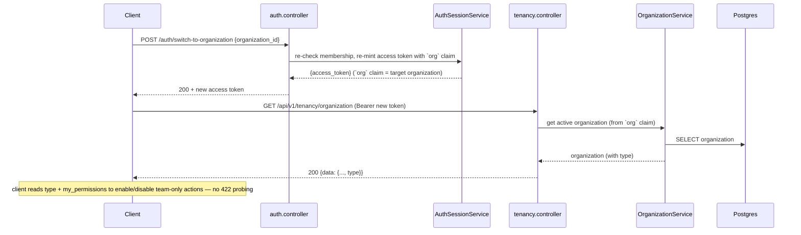
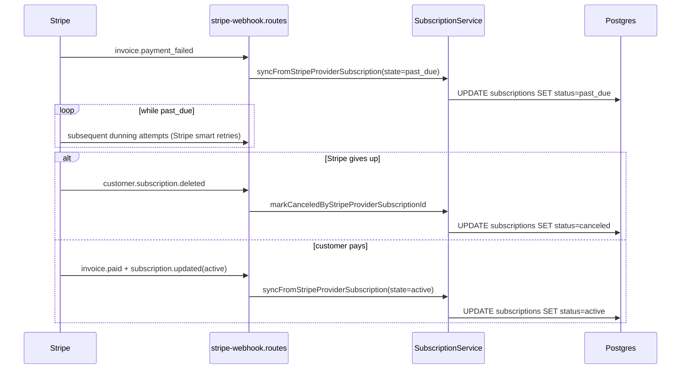
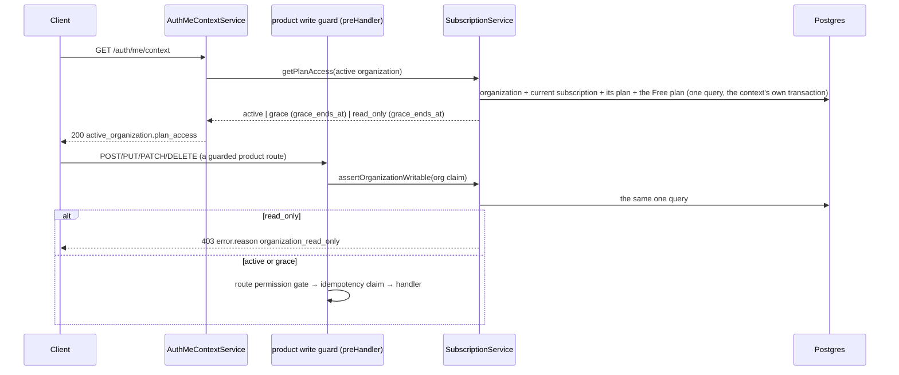
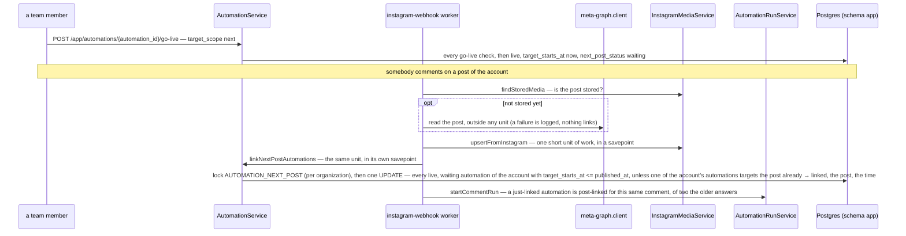

`src/`

# End-to-end feature flows

These are the multi-domain user journeys that touch more than one bounded context. Each flow lists the **trigger**, the **sequence** across domains, the **side effects** the platform produces, and the **failure modes** the platform tolerates.

When a domain `<folder>.overview.md` says **Cross-domain flows: signup-flow, subscription-change-flow**, it is asserting that the domain participates in the journeys documented here. Drift = bug.

> **Client-facing companion:** the sequences below show the **server internals** (services, DB, event bus, mail). For the **frontend** view of the auth journeys — the HTTP-only call sequence, the response body at each step, and how many calls each entry flow takes to land on the dashboard — see [docs/reference/api/frontend-auth-guide.md](docs/reference/api/frontend-auth-guide.md) (kept in step with `signup-flow`, `login-flow`, and the organization-switch flow below).

## signup-flow (unified email verification-code login)

### Trigger

Anonymous user submits an email at the unified login/sign-up form: `POST /api/v1/auth/email/send-code`.
There is no separate sign-up — an unknown email is auto-signed-up on first successful login.

### Sequence

```mermaid
sequenceDiagram
  participant Client
  participant Auth as auth.controller
  participant EL as EmailLoginService
  participant US as UserService
  participant DB as Postgres
  participant Bus as event-bus
  participant Mail as mail.processor
  participant Resend
  Client->>Auth: POST /auth/email/send-code {email}
  Auth->>EL: sendCode({email})
  Note over EL: claim the per-email 60 s send spacing (Redis SET NX) before any lookup — held → 429 code_resend_too_soon + retry_after_seconds
  EL->>US: findByEmail(email)
  US-->>EL: user | null
  alt user does not exist (auto-signup)
    EL->>DB: insert users (passwordless, is_email_verified=false) + auth_methods (EMAIL_CODE), atomic
    Note over EL: post-commit best-effort provisionPersonalOrganization (when enabled)
  end
  Note over EL: new and existing users converge on the same issue-code path
  EL->>DB: invalidateAllForUser (prior EMAIL_CODE codes) + insert verification_tokens (EMAIL_CODE, HMAC(pepper, type:user:code), expires_at = now + 15m)
  EL->>Bus: emit AUTH_EVENT.EMAIL_VERIFICATION_CODE_REQUESTED {email, verification_code, expires_in_minutes}
  Bus->>Mail: recordOutboxEmail (via event handler)
  EL-->>Auth: {messageKey: success:verificationCodeSent, resend_after_seconds: 60, expires_in_seconds: 900}
  Auth-->>Client: 200 (uniform — no account enumeration)
  Mail->>Resend: POST /emails (signed, 6-digit code)
  Resend-->>Mail: 200
  Client->>Auth: POST /auth/email/login {email, code}
  Auth->>EL: login({email, code})
  Note over EL: per-email day limit (20 wrong / 24 h → 429 code_day_limit) and per-code try cap (5, keyed by the email's hash) in Redis
  EL->>US: findByEmail(email) — unknown → 401 code_wrong + tries_left, like a wrong code
  EL->>DB: UPDATE verification_tokens SET used_at=NOW() WHERE user_id=$1 AND token_type='EMAIL_CODE' AND token_hash=$2 AND used_at IS NULL RETURNING *
  EL->>DB: invalidateAllForUser (single-use: redeeming one code kills the rest of the live set)
  EL->>DB: UPDATE users SET is_email_verified=true (when not already)
  EL->>DB: INSERT auth_sessions (or, when MFA enrolled, mint mfa_session_token instead — see /auth/mfa/login)
  Note over EL: post-commit best-effort provisionPersonalOrganization on FIRST login (claims a bare invited placeholder created without one; idempotent no-op for a brand-new user already provisioned at send)
  EL-->>Auth: {access_token, session_public_id} | {mfa_required, mfa_session_token}
  Auth-->>Client: 200 + Set-Cookie session_id
```

### Side effects

- `verification_tokens`: a single live code per user — each send invalidates the prior unused codes. Codes are stored only as a keyed, user-scoped HMAC (never plaintext, never bare SHA-256).
- `AUTH_EVENT.EMAIL_VERIFICATION_CODE_REQUESTED` event emitted on the in-process event bus.
- `mail_outbox` row inserted by the event handler (transactional outbox).
- Mail worker delivers via Resend (best-effort; retries via DLQ).
- On login: `auth_sessions` row + JWT issued (RS256, 15-minute access-token TTL); the user's other live codes are invalidated.

### Failure modes

- **Send under 60 s since this email's last code** → 429 `code_resend_too_soon` + `retry_after_seconds` (and `Retry-After`). The spacing is claimed before any user lookup, so it tells nothing about the email; the 200 answer is identical for known and unknown emails.
- **Disposable email domain** → 400 `errors:disposableEmail`. Not silent because the user can fix it.
- **Mail enqueue failure** → does not fail the HTTP request; mail outbox sweeper retries.
- **Code replay** → atomic `UPDATE ... RETURNING` consumes the code on the first login; the post-consume `invalidateAllForUser` invalidates any other live code, keeping login single-use. Two concurrent `/email/login` requests yield exactly one session.
- **Wrong code, unknown email, used code** → 401 `code_wrong` + `tries_left`; **this email's newest code over 15 minutes old** → 401 `code_expired`; **the code's 5th wrong try** → 401 `code_used_up`; **20 wrong tries for the email in 24 hours** → 429 `code_day_limit` + `retry_after_seconds` (cleared by a success).
- **MFA enrolled** → login returns `mfa_required` + `mfa_session_token`; the client completes via `POST /auth/mfa/login` — unless the browser's `trusted_device` cookie is a live trusted device of this person and none of their organizations requires 2FA and they are not a `super_admin` (AT17): then the session opens without the code (`mfa_verified_at` empty).

## login-flow

Passwords are off everywhere (feat-instagram-dm-sending P84): there is no `POST /auth/login`,
forgot, reset or change. A returning person signs in exactly as in the `signup-flow` above — the
email code (`POST /auth/email/send-code` then `POST /auth/email/login`) — or with Google/Apple OAuth
or a passkey. Every first factor ends in `completeFirstFactorAuth`: a session, or an
`mfa_required` challenge completed with `POST /auth/mfa/login`.

Apple (feat-instagram-dm-sending § 10.B): `GET /auth/oauth/apple` → Apple's page → Apple posts its
form to `POST /auth/oauth/apple/callback`, which signs nobody in — it checks the state, keeps the
first-time name next to it and answers `303` to the app's `/callback/apple?code&state` (the one
method→status exception, P85) → the app calls `GET /auth/oauth/apple/callback` with the nonce cookie.
An OAuth sign-in matches the person by the provider account first (Apple's later sign-ins may carry
no email), then by email. A signed-in person with a recent step-up links Google or Apple with
`GET /auth/oauth/{provider}?intent=link`; the callback then answers the linked way.

The 2FA step (feat-instagram-dm-sending § 10.C): `POST /auth/mfa/login` with the TOTP or recovery
code; `trust_device: true` on a right code also stores an `auth.trusted_devices` row (SHA-256 of the
cookie, 30 days, at most 10 live) and sets the `trusted_device` cookie, so the next first factor on
this browser skips the step. Step-up before a sensitive action: `POST /auth/step-up` with an email
code (strong for a person without settled 2FA — AT15), or `POST /auth/me/mfa/verify` with the 2FA
code.

### Failure modes

- **MFA challenge expired, already used, or burned by a wrong code** → 401 `mfa_session_invalid`; client must sign in again.
- **Wrong 2FA code** → 401 `mfa_code_wrong` + `tries_left`; **over 10 in 15 minutes** → 429 `mfa_locked` + `retry_after_seconds`.
- **Trusted-device cookie of another person, expired or revoked** → ignored; the 2FA step shows as without it.
- **Suspended, locked or deleted account** → 401 `account_not_active`; **the sign-in way turned off by the owner** → 403 `login_method_turned_off`.
- **OAuth state spent, expired or not this browser's** → 401 `oauth_expired`; **the provider refused or its answer did not verify** → 401 `oauth_failed`; **link mode, the account is someone else's** → 409 `provider_account_in_use`.

## email-confirmation-flow

A signed-in person whose `is_email_verified` is false (an OAuth or invited account not yet proven
by a code) confirms the address with an emailed link (feat-instagram-dm-sending § 11.B).

### Sequence

1. `POST /users/me/email-confirmation` (AUTH) → `EmailConfirmationService.requestLink`: `409 email_already_confirmed` when confirmed; `429 email_confirmation_resend_too_soon` + `retry_after_seconds` when the person's newest link is under 60 s old; else, in one transaction, the person's earlier links end, the SHA-256 of a 32-byte token is stored as `EMAIL_CONFIRM` (24 hours) and `AUTH_EVENT.EMAIL_CONFIRM_LINK_REQUESTED` records a `mail_outbox` row with `<FRONTEND_URL>/confirm-email?token=…` (always sent — not a notification choice). `200 { resend_after_seconds, expires_at }`.
2. The frontend's `/confirm-email` page posts `POST /auth/email/confirm { token }` (PUBLIC) → `EmailConfirmationService.confirm`: one transaction consumes the token (`consumeIfValid(hash, EMAIL_CONFIRM)`) and sets `is_email_verified`; audit `user.email.confirm`. `200 { is_email_verified: true }` — also when a code sign-in already confirmed it. No session is made.

### Failure modes

- **Unknown, spent or expired token**, or one sent to an address the person no longer has → 400 `email_confirm_token_invalid`.
- **Mail not configured** → 503 `errors:mailNotConfigured`; the new link rolls back.

## organization-switch-and-capability-discovery-flow

### Trigger

A signed-in user switches which organization is active — `POST /api/v1/auth/switch-to-organization { organization_id }` (or back to their personal workspace via `POST /api/v1/auth/switch-to-personal`).

### Sequence



### Side effects

- A new access token is minted with the target organization in the `org` claim (the prior token's organization is replaced). No DB write to the organization itself.
- `switch-to-organization` then remembers the organization as the caller's login default (`auth.users.last_active_organization_id`, written only when it changes). It is best-effort — the session is already re-bound to the new token, so a failed write is logged, never returned. Every later login (password, email code, OAuth, passkey, MFA) mints its token for that organization while the membership is active, else the most recently joined team organization, else the personal organization — so the frontend lands on the organization, not the organization picker. `switch-to-personal` does not change it.
- The organization **chooser** the switch starts from is `GET /users/me/organizations` (feat-instagram-dm-sending UN5): team organizations only — the personal one is never listed — with a `q` name search, the caller's main role, and per organization `members_count`, `channel_accounts_count` and `live_automations_count`. Tenancy reads the page and the roles (the SECURITY DEFINER `tenancy.resolve_main_roles_for_user`) and asks the app for the counts once per page through `OrganizationCountsPort` (UN1, the SECURITY DEFINER `app.list_organization_counts_for_user`, which answers only organizations where the caller is an active member); Postgres stays the only truth.
- An organization the person **pinned** (`PATCH /users/me/settings { default_organization_id }`, `auth.user_settings.default_organization_id`) comes before the remembered one at every login, while that membership and the organization are active; `null` returns to the automatic choice; their personal organization is refused (`422 team_organization_required`, UN4). The remembered organization keeps updating underneath, ready for when the pin is cleared.
- Both switch endpoints (`switch-to-organization` / `switch-to-personal`) return the **active-organization delta inline** — `{ access_token, active_organization, my_permissions, global_role }`, the organization carrying its `plan_access` as on `GET /auth/me/context` ([unpaid-organization-read-only-flow](#unpaid-organization-read-only-flow)) (`AuthMeContextService.getActiveOrganizationContext` post-gate read) — so the client repaints the dashboard for the new organization **without** a follow-up `GET /auth/me/context`. The omitted `user` / `organizations[]` are stable across a switch and reused from the client's initial context.
- Serialized organization responses (this `GET`, list, create, patch) carry the organization `type` (`PERSONAL` / `TEAM`) but **no** `capabilities` object. Clients derive team-only availability from `type` and gate the action on the caller's `my_permissions`. The personal-vs-team rule is enforced server-side by `assertTeamOrganization` in `src/domains/tenancy/sub-domains/organization/organization-capability.ts`.

### Failure modes

- **Not a member of the target organization** → switch is rejected (the token is not re-minted); the active organization is unchanged.
- **Client calls a team-only route on a personal organization** → the centralized guard `assertTeamOrganization` rejects with **422** (`unprocessable_entity`), not 409, because the organization `type` is immutable and retrying is futile. Clients hide/disable those actions up front from the organization `type` + permissions instead of probing for the 422. The team-only routes are the ones marked `team` in the `O` column of [docs/routes.txt](docs/routes.txt); the one that answers without the guard — membership restore — is noted under [ORGANIZATION_TYPE_CAPABILITY_MATRIX](src/POLICIES.md#organization_type_capability_matrix).

## organization-invitation-flow

### Trigger

Organization admin adds a teammate by email: `POST /api/v1/tenancy/organization/memberships {email, role_ids, expires_in_days?, …}` (REQ-1). That single call provisions/finds the user, creates the `INVITED` membership, and issues the invitation — there is no separate "create invitation" route.

### Sequence

```mermaid
sequenceDiagram
  participant Admin as Admin Client
  participant Mem as MembershipService
  participant Usr as UserService
  participant Inv as MembershipInvitationService
  participant DB as Postgres (RLS scoped to organization)
  participant Bus as event-bus
  participant Mail as mail.processor
  participant Invitee as Invitee Client
  participant Auth as auth (OAuth / email-code)
  Admin->>Mem: POST /organization/memberships {email, role_id}
  Mem->>Usr: findOrCreateInvitedByEmail(email)
  Usr->>DB: resolve by email (SECURITY DEFINER) — else INSERT auth.users (ACTIVE, is_email_verified=false, no auth method)
  Mem->>DB: BEGIN; SET LOCAL app.current_organization_public_id
  Mem->>DB: privilege-escalation guard; INSERT memberships (status=invited)
  Mem->>Inv: createForMembership(...)
  Inv->>DB: INSERT membership_invitations (token_hash, expires_at)
  Inv->>Bus: emitStrict MEMBERSHIP_INVITATION_EVENT.CREATED {email, raw_token, organization_name, ...}
  Mem->>DB: COMMIT
  Bus->>Mail: recordOutboxEmail (via event handler)
  Mail-->>Invitee: invitation email (raw_token in URL)

  Note over Invitee,Auth: invitee onboards (claims the pre-created user) via email verification-code login or OAuth — find-by-email reuses the row and email-code/OAuth set is_email_verified
  Invitee->>Inv: POST /tenancy/membership-invitations/:membership_invitation_id/accept {token} (authenticated)
  Inv->>Usr: requireUserRecordByPublicId(actingUser) — 403 if email unverified, 403 if email ≠ invitee
  Inv->>DB: BEGIN; SET LOCAL app.current_organization_public_id
  Inv->>DB: UPDATE membership_invitations SET accepted_at=NOW() WHERE token_hash=$1 (atomic, single-use)
  Inv->>DB: UPDATE memberships SET status=active, joined_at=NOW() (activateForInvitationAccept)
  Inv->>DB: COMMIT
  Inv-->>Invitee: 200 {invitation}
```

### Side effects

- New invitee → a bare ACTIVE `auth.users` row (`is_email_verified=false`, no auth method), claimed on first onboarding — **email verification-code login** or **OAuth**; an existing address resolves to that account.
- `invited` `memberships` row + `membership_invitations` row (hashed token; the raw token leaves the platform only via the email payload, parallel to the email verification code).
- `MEMBERSHIP_INVITATION_EVENT.CREATED` (emitStrict — a failed outbox write rolls back the whole organization transaction) → mail outbox → invitation email.
- Accept requires authentication, a **verified** email, and an email matching the invitee (sec-T4 + follow-up) — so a forwarded invite token alone, or an unverified account, cannot join the organization. On accept the membership is activated (`status=ACTIVE`, `joined_at`) and the member's permission cache invalidated.
- On revoke (`DELETE /organization/memberships/:membership_id/invitation`): the invitation is revoked AND the auto-created `invited` membership is soft-deleted (no ghost invitee in the members table).

### Failure modes

- **Disposable email** → 400 `errors:disposableEmail`.
- **Already a member (active or live invited) for that email** → 409 `errors:membershipAlreadyExists`.
- **Personal organization** (single-member) → 422 (team-only route).
- **Token expired / invalid / revoked / already accepted** → `ValidationError` on accept.
- **Token reuse** → the atomic accept consumes the row on first accept; a second attempt fails validation.

## subscription-change-flow

### Trigger

Two paths:

- **Inbound (authoritative)**: Stripe sends `customer.subscription.updated` → `POST /api/v1/billing/webhook`.
- **User-initiated**: organization admin calls `POST /api/v1/billing/subscriptions/:subscription_id/change-plan` (active organization from the JWT `org` claim). The service calls Stripe; the inbound webhook lands shortly after and reconciles state.

A plan change or cancel writes the local row right after Stripe accepts the call (stamping `last_stripe_event_created_at` so an older webhook cannot roll it back); the webhook that follows is authoritative and reconciles anything that drifted. Plan changes to one subscription run one at a time (a Redis lock per subscription; a concurrent one gets `409 subscription_change_in_progress`), and a plan change never writes the billing period — that is Stripe's, synced by the webhook.

A new subscription bills every member the organization already has from its first invoice (Stripe `quantity` = ACTIVE + INVITED, at least 1). Only a failed local write cancels the just-created Stripe subscription; when the webhook's `.created` inserted the row first, the create returns that row instead.

### Sequence

```mermaid
sequenceDiagram
  participant Stripe
  participant Ingest as stripe-webhook (ingress + controller)
  participant SWS as StripeWebhookService
  participant Queue as stripe-webhook queue (BullMQ)
  participant Worker as stripe-webhook worker
  participant Sub as SubscriptionService
  participant DB as Postgres (RLS scoped to organization)

  Note over Stripe,Ingest: signature verified in the ingress plugin, before the handler
  Stripe->>Ingest: POST /api/v1/billing/webhook (Stripe-Signature)
  Ingest->>SWS: ingestEvent(event)
  SWS->>DB: insert stripe_webhook_events (status=processing) ON CONFLICT (event_id) DO NOTHING
  alt new event, or a redelivery still waiting for its run
    SWS->>Queue: enqueue stripe-webhook job (job id = event id)
  else already processed or abandoned
    Note over SWS: no enqueue; idempotent no-op
  end
  Note over SWS: the ingress records, never claims — the worker's first claim stays free
  Ingest-->>Stripe: 200

  Queue->>Worker: deliver job (async, separate process)
  Worker->>SWS: handleEvent → dispatchEvent
  SWS->>Sub: syncFromStripeProviderSubscription({ provider_subscription_id, data, stripe_event_created_at })
  Sub->>DB: BEGIN; SET LOCAL app.current_organization_public_id
  Sub->>DB: UPDATE subscriptions SET ... WHERE provider_subscription_id=$1
  Sub->>DB: COMMIT
  Worker->>DB: UPDATE stripe_webhook_events SET status=processed
```

### Side effects

- `stripe_webhook_events` row keyed by Stripe `event.id` (idempotent inbound).
- `subscriptions` table updated with the latest Stripe state.
- `subscription.updated` (or `subscription.cancelled` once the status is `CANCELED`) to the organization's subscribed webhooks — see `organization-resource-webhook-flow`.

### Failure modes

- **Invalid Stripe signature** → 400; Stripe retries.
- **Duplicate `event.id`** → silently no-op (unique constraint); Stripe retries are safe. A redelivery that arrives before the worker ran is re-enqueued (a no-op while the job exists) and leaves the claim to the worker — an ingress that claimed made the worker wait out the 15-minute lease.
- **`.deleted` that finds the row already cancelled or newer** → processed with a log line (`stripe.webhook.subscription_cancel_already_terminal_or_stale`), never retried into an alert.
- **Stripe API timeout or outage (user-initiated path)** → 503 `paymentProviderUnavailable`; nothing is written locally. If Stripe did apply the change, its webhook reconciles the row.
- **Worker crash mid-processing** → row stuck in `processing`; reclaim worker (`stripe-webhook-event-reclaim.processor`) restarts it after `STRIPE_WEBHOOK_STUCK_PROCESSING_LEASE_MINUTES` (15 min).
- **Event that keeps failing** → after `STRIPE_WEBHOOK_MAX_PROCESSING_ATTEMPTS` (25) handler attempts — or at once for a permanent failure — the row turns `abandoned` and one alert fires; the reclaim never selects it again.
- **Stale event** (timestamp older than current row) → service rejects the update so out-of-order webhooks don't roll state backwards.

## dunning-flow

### Trigger

Stripe sends a billing-failure webhook (`invoice.payment_failed`, `customer.subscription.updated` with `past_due`) → `POST /api/v1/billing/webhook`.

### Sequence

> Ingestion uses the same async claim → enqueue → worker path as `subscription-change-flow`; the diagram below collapses that plumbing to focus on the `subscriptions.status` state machine.



### Side effects

- `subscriptions.status` transitions: `active` → `past_due` (and back, or onward to `canceled`).
- Each transition is a `subscription.updated` (the final one a `subscription.cancelled`) to the organization's subscribed webhooks.
- **Losing the paid entitlement keeps the team.** Once a cancel, expiry, pause or never-paid status commits, `billing.entitlement_lost` is logged and no member is suspended (owner decision, 2026-10-17: suspending everyone past the Free allowance locked an organization's team out mid-day). The end of a dunning grace (`current_period_end + BILLING_DUNNING_GRACE_DAYS`) has no Stripe event, so the 15-minute plan-state check (`subscription-plan-state-check`, feat-instagram-dm-sending R52, WC-59) emits `plan_ended` for it, and the app's plan-change task stops every channel account with `plan_ended`. The seat sync and its hourly reconcile are off (`BILLING_SEAT_SYNC_ENABLED`, BL9, WC-65): members are unlimited and no plan change suspends anyone.
- **Then read-only, not lock-out.** With `BILLING_READ_ONLY_ENFORCED` on, an organization whose entitlement has lapsed keeps writing until `current_period_end + BILLING_DUNNING_GRACE_DAYS`, then turns read-only — see [unpaid-organization-read-only-flow](#unpaid-organization-read-only-flow).

### Failure modes

- **All standard subscription-change-flow failure modes apply** (signature, duplicate event id, stale events, worker crash).
- **Customer ignores the dunning emails** → Stripe-driven cancellation eventually fires; the platform does not unilaterally cancel.

## unpaid-organization-read-only-flow

### Trigger

A TEAM organization's PAID plan lapsed (dunning past its grace) or was cancelled (past its period end) while `BILLING_READ_ONLY_ENFORCED` is on (owner decision D3, 2026-10-17; **on by default** since routes-final BL4 — Free never ends, so an organization that never paid is never read-only). `GET /api/v1/auth/me/context` (and both organization switches) report the organization's state; a product write guard checks it with `SubscriptionService.assertOrganizationWritable` — the app domain's `app-plan-access.ts` preHandler, on the automation writes only (`POST /app/automations`, `PATCH` and `DELETE /app/automations/{automation_id}`; launch D27).

### Sequence



### Side effects

- **Nothing is written.** The state is computed on every read from `tenancy.organizations` and `billing.subscriptions` (`resolvePlanAccess` in `subscription-entitlement.util.ts`) — no column, no job, so paying lifts read-only on the very next request.
- **The entitlement** (routes-final BL2): the state plus the plan whose features apply and its typed features — the one plan read every decision uses. **Free never ends:** no subscription, the Free plan, an unpaid row that never earned its plan (INCOMPLETE, PAUSED) or an expired checkout → `active` on Free. ACTIVE / TRIALING on a paid plan → `active` on it (`trial_ends_at` while TRIALING).
- **The grace:** a dunning paid subscription (PAST_DUE / UNPAID) — `grace` until `current_period_end + BILLING_DUNNING_GRACE_DAYS`, then `read_only` on Free's features; a cancelled paid plan — `active` until its `current_period_end`, then `read_only` with no grace ("plan ended"). `grace_ends_at` is the moment read-only began.
- **Where the rows change (the Stripe webhook, routes-final § 8.D BL22):** an unpaid trial end and a scheduled move to Free end the Stripe row and insert a local `ACTIVE` Free row in the same commit (`active` on Free); a paid schedule's flip moves `plan_id` and clears the schedule; a cancelled paid plan ends with no Free row (`read_only` from its period end). Each change of the entitlement is announced once after the commit as `subscription.plan_state_changed`.
- **Only the guarded product writes close.** Reads stay open, and so do billing, auth, user, tenancy and upload — a read-only organization can still pay, sign in, manage its team and export its data. Nobody is suspended and no data is deleted. PERSONAL organizations are always `active`.
- The write guard runs before the route's permission gate and the idempotency claim, so a refused write holds no idempotency key.

### Failure modes

- **The plan access read fails** → the write fails with the error (no write goes through unchecked); `GET /auth/me/context` fails the same way.
- **`BILLING_READ_ONLY_ENFORCED` off** → every organization reads `active`; the plan and its features are still read (one query).
- **Switching the flag on** → every lapsed or cancelled paid plan already past its grace turns read-only at once; the grace counts from `current_period_end`, not from the day the flag was switched on.

## organization-resource-webhook-flow

### Trigger

A write changes one of the public resources the webhook catalog (`GET /api/v1/notify/webhook-events`) advertises:

| Event | Emitted by |
| ----- | ---------- |
| `organization.created` | `POST /tenancy/organizations` |
| `organization.updated` | `PATCH /tenancy/organization`, logo upload / delete |
| `membership.created` | `POST /tenancy/organization/memberships` (the INVITED membership) |
| `membership.updated` | membership PATCH (role, suspend, reactivate), invitation accept, downgrade auto-suspend |
| `membership.deleted` | membership DELETE, leave, invitation revoke |
| `subscription.created` | `POST /billing/subscriptions`, the Stripe `.created` fallback insert |
| `subscription.updated` | change-plan, cancel at period end, resume, a Stripe sync that changes a customer-visible field (status, cancel at period end, cancelled at, periods, plan) |
| `subscription.cancelled` | immediate cancel (`INCOMPLETE`), Stripe `.deleted` or a sync to `canceled` |

Creating or changing a webhook needs the permission the API needs to read each event's resource — for the events it will receive and, on a change, those it already receives (its pending attempts go to the URL it holds at delivery time): `membership:read` for `membership.*`, `subscription:read` for `subscription.*` (`organization.*` is readable by every member).

### Sequence

```mermaid
sequenceDiagram
  participant Service as Tenancy / billing service
  participant Bus as Event bus
  participant Notify as Webhook fan-out (notify)
  participant DB as Postgres
  participant Queue as webhook-delivery queue

  Service->>DB: BEGIN (organization context); write the resource
  Service->>Bus: emit <resource>.<verb> { organization_public_id, data: public JSON }
  Bus->>Notify: dispatchOrganizationWebhooks (reuses the transaction)
  Notify->>DB: SAVEPOINT
  Notify->>DB: list enabled webhooks subscribed to the type
  Notify->>DB: INSERT webhook_delivery_attempts (PENDING, envelope { id, type, created_at, data })
  Notify->>DB: RELEASE SAVEPOINT
  Service->>DB: COMMIT
  Notify->>Queue: enqueue one delivery job per attempt (after the commit)
```

### Side effects

- One PENDING `webhook_delivery_attempts` row per subscribed enabled webhook, committed with the write. Every endpoint gets the same envelope: `id` (`evt_…`, one per event), `type`, `created_at`, `data` (what the resource's serializer returns over the API).
- One `webhook-delivery` job per attempt, enqueued only once the transaction commits (`runInCommitUnit`): over HTTP by the request's `onResponse` flush, in a worker right after the commit. A unit that rolls back drops its jobs.

### Failure modes

- **The write rolls back** → the attempts roll back with it; nothing is delivered.
- **Fan-out fails** → the savepoint rolls back every attempt of that event (all or nothing) and the write still commits. Over HTTP the bus logs and alerts; in the Stripe webhook job the failure is rethrown (`emitStrict`), so the job retries the whole event — otherwise the watermark would let the retry emit nothing.
- **Redis refuses the enqueue, or the process dies after the commit** → the attempt stays PENDING and `webhook-delivery-reclaim` re-enqueues it.
- **A Stripe event replayed, or a sync that changes nothing customer-visible** (the same-second reconciliation after an HTTP mutation) → no event: the watermark refuses a replay, and a sync is compared with the row's state before it.
- **The organization is deleted** → organization offboarding emits no `subscription.cancelled` (nothing could deliver it); `webhook-delivery-reclaim` skips its pending attempts, and a delivery job already queued completes as skipped (`attempt_missing`).
- **`organization.created`** → cannot reach a webhook: the new organization has none yet. It is emitted for completeness.
- **Ownership transfer, organization settings, seat-quantity sync** → no event: the organization's public JSON does not change, settings are another resource, and Stripe's quantity update returns as a `customer.subscription.updated` that emits `subscription.updated`.

## instagram-account-connect-flow

### Trigger

A team member holding `channel-account:manage` clicks "Connect Instagram" in the frontend: `POST /api/v1/app/social/channel-connections/meta/start` (route 1) answers Meta's Unified Login address with a one-use `state`; the person logs in to Meta, picks the business portfolio and its Instagram accounts, and lands on the frontend's return page (`META_REDIRECT_URI`), which posts `POST …/meta/callback { code, state }` with `X-Idempotency-Key: channel-connect:<state>` (route 2), shows the picker, then posts `POST …/{channel_connection_id}/accounts { channel, provider_account_ids }` with a key (route 3). The connections screen's Reconnect starts with `POST …/{channel_connection_id}/reconnect` (route 40) instead of route 1. Built by ROUTE row R3 of `iterations/feat-instagram-dm-sending-2026-11-23-oxak/` (routes-final § 1 MC4–MC7, MC17); the launch's Instagram Login connect (`POST /app/social/instagram/connect`) is gone (RC-6).

### Sequence

```mermaid
sequenceDiagram
  participant Client as Frontend
  participant Gate as auth + tenancy (permission, team check)
  participant Service as ChannelConnectionService
  participant Redis as Redis (one-use login state)
  participant Meta as meta-graph.client / meta-login (graph.facebook.com)
  participant Accounts as ChannelConnectionAccountPort (ChannelAccountService, R5)
  participant DB as Postgres (organization scope)

  Client->>Gate: POST /app/social/channel-connections/meta/start
  Gate->>Service: channel-account:manage held, team organization
  Service->>Redis: SET app:channel-connect-state:<state> EX 600
  Service-->>Client: 200 { login_url, state_expires_at }
  Client->>Gate: POST …/meta/callback {code, state} + X-Idempotency-Key
  Service->>Redis: GETDEL the state — this user, organization and provider (else 400)
  Service->>Meta: code exchange, then client_business_id, assigned Instagram accounts, granted permissions
  Service->>Service: another business on a reconnect (409), a missing permission (422)
  Service->>DB: BEGIN — upsert the connection (connected, scopes); store the encrypted token
  Service->>Accounts: reconnect every not-revoked account of the organization still assigned (moved accounts too)
  Service->>DB: revoke a connection a move left empty, with its token; COMMIT
  Service-->>Client: 200 { is_reconnect, channel_connection, accounts (free / here / elsewhere), plan_room }
  Client->>Gate: POST …/{channel_connection_id}/accounts {channel, provider_account_ids} + X-Idempotency-Key
  Service->>Meta: re-read the assigned accounts; one profile read per pick (3 s, fails open)
  Service->>DB: BEGIN — pg_advisory_xact_lock(organization); count the not-revoked accounts
  Service->>Accounts: over channel_accounts_max → 409; else each pick a connected account with default settings
  Service->>DB: COMMIT
  Service->>Accounts: after the commit, one instagram-account-setup task per account (WC-30, R40)
  Service-->>Client: 200 { results (connected / already_connected / connected_elsewhere / not_assigned), plan_room }
```

No Meta call runs inside the database context: read, close the unit of work, call Meta, then write in a new one.

### Side effects

- Redis `app:channel-connect-state:<state>` — 10 minutes, spent by the callback.
- `app.channel_connections` — one row per organization, provider and business (a revoked one reused): `connected`, `config_id`, `scopes`, `connected_by_user_id`, `connected_at`, `last_checked_at`; `disconnected_at` cleared.
- `app.channel_connection_tokens` — the business's system-user token, stored only as `encryptFieldSecret` ciphertext; never ends (`expires_at` empty); the plain token exists only inside the Meta client (MC9).
- `app.channel_accounts` — on the callback, every not-revoked account of the organization the business still assigns attached to this connection and `connected`; on the pick, a new row per picked account (or the organization's revoked row back) with `channel_connection_id`, `provider_account_id` = the Instagram user id and `display_name` `@username`.
- `app.instagram_accounts` — on the pick, the 1:1 Instagram extension of each picked channel account (or the organization's earlier row back): the Instagram user id, the profile, `account_type`, `is_private`, `profile_synced_at`; `profile_erased_at` cleared (ROUTE row R6, 2.A IA8).
- `app.instagram_account_settings` — the default row for a new account; a returning account keeps the team's settings.
- `app.channel_connection_usages` — Meta's usage of the pick's calls, per asset and type (MC19).
- Audit `app.channel_connection.connect` (WARNING, `provider`, `is_reconnect`, `reconnected_account_count`) and one `app.channel_account.connect` (WARNING) per picked account, after commit, best-effort (D36).
- The idempotency layer stores both answers: a repeated key replays the first response (no key in them names a token).

### Failure modes

- **The state is missing, used, older than 10 minutes, or another person's, organization's or provider's** → `400 channel_connect_state_invalid`; nothing is saved.
- **Meta refuses the code** → `422 provider_code_invalid`; **a required permission not granted** → `422 provider_permissions_missing`; **a reconnect from another business** → `409 channel_connection_business_mismatch`. Nothing is saved.
- **Meta down or throttling on the code exchange** → `503 instagram_unavailable` with `Retry-After`; **once the one-time code is spent** → `409 instagram_connect_restart_required` (D56); **a `META_*` setting unset** → `503 instagram_not_configured`.
- **The picks exceed the plan's `channel_accounts_max`** → `409 plan_account_limit`, nothing saved; two picks at once in one organization are serialized by the organization lock. **A pick live in another organization** → `connected_elsewhere` for that pick, the others connect; a race with another organization at the same moment → `409 instagram_account_connected_elsewhere`.
- **The connection is `error` or `revoked`, or Meta refuses its token on the pick** → `409 channel_connection_not_connected`: reconnect first.
- **The set-up fails after the pick's commit** → never fails the pick: the `instagram-account-setup` task (six webhook fields, starter questions, message-access probe) tries again after 1, 5, 15, 60 minutes, then hourly, and emails the owners once after the 60-minute try; the account shows `is_webhook_subscribed: false` meanwhile, and the 10-minute subscription check starts the set-up again (feat-instagram-dm-sending R40, P409).
- **No `channel-account:manage`** → `403 missing_permission`; **a personal organization** → `422`; **a missing or reused `X-Idempotency-Key`** on the callback or the pick → `422`.

## instagram-account-health-flow

### Trigger

Two background checks keep a connected Instagram account usable, and one notice tells the team when it is not. **The channel connection's daily token check** (feat-instagram-dm-sending MC10, WC-34, ROUTE row R51): the `channel-connection-token-check` sweep every hour (`scheduler.ts`) adds one check per connection last checked over 24 hours ago — the assigned-account list, the profiles and display names (P17), a refused token breaking the connection and every account (MC11), an old-key token re-encrypted (S26). **The webhook subscription check** (WC-25, ROUTE row R40): a 10-minute sweep on the same queue hands each connected account one check on `instagram-tasks` — all six fields on stamps an unstamped account; a field off on a stamped account empties the stamp, alerts the team, starts the set-up again (WC-30) and asks for the missed-comment look (WC-26). The launch's `instagram-account-daily-check` (IA8, D9) is retired: R3 took its token renewal (WC-35), R51 its profile refresh and the R40 × R51 merge its subscription retry. **The reconnect notice** (IA9, D10): any caller of the account service's guarded change `markConnectionBroken` that wins — the token check, the account jobs, and the senders and follow check of the automations and the Instagram webhook on a token error. Built by the launch's ROUTE row R7 (`iterations/launch-2026-11-20-ujai/plans/routes-final.md` IA9) and feat-instagram-dm-sending R40 / R51. Since feat-instagram-dm-sending R8 the post and story pickers (routes 13–14) answer Meta's 190 by breaking the account's connection (MC11) — every `connected` account of it, each with its notice.

### Sequence

```mermaid
sequenceDiagram
  participant Scheduler as scheduler (hourly / every 10 minutes)
  participant Check as channel-connection-token-check worker
  participant Tasks as instagram-tasks worker
  participant DB as Postgres (retention sweep arm / organization job scope)
  participant Instagram as meta-graph.client (Meta Graph API)
  participant Account as InstagramAccountService / ChannelConnectionService
  participant Notice as instagram-reconnect-notice worker
  participant Notify as NotificationService → notification worker → mail outbox

  Scheduler->>Check: sweep-due-channel-connections (hourly)
  Check->>DB: page the due connections (sweep arm, USING only); one check per connection
  Check->>DB: organization scope — the connection and its encrypted token
  Check->>Instagram: the assigned accounts and their profiles (outside any database context)
  Check->>DB: profiles, last check; a token on an old key re-encrypted
  Scheduler->>Check: sweep-instagram-webhook-subscriptions (every 10 minutes)
  Check->>DB: page the connected accounts (sweep arm); one task per account on instagram-tasks
  Tasks->>Instagram: GET subscribed_apps (after the sending gate)
  Tasks->>DB: stamp webhook_subscribed_at, or empty it and start the set-up again
  Account->>DB: connected → error (WHERE connected); COMMIT
  Account->>Notice: after commit — one job per account and break (job id = account + break time)
  Notice->>Notify: one notification each (type instagram.reconnect_required, in-app + email), once per break; COMMIT
```

No Instagram call runs inside a database context: every step reads, closes its unit of work, calls Instagram, then writes in a new one.

### Side effects

- `app.channel_connections` — the last check, its error, a re-encrypted token; on a break `error`.
- `app.instagram_accounts` — the profile and `profile_synced_at`, `webhook_subscribed_at`.
- `app.channel_accounts` — on a break `connection_status` `error` (Meta's subcode 463 too, CA4); the notice's once key is the account and the row's `updated_at` at the break.
- `notify.notifications` — one `instagram.reconnect_required` notification per active `instagram-account:manage` holder, in the organization's language, linking to the frontend's Instagram page (`FRONTEND_URL` + `/instagram`), each also emailed through the mail outbox by the notification worker.

### Failure modes

- **Meta down or busy** → the token check returns `deferred` without spending an attempt (never paused, F3) and the next hourly sweep adds it again; a subscription check that cannot read is `unavailable` and the next window checks again.
- **Meta refuses the token** → `error` (`expired` for subcode 463) at once, and the notice. A code-10 "outside the messaging window" answer is a refusal of that one request, never a break (D32).
- **Two callers break the account at once** → the guarded update lets one win; only the winner enqueues a notice. A break inside a unit of work that rolls back enqueues nothing.
- **The notice job runs twice** (a stalled job) → the notifications carry the break's key, so nothing is sent twice; a break that is over by the time the job runs (reconnected, disconnected) is skipped.
- **Redis refuses an enqueue** → logged (`app.instagram_account.reconnect_notice_enqueue_failed`, `…webhook_subscription_check.enqueue_failed`); a lost check is added again by the next sweep, a lost notice is not re-sent — the Instagram page still shows the reconnect card.

## instagram-meta-callback-flow

### Trigger

The person who connected a business removes the app, or asks Meta to delete their data. Meta posts a form with one field, `signed_request`, to the Meta app's **Deauthorize callback URL** — `POST /api/v1/app/social/channel-connections/meta/deauthorize` (route 16) — or its **Data deletion request URL** — `POST /api/v1/app/social/channel-connections/meta/data-deletion` (route 17). Both PUBLIC: no sign-in, no idempotency key (K3). Built by the launch's ROUTE row R6 (`iterations/launch-2026-11-20-ujai/`, IA18–IA20); moved to the channel connection with the account-then-business match by feat-instagram-dm-sending ROUTE row R9 (`iterations/feat-instagram-dm-sending-2026-11-23-oxak/plans/routes-final.md` § 1 MC14–MC16, P46, P56).

### Sequence

```mermaid
sequenceDiagram
  participant Meta
  participant Ingress as Meta callback ingress plugin
  participant Controller as Meta callback controller
  participant Service as ChannelConnectionMetaCallbackService
  participant Resolvers as app.resolve_organization_public_ids_for_provider_account / _business
  participant Erasure as InstagramAccountErasureService
  participant Account as InstagramAccountService (+ token service)
  participant Media as InstagramMediaService
  participant DB as Postgres (each organization's VERIFIED scope)

  Meta->>Ingress: POST …/meta/deauthorize or …/meta/data-deletion (form: signed_request)
  Ingress->>Ingress: form body only (else 415); app secret set (else 503); HMAC-SHA256 of the payload, constant time; algorithm HMAC-SHA256; user_id digits (else 400)
  Ingress->>Controller: request.metaSignedRequest
  Controller->>Service: the provider, the signed user_id and issued_at
  Service->>Service: data deletion: the confirmation code = HMAC(app secret, user_id, issued_at), 21 [a-z0-9]
  Service->>Resolvers: which organizations hold a channel account of this provider account id (any status)? none → which hold a connection of this business id?
  Resolvers-->>Service: organization public ids only
  loop each organization, one transaction in its PRINCIPAL_SCOPE.VERIFIED scope
    Service->>Erasure: eraseForMeta (account match: that account id; business match: the organization's connections of that business)
    Erasure->>Account: disconnectForMeta — lock the accounts reached, leave out one connected after issued_at (D53), revoke (unless revoked), the connection and its token with its last account; data deletion: erase the profile (once)
    Erasure->>Media: data deletion: delete the accounts' stored posts
    Service->>DB: business match: a connection of that business left with no account revoked with its token
    Service->>DB: COMMIT (this organization's changes together)
  end
  Service->>Service: no organization matched → error-level log and the team email (GLOBAL_ADMIN_EMAILS, R53)
  Service-->>Controller: the match kind, the organizations changed (and route 17's answer)
  Controller->>DB: one audit entry per organization changed (anonymous actor, source meta) — after commit, best-effort
  Controller-->>Meta: 200 { data: null, meta } — or, route 17, { url, confirmation_code } outside the envelope
```

No Meta call: the app is already removed, so the disconnect skips the unsubscribe route 8 makes.

### Side effects

- `app.channel_accounts` / `app.instagram_accounts` — an account match: every account of that provider account id (Meta's signed id tried as the Instagram user id first, P56), in every organization, any status; a business match: every not-revoked account of that business's connections. Only those connected before Meta signed the request (`issued_at`; a request without it means every row, D53): the channel account `revoked` with `disconnected_at`, the extension's `webhook_subscribed_at` emptied (accounts already revoked stay as they are). Data deletion also erases the extension's profile — `username`, `biography`, `website`, `profile_picture_url`, `account_type` emptied, counts 0, `profile_erased_at` stamped — on an account match revoked rows of the same account too.
- `app.channel_connections` / `app.channel_connection_tokens` — the connection revoked and its token deleted once no other not-revoked account uses it (CA8); on a business match also a connection of that business left with no account (a login never picked).
- `app.instagram_media` — data deletion: the accounts' stored posts deleted (IQ4); automations, runs and comment logs keep naming a post by its Instagram media id.
- Settings, contacts and webhook events stay (D22: a contact's own request is route 10). No automation run is cancelled and automations stay `live` (IQ1, D24). Each account the callback revokes has its sending lanes stopped in the same unit (`ChannelConnectionLanePort.stopLanes`, sub-domain 6), as route 8's are.
- Audit `app.channel_connection.deauthorize` / `app.channel_connection.data_deletion` (WARNING, anonymous actor, `metadata.source = 'meta'`, `match`, the accounts' and the revoked connections' public ids; on a data deletion the confirmation code — the request's only record, IQ2 — and the erased post count), one per organization changed.
- Route 17's link opens the frontend's `/instagram/data-deletion?code=…` page (meepzo-fe), which says the data is deleted and shows the code — no status route, no request table (IQ2).

### Failure modes

- **A missing, doubled, malformed or wrongly signed `signed_request`, another algorithm, or no `user_id`** → `400 instagram_signed_request_invalid`; nothing changes. **A body over 16 KB** → `413`; **one that is not form-encoded** → `415`. **No `META_APP_SECRET`** → `503 instagram_not_configured`. **Over the webhook rate limit** → `429`. **A provider other than `meta`** → `400`.
- **An id that matches neither an account nor a business, or whose organization was deleted** (its delete erased the account, D54) → still `200` (route 17 with its code), so Meta does not retry; no audit entry. An unmatched id is logged at error level (`app.channel_connection.meta_callback.unmatched`) and emailed to the team (`GLOBAL_ADMIN_EMAILS`, once per id), who handle it by hand (MC16, R53).
- **Meta repeats a request** → nothing is left to do: `200` again, the same confirmation code, no new audit entry. **The account was connected again in between** → that connection is newer than the request and is left alone (D53); the same `200`, no new audit entry. A reconnect that races the request waits for its row lock and connects on top.
- **A database failure in one organization** → the request fails and Meta retries it; the organizations already done find nothing left to do the second time.

## instagram-retention-erasure-flow

### Trigger

How Instagram, contact, automation and webhook-event data leaves (`iterations/launch-2026-11-20-ujai/plans/routes-final.md` § 2 CT7–CT9, § 3.B AU25–AU26, § 4.B WH18–WH19; proved end to end by ROUTE row R18, `src/domains/app/__tests__/e2e/instagram-retention-erasure.e2e.test.ts`). Four triggers: **the timers** (`scheduler.ts`, UTC); **a contact delete** — `DELETE /api/v1/app/contacts/{contact_id}` (route 10), the team honouring the person's own request (D22); **Meta's data deletion** (route 17, [instagram-meta-callback-flow](#instagram-meta-callback-flow)) — the account owner's data, never a contact's; **an organization delete** — `DELETE /api/v1/tenancy/organization`, which erases its Instagram account at once (D54), then its purge after `TOMBSTONE_RETENTION_DAYS`.

### Sequence

```mermaid
sequenceDiagram
  participant Scheduler as scheduler.ts (UTC)
  participant Worker as the app clean-up workers
  participant Engine as AutomationRunService
  participant Team as a team member (contact:delete)
  participant Contact as ContactService
  participant Organization as OrganizationService (tenancy)
  participant Erasure as InstagramAccountErasureService
  participant Instagram as meta-graph.client (Meta Graph API)
  participant Purge as organization-tombstone-retention worker
  participant DB as Postgres (schema app)

  Scheduler->>Worker: every hour — automation-run-wait-expiry
  Worker->>DB: scan (read only, live organizations) — runs waiting more than 7 days, 500 a tick
  loop each organization, its own PRINCIPAL_SCOPE.JOB
    Worker->>Engine: cancelExpiredWaitingRuns — re-check, cancelled · wait_expired, its open key deleted, one status_changed event, log cancelled, its waiting messages cancelled through the channel's port (WC-45)
  end
  Scheduler->>Worker: every hour at :37 — app-partition-upkeep (drop-expired-app-partitions)
  Worker->>DB: app.fn_manage_time_partitions per table, maintenance role only — parts made 14 days ahead; expired parts detached and dropped (events and keys 8 days, attempts 8, messages 30 after their week, comment logs 90 and run events then runs 98 after their month; a runs part with an open run kept)
  Note over Scheduler,DB: no batch delete remains on the seven time-split tables (feat-instagram-dm-sending R14, R49); the daily 02:23 make pass and one at worker start keep the parts coming
  Scheduler->>Worker: every hour at :07 — app-partition-upkeep (clean-up-app-tables)
  Worker->>DB: within a 10-minute budget, per table its cap: unused file links of automations deleted over 179 days ago, broadcasts and segments deleted over 90 days ago, recipients and ended stops over 90 days, tag events over 8 days, month counts over 13 months; the oldest-row gauge per table (P92)
  Scheduler->>Worker: every hour at :47 — automation-tombstone-retention
  Worker->>DB: automations deleted more than 180 days ago that nothing points at (the others wait for a later hour), within the budget

  Team->>Contact: DELETE /app/contacts/{contact_id}
  Contact->>DB: lock the live contact (FOR UPDATE) — else 404 contact_not_found
  Contact->>Engine: eraseContactRunCopies (the ContactErasureStep)
  Engine->>DB: open runs cancelled · contact_deleted (open keys deleted, one event each, logs cancelled), the comment-log copies cleared (a run keeps no text, D46)
  Contact->>DB: every personal column cleared, deleted_at stamped, COMMIT — all or nothing

  Team->>Organization: DELETE /tenancy/organization (the owner, with a recent step-up)
  Organization->>Erasure: eraseForOrganizationOffboarding — after the subscription cancel, in the organization's own scope
  Erasure->>Instagram: unsubscribe the live account (best effort, outside any transaction)
  Erasure->>DB: every account revoked, its token deleted, its profile erased, its stored posts deleted, COMMIT
  Organization->>DB: the soft delete — the organization's rows are hidden from here on
  Purge->>DB: the organization tombstoned long enough — hard delete, every app row cascades
```

A contact erase and a running automation meet on the contact's row: both lock it first — the erase `FOR UPDATE`, every unit of the engine `FOR KEY SHARE` (`lockLiveContact`) — so an erase either waits for the unit and clears what it wrote, or comes first and nothing is written or sent; the two never block each other. Both then lock the automations of the contact's open runs (`FOR KEY SHARE`) before those runs, and an automation delete (route 15) locks the automation (`FOR UPDATE`) before its runs: one order — contact, automation, runs — for all three (AU12, D47).

### Side effects

- **Timers** — rows removed or runs cancelled as above, across organizations under the retention sweep arm (deletes) or each organization's own scope (changes); contacts, stored posts and the account have no timer (D8). Log lines carry counts and public ids only.
- **Contact delete** — the contact row stays without personal data (its runs point at it); runs and comment logs stay without the person's text, username, Instagram id, email and phone; the Instagram ids of posts, stories and comments stay (reply safety's duplicate rule). Audit `app.contact.delete` (the contact's public id only), after commit. The person's webhook events stay, their payload masked in route 18, until the 30-day clean-up (CQ1); one still waiting is processed like any new interaction and starts a fresh contact (CT9).
- **Meta's data deletion** — the account's token, profile and stored posts; contacts, runs, logs, events and settings stay, and no run is cancelled (D22, D24).
- **Organization delete** — every Instagram account it ever held unsubscribed (best effort), revoked and erased (token, profile, stored posts) and every connection still live revoked with its token, just before it is hidden (D54, IAC5), so each Instagram account connects elsewhere at once; the accounts are named on the `tenancy.organization.delete` audit entry. Automations, runs, logs, contacts, settings and events stay hidden until the purge removes every `app` row with the organization (`ON DELETE CASCADE`), whatever the `RESTRICT` links between them.
- No log line carries a contact's email, phone, name, username or picture, or a message's text — request logs name the route or the path, never the query; a database failure is reduced to its code; and the personal keys are redacted (`sensitive-redaction.util.ts`).

### Failure modes

- **Any part of a contact delete fails** → the whole erase rolls back: no run cancelled, no copy cleared, no audit entry; the team tries again. A repeat after success is `404 contact_not_found`.
- **The answer arrives just before the 7-day check** → the cancel re-checks the wait in its update, so the run goes on. **One organization's cancel fails** → counted, logged and sent to Sentry; its runs stay due for the next hour.
- **A deleted automation is still pointed at** → skipped (`blockedCount`) and tried again the next day.
- **A night is skipped, or a clean-up runs twice** → the next one catches up; a repeat removes nothing. A run stopped at its batch cap leaves the rest to the next day.
- **The unsubscribe of an organization delete fails** → logged (`app.instagram_account.webhook_unsubscription_failed`), never blocks it. **Its erase fails** → the delete stops before the soft delete and `organization-offboarding-reconcile` runs it again, safely.
- **A deleted organization's waiting runs and windows** are not listed (its rows wait for the purge), so they never take a place in a batch.

## instagram-webhook-intake-flow

### Trigger

Meta calls the Instagram webhook's two public routes at the Instagram object's own callback path (`iterations/feat-instagram-dm-sending-2026-11-23-oxak/plans/routes-final.md` § 5.A, routes 60–61, built by ROUTE row R17 on the launch's R13; P53): **the subscription check** — `GET /api/v1/app/social/channel-connections/meta/webhooks/instagram` when the Instagram object's webhook is saved in the Meta App Dashboard — and **every delivery** — `POST` on the same path with the six subscribed fields (comments, Live comments, messages, postbacks, referrals, reactions) of a connected account. The receiver **saves only**; taking the saved events in (one job per kind group, the one lock order, retries, the stuck-event pick-up) is the [instagram-webhook-processing-flow](#instagram-webhook-processing-flow) below (intake per kind, ROUTE row R38).

### Sequence

```mermaid
sequenceDiagram
  participant Meta as Meta (Instagram webhook)
  participant Parser as JSON parser + raw-body registry
  participant Plugin as instagramWebhookIngressPlugin
  participant Receiver as InstagramWebhookService
  participant Account as InstagramAccountService
  participant Resolver as app.resolve_organization_public_id_for_instagram_user
  participant Events as InstagramWebhookEventService
  participant DB as Postgres (the organization's VERIFIED scope)

  Meta->>Receiver: GET …/webhooks/instagram ?hub.mode=subscribe&hub.verify_token&hub.challenge
  Receiver-->>Meta: 200 text/plain challenge (token compared in constant time; 400 / 503 otherwise)
  Meta->>Plugin: POST …/webhooks/instagram + X-Hub-Signature-256 — no header: counted (429 past 1,200/min per IP), 400 before the body is read
  Plugin->>Parser: the raw JSON body is read (up to 5 MB), its bytes kept, nothing parsed
  Parser->>Plugin: raw bytes
  Plugin->>Plugin: HMAC-SHA256 of the raw bytes with the Meta app secret (wrong: counted, 400 / 429; unset: 503), then parse them — a valid one is never counted
  Plugin->>Receiver: signed delivery — object instagram? (else 200 OK, nothing saved)
  loop each entry[] (the account's webhook user id), its text cleaned of NUL and lone surrogates
    Receiver->>Resolver: which organization holds this account, not revoked?
    alt nobody (never connected, or revoked)
      Receiver->>Receiver: log instagram.webhook.unknown_account + metric; nothing saved
    else an organization
      Receiver->>DB: SET LOCAL statement_timeout = 3 s (the unit's first statement)
      Receiver->>Account: account state in its VERIFIED scope (status, automation switch, both ids, cha_ id)
      Receiver->>Receiver: classify every item — read receipts dropped; our own echoes dropped (own-message lookup, R19)
      Receiver->>Events: recordReceivedEvents — 8-day replay guard, keys ON CONFLICT DO NOTHING, then only the new keys' events; COMMIT
      Receiver->>Receiver: after commit — one intake job per kind group that got events (the rows stay received, S25)
    end
  end
  Receiver-->>Meta: 200 text/plain OK — only once every entry is saved (over 3 s or Postgres down: 503; other failure: 500 — after the others)
```

### Side effects

- `app.instagram_webhook_event_keys` — one row per channel account, event key and Meta day; `app.instagram_webhook_events` — one row per new key, born `received` (and left `received` — S25, P97: no `queued` update; a failed intake add is logged and left to the stuck-event pick-up), or `skipped` and final with its reason: the kind's own (`own_comment` — the account's own comment or Live comment, `edit`, `unsupported`) or `automation_disabled` when the switch is off. An `error` account's events are saved `received`. Read receipts, our own echoes and events over 8 days old are never saved; nothing is kept in Redis (P32).
- Log lines (`instagram.webhook.*`) with the request id, Instagram and public ids and counts — never the payload, message or comment text; the `instagram_webhook_unknown_account_entries_total` metric. No audit entry, no `*_by_user_id` (WH6).

### Failure modes

- **A wrong or missing signature** → `400 invalid_webhook_signature`, nothing parsed or stored (a missing one before the body is read); **the app secret or verify token unset** → `503 instagram_webhook_not_configured`.
- **An entry that cannot be saved** → the delivery's other entries (other organizations') are saved all the same, then `500` / `503`, never `200`: Meta delivers again and the part already saved dedupes on its key (D53). A unit over its 3 s (a statement or lock wait cancelled) or Postgres down is a `503` (WH2).
- **Text Postgres refuses** (NUL, lone surrogates) → cleaned once, after the signature — the stored payloads and their event keys — so one person's comment never fails a delivery (D53).
- **A signed body that is not JSON, or about another object, or an account no team holds** → `200 OK`, nothing stored, one log line — Meta does not retry what can never be stored.
- **A flood of unsigned requests** → the per-IP cap of unsigned traffic (`INSTAGRAM_WEBHOOK_UNSIGNED_RATE_LIMIT_OPTIONS`, 1,200 a minute) answers `429`; one without the signature header is refused before its body is read, a wrongly signed one costs reading its body (5 MB at most) and one HMAC — its JSON is never parsed (D53) — and neither reaches the database. A validly signed burst from Meta is never counted (S9), and under load the overload guard sheds the UI first (`overloadShedLast`, S10).

## instagram-webhook-processing-flow

### Trigger

Intake per kind on the `instagram-webhook` queue (`iterations/feat-instagram-dm-sending-2026-11-23-oxak/plans/routes-final.md` § 5 WH5, WH11–WH17, WH25–WH27, built by ROUTE row R38): three jobs per account — `intake-messages` (taps, typed answers, DMs, story replies and mentions, shared posts, starter questions, links, ad messages, reactions, echoes — priority 1), `intake-live` (Live comments — 1) and `intake-comments` (comments and ad comments — 5; 10 while more than 500 wait) — added by the receiver after each stored entry for each kind group that got events ([instagram-webhook-intake-flow](#instagram-webhook-intake-flow)), by the every-minute stuck-event pick-up, and by a job that yielded after its 25 events; plus `intake-tag-events` (one contact at 5, a bulk piece of up to 500 at 10) added after a tag change's commit. Messages and Live run one job per account (deduplicated `intake-<kind>-<cha_…>`, strict order); comments up to four (`SKIP LOCKED`, S11). A **plain** worker — never paused by an Instagram outage (WH25); every unit of work takes a slot of the process's Instagram database limiter (SN24).

### Sequence

```mermaid
sequenceDiagram
  participant Queue as instagram-webhook queue
  participant Worker as intake worker (plain, database limiter)
  participant Events as InstagramWebhookEventService
  participant Account as InstagramAccountService
  participant Contact as ContactService (recordInboundContactEvent)
  participant Engine as AutomationRunService
  participant Messages as InstagramMessageService (6)
  participant Tasks as instagram-tasks

  Queue->>Worker: intake-<kind> {organizationPublicId, channelAccountPublicId, intakeKind}
  loop up to 25 events of the group, oldest first
    Worker->>Events: claim — the group's head (comments: the oldest free row, SKIP LOCKED); one more try, 5-minute lease; a row at 5 tries → failed, next_attempt_at +1 h
    Worker->>Account: read again — gone or revoked → skipped account_disconnected; switch off → skipped automation_disabled (an error account is taken in)
    Worker->>Events: no lock held — the flood count (> 20 of her message events a minute → skipped flood), the owner's echoes of 6 h (quiet time), the stop words
    Note over Worker,Engine: ONE transaction
    Worker->>Contact: lockInboundContact — her live contact FOR UPDATE (an erase holding her goes first)
    Worker->>Events: mark processed / skipped while it still waits (0 rows → done already, stop)
    alt an echo of the owner
      Worker->>Messages: matchEchoedMessage — our unconfirmed message → sent; else the quiet time starts
    else every other kind
      Worker->>Contact: recordInboundContactEvent (the first lock: her contact)
      Worker->>Contact: a stop word → recordContactOptOut (waiting skipped, runs cancelled)
      Worker->>Engine: startCommentRun / handleDirectMessage / handleButtonClick (automation → runs; waiting messages through the sending port)
    end
    Note over Worker,Engine: COMMIT
    Worker->>Tasks: a new contact → contact-profile task (lowest priority, S11)
  end
  Worker->>Queue: after 25 events — follow-up job(s) of the group
```

### Side effects

- `app.instagram_webhook_events` — the claim (`attempt_count`, `last_attempted_at`) and the final status: `processed`, `skipped` (`automation_disabled`, `account_disconnected`, `flood`), or `failed` with a code (`event_payload_invalid:<reason>`, `processing_attempts_exhausted`, `processing_error:<name>[:<SQLSTATE>]`) and `next_attempt_at` an hour later (none for a refusal) — never payload text; the body cleared when done.
- In the event's one commit: the contact (her window, comment count, story activity, first message; an opt-out), runs, run events, comment logs, counts and waiting messages (through the engine and `ChannelSendingPort` — intake sends nothing), the stored post and "next post" links; after it, a `contact-profile` task for a new contact.
- `intake-tag-events`: per undone tag event, one commit — `done_at`, then `startTagRun` (window open, chain under 3, `run_in_progress` while her run is open).
- Log lines `app.instagram_webhook.*` with ids, kinds, keys, statuses and counts — never the payload, a message or comment text, emails or phone numbers (WH6).

### Failure modes

- **A deadlock or lock timeout** → the transaction runs again, 3 times at most; **every path takes its locks in one order** — her contact, then the automation, then the runs (WH26, raced in `instagram-webhook-intake.processor.db.unit.test.ts`).
- **Postgres unreachable** → the claim is given back without using a try and the job retries with backoff.
- **Any other failure** → the try is kept, the lease ends and the group's job retries with backoff (only that group of that account waits); the 5th failed try marks the event `failed` with `next_attempt_at`; **a refusal** (an unreadable payload) fails it at once.
- **An Instagram outage** → intake goes on (WH25): its only Meta calls are fail-open reads (a commented post not stored yet, a late comment's time — `createInstagramLateCommentTimeReader`, 3 s, R39).
- **A lost job** (a Redis refusal at the receiver, a crash mid-event) → the stuck-event pick-up re-adds the account's job of that kind group every minute once the event waited 1 minute and no lease holds it (R39).
- **A `failed` event** → the same pick-up sends it back to `received` (its 5 tries again) when `next_attempt_at` is due — an hour after each 5th failure — while its comment or message is under 7 days old; then it stays `failed` (R39, WH21).
- **A comment Meta never delivered** (webhook off, an outage) → the 30-minute missed-comment sweep hands each account with a due watched post a look on `instagram-tasks` — the full pass at the lowest priority when two rounds were missed — which reads the post's comments back (25 posts, 7 days, stopping at 80 % / 60 % Meta usage) and saves the new ones through the receiver's store function, so a comment also delivered is saved once (R39, WH17, P93).
- A skipped event is never taken in later, even when the switch is turned back on. Nobody is told about a failed event; it shows in route 62.

## instagram-comment-automation-flow

### Trigger

Somebody comments on a post of a connected account (feat-instagram-dm-sending routes-final § 4.B, the run
engine rebuilt by ROUTE row R14 — `src/domains/app/sub-domains/automation/automation-run/__tests__/unit/automation-run.service.db.unit.test.ts`).
The account's job claims the comment ([instagram-webhook-processing-flow](#instagram-webhook-processing-flow))
and calls `AutomationRunService.startCommentRun`; her later taps and answers come back as
`handleButtonClick` and `handleDirectMessage`; each saved message's result comes back from the
channel's sending sub-domain as `recordMessageResult` (Instagram's at ROUTE rows R19–R20).

### Sequence

```mermaid
sequenceDiagram
  participant Worker as intake (instagram-webhook worker)
  participant Engine as AutomationRunService
  participant Port as ChannelSendingPort (the account's channel)
  participant Sending as the channel's sending sub-domain
  participant DB as Postgres (the organization's JOB scope, one unit per event)

  Worker->>Engine: startCommentRun (the account, the contact, the comment)
  Engine->>DB: lock her contact, the automations of her open runs; the choice (post-linked first, oldest); every other match logged comment_already_answered
  Engine->>DB: the gates — own comment, a reply under a comment with the switch off (thread_reply_off), paused (contact_excluded), the once key (once_per_post), her open run (same key → once_per_post; else replaced, P35)
  Engine->>DB: the run, its open key, runs_started (+ hello version), her first run, the comment log
  Engine->>Port: saveWaitingMessage — hello (answers the comment), content by reference
  Engine->>DB: COMMIT — run, key, log, counts and the waiting message together
  Sending->>Engine: recordMessageResult (hello sent) in its commit
  Engine->>Port: public reply (unless a duplicate, or the 80 % draw of "Reply like a person"), then the hide
  Engine->>DB: the run waits for her tap
  Worker->>Engine: handleButtonClick (her tap) or handleDirectMessage (her text — a typed answer)
  Engine->>DB: hello_tapped event, taps / typed_answers (+ hello version)
  Engine->>Port: follow check → follow ask → email → phone → messages 1–N, one at a time, each moved on by its result
  Engine->>DB: tags (with tag events), completed, the open key deleted — in the last result's commit
```

### Side effects

- `app.automation_runs`, `app.automation_run_events`, `app.automation_comment_logs`, `app.automation_run_open_keys`, `app.automation_counts`, the reply state, the contact (email, phone, tags, first run) — and the channel's waiting messages, through its port (AU35). The engine never sends.
- Log lines `app.automation_run.*` with public ids and counts — never a comment's or message's text.

### Failure modes

- **A database error** → the unit rolls back; the intake retries the event; nothing of it was written.
- **A result `unknown`** → never sent again by itself: the run waits for `any`, and her next message or tap sends that step once more (D17).
- **A result `failed`** → the run fails with `<step>:failed:<reason>`; **`skipped`** → cancelled with its reason (`window_closed`, `expired`, …) or failed.
- **A start racing another for the same person** → the open key's insert is the guard: one run, the other `run_in_progress` (AU37).

## instagram-next-post-flow

### Trigger

A team prepares an automation before its post exists: a comment automation with `target_scope` `next` that goes live (`POST /api/v1/app/automations/{automation_id}/go-live`, feat-instagram-dm-sending routes-final § 4.A AU13, AU20). It waits from its go-live (`target_starts_at`) with **no end date** (P12): **a comment** on a post published at or after that time, on a live, waiting automation of that channel account, ends the wait — linking is part of every comment's handling ([instagram-webhook-processing-flow](#instagram-webhook-processing-flow)), before the comment is matched ([instagram-comment-automation-flow](#instagram-comment-automation-flow)). The 15-minute linking sweep (WC-43) lands with ROUTE row R41; the launch's expiry is gone (R13). Proven end to end by `src/domains/app/__tests__/e2e/instagram-next-post-flow.e2e.test.ts`.

### Sequence



### Side effects

- `app.automations` — `next_post_status` `waiting` → `linked` (with `target_instagram_media_id` and `next_post_linked_at`); it moves `updated_at`, so a save opened before it is `409 record_changed`, and a save that changes a linked one's scope or post is `409 next_post_already_linked` (route 30).
- `app.instagram_media` — the post, stored once at its first comment, whether anything links or not; a stored one is never read from Instagram again.
- The comment's run and logs are the [instagram-comment-automation-flow](#instagram-comment-automation-flow)'s. A `waiting` automation answers no comment and gets no log.
- Nobody is told (D11): no notification, email or audit entry — the list shows the new status when it is read again. Log line `app.automation.next_post_linked` carries public ids only.

### Failure modes

- **The post cannot be read or mapped** (Instagram busy or down, no answer, no readable publish time) → logged, nothing links, the comment is still matched; the next comment on that post tries again. **A refused token** is the one exception (D44): the account turns `error` / `expired` and the event fails ([instagram-account-health-flow](#instagram-account-health-flow)).
- **The link fails** → its savepoint alone is undone and logged (`app.instagram_webhook.next_post_link_failed`): the stored post stays, the comment is still matched, the next comment on that post tries again (D18).
- **The comment is retried** → the post is not read and the automation not linked again.
- **A link and a save, or two posts, at the same moment** → the lock makes them take turns: a save after the link finds it `linked` (its window and target are fixed, `409 next_post_already_linked`), a link after the save reads the new window, and one automation takes one post.
- **A link lands while the check runs** → the check's conditional update leaves it `linked`. **The check is skipped, or one organization's change fails** → the next one catches up; a repeat changes nothing.
- **A post published just before the end whose first comment comes after the check** → does not link (accepted for launch, D26).

## instagram-message-flow

### Trigger

A person sends the connected account a DM, replies to or mentions one of its stories, shares a post, taps a
button of a message the engine saved, a starter question, an ig.me link or an ad's "Send message"
(feat-instagram-dm-sending § 4.B, plan §4.3 — ROUTE row R14; intake per kind is R38). The intake calls
`handleDirectMessage` or `handleButtonClick`; a tag change calls `startTagRun`.

### Sequence

```mermaid
sequenceDiagram
  participant Worker as intake
  participant Engine as AutomationRunService
  participant Port as ChannelSendingPort
  participant DB as Postgres (one unit per event)

  Worker->>Engine: handleDirectMessage / handleButtonClick / startTagRun
  Engine->>DB: lock her contact, then the automations of her open runs
  alt one of her runs waits for this (level 1)
    Engine->>DB: an email or phone answer (wrong → asked again, at most 3 asks), her text as the hello's answer, a tap, or `any` after an unknown result
    Engine->>Port: the run's next step
  else a start (levels 2–5)
    Engine->>DB: exact source → keyword or kind → her first DM → "no other automation answered"; her stop word (only a keyword DM, a starter question or a link restarts her), the once key, her open run (run_in_progress)
    Engine->>DB: the run, its key, runs_started, her first run
    Engine->>Port: the first step (a DM — her window is open)
  end
  Engine->>DB: COMMIT
```

### Side effects

As [instagram-comment-automation-flow](#instagram-comment-automation-flow), without comment logs, public replies or hides.

### Failure modes

- **A tap on a run that does not wait, of another person, a deleted automation or another account, or a payload the engine never sent** → ignored.
- **A tag start whose chain number reaches 3, or while her window is closed** → nothing starts (D45).
- **A database error** → the event is retried; nothing of it was written.

## notification-notices-flow

Notices and emails of the Instagram app (feat-instagram-dm-sending § 11.D, WC-56–WC-58, WC-63; ROUTE row R53). Domains: app (the facts and its two read ports, UN1), notify (recipients, choices, the inbox, the outbox, the weekly and grouped jobs), tenancy (memberships by permission code, the organization's language and time zone).

### Trigger

The send's claim moving the month over 80 % or 100 %; every minute, the owners' problem check and the month backup check (intake queue); every hour, the weekly summary's sweep (notification queue); an email or phone answer saved; a past-comments read ending `done`; a missed-comment look finding comments; an unmatched Meta callback.

### Sequence

```mermaid
sequenceDiagram
  participant App as app (claim / sweeps / run engine)
  participant Notice as notify notifyOrganizationKind
  participant Members as tenancy MembershipService
  participant DB as Postgres
  participant Queue as notification queue
  App->>Notice: type, copy key, once key (in the organization's unit)
  Notice->>Members: the kind's recipients by permission code (UN2)
  Notice->>DB: lock (organization, type, key); in-app rows / email-only outbox rows (UN11)
  Notice-->>Queue: after commit — the inbox rows' dispatch jobs (their emails)
  App-->>Queue: after commit — noteContactDetailsLeft (one delayed job per account and hour)
  Queue->>App: weekly summary / grouped note read the app through its ports (UN1)
```

### Side effects

`notify.notifications` rows (in-app on), `auth.mail_outbox` rows (keys `notification:<type>:<once key>:<user>`), mail jobs; team emails (`team-alert:<key>:<address>`) to `GLOBAL_ADMIN_EMAILS`.

### Failure modes

- **A lost after-commit month notice** → the every-minute backup check tells the line (`month-limit:<month>:<line>` keeps it once).
- **Two servers crossing one line** → the key's transaction lock: one notice, one email.
- **A replayed or restarted job** → the once keys and job ids keep every notice once; a quiet week sends nothing.
- **A stop that ended before its email was due** → nothing; one email of a kind per account in 6 hours.
