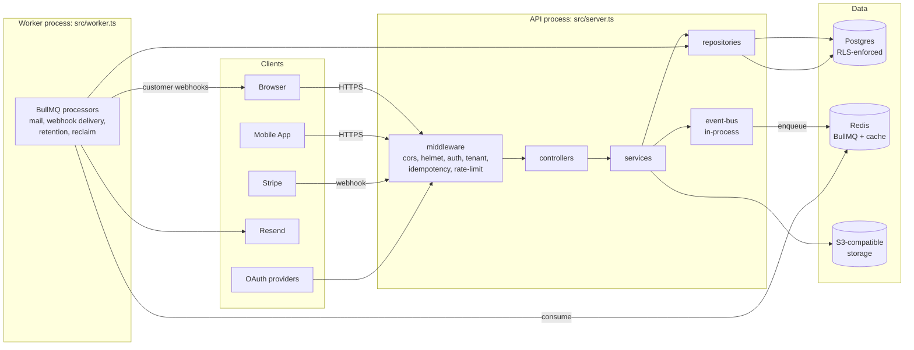

`src/`

# Platform overview

## Purpose

`meepzo-be` is a multi-tenant SaaS backend: a Node.js + Fastify HTTP API plus a separate BullMQ worker process, both speaking to a single Postgres database and a Redis instance. It is the platform's single source of truth for authentication, organization-scoped tenancy, billing (Stripe-backed), notifications (in-app + email + outbound webhooks), audit, and file uploads.

The codebase is organized by **domain** (bounded context) rather than by layer. Each domain owns its routes, services, repositories, schemas, events, and workers. Cross-domain coordination happens at the service layer: a service uses its own domain's repository and calls other domains' **services** only — never another domain's repository or schema. Postgres is the only source of truth — workers are pull-based, idempotent, and may be restarted without coordination.

This document is the **system entry point**. New contributors should read it first, then descend into the domain `OVERVIEW.md` files for the area they're working in. Cross-cutting rules live in [src/PATTERNS.md](src/PATTERNS.md), end-to-end user journeys in [src/FLOWS.md](src/FLOWS.md), and the deliberate business/security trade-offs encoded as constants in [src/POLICIES.md](src/POLICIES.md).

Per-symbol documentation lives directly in TSDoc on each export — IDE hover, [TypeDoc](https://typedoc.org/) (when needed), and `pnpm tsdoc:check` all read it from the source. Routes are documented inline in their Zod `schema.summary` / `schema.description`, which drive [docs/openapi/openapi.json](../docs/openapi/openapi.json).

## Architecture at a glance

- **One TS codebase, two processes**: the API (`pnpm dev` / `pnpm start`) and the worker (`pnpm dev:worker` / `pnpm start:worker`). They share `src/` modulo the entry-point file.
- **Route flow**: HTTP request → middleware → controller → service → repository → Postgres. Controllers are thin; services own intent; repositories own DB access.
- **Event flow**: services emit on the in-process `event-bus` after a successful write; handlers translate events into BullMQ enqueues. Side effects never run synchronously inside the request.
- **Worker flow**: BullMQ processors pull from Redis, write back to Postgres (with RLS context where applicable), and call external services (Resend, Stripe, customer webhooks, S3).

Detailed architectural rules and conventions live in [CLAUDE.md](CLAUDE.md). The infrastructure layer is documented in [src/infrastructure/](src/infrastructure/) and the cross-cutting shared layer in [src/shared/](src/shared/).

## Domains

Bounded contexts live under [src/domains/](src/domains/). Each domain owns its routes (registered under `/api/v1/<domain>`), services, repositories, schemas, events, and workers.

| Domain | Routes | Purpose |
| --- | --- | --- |
| [app](src/domains/app/) | `/api/v1/app` | Instagram automation: a team's connected Instagram account, its comment / DM / story-reply automations and their contacts (Postgres schema `app`). The Instagram account sub-domain (connect, read, disconnect; its token kept encrypted), contacts, the automations (list, create, read, edit, delete; the "next post" expiry) and the stored webhook events are built; the run engine and the webhook receiver land with launch-2026-11-20-ujai. |
| [audit](src/domains/audit/) | `/api/v1/audit` | Append-only audit log of security- and governance-relevant actions (`audit-emission` pattern). Read API is global-admin only. |
| [auth](src/domains/auth/) | `/api/v1/auth` | Authentication with no passwords (P84; the password routes are disabled behind `PASSWORD_ROUTES_ENABLED`, P251): email verification-code login, OAuth, MFA (TOTP), WebAuthn, sessions. Issues short-lived JWTs and Origin-checked session cookies. |
| [billing](src/domains/billing/) | `/api/v1/billing` | Plans, subscriptions, and the Stripe integration. Stripe is authoritative; webhooks reconcile state via the `subscription-change-flow` and `dunning-flow`. |
| [notify](src/domains/notify/) | `/api/v1/notify` | In-app notifications and outbound webhook delivery to customer endpoints (transactional outbox + retries + DLQ). |
| [tenancy](src/domains/tenancy/) | `/api/v1/tenancy` | Organizations, memberships, member roles + permissions, invitations, organization API keys. Owner of `tenant-isolation` enforcement. |
| [upload](src/domains/upload/) | `/api/v1/uploads` | S3-presigned upload + download flow. Two-phase: presign → confirm. |
| [user](src/domains/user/) | `/api/v1/users` | User profile, settings, notification preferences, and GDPR data export. |

Each domain folder above has its own hand-written `OVERVIEW.md` describing its purpose, design decisions, and operational concerns; per-symbol docs live in TSDoc on each export.

## Patterns

These patterns are implemented identically across the codebase. See [src/PATTERNS.md](src/PATTERNS.md) for the full contract of each.

- **`tenant-isolation`** — every read/write under an organization scope is filtered by `organization_id`, with Postgres RLS as defense-in-depth.
- **`audit-emission`** — security- and governance-relevant writes stage a row in `audit.outbox` (drained into `audit.logs`); failures never fail the originating request.
- **`idempotency`** — mutating endpoints accept (and some require) an `X-Idempotency-Key` header backed by a 24 h Redis cache.
- **`soft-delete`** — most user/organization-owned tables tombstone with `deleted_at`; immutable ledgers (audit, billing) hard-delete only after retention windows.
- **`rls-context`** — workers and request handlers wrap DB I/O in context helpers that `SET LOCAL app.current_organization_public_id`. Workers must not import request-scoped DB context.
- **`transactional-outbox`** — outbound side effects (mail, webhook delivery) are written to an outbox table inside the originating transaction and dispatched by a separate worker with at-least-once semantics.
- **`read-caching`** — a polled read may be served from Redis, keyed on the verified scope, invalidated after commit by writing a short-lived tombstone rather than deleting. Most reads do not qualify; the bar and the reasoning are in the pattern.
- **`be-import-paths`** — `@/` alias for all cross-folder imports inside `src/` (`@tooling/` in tooling); same-folder `./` only, never `../` traversal.

## End-to-end flows

Top user journeys that touch more than one domain. Full sequence diagrams and failure modes in [src/FLOWS.md](src/FLOWS.md).

- **`signup-flow`** — email verification-code sign-up across `auth` (verification token, JWT issuance) → `notify`/mail (delivery) → `user` (profile materialization).
- **`login-flow`** — a first factor (email code, OAuth, passkey) + optional MFA across `auth` (challenge) → audit (`audit-emission`).
- **`organization-invitation-flow`** — admin invites teammate across `tenancy` (membership materialization) → `notify`/mail → `auth` (signup-flow for new users).
- **`organization-switch-and-capability-discovery-flow`** — active-organization switch across `auth` (`switch-to-organization` / `switch-to-personal`, `org`-claim JWT re-issue) → `tenancy` (membership check, capability discovery).
- **`subscription-change-flow`** — Stripe webhook reconciliation across `billing` (subscription state) → `notify` (in-app + email) → `audit`.
- **`dunning-flow`** — billing-failure handling driven by Stripe across `billing` → `notify` → potentially `subscription-change-flow` to cancellation.
- **`unpaid-organization-read-only-flow`** — read-only mode for lapsed paid plans (owner decision D3, behind `BILLING_READ_ONLY_ENFORCED`, on by default; Free never ends) across `billing` (the plan entitlement — state, plan and typed features — from the subscription, and the `assertOrganizationWritable` write guard refusing with 403 `organization_read_only` past the grace — run by `app` as a preHandler on the automation writes, launch D27) → `auth` (`active_organization.plan_access` on `GET /auth/me/context` and the switches).
- **`instagram-account-connect-flow`** — a team connects its Instagram professional account across `app` (account, encrypted token, default settings) → the Instagram client (code exchange, `/me`, webhook subscription) → `tenancy` (permission gate, team check) → `audit`.
- **`instagram-account-health-flow`** — the channel connection's daily token check (profile refresh, a refused token's break), the 10-minute webhook subscription check (re-subscription) and the reconnect notice after a break, across `app` (the token-check, `instagram-tasks` and notice workers) → the Instagram client → `tenancy` (the `instagram-account:manage` holders, the organization's language) → `notify` (in-app + email).
- **`instagram-retention-erasure-flow`** — how Instagram, contact, automation and webhook-event data leaves: the clean-up timers of `app` (the 7-day wait, runs, comment logs, webhook events, deleted automations), a contact delete that reaches every copy in one transaction, Meta's data deletion, and the organization delete (`tenancy`) — its Instagram account erased at once, the rest at its purge → `audit`.
- **`instagram-webhook-intake-flow`** — Meta's subscription check and signed deliveries across `app` (the receiver, sub-domain 1's resolver and account state, the events table) → each event stored once, in its organization's verified scope, before Meta gets `OK`; then picked up by `instagram-webhook-processing-flow`.
- **`instagram-webhook-processing-flow`** — intake per kind (R38): the saved events of one Instagram account by kind group (messages, Live, comments) and the tag events, across `app` (the plain intake worker on the database limiter, the events' claim and marks, sub-domain 1's account check) → the inbound seam — contacts (`recordInboundContactEvent`, her contact first) → the run engine (comment, DM, tap, starter question, link, ad) → waiting messages for sub-domain 6 — one transaction per event, one lock order, the flood skip, capped retries, never paused by an outage, the every-minute stuck-event pick-up.
- **`instagram-comment-automation-flow`** — a comment runs its automation, across `app` (the run engine: the choice, the steps, reply safety, the claim of every send) → the Instagram client (public reply, private reply, DMs, the follow read) → `app` contacts (follow, email, phone, tags) and, on a dead token, the reconnect notice of `instagram-account-health-flow`.
- **`instagram-next-post-flow`** — an automation made before its post exists, across `app` (its window; event processing, which stores the post and links it before the comment is matched; the run engine, which answers that same comment; the 15-minute expiry worker) → the Instagram client (the post, read once).
- **`instagram-message-flow`** — a DM, a story reply or a button click answered by one automation across `app` (the processing worker, the contact first) → the run engine (the waiting answer, the keyword match, the named run) → the Instagram client (normal DMs, each claimed before and recorded after) → the contact (email, phone, follow, tags) and the run's history.

## Policies

Deliberate business, UX, and security trade-offs encoded as constants. Full rationale and consequences-of-change in [src/POLICIES.md](src/POLICIES.md).

- **`VERIFICATION_CODE_TTL_MINUTES = 15`** — security/UX trade-off on the verification-token replay window.
- **`ACCESS_TOKEN_EXPIRY_SECONDS = 900`** — short JWT lifetime; refresh via Origin-checked session cookie.
- **`VERIFICATION_CODE_MAX_VERIFY_ATTEMPTS = 5` / `EMAIL_CODE_WRONG_TRIES_PER_DAY = 20`** — email-code guessing deterrent (per code, per email per day).
- **`IDEMPOTENCY_RESPONSE_CACHE_TTL_SECONDS = 86 400`** — mirrors Stripe's 24 h replay window.
- **`PERMISSION_CACHE_DEFAULT_TTL_SECONDS = 300`** — safety net for cross-process permission-cache invalidation.
- **`NOTIFICATION_UNREAD_COUNT_CACHE_TTL_SECONDS = 60`** — backstop on the polled unread badge, for the two writers that cannot name a user.
- **`CACHE_INVALIDATION_TOMBSTONE_TTL_SECONDS = 15`** — how long a freshness tombstone blocks repopulation; sized to the in-flight read, not to the cache.
- **`STRIPE_WEBHOOK_MAX_PROCESSING_ATTEMPTS = 25`** — handler attempts after which a Stripe event is abandoned (one alert) instead of reclaimed forever.
- **`STRIPE_WEBHOOK_STUCK_PROCESSING_LEASE_MINUTES = 15`** — Stripe-webhook reclaim window after a worker crash (the mail outbox uses `MAIL_OUTBOX_RECLAIM_SENDING_MINUTES`; webhook deliveries need no lease — a new execution re-claims any row not yet `SENT`).
- **`PAGINATION = { DEFAULT_LIMIT: 25, MAX_LIMIT: 100 }`** — list endpoint defaults; cursor pagination only.
- **`GDPR_EXPORT_MAX_ROWS_PER_TABLE = 1 000`** — bounded export bundle size.

## Tech stack

- **Runtime**: Node.js ≥ 24 (single-process API + single-process worker)
- **HTTP**: [Fastify 5](https://fastify.dev) with `fastify-type-provider-zod`, `@fastify/helmet`, `@fastify/cors`, `@fastify/cookie`, `@fastify/rate-limit`, `@fastify/compress`
- **Validation**: [Zod 4](https://zod.dev) (HTTP DTOs + route schemas)
- **ORM**: [Drizzle 0.45](https://orm.drizzle.team) over the [node-postgres (`pg`) 8.x](https://node-postgres.com) driver (Postgres 17, RLS-enforced)
- **Cache + queue**: [ioredis 6](https://github.com/redis/ioredis) + [BullMQ 6](https://docs.bullmq.io)
- **Auth**: [jose 6](https://github.com/panva/jose) (RS256 JWT), [otplib](https://github.com/yeojz/otplib) (TOTP), [@simplewebauthn/server](https://simplewebauthn.dev) (WebAuthn)
- **Payments**: [Stripe 23](https://stripe.com)
- **Email**: [Resend 6](https://resend.com)
- **Storage**: AWS SDK v3 S3 (`@aws-sdk/client-s3`, `@aws-sdk/s3-presigned-post`, `@aws-sdk/s3-request-presigner`) — works against any S3-compatible store
- **Observability**: [Pino 10](https://getpino.io), [Sentry 11](https://sentry.io) (errors + tracing + profiling), [OpenTelemetry API](https://opentelemetry.io) trace context across queued jobs (under Sentry's tracing), [@prometheus-io/client](https://github.com/prometheus/client_js) metrics
- **Resilience**: a Redis-backed, cluster-wide circuit breaker (`src/infrastructure/resilience/`) around Stripe / S3 / Resend / Turnstile / Instagram; [opossum](https://nodeshift.dev/opossum/) per destination for customer webhooks
- **i18n**: [i18next 26](https://www.i18next.com) with file-system backend (English + Spanish today)
- **MCP**: [@modelcontextprotocol/sdk](https://github.com/modelcontextprotocol/sdk) (optional dependency, gated by `ENABLE_MCP_SERVER`)
- **Testing**: [Vitest 5](https://vitest.dev), [fast-check](https://fast-check.dev) (property-based), [nock](https://github.com/nock/nock) (contract), [Toxiproxy](https://github.com/Shopify/toxiproxy) (chaos), [k6](https://k6.io) (load), [Stryker](https://stryker-mutator.io) (mutation)
- **Tooling**: [Biome](https://biomejs.dev) (lint + format), [pnpm 12](https://pnpm.io), [tsx](https://tsx.is) for dev runs, [Husky](https://typicode.github.io/husky/) for pre-commit
- **Hosting**: [Railway](https://railway.app); CI on GitHub Actions
