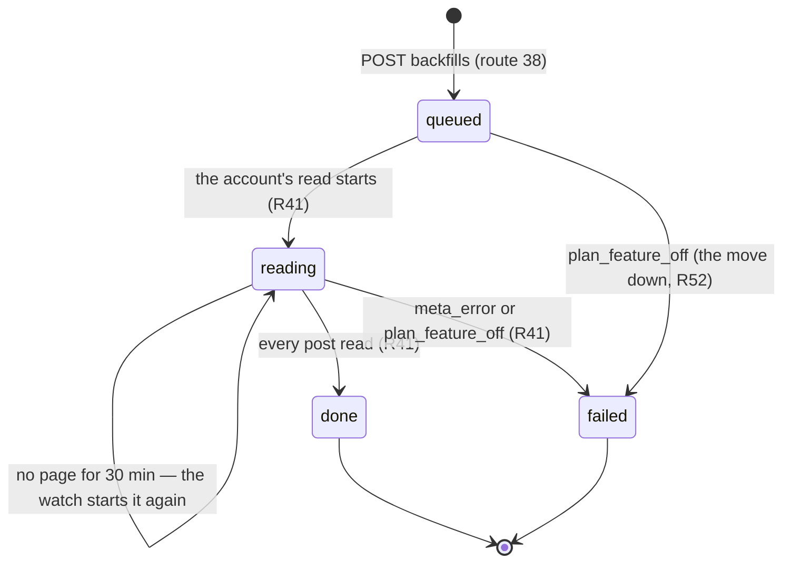

`src/domains/app/sub-domains/automation/automation-backfill/`

# Automation backfill (nested resource)

Parent: [Automation](../automation.overview.md)

## Purpose

An automation's past-comments reads (`app.automation_backfills`, feat-instagram-dm-sending
routes-final § 4.C, AU31–AU33, ROUTE row R15): "also answer comments from the last N days" (1–7) on
a live comment or ad-comment automation, a PRO feature (`past_comments`, P83). Route 38
(`POST /api/v1/app/automations/{automation_id}/backfills`, `automation:update`, `X-Idempotency-Key`)
saves a `queued` read; route 39 (`GET …/backfills/{automation_backfill_id}`, `automation:read`)
reads one; the automation's object (routes 28–30, 32–34) carries its open read as `open_backfill`.
The read itself (WC-41, ROUTE row R41) is Instagram's `automation-backfill-read` task on
`instagram-tasks` (`instagram-webhook/workers/instagram-past-comment-read.processor.ts` — the
automation folder imports no channel, AUC13), woken through the `AutomationBackfillReadQueue` port:
Meta's comments saved as "old" comment events that intake takes in at the low priority, one read at
a time per account, its start, numbers and end through this service; the 10-minute watch
(`workers/automation-backfill-watch.*`) wakes a stuck one. A read that ends `done` tells who started it
and the Owner and Admin in the same unit — the `automation.backfill_done` notice with the numbers,
in-app on and email off by default (AC-8.8, R53).

## Layout

- `automation-backfill.schema.ts` — the table, its two composite keys (automation `CASCADE`, account
  `RESTRICT`), the checks of 4.C.3, the open, watch and queued indexes, the RLS policy (the
  organization arm plus the retention sweep arm in `USING` for the watch)
- `automation-backfill.repository.ts` — the open read of an automation, one read by its public id
  under its automation, the `queued` insert; the read job's account lock (`ABFR`), start, counters,
  end, the move down's `plan_feature_off`, and the watch's read across organizations
- `automation-backfill.service.ts` — `AutomationBackfillService`: route 38's checks and insert,
  route 39, `findOpenAutomationBackfill` (the automation service's `openBackfills` port); the read
  job's `beginAutomationBackfillRead` / `recordAutomationBackfillProgress` /
  `finishAutomationBackfillRead`, and `failOpenBackfillsForPlanFeatureOff` (WC-38, R52)
- `workers/automation-backfill-watch.*` — the 10-minute watch (job `watch-automation-backfill-reads`
  on the intake queue, run by the intake worker)
- `automation-backfill.routes.ts` / `.controller.ts` / `.dto.ts` / `.validator.ts` — routes 38–39:
  the strict body (`days` 1–7), the audit entry after commit
- `automation-backfill.serializer.ts` / `.types.ts` — the Automation backfill object (4.C.6); the
  ports `AutomationBackfillReadQueue` (R41) and `AutomationOpenBackfillReader`
- `automation-backfill.constants.ts` — statuses, fail reasons, `PAST_COMMENTS_MAX_DAYS` (7), the
  ways to start it supports, `PAST_COMMENTS_POSTS_MAX` (50), the watch's 30 / 10 minutes,
  `META_TASK_RETRY_MINUTES` (1, 5, 15, 60), the 7-days-minus-30-minutes comment age
- `seed/` — bulk: a read in every status on each seeded team's live comment automations
- `__tests__/` — unit (validator, serializer), the repository against the database, routes 38–39
  over HTTP

## Key invariants

- **One open read per automation** — the partial unique `idx_automation_backfills_open` over
  `(organization_id, automation_id) WHERE status IN ('queued', 'reading')`; a second start answers
  `409 automation_backfill_in_progress` ("Past comments are already being read"), the race loser
  too. A start after a `done` or `failed` read makes a new row.
- **Route 38's order** (AU31): team-only (`422`), the automation locked `FOR UPDATE`
  (`404 automation_not_found`), 1B's one feature check `past_comments` (`403 plan_lacks_feature`,
  `422 channel_lacks_feature`, `409 permission_not_granted`), `live` only (`409 automation_not_live`),
  `comment` or `ad_comment` only (`422 automation_backfill_not_supported` — never `live_comment`), no
  open read; then the row, its account copied.
- **A read is found under its own automation only**: another automation's or organization's answers
  `404 automation_backfill_not_found` (AU33). No list route.
- **`fail_reason` is set exactly when `failed`** (`meta_error` · `plan_feature_off`); `last_error`
  holds codes only and never leaves (support reads the logs).
- **No Meta call in a request** (4.10): the start writes a row; the job reads.
- **One read at a time per account** (AU32): the job's start runs under the account's advisory lock
  — a `reading` read with a page in the last 30 minutes leaves the job idle, an older one is started
  again from zero (the watch), else the oldest `queued` read starts; every later write is guarded by
  the read's `started_at`, so a read started again stops the old job. An ended read wakes the next.
- **The read never sends** (4.C.10): its comments go through the webhook's store function (key
  `comment:<id>` — a comment Meta delivered keeps its one event and handling) and intake; `found` is
  the comments in the window, `matched` those the automation's keywords match, `queued_count` the
  matched ones saved as new events (P316).
- **Kept with its automation**: the purge of a deleted automation takes its reads by cascade.

## Lifecycle

## Failure modes

- **Route 38**: no `automation:update` → `403 missing_permission`; no `X-Idempotency-Key` →
  `422`; a personal organization → `422`; `days` missing, not whole, outside 1–7, or an unknown
  field → `400`; then the refusals of the order above. Nothing is written and no audit entry is
  recorded on any of them.
- **Route 39**: no `automation:read` → `403`; a personal organization →
  `404 team_organization_required`; `404 automation_not_found`; `404 automation_backfill_not_found`.

## Audit

`app.automation_backfill.start` (INFO, resource type `automation_backfill`, metadata
`automation_backfill_public_id`, `automation_public_id`, `days`), after route 38 commits,
best-effort.
