`src/domains/app/sub-domains/automation/automation-run/`

# Automation run

Parent: [Automation](../automation.overview.md)

## Purpose

What happens when an automation runs for a contact (routes-final § 3.B, ROUTE row R10): the run
(`app.automation_runs`), its history (`app.automation_run_events`), the per-comment step log
(`app.automation_comment_logs`) and the run engine that writes them. No routes (D13): sub-domain
4's event processing calls the engine's four entry points per event, and the run sub-domain hooks
into three transactions of other sub-domains — the automation delete (route 15) cancels its open
runs, the contact erase (route 10) clears every copy of the contact's personal data, and an event
marked `failed` (sub-domain 4) fails the runs it left running. The contacts
list's `automation_id` filter (CT5) reads the runs through `contactHadRunOfAutomation`. Three
workers keep the tables bounded (R11 — AU25, D8): the hourly 7-day wait cancel, run retention and
comment-log retention.

## Layout

- `automation-run.schema.ts`, `automation-run-event.schema.ts`, `automation-comment-log.schema.ts`
  — the three tables with every check and index of 3.B.3 and their RLS policies;
  `contactHadRunOfAutomation` (the contacts filter's `EXISTS`)
- `automation-run.repository.ts`, `automation-run-event.repository.ts`,
  `automation-comment-log.repository.ts` — each with its `createWorker…Repository(databaseHandle)`;
  the run and comment-log repositories also with `createRetention…Repository(databaseHandle)` (the
  7-day wait's scan, run and comment-log retention)
- `automation-run.service.ts` — `AutomationRunService`: the entry points `startCommentRun`,
  `handleDirectMessage`, `startStoryReplyRun`, `handleButtonClick`, each followed by the contact's
  runs that wait for a step now off (AU14); the step machine (plan → claim → send → record);
  `cancelAutomationOpenRuns`, `eraseContactRunCopies` and `cancelExpiredWaitingRuns` (the 7-day wait,
  AU25) — one cancel path; `failRunsOfFailedEvent` (AU19, D47)
- `automation-run-message.service.ts` — `AutomationRunMessageService`: composes each DM with the
  English defaults (AU22), sends it through the one Instagram client after a random pause, the
  quick-reply fallback, the public reply, the follow read, and classifies every failure once
- `automation-public-reply-safety.service.ts` — `AutomationPublicReplySafetyService` (AU20)
- `automation-run-matching.util.ts` — which automation a comment, a DM or a story reply starts
  (AU16, D26), AU17's decision, the answer a DM carries (D18) — pure
- `automation-run-step.util.ts` — the step planner (AU18, AU14, D14) and where a waiting run goes
  when its step is now off (`planWaitedStepNowOff`, D48) — pure
- `automation-run-message.util.ts` — the button payload `<aut_…>::<run_…>`, the channel a DM takes
  (3.B.10) and the wire shape of each message — pure
- `automation-run.validator.ts` — the strict `queued_automations` shape (AU21)
- `automation-run.types.ts`, `automation-run.constants.ts`
- `workers/` — `automation-run-wait-expiry` (every hour, 500 runs a tick: a cross-organization
  scan, then each organization's cancel in its own job scope), `automation-run-retention` (daily
  03:20 UTC, runs by `ended_at`) and `automation-comment-log-retention` (daily 03:30 UTC, logs by
  `created_at`) — family `retention`, no Instagram call
- `seed/` — bulk: a run in every status per seeded team, its events and the comment runs' logs
- `__tests__/` — unit (matching, planner, messages, queued shape, reply safety, sending, the
  three workers and the wait check's processor), the engine end to end, its locks on two connections
  (the delete, the erase, the 7-day cancel), the repositories and the three workers' processors
  against the database, the route integration suite and the factory

## Key invariants

- **One automation answers a comment** (AU16, D26): only the comment's account's live comment
  automations are eligible (AU27); the post-linked ones (`specific` on the post, or a `next` linked
  to it) are checked first and the oldest match runs; only when none matches is the oldest "any
  post" match chosen. Every other match is logged `ignored` · `comment_already_answered`, never
  `failed`. The choice and every log are written in one short unit, so a retried comment finds its
  logs and resumes the chosen run instead of choosing again.
- **One open run per automation × contact** (AU17, `idx_automation_runs_one_open`), and what a
  trigger meets, in order: another automation's run waits for the contact's email → the trigger is
  queued on it and the question asked again; this automation's run waits — for the email too —
  → `already_waiting`, nothing asked again (D14); it runs → `run_in_progress`; its last run is
  `completed` or `failed` → `previous_run_final` (a `cancelled` one allows a new run).
- **A message is sent at most once** (AU19, D16): each send is claimed (`sending_message_kind`,
  `sending_started_at`, the event key) in a short unit, sent outside any unit, and recorded in
  another. Delivered → the step moves on; refused → the step fails; a temporary error → the claim
  is cleared and the error rethrown (on the event's last attempt the run fails instead); an
  unknown outcome — a timeout, a gateway's 502 or 504 (D55) — → the claim stays and the step fails
  (AQ5). A claim still set when the run
  resumes fails the step — never re-sent. An event whose key is a run's `last_instagram_event_key`
  resumes that run instead of being applied again. A question asked again, or the wrong-email text,
  follows the same rule on a run that keeps waiting: a temporary error puts the run's previous event
  key back, so the retried event sends it; any other outcome marks it done.
- **An event that ends `failed` leaves no run `running`** (AU19 rev 2, D47): whenever sub-domain 4
  marks an event `failed` — the 5th failed attempt, attempts that ran out, a permanent or token
  failure — `failRunsOfFailedEvent` fails, in the mark's own unit, every run of the organization that
  is still `running` with that event as its last one: `code:<the event's code>`, the claim cleared, a
  `status_changed` event, its comment log `failed` (an error it already holds is kept). Waiting and
  ended runs are not touched; a repeat finds none. An event skipped after a claim does the same with its
  skip reason as the code (`code:automation_disabled`, `code:account_disconnected`, D51).
- **Until ROUTE row R14** the engine reads each automation through its step view of the shared row
  (`automation-run-automation.repository.ts`, feat-instagram-dm-sending R13): the hello's and the follow
  ask's first version, the first email / phone wording, the last text message as the final DM, the tag
  step's tags; `dm_keyword` runs as `dm`, "also start from" DMs as the DM keyword switch.
- **The steps** (AU18): the public reply (comments, reply safety), the opening message on every
  trigger (AQ3; skipped when the contact got a DM in the last 24 hours, D14; with a button the run
  waits), the follow check, the email and the phone (skipped when the contact has them), the final
  DM — then `completed` and the automation's tags (or its name) on the contact (the all-time counts
  are `app.automation_counts`, written from ROUTE row R14). The automation is read as it is now at every step (AU14).
- **A step turned off while a run waits for it** (AU14, D48) — the opening button, the follow, the
  email or the phone: nothing is sent when the setting changes. The run takes no answer any more,
  holds no trigger or click back (AU17 (1)) and is never asked again; at the contact's next event —
  a comment, a DM, a story reply, a button click — once that event's own handling is done, it goes on
  from its next step and, when it waited for the email, its queued automations start (AU21), each
  with its own settings. Inside the messaging window only: a comment does not open it and Instagram
  takes one private reply per comment, so a comment outside it moves no waiting run on — it waits for
  the next event (3.B.10, D50). A
  deleted automation's run stays cancelled; a dead token leaves the rest to a later event.
- **The channel** (3.B.10): a normal DM inside the contact's 24-hour messaging window
  (`last_direct_message_received_at`); otherwise, on a comment run, a private reply to the comment
  within 7 days; otherwise the step fails without a call (`outside_messaging_window`).
- **Reply safety** (AU20, D17), only when on: duplicate → random → hour limit → gap, counted from
  the comment logs in Postgres; never the automation's last reply text. The DM is never held back.
- **Queued automations** (AU21): one entry per automation, at most 100, public ids only, a strict
  shape checked before every save; when the email arrives each starts as its own run, in order
  (skipped when no longer live or deleted — read under its lock — another account's, or held back by
  AU17), and its comment log moves from `ignored` to `started`.
- **Run events** are append-only, one per status change and per email or phone collected, in the
  same unit as the run change (AU23).
- **One lock order** (AU12, CT8, D47): the contact, then the automation, then its runs. Every unit of
  the engine locks the contact (`lockLiveContact`, `FOR KEY SHARE`) and then the automations of the
  contact's open runs (`lockForRunChanges`, `FOR KEY SHARE`) before it touches a run; the contact
  erase (`FOR UPDATE` on the contact) locks those automations the same way before it cancels; the
  delete (route 15) holds the automation `FOR UPDATE` and then cancels its runs. Whoever holds a run
  holds its automation, so the three never block each other. A unit that starts a run reads its
  automation live again under its lock (`lockLiveForRunStart`): one deleted or turned off since it was
  matched starts nothing — `ignored`, nothing written — and a delete that comes later finds the run,
  so no open run stays on a deleted automation. The 7-day cancel skips a run another transaction
  holds (`SKIP LOCKED`, due again the next hour).
- **Erase and disconnect** (AU26, IQ1): the contact erase cancels the contact's open runs and
  clears `trigger_text`, the queued automations and the five comment-log copies; a contact erased
  while its event was being handled starts no run and leaves no copy (CT9); a disconnect cancels
  nothing — waiting runs continue on a reconnect of the same account, else the 7-day limit ends them.
- **Retention** (D8, AU25): a run waiting more than 7 days is cancelled `wait_expired` by the
  hourly check — the same cancel as a delete (one `status_changed` event, its comment log
  `cancelled`, `queued_automations` emptied), after re-checking in the update that it still waits,
  so a run answered just before is left alone; a deleted organization's runs are not listed (they
  wait for its purge). Runs that ended more than 180 days ago go daily at
  03:20 UTC with their events (`CASCADE`), their comment logs staying with the run emptied
  (`SET NULL`); comment logs written more than 180 days ago go at 03:30 UTC. Open runs are never
  removed. Each is safe to repeat and to skip.
- **No database context across an Instagram call** — every call is between two short units.
- **RLS:** each table's organization policy in `USING` and `WITH CHECK`, plus the retention sweep
  arm in `USING` only; the engine's units run in the job's organization scope relayed by
  sub-domain 4 (never minted here).

## Lifecycle

A run's status (`app.automation_runs.status`):

```mermaid
stateDiagram-v2
    [*] --> running: a trigger starts it (keyword_match)
    running --> waiting: a message with a button, the follow request, the email or phone question went
    waiting --> running: the click, the answer, or any next event once the step was turned off
    running --> completed: the final DM went
    running --> failed: a refused, unknown or (last attempt) temporary send; a dead token; its event ended failed or skipped
    running --> cancelled: the automation deleted, the contact erased
    waiting --> cancelled: the automation deleted, the contact erased, 7 days of waiting (hourly check)
    completed --> [*]
    failed --> [*]
    cancelled --> [*]
```

## Events

None emitted and no audit entries — runs are their own history (AU4). The engine calls sub-domain
1's `markConnectionBroken` on a dead token (the reconnect notice follows from there).

## Failure modes

- **A temporary Instagram error** (a throttle, a 5xx other than 502 and 504, an open circuit, a
  connection refused) → the claim is cleared and the error rethrown for sub-domain 4's
  capped retry; on the last attempt the run fails (`instagram_api` or `network`). A question asked
  again on a waiting run (a wrong email, a story reply, a click) also gets its event key back, so
  the retried event asks again; on the last attempt that run just keeps waiting.
- **A refusal, a dead token, an unknown outcome or a closed messaging window** → the run fails with
  its error on the run and the comment log; a dead token also marks the account `error`. The comment
  log's `error_response` holds Instagram's class, codes, type, trace id and HTTP status — never its
  text, which can name the person or quote a token (D53), so an erase has nothing to clear there.
- **A database error, or any other error of our own** → propagates; the event is retried and the run
  resumes from its saved step. When the event's last attempt dies that way — or the process does — the
  event ends `failed` and its run with it (`error_type` `code`).
- **The automation is deleted while a run of it starts or moves** → one waits for the other: the run
  is cancelled with the delete, or never starts.
- **A malformed queued entry** → skipped and logged; the others start.
- **The 7-day check fails for one organization** → counted, warn-logged and sent to Sentry; its
  runs stay due for the next hour. A scan or a retention delete error → BullMQ retry and the DLQ;
  a retention run stopped at its batch cap leaves the rest to the next day.

## Policy constants

`AUTOMATION_RUN_QUEUED_AUTOMATIONS_MAX_COUNT` (100), `AUTOMATION_OPENING_MESSAGE_SKIP_WINDOW_MILLISECONDS`
(24 hours), `INSTAGRAM_MESSAGING_WINDOW_MILLISECONDS` (24 hours),
`INSTAGRAM_PRIVATE_REPLY_WINDOW_MILLISECONDS` (7 days), `AUTOMATION_SEND_PAUSE_MIN_MILLISECONDS` /
`_MAX_MILLISECONDS` (200 / 1000), `AUTOMATION_PUBLIC_REPLY_HOUR_WINDOW_MILLISECONDS` (60 minutes) and
the default-text keys `AUTOMATION_MESSAGE_KEYS` (`common:automationMessages.*`), and the product
rule `AUTOMATION_RUN_WAIT_MAX_DAYS` (7) in `automation-run.constants.ts`; the product rules
`AUTOMATION_RUN_RETENTION_DAYS` (180) and `AUTOMATION_COMMENT_LOG_RETENTION_DAYS` (180) in
`src/shared/constants/instagram.constants.ts`;
`AUTOMATION_RUN_WAIT_EXPIRY_BATCH` (500) in `workers/automation-run-wait-expiry.constants.ts`.
