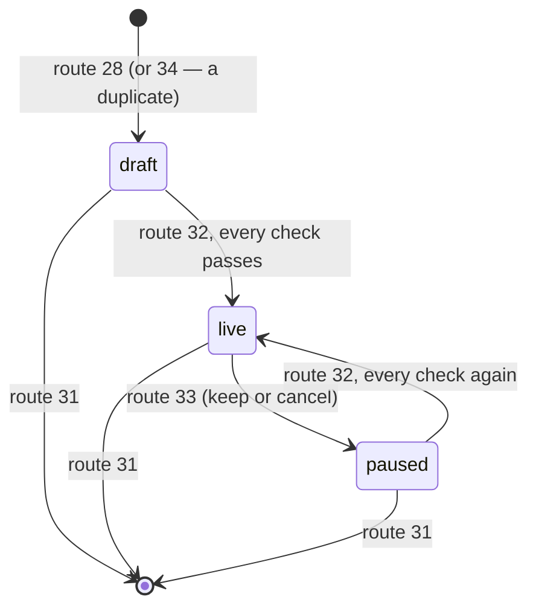

`src/domains/app/sub-domains/automation/`

# Automation

Parent: [App](../../app.overview.md)

## Purpose

What an organization builds to answer people on its channel accounts, shared by every channel
(feat-instagram-dm-sending routes-final § 4, ROUTE row R13, P48): one automation of one channel
account — how it starts (one of 15 ways, "also start from", where it listens, keywords, the link code,
starter questions, the ad, the trigger tag), its public reply and "Reply like a person" pacing, and
one `steps` object for what it sends (hello, follow, email, phone, 1–10 messages of 7 kinds, tags)
(`app.automations`). `draft` → `live` ⇄ `paused`, by actions only. The team lists one account's
automations, saves drafts, reads, saves content, deletes, goes live, pauses, duplicates and tries a
keyword (routes 27–35, `/api/v1/app/automations`; its failed messages' summary and retry, routes
36–37 `…/{automation_id}/failed-messages/summary` · `/retry`, over the channel's sending port — R19). All-time counts live in 16 slot rows
(`app.automation_counts`) and the reply pacing in `app.automation_reply_states`. Event processing
(sub-domain 5) links waiting "next post" automations to a new post through this service (no end
date — P12); a worker removes for good the automations deleted long ago that nothing points at. The
runs, their history, the per-comment logs and the run engine are the nested
[`automation-run/`](automation-run/automation-run.overview.md) (§ 4.B — rebuilt at ROUTE row R14).

## Layout

- `automation.schema.ts` — the table: the composite key to the channel account, the every-save and
  the go-live (`status = 'draft' OR (…)`) checks, the indexes of 4.A.3, the RLS policy
- `automation-steps.dto.ts` — the one zod schema of `steps` (types and kinds at every save)
- `automation.repository.ts` — one account's list (status and kind filters, name search, three keyset
  sorts), the reads and the locked read, insert, update, the action write, soft delete, the go-live's
  account-wide reads (catch-all, starter questions, ref code, shared keywords), the keyword test's
  candidates, the linking `UPDATE`, the contacts filter's lookup and the purge
- `automation-count.{schema,repository,service}.ts` — the 16 count slots: the `+1` (the run engine
  writes it in the event's commit) and the sums the list and the read show
- `automation-reply-state.{schema,repository,service}.ts` — the "Reply like a person" pacing the
  channel's reply lane reads and writes
- `automation.service.ts` — routes 27–35, the go-live list (every check at once), the warnings,
  `linkNextPostAutomations` and `findAutomationIdForFilter` (CT5)
- `automation.validator.ts` — the parsers, the merges, `listAutomationContentProblems` (go-live
  checks 1 and 6–17, pure, each with its step path), the feature-check parts, the uploads, ref codes
- `automation.types.ts` — the objects, the later rows' ports (`AutomationStarterQuestionSyncQueue`,
  `AutomationMonthLimitPort`, `AutomationMessageFilePort`) and `AutomationOpenRunCancelStep`
- `automation.dto.ts`, `automation.serializer.ts`, `automation.controller.ts`,
  `automation.routes.ts`, `automation.constants.ts`
- `workers/` — the deleted-automation purge (`automation-tombstone-retention`, daily 03:40 UTC)
- `automation-run/` — the nested run sub-domain: runs, run events and comment logs split by month,
  the open-run keys and the run engine over `steps` (R14), which saves its steps through
  `ChannelSendingPort` and reads automations through this folder's repository
- `seed/` — bulk: one automation of each of the 15 ways per seeded account, drafts, a paused one,
  counts; then the runs

## Key invariants

- **Shared by every channel (P48, AU34):** keyed by `channel_account_id` with `channel` copied from
  the account; the folder root imports no `instagram-*` folder (`automation-channel-neutral` policy
  test) — accounts and the one feature check come through the channel account (1B), a channel's
  sending through `app.channel-ports.ts`.
- **Two levels (AU9):** a draft saves anything of the right shape; a live or paused row must pass the
  go-live CHECKs; a save of one also passes the content checks (`400`, one item per problem with its
  `body.steps…` path) and may not turn a PRO part on (`403 plan_lacks_feature`).
- **Go-live answers every problem at once (AUQ1):** `409 automation_not_ready` with `errors[]`
  (`field`, `reason`, `message`) — the account, the month limit, the content, the one feature check
  (`channel_lacks_feature`, `permission_not_granted`, `plan_lacks_feature`, `feature_not_offered`),
  the starter-question total (≤ 4 per account, counted under the account row's `FOR UPDATE`), the free
  ref code, one live catch-all, usable files. Warnings never refuse. The plan-ended `403` is route
  32's preHandler only (P10).
- **Lock order (4.A.10):** go-live locks the account, then the automation; saves, actions and the
  delete lock the automation `FOR UPDATE` after the organization's `AUTOMATION_NEXT_POST` advisory
  lock (a save and a link take turns); the run engine holds it `FOR KEY SHARE` (D47).
- **Counts survive the runs (AU19):** 16 slot rows per automation, `+1` with an upsert; no run key.
- **A "next post" never expires (P12):** it waits from its first go-live (`target_starts_at`) and links
  the first post published after it; a save may not change a linked one's target.
- **The delete (AU16, P11):** an optional reason; the open runs are cancelled in the same commit; the
  contacts it collected stay; the purge sets the two contact keys null.

## Lifecycle

## Events

None on the event bus. The audit entries are the controller's, after commit: `app.automation.create`,
`.update`, `.delete`, `.go_live`, `.pause` (`mode`), `.duplicate`. A starter-question automation's
go-live, pause, delete or question change enqueues the account's starter-question sync after commit
once ROUTE row R40 wires it.

## Failure modes

- The `400`s of a draft's shape and a live save's content; `400 trigger_type` for a change across
  groups; `403 plan_lacks_feature`, `403 organization_read_only` (route 32); `404
  automation_not_found`, `404 team_organization_required`; `409 automation_not_ready`,
  `automation_ref_code_exists`, `instagram_not_connected`, `next_post_already_linked`,
  `record_changed`, `transition_not_allowed`; `422` on a personal organization's writes and a missing
  `X-Idempotency-Key` (routes 28, 34).
- A cancel step that throws rolls the delete back.

## Policy constants

`automation.constants.ts` — the 15 ways with their groups, the scopes and "also start from" each
allows, statuses, the limits of 4.A.3 (`AUTOMATION_*_MAX_*`, full names — P6), `AUTOMATION_COUNT_SLOTS`
(16), `AUTOMATION_LAST_TRIGGERED_UPDATE_SECONDS` (60), the sorts; the shared matcher's
`AUTOMATION_KEYWORD_CLOSE_MATCH_MIN_LETTERS` (5) in `automation-run/automation-run-matching.util.ts`;
`RESOURCE_QUOTA_LOCK_NAMESPACE.AUTOMATION_NEXT_POST`.
