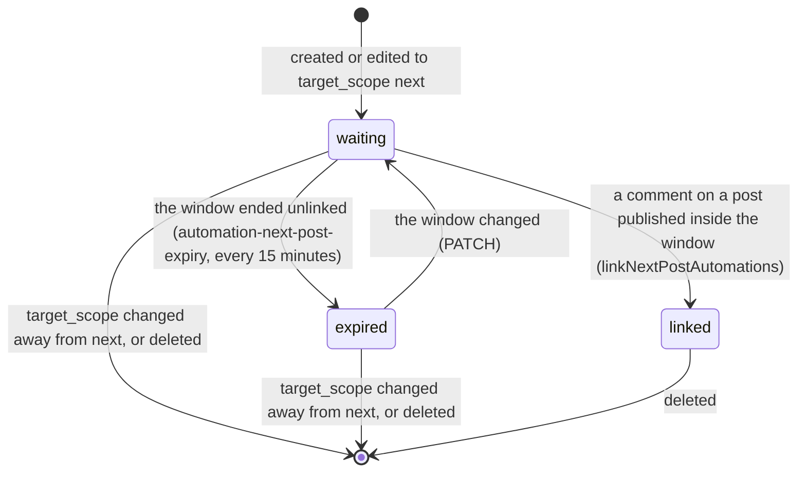

`src/domains/app/sub-domains/automation/`

# Automation

Parent: [App](../../app.overview.md)

## Purpose

What an organization builds to answer comments, DMs and story replies on its Instagram account: one
automation of one Instagram account — its trigger, target, keywords and tags, the message of each
step, and the counters the run engine keeps (`app.automations`, routes-final § 3.A, ROUTE row R9).
The team lists, creates (the frontend's Duplicate too), reads, edits and deletes them (routes
11–15, `/api/v1/app/automations`); event processing (sub-domain 4) links waiting "next post"
automations to a new post through this service, a worker expires the windows that ended
unlinked every 15 minutes, and another removes for good the automations deleted 180 days ago that
nothing points at any more (AQ7). The runs, their history, the per-comment logs and the run engine are the
nested [`automation-run/`](automation-run/automation-run.overview.md) (§ 3.B, ROUTE row R10).

## Layout

- `automation.schema.ts` — the table: its composite key to the Instagram account, every check and
  index of 3.A.3 and the RLS policy
- `automation.repository.ts` — the list (filters, name search, four keyset sorts, capped total),
  the reads and the locked read, insert, update and soft delete, the "next post" overlap read, the
  linking `UPDATE`, the run engine's reads, locks and counters, the expiry's scan and change and the
  purge's batch delete; `createWorkerAutomationRepository` and `createRetentionAutomationRepository`
- `automation.service.ts` — routes 11–15, `linkNextPostAutomations` (AU15) and
  `findAutomationIdForFilter` (the contacts list's `automation_id`, CT5)
- `automation.validator.ts` — the body and query parsers, the merge of a body over the defaults or
  the stored row, `validateAutomationFlow` (every cross-field rule of AU8 and AU9, pure),
  `assertNextPostLinkUnchanged` and `resolveNextPostState`
- `automation.types.ts` — the automation object, the message shapes and
  `AutomationOpenRunCancelStep`, the delete hook the run sub-domain registers through the app
  container (AU12)
- `automation.dto.ts`, `automation.serializer.ts`, `automation.controller.ts`,
  `automation.routes.ts`, `automation.constants.ts`
- `workers/` — the "next post" expiry (`automation-next-post-expiry`, every 15 minutes, D9) and the
  deleted-automation purge (`automation-tombstone-retention`, daily 03:40 UTC, AQ7)
- `automation-run/` — the nested run sub-domain: runs, run events, comment logs, the run engine
- `seed/` — bulk: every trigger and scope per seeded live Instagram account, then the runs
- `__tests__/` — unit (validator, serializer, service, the expiry processor and worker, the purge
  worker), the repository's and the purge's database suites, the route integration suite and its
  factory

## Key invariants

- **Each automation belongs to one Instagram account** (AU27): the organization's not-revoked
  account (an `expired` or `error` one counts), read through the account service in the create's
  transaction; without one the create is `409 instagram_not_connected`. No DTO carries
  `instagram_account_id`, so it never changes; the composite key
  `(organization_id, instagram_account_id)` → `app.instagram_accounts (organization_id, id)` is
  `ON DELETE RESTRICT`. Another account's automations never run.
- **Every save is a complete flow, whatever the status** (AU8, D19): the body is laid over the
  create's defaults or the stored row and one rule set runs on the result — the final message
  always; the opening and follow messages when their step is on; on a comment automation with the
  opening message on, its button (AQ2); `next` only on comments; a DM automation `any`, with a
  keyword and the DM keyword trigger on; `specific` with exactly its post or story id; public
  replies only on comments, with 1–20 texts. One `errors[]` item per broken field. The table's
  checks hold the same rules.
- **Keywords are trimmed, lowercased and deduplicated, tags deduplicated** (AU7); the message
  objects are strict — an unknown key is a `400`.
- **"Next post" windows** (AU9): both dates, the end after the start; a new or changed start not
  before 24 hours ago, a new or changed end not in the past; a started window may move later,
  never earlier. A save that leaves the automation live and waiting is checked against the same
  account's other live, waiting windows — overlapping and sharing a keyword, or either without
  keywords, is `409 next_post_window_overlap` — under the organization's `AUTOMATION_NEXT_POST`
  advisory lock, which linking takes too, so two saves never both pass. A changed window on an
  `expired` automation waits again; a `linked` one's window, scope and target ids are fixed
  (`409 next_post_already_linked`); leaving `next` clears every next-post field.
- **Linking** (AU15, AQ4): under the same lock, one conditional `UPDATE` links every live, waiting
  automation of the post's account whose window holds the post's publish time (the start counts, the
  end does not), unless one of the account's automations targeted the post before — so two may link
  one post. **Expiry** (D9): the worker scans every live organization's ended `waiting` windows (500 a
  tick, oldest first) under the retention sweep arm, then changes each organization's in its own job
  scope with the same conditional `WHERE`. Both change `updated_at`, so a save opened before them is
  `409 record_changed`. End to end: [`instagram-next-post-flow`](src/FLOWS.md#instagram-next-post-flow).
- **The counters are the run engine's** (AU10): `completed_run_count` and `last_triggered_at` are
  in no DTO; the engine writes them in SQL through this repository (`markRunStarted`,
  `incrementCompletedRunCount`) and leaves `updated_at` as it is, so a person's
  `expected_updated_at` does not go stale each time the automation runs.
- **Edits** carry an optional `expected_updated_at`; an older one is `409 record_changed` (AU11).
  An edit reaches open runs from their next step; turning one `inactive` stops new runs (AU14).
- **Delete** (AU12, AQ6): soft, with `reason` required and `note` for `other`, in the query; in the
  same transaction every registered `AutomationOpenRunCancelStep` runs — the run sub-domain's
  `cancelAutomationOpenRuns` (its open runs `cancelled` · `automation_deleted`, one run event each,
  their comment logs `cancelled`). It locks the automation (`FOR UPDATE`) before its runs — the order
  of the run engine and the contact erase, which hold the automation `FOR KEY SHARE` before they touch
  a run (`lockForRunChanges`, `lockLiveForRunStart`) — so they never block each other, and the cancel,
  which reads after the lock, leaves no open run on a deleted automation (D47).
  No restore route. **Purge** (AQ7, AU25): daily at 03:40 UTC, after run retention (03:20) and
  comment-log retention (03:30), the automations deleted more than 180 days ago are removed in
  capped batches; one a run or a comment log still points at (`RESTRICT`) is skipped by the batch
  delete's per-row fallback and tried again the next day. The audit log keeps the delete.
- **Team-only and read-only plans** (AU3, AQ8, D27): the reads answer
  `404 team_organization_required` on a personal organization, the writes `422`; another
  organization's automation is `404 automation_not_found`. The three writes run the app domain's
  read-only guard first (`app-plan-access.ts`, `403 organization_read_only`); the reads and
  running automations go on. Members list, read, create and edit; only Owner and Admin delete.
- **The list** searches the name (any case, trigram index), filters by status, trigger, scope,
  "next post" status and account (an unknown account is an empty page), and sorts by created
  (default, newest first), name (A→Z), last triggered (never-triggered last in both directions —
  the nulls-last timestamp keyset) or completed runs (the integer keyset), either way.
- **RLS:** the organization policy in `USING` and `WITH CHECK`, plus the retention sweep arm in
  `USING` only — the expiry scan reads across organizations and never writes there; the purge
  deletes there.

## Lifecycle

The "next post" status of a `next` automation (`next_post_status`):

A linked automation never returns to `waiting`; its Duplicate starts `waiting` on a new window.

## Events

None emitted. Audit entries are the controller's, after commit (AU4): `app.automation.create`
(`automation_public_id`), `app.automation.update` (`automation_public_id`, `changed_fields`) and
`app.automation.delete` (`automation_public_id`, `delete_reason`, `cancelled_run_count`).

## Failure modes

- **An open-run cancel step throws** → the whole delete rolls back; the automation stays live.
- **Two saves race on overlapping windows** → the advisory lock makes the second wait and then see
  the first; it answers `409 next_post_window_overlap`.
- **A link fails** → sub-domain 4 logs it and still matches the comment (D18); the next comment on
  that post tries again.
- **An expiry change fails for one organization** → counted, logged and sent to Sentry; its
  automations stay due for the next tick.
- **The purge meets a still-referenced automation** → skipped and counted (`blockedCount`, a warn
  log per row); any other database error → BullMQ retry and the DLQ.

## Policy constants

`AUTOMATION_KEYWORDS_MAX_COUNT` (50), `AUTOMATION_TAGS_MAX_COUNT` (20),
`AUTOMATION_PUBLIC_REPLY_TEXTS_MAX_COUNT` (20), `AUTOMATION_MESSAGE_TEXT_MAX_LENGTH` (1000),
`AUTOMATION_BUTTON_TITLE_MAX_LENGTH` (20), `AUTOMATION_FINAL_MESSAGE_LINKS_MAX_COUNT` (3),
`AUTOMATION_LINK_URL_MAX_LENGTH` (2048) and `AUTOMATION_NEXT_POST_START_GRACE_MILLISECONDS` (24
hours) in `automation.constants.ts`; `AUTOMATION_TOMBSTONE_RETENTION_DAYS` (180, a product rule — not
`TOMBSTONE_RETENTION_DAYS`) in `src/shared/constants/instagram.constants.ts`;
`AUTOMATION_NEXT_POST_EXPIRY_BATCH` (500) in
`workers/automation-next-post-expiry.constants.ts`; `RESOURCE_QUOTA_LOCK_NAMESPACE.AUTOMATION_NEXT_POST`
in `src/infrastructure/database/resource-quota-lock.util.ts`.
