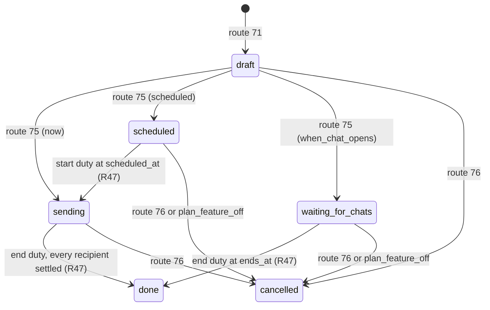

`src/domains/app/sub-domains/broadcast/`

# Broadcast

Parent: [App](../../app.overview.md)

## Purpose

Sending 1 to 3 messages to the contacts of one channel account who match an audience — shared by
every channel (P48; Instagram the only one now) — and the audiences themselves (routes-final § 7 of
the DM-sending iteration, routes 70–82). Built one ROUTE row at a time: the saved segments and the
audience count (7.B, routes 77–82) landed with ROUTE row R21; the broadcast at this folder's root
(7.A, `app.broadcasts`, routes 70–76, the send) with R22 — its start and end duties are R47's; the
recipients (7.C, `app.broadcast_recipients`, no routes) with R23. Sending itself is sub-domain 6's
broadcast lane (R45).

## Layout

- `broadcast-segment/` — saved audiences of one account (`app.segments`), the audience builder and
  the audience count — [Broadcast segment](broadcast-segment/broadcast-segment.overview.md)
- the folder root — the broadcast itself: `broadcast.schema.ts` (`app.broadcasts`, prefix `brc_`),
  `broadcast.repository.ts` (the list, the reads, each status move as one guarded `UPDATE`, the
  segment delete's draft step), `broadcast.service.ts` (`BroadcastService` — draft, edit, send,
  cancel, delete), DTOs (the automation's message schema and the segment condition tree reused),
  validator (each message's own automation checks), serializer, controller (the five audit
  actions), routes 70–76, `seed/`
- `broadcast-recipient/` — who a broadcast goes to and what happened (`app.broadcast_recipients`,
  no routes): the audience piece, each message's result through the port, the skips and her reply —
  [Broadcast recipient](broadcast-recipient/broadcast-recipient.overview.md)

## Key invariants

- One account each (BC5): a segment and a broadcast name their channel account at create and keep
  it; their conditions read only that account's contacts; a broadcast's segment and its button
  automation (`start_automation_id`, a live automation) are the account's.
- The automation codes gate every route (P20): `automation:read` · `create` · `update` · `delete`.
- PRO through the plan's switches (BC3, BC19, P76, P83): segment create, edit and the audience count
  need the `segments` switch; broadcast create and send the `broadcasts` switch; reading, editing a
  draft, cancelling and deleting stay open. The read-only plan refuses the send only.
- The send copies the audience (BC10): a later segment edit never changes a sent broadcast; deleting
  a segment empties `segment_id` on the drafts that use it (BC17, the segment delete's step).
- Soft delete, then purge 90 days later (BC4, P9, P75 — the purge is ROUTE row R50); only a draft,
  done or cancelled broadcast may be deleted (`409 broadcast_active`).
- The messages' link: `app.instagram_outgoing_messages (organization_id, broadcast_id)` → `app.broadcasts`,
  `ON DELETE CASCADE` (SN17) — sub-domain 7 never writes a message itself; it hands them to the
  account's channel's `ChannelSendingPort` (BC18, R23 / R46).

## Lifecycle

The broadcast's status moves by actions only (BC9); anything else is `409 transition_not_allowed`.

After route 75's commit the send queue (ROUTE row R46, `BroadcastSendQueuePort`, `app.tasks.ts`)
adds the `broadcast-audience` task for `now` (`bcaud-<brc_…>-1`; each piece chains the next and its
last sets `audience_built_at`, the end duty's mark) and the `segment-count` task for a waiting
broadcast's `matched`; a failed add is logged, the send stays committed. A cancelled broadcast's waiting recipients and messages are
settled by the end duty (R47).

## Ports for later rows

- `BroadcastSendQueuePort` (R46) — the audience task (WC-40) and the matched count (WC-39).
- Built at R47: `workers/broadcast-start.processor.ts` (WC-28 — due `scheduled` → `sending` with `started_at`, then
  the audience task through `BroadcastSendQueuePort`; without the port nothing starts) and
  `workers/broadcast-end.processor.ts` (WC-29 — a cancelled broadcast's waiting recipients skipped and their waiting
  messages cancelled through the channel port, 500 a piece; a "when her chat opens" one past `ends_at`, or a sending
  one whose audience is built, `done` with the `broadcast.done` notice once nobody waits), both on `instagram-tasks`;
  `BroadcastRecipientService.handleChatOpened` (BC17 — intake's hook after her chat event, and, since R56, the run
  engine's `runEndedHook` in the commit that ends her run; the oldest matching broadcast only, none while one of hers
  waits). The `broadcast.done` note carries sent, skipped and replies (R56). The "audience built" mark is R46's
  `audience_built_at`; until that column is in, no `sending` broadcast is ended (P319).
- The broadcast lane (R45) sends what the recipients saved; the purge and the recipients' 90-day
  clean-up (R50).
- `BroadcastRecipientService` (R23) for later rows: `buildAudiencePiece` (the `broadcast-audience`
  task chains it, R46), `addChatOpenedRecipient` (intake's `handleChatOpened`, R47),
  `skipBroadcastWaitingRecipients` (the end duty's cancelled settle, R47), `recordContactReply`
  (intake's first reply, R38); `recordMessageResult` is wired to Instagram's result save.
