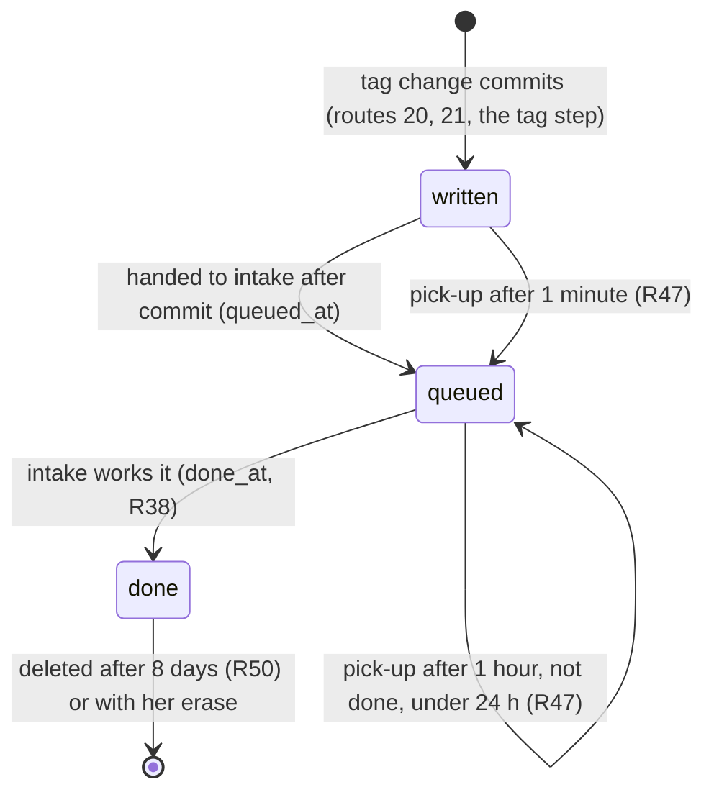

`src/domains/app/sub-domains/contact/contact-tag-event/`

# Contact tag event

Parent: [Contact](../contact.overview.md)

## Purpose

One tag added to or removed from one contact (`app.contact_tag_events`; routes-final § 3.B of the
DM-sending iteration, CT16–CT17, ROUTE row R11). Every tag change — the owner's (routes 20 and 21,
`source` `owner`) and a run's tag step (4.B, `source` `automation` with its automation and chain
number) — writes one row in the change's own commit, so a tag automation's start is never lost
(D45, AC-5.5). After that commit the changed contacts are handed to intake (WC-4), one job per 500
contacts (scale review S20). No routes and no public id: the rows are never returned; an event's
`id` is part of a tag start's once key (`tag:<tag>:<event id>`).

## Layout

- `contact-tag-event.schema.ts` — `app.contact_tag_events`: the composite keys to the contact
  (`CASCADE`) and its account (`RESTRICT`), the checks, the five indexes and RLS
- `contact-tag-event.repository.ts` — the multi-row insert, the hand-over's public ids, the erase's
  delete, one contact's events; `createWorkerContactTagEventRepository(databaseHandle)` for jobs
- `contact-tag-event.service.ts` — `ContactTagEventService`: the contact service's
  `ContactTagEventRecorder` (`recordContactTagEvents`) and the erase step (`deleteContactTagEvents`)
- `contact-tag-event.types.ts` — the intake port `ContactTagEventIntakeQueue` (WC-4, ROUTE row R38)
  and its job input
- `contact-tag-event.constants.ts` — kinds, sources, contacts per intake job
- `seed/` — bulk: one finished `added` event per seeded contact's tag
- `__tests__/` — the service unit suite and its database suite

## Key invariants

- **In the change's commit (CT16):** the recorder inserts on the caller's handle — the request's
  unit (routes 20, 21) or the job's (the tag step) — so a rollback writes none and a commit never
  lacks its events.
- **Hand-over after commit:** with intake wired, `queued_at` is stamped in the same insert and the
  live contacts' public ids are handed over by `runEnqueueAfterCommit` in jobs of at most 500
  (`CONTACT_TAG_EVENT_INTAKE_CONTACTS_PER_JOB`); a failed enqueue is logged and left to the pick-up.
  Until ROUTE row R38 passes the port, events stay `queued_at` null.
- **Erase (CT11):** the contact's erase deletes her events in its own unit (the contact row is
  erased in place, so the cascade never fires).
- **Field rules:** `tag` 1–50, trimmed, no comma (the contact validator normalises first); `kind`
  `added` · `removed`; `source` `automation` · `owner`; `source_automation_id` only with
  `automation`; `chain_number` ≥ 0.
- **RLS:** the organization arm plus the maintenance arm (`app.global_retention_cleanup`) for the
  pick-up scan and the clean-up; `WITH CHECK` the organization only.

## Lifecycle

## Events

None emitted; the hand-over is a queue job through the intake port.

## Failure modes

- **An insert breaks a check or a key** → it throws into the caller's unit; the tag change rolls back.
- **The hand-over fails after commit** → logged (`app.contact_tag_event.hand_over_failed`); the
  pick-up hands the events over again.

## Policy constants

`CONTACT_TAG_EVENT_INTAKE_CONTACTS_PER_JOB` (500), `CONTACT_TAG_EVENT_KINDS`,
`CONTACT_TAG_EVENT_SOURCES` in `contact-tag-event.constants.ts`.

Later rows: intake of tag events (WC-4) at ROUTE row R38, the pick-up (WC-27) at R47; the 8-day
clean-up (WC-54) is built (R50: `deleteCreatedBefore` over `idx_contact_tag_events_created`, the hourly
app-table clean-up, `CONTACT_TAG_EVENT_KEEP_DAYS`), `source_automation_id`'s key with the automations migration (R13).
