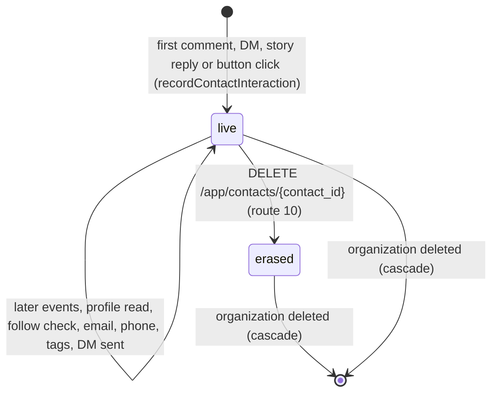

`src/domains/app/sub-domains/contact/`

# Contact

Parent: [App](../../app.overview.md)

## Purpose

The people who interacted with one of the organization's Instagram accounts — commented, sent a
DM, replied to a story or clicked a button — with the email and phone they shared, their tags and
their message times (`app.contacts`, routes-final § 2, ROUTE row R8). Event processing
(sub-domain 4) creates and updates them and the run engine (sub-domain 3) records what a run
collected, both through this sub-domain's service; the team lists them (route 9,
`GET /api/v1/app/contacts`) and may erase one at the person's request (route 10,
`DELETE /api/v1/app/contacts/{contact_id}`, D22). No route adds or edits a contact (CT2).

## Layout

- `contact.schema.ts` — the table, its composite key to the Instagram account, its checks, indexes
  and RLS policy
- `contact.repository.ts` — the list (filters, search, keyset sorts, capped total), the locked
  read and the anonymising update of the erase, and the worker writes;
  `createWorkerContactRepository(databaseHandle)` for event processing
- `contact.service.ts` — routes 9–10 and the worker operations of 2.10: `recordContactInteraction`,
  `recordContactProfile`, `recordContactEmail`, `recordContactPhone`, `addContactTags`,
  `recordContactMessageSent`, `findLiveContact`, `lockLiveContact`
- `contact.types.ts` — the contact object, the list query, `ContactErasureStep` (the hook other
  sub-domains register through the app container, CT8) and `ContactAutomationFilterResolver` (the
  automation filter's lookup, CT5)
- `contact.dto.ts`, `contact.validator.ts` — the list query; the email, phone and tag rules (CT10)
- `contact.serializer.ts`, `contact.controller.ts`, `contact.routes.ts`, `contact.constants.ts`
- `seed/` — bulk: contacts of every seeded live Instagram account
- `__tests__/` — unit (validator, serializer, service), the service's database suite, the route
  integration suite, and fixtures

## Key invariants

- **One live contact per organization, Instagram account and Instagram user** — the upsert target
  `idx_contacts_organization_account_instagram_user` (CT13). Instagram gives one person a different
  id per professional account, so each account has its own contacts; reconnecting the same account
  keeps them. The account link is the composite `(organization_id, instagram_account_id)` →
  `app.instagram_accounts (organization_id, id)`, `ON DELETE RESTRICT` (an account is only revoked).
- **Only event processing writes a contact**, through the service on its job's handle; every write
  changes a live contact only and answers `null` for an erased one, so a run that raced an erase
  stops before it messages anyone (CT2, CT9). Every unit of the run
  engine locks the contact's row first (`lockLiveContact`, `FOR KEY SHARE`), so an erase (`FOR
  UPDATE`) waits and clears what it wrote, or went first and nothing is written.
- **Times move forward only.** `first_seen_at` is the first event's time; `last_message_received_at`
  is never null and moves by `greatest` on every comment, DM, story reply and button click;
  `last_direct_message_received_at` moves on the last three only (they open Instagram's 24-hour
  messaging window); `last_message_sent_at` by `greatest` after every DM.
- **Field rules (CT10):** email through `trimmedEmail()`; phone normalised to an optional `+` and
  10–15 digits (`INTERNATIONAL_PHONE_NUMBER_PATTERN`); at most 50 tags, each 1–255 characters
  without a comma — past 50 a new tag is dropped and logged (a count, never the tag); a null follow
  status means never checked (`follow_checked_at`).
- **The erase anonymises in place (D22, CT7, CT8):** one transaction locks the live contact
  (`FOR UPDATE`), runs every registered `ContactErasureStep` (sub-domain 3's
  `eraseContactRunCopies`, CTC7 — the contact's open runs cancelled, the run trigger texts and the
  comment-log copies cleared), then clears
  the Instagram user id, username, full name, picture, followers, follow status, email and phone
  with their times and tags, and stamps `deleted_at` — `chk_contacts_erased` holds it. The row
  stays so its runs stay; a repeat is `404 contact_not_found`; nothing restores it. The person's
  next event creates a fresh contact — an erased row's `NULL` Instagram user id never collides.
- **Team-only (CT3):** the list answers `404 team_organization_required` on a personal
  organization, the erase `422`; another organization's contact is `404`. Members see emails and
  phones (`contact:read`); only Owner and Admin erase (`contact:delete`, D23).
- **The list** searches username, full name and email in one trigram expression (every word, any
  case), filters by tags (holds all), email, phone, follow status, first-seen range, account and
  automation (`automation_id` — had a run of it, deleted automations included, through
  `contactHadRunOfAutomation` on the run schema; the `aut_…` id resolved by the app container's
  `ContactAutomationFilterResolver` hook, so contacts never import sub-domain 3; CT5), and sorts by last message (default, newest first), first seen or username — A→Z, contacts
  without one last in both directions, through the shared nulls-last text keyset (CQ2, CTC4).
- **Personal data stays out of logs (K7, CT12, D38):** `phone`, `full_name`, `username` and
  `profile_picture` are in the log and Sentry redactor's list (`PERSONAL_DATA_KEY_FRAGMENTS`, part of
  `SENSITIVE_KEY_FRAGMENTS` in `sensitive-redaction.util.ts`) — but not in the secret list
  (`SECRET_KEY_FRAGMENTS`), so a response carrying them stays cacheable and replayable.
- **RLS:** the organization policy in `USING` and `WITH CHECK`, plus the retention sweep arm in
  `USING` only. No cross-organization resolver: event processing routes an event to its
  organization before any contact is read.

## Lifecycle

An erased contact never returns to `live`; the same person's next event starts a new `live` row.

## Events

None emitted. The erase's audit entry `app.contact.delete` (`WARNING`, `metadata.contact_public_id`
only — never an erased value) is the controller's, after commit (CT12).

## Failure modes

- **An erasure step throws** → the whole erase rolls back; the contact stays as it was.
- **A value breaks a `chk_contacts_*` check** → the service normalises first (a non-`https://`
  picture and a negative follower count are stored as unknown); a non-digit Instagram user id is a
  caller bug and throws.
- **An unknown or another organization's `instagram_account_id`** → an empty page, never an error;
  a malformed one is `400`.

## Policy constants

`CONTACT_TAGS_MAX_COUNT` (50), `CONTACT_TAG_MAX_LENGTH`, `CONTACT_LIST_TAGS_FILTER_MAX_COUNT` (10)
in `contact.constants.ts`; `INTERNATIONAL_PHONE_NUMBER_PATTERN` and `RECORD_SHORT_TEXT_MAX_LENGTH`
in `src/shared/constants/record-fields.constants.ts`.
