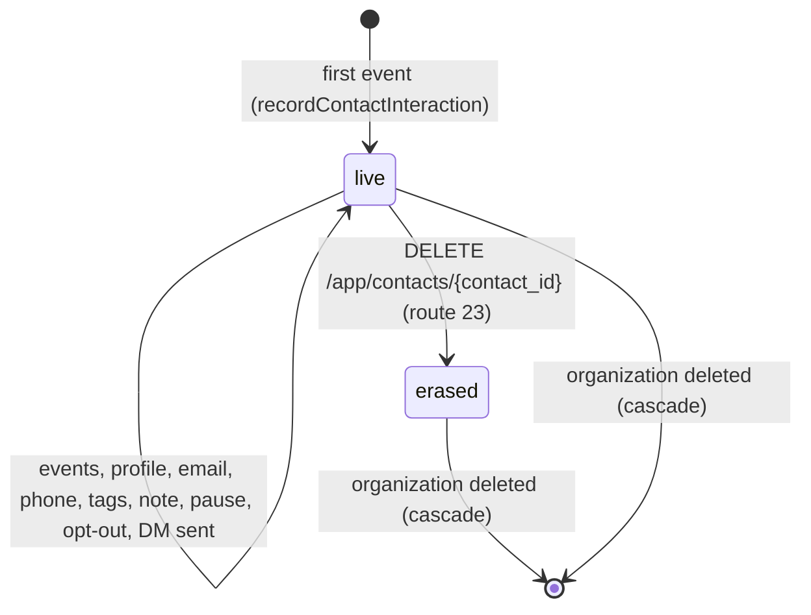

`src/domains/app/sub-domains/contact/`

# Contact

Parent: [App](../../app.overview.md)

## Purpose

The people who wrote to or commented on one of the organization's channel accounts — of any
channel (P48; Instagram the only one now) — with the email and phone they shared, their tags, the
team's private note, the team's "pause automations for this person", her own opt-out, how she came
in, and her activity times (`app.contacts` with its 1:1 `app.contact_activities`, and the per-account
`app.contact_tag_counts`; routes-final § 3, 3.A of the DM-sending iteration, ROUTE row R10; launch
§ 2, R8). Event processing creates and updates them and the run engine records what a run collected,
both through this sub-domain's service; the team lists one account's contacts (route 18,
`GET /api/v1/app/contacts?channel_account_id=`), opens one (19), writes a note, tags and pauses her
(20, `PATCH /contacts/{contact_id}`), runs one tag or pause on many (21,
`POST /contacts/bulk-actions`), reads the account's tags with counts (22, `GET /contact-tags`) and
erases one at the person's request (23). Routes 24–26 ("What happened", the failed messages) are
ROUTE row R19's. Every tag change is an event in the nested
[contact tag events](contact-tag-event/contact-tag-event.overview.md) (3.B, ROUTE row R11).

## Layout

- `contact.schema.ts` — `app.contacts`: the composite key to the channel account, the owner's and
  her own columns, checks, indexes (led by the account; search and tags through `btree_gin`, S6) and
  RLS
- `contact-activity.schema.ts` — `app.contact_activities` (S5): the fast-changing times and counts,
  one row per live contact, fillfactor 70, three indexes (the list's "last message" sort, a
  broadcast's chat-open, a segment's last comment)
- `contact-tag-count.schema.ts` — `app.contact_tag_counts` (S7): live contacts per account and tag
- `contact.repository.ts` — the list (filters, search under its 2 s timeout, keyset sorts, capped
  total), the detail read, the locks, the owner's writes, the bulk selection count, the tag counts,
  the anonymising erase and the worker writes; `createWorkerContactRepository(databaseHandle)` for
  jobs
- `contact.service.ts` — routes 18–23 and the operations of 3.A.10: `recordContactInteraction`,
  `recordContactProfile`, `recordContactEmail`, `recordContactPhone`, `addContactTags`,
  `recordContactMessageSent`, `recordContactOptOut` / `clearContactOptOut`, `recordContactComment`,
  `recordContactStoryActivity`, `recordContactFirstMessage`, `recordContactFirstRun`,
  `recordContactOpeningMessage`, `recordContactBroadcastSent`, `findContactSendState`,
  `findLiveContact`, `lockLiveContact`
- `contact.types.ts` — the objects, the queries and bodies, and the hooks: `ContactErasureStep`,
  `ContactPauseStep` (CTC4), `ContactAutomationFilterResolver`, the tag-event port
  `ContactTagEventRecorder` (3.B, built by `contact-tag-event/` at ROUTE R11) and the bulk queue port
  `ContactBulkActionQueue` (WC-36, ROUTE R46)
- `contact-tag-event/` — nested: `app.contact_tag_events`, one row per tag change written in its
  commit, handed to intake after it; no routes
- `contact.dto.ts`, `contact.validator.ts` — the list and tag-list queries, route 20's and 21's
  bodies; the email, phone and tag rules (CT9)
- `contact.serializer.ts`, `contact.controller.ts`, `contact.routes.ts`, `contact.constants.ts`
- `seed/` — bulk: contacts of every seeded live account, with notes, a paused and an opted-out one,
  their activity rows and the account's tag counts; then the nested tag events' contribution
- `__tests__/` — unit (validator, serializer, service), the service's and repository's database
  suites, the route integration suite, the channel-neutral import policy (CTC12), and fixtures

## Key invariants

- **One live contact per organization, channel account and provider person id** — the upsert target
  `idx_contacts_organization_account_instagram_user` (CT18; the column keeps its launch name
  `instagram_user_id`). Every list, the bulk action and the tag list name one `channel_account_id`
  (CT2, P65). The account link is the composite `(organization_id, channel_account_id)` →
  `app.channel_accounts (organization_id, id)`, `ON DELETE RESTRICT`.
- **Activity apart (S5):** every inbound event writes the activity row (`greatest` per time); the
  contact row is rewritten only when the username changes — so `updated_at` (route 20's
  `expected_updated_at`) moves on the team's changes and profile data, not on every message. Every
  read of a live contact inner-joins its activity row (`ContactRow` carries both).
- **Only this service writes contacts (CT1)** — the owner's routes and event processing call it;
  every write changes a live contact only and answers `null` for an erased one (CT9). Every unit of
  the run engine locks the contact first (`FOR KEY SHARE`); the owner's change takes `FOR NO KEY
  UPDATE` (waits for an erase, never for the engine); the erase `FOR UPDATE`.
- **The owner's change (route 20, CT5):** note 1–2,000 (`null` clears; nothing is sent); tags
  removed then added, each 1–50, at most 50 held — `422 contact_tag_limit`; each tag change moves the
  account's tag count (S7) and goes to the tag-event port in the same commit; a pause sets
  `automations_off_at` and the user and runs every `ContactPauseStep` with `contact_excluded` (4.B's
  `cancelContactOpenRuns` now; 6's waiting-message skip at its row); switching it off restarts
  nothing (AC-5.9). `expected_updated_at` older → `409 record_changed`. Her opt-out is never a route
  field (AC-5.10): intake sets it through `recordContactOptOut`, which runs the same steps with
  `opted_out`.
- **The bulk action (route 21, CT7):** ids (1–500) or a filter, the matches counted up to 100,000
  (`422 contact_bulk_too_many`), then one job through `ContactBulkActionQueue`; until ROUTE R46 wires
  the job, the route answers `503 contact_bulk_action_unavailable` after validating and counting.
- **The tag list (route 22, S7, P64):** the account is read back inside the organization's scope
  (`404 channel_account_not_found`), then one index range of `app.contact_tag_counts`, most first —
  no cache: the table is kept in every tag commit (P123).
- **Field rules (CT9):** email the strict shape, ≤ 254, plus addresses accepted (P19); phone an
  optional `+` and 10–15 digits; tags 1–50 characters without a comma.
- **The erase anonymises in place (CT11):** lock, every registered `ContactErasureStep` (her tag
  events deleted, 3.B; her run copies, 4.B), then the
  personal columns cleared — now with the note, the opt-out, the pause and the came-in ref — the
  activity row deleted and the tag counts lowered; `first_automation_id`, `came_in_via` and
  `channel` stay. A repeat is `404 contact_not_found`; nothing restores it.
- **Team-only (3.5):** reads answer `404 team_organization_required` on a personal organization,
  writes `422`; gates `contact:read` (18, 19, 22), `contact:update` (20, 21 — Owner, Admin, Editor,
  P20) and `contact:delete` (23 — Owner, Admin).
- **The list** searches username, full name, email and phone in one trigram expression led by the
  account (≥ 3 characters, every word, any case, a 2 s statement timeout — S6), filters by tags,
  email, phone, follow status, opt-out, pause, how she came in, her first automation, first-seen
  range and automation (`automation_id` — had a run of it), and sorts by last message (default,
  newest first, on the activity row's index), first seen or username (contacts without one last).
- **Personal data stays out of logs (CT4):** `note` joins `phone`, `full_name`, `username` and
  `profile_picture` in `PERSONAL_DATA_KEY_FRAGMENTS`; audit entries carry field names only.
- **Channel-neutral (CT18, CTC12):** the runtime code of `contact/` imports no `instagram-*`
  sub-domain — pinned by `contact-channel-neutral.policy.unit.test.ts`.
- **RLS:** `app.contacts` the organization policy plus the retention sweep arm in `USING`; the
  activity and tag-count tables the organization arm only.

## Lifecycle

An erased contact never returns to `live`; the same person's next event starts a new `live` row.

## Events

None emitted. Audit entries (CT10), after commit, best-effort: `app.contact.update` (INFO,
`changed_fields`), `app.contact.automations_pause` / `.automations_resume` (WARNING),
`app.contact.bulk_action` (INFO, action and `matched_count`), `app.contact.delete` (WARNING).

## Failure modes

- **An erasure or pause step throws** → the whole unit rolls back.
- **A value breaks a check** → the service normalises first; a non-digit provider id is a caller
  bug and throws.
- **A search runs past 2 s** → the statement is cancelled and the request fails (S6).
- **An unknown or another organization's `channel_account_id`** → an empty page on the list; `404
  channel_account_not_found` on the bulk action and the tag list.

## Policy constants

`CONTACT_TAGS_MAX_COUNT` (50), `CONTACT_TAG_MAX_LENGTH` (50), `CONTACT_NOTE_MAX_CHARACTERS` (2,000),
`CONTACT_EMAIL_MAX_LENGTH` (254), `CONTACT_SEARCH_MIN_LENGTH` (3),
`CONTACT_SEARCH_STATEMENT_TIMEOUT_MS` (2,000), `CONTACT_TAG_CHANGE_MAX_COUNT` (20),
`CONTACT_BULK_ACTION_IDS_MAX_COUNT` (500), `CONTACT_BULK_ACTION_MATCH_MAX_COUNT` (100,000),
`CONTACT_BULK_ACTION_PIECE_SIZE` (500), `CONTACT_TAG_LIST_MAX_COUNT` (1,000),
`CONTACT_LIST_TAGS_FILTER_MAX_COUNT` (10) in `contact.constants.ts`;
`INTERNATIONAL_PHONE_NUMBER_PATTERN` in `src/shared/constants/record-fields.constants.ts`.
