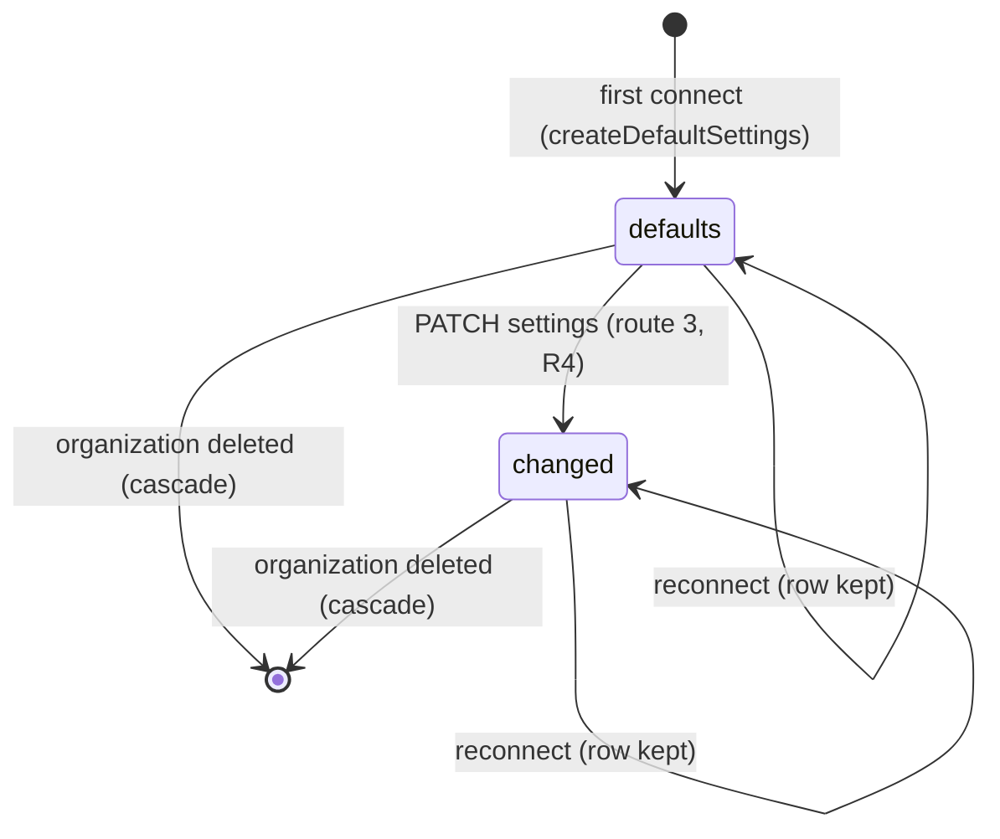

`src/domains/app/sub-domains/instagram-account/instagram-account-settings/`

# Instagram account settings (nested resource)

Parent: [Instagram account](../instagram-account.overview.md)

## Purpose

The connected Instagram account's automation switch and public reply safety
(`app.instagram_account_settings`, routes-final § 1.B, IA15): one row per account, created with
the defaults by the first connect and kept on a reconnect, so a disconnect and reconnect of the
same account brings the team's choices back. Route 2 (`GET /api/v1/app/social/instagram/account`)
returns it inside the account object; event processing (sub-domain 4) reads it on every event.
Route 3 (`PATCH /api/v1/app/social/instagram/account/settings`) lands with ROUTE row R4.

## Layout

- `instagram-account-settings.schema.ts` — the table, its composite key to the account, its checks
  and RLS policy
- `instagram-account-settings.repository.ts` — insert the defaults if absent, read one account's
  row; a worker factory for event processing
- `instagram-account-settings.service.ts` — `createDefaultSettings` (joins the connect transaction)
  and `findSettings`
- `seed/` — bulk: the default row of every seeded account, after the accounts
- `__tests__/unit/` — the service's database suite

## Key invariants

- **One row per account** (`idx_instagram_account_settings_organization_account`), tied to it by the
  composite key `(organization_id, instagram_account_id)` → `app.instagram_accounts (organization_id, id)`,
  so a row can never point at another organization's account.
- **Written through this sub-domain's service only**, never by the account's repository (1.B.10):
  the connect calls `createDefaultSettings`, which inserts the defaults only when the account has
  none (`ON CONFLICT DO NOTHING`) and otherwise returns the kept row.
- **The defaults are the column defaults** — the switch on, public reply safety off, a 80 % reply
  chance, 60 replies an hour, a 20–60 second gap — and the checks hold the ranges: chance 0–100
  (`chk_instagram_account_settings_chance`), hour limit 1–1000, each gap 5–3600 seconds, and the
  minimum gap never above the maximum (`chk_instagram_account_settings_gap_order`).
- **Kept for the account's life.** A disconnect leaves the row; it goes only when the account does —
  with the organization (cascade).
- **RLS**: the organization policy in `USING` and `WITH CHECK`, plus the retention sweep arm in
  `USING` only; `updated_by_user_id` → users `ON DELETE SET NULL`.

## Lifecycle

## Failure modes

- **The account is not in the caller's organization** → the insert is refused (the policy's
  `WITH CHECK`, or the composite key) and the read finds nothing; the connect rolls back.
