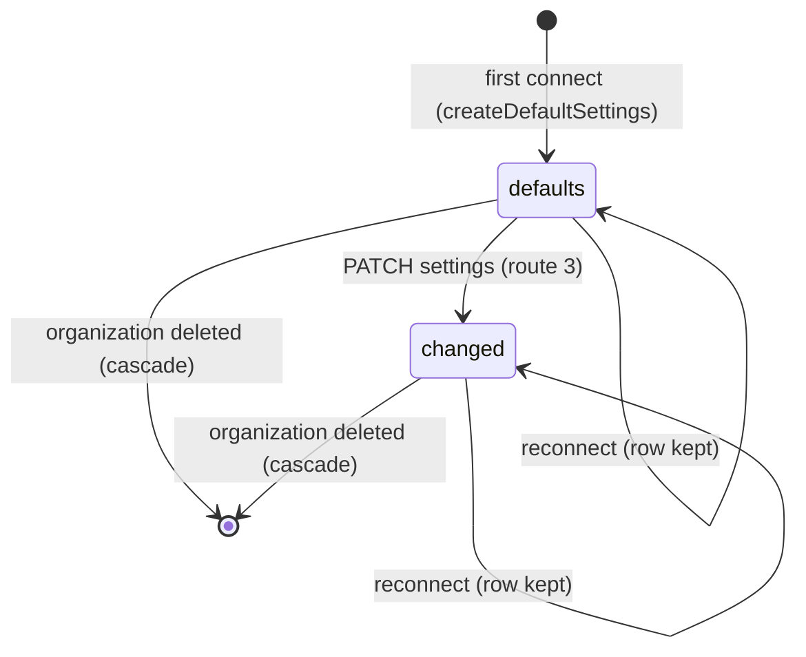

`src/domains/app/sub-domains/instagram-account/instagram-account-settings/`

# Instagram account settings (nested resource)

Parent: [Instagram account](../instagram-account.overview.md)

## Purpose

The connected Instagram account's automation switch and public reply safety
(`app.instagram_account_settings`, routes-final § 1.B, IA15): one row per account, created with
the defaults by the first connect and kept on a reconnect, so a disconnect and reconnect of the
same account brings the team's choices back. Route 2 (`GET /api/v1/app/social/instagram/account`)
returns it inside the account object; route 3 (`PATCH /api/v1/app/social/instagram/account/settings`,
gate `instagram-account:manage`, team-only) changes it; event processing (sub-domain 4) reads it on
every event.

## Layout

- `instagram-account-settings.schema.ts` — the table, its composite key to the account, its checks
  and RLS policy
- `instagram-account-settings.repository.ts` — insert the defaults if absent, read one account's
  row (plain, or locked `FOR UPDATE` for route 3), write route 3's change; a worker factory for
  event processing
- `instagram-account-settings.service.ts` — `createDefaultSettings` (joins the connect transaction),
  `findSettings` and `updateSettings` (route 3)
- `instagram-account-settings.routes.ts` / `.controller.ts` / `.dto.ts` / `.validator.ts` — route 3:
  the strict body (six optional settings, at least one, `expected_updated_at`), the merged gap
  check, the audit entry after commit
- `instagram-account-settings.serializer.ts` / `.types.ts` — the settings object (1.B.6), shared by
  routes 2 and 3
- `seed/` — bulk: the default row of every seeded account, after the accounts
- `__tests__/unit/` — the validator (every range edge, the merged gap) and the database suite;
  `__tests__/integration/` — route 3 over HTTP

## Key invariants

- **One row per account** (`idx_instagram_account_settings_organization_account`), tied to it by the
  composite key `(organization_id, instagram_account_id)` → `app.instagram_accounts (organization_id, id)`,
  so a row can never point at another organization's account.
- **Written through this sub-domain's service only**, never by the account's repository (1.B.10):
  the connect calls `createDefaultSettings`, which inserts the defaults only when the account has
  none (`ON CONFLICT DO NOTHING`) and otherwise returns the kept row.
- **The defaults are the column defaults** — the switch on, public reply safety off, a 80 % reply
  chance, 60 replies an hour, a 20–60 second gap — and the checks hold the ranges: chance 0–100
  (`chk_instagram_account_settings_chance`), hour limit 1–1000, each gap 5–3600 seconds, and the
  minimum gap never above the maximum (`chk_instagram_account_settings_gap_order`).
- **Kept for the account's life.** A disconnect leaves the row; it goes only when the account does —
  with the organization (cascade).
- **RLS**: the organization policy in `USING` and `WITH CHECK`, plus the retention sweep arm in
  `USING` only; `updated_by_user_id` → users `ON DELETE SET NULL`.
- **Route 3 changes only what it is sent** (IA15): any of the six settings, at least one, whole
  numbers in range (chance 0–100, hour limit 1–1000, each gap 5–3600 seconds); an unknown field is a
  `400`. The minimum gap never above the maximum is judged on the merged result — the body's ends,
  else the saved ones — and refused with `400` on `public_reply_gap_max_seconds` before the table's
  check would fire. It records the caller as `updated_by_user_id` and stamps `updated_at`.
- **A stale save is refused**: an `expected_updated_at` older than the saved row answers
  `409 record_changed`, naming who changed it and when (`assertRecordNotChangedSince`, D43). The row
  is read `FOR UPDATE`, so two saves are judged one after the other.
- **Works on an `expired` or `error` account** — the switch can be turned off while a reconnect is
  pending; only a revoked account (or none) answers `404 instagram_not_connected`. Team-only: a
  personal organization answers `422` (`assertTeamOrganization`, capability `INSTAGRAM`), after the
  permission gate's `403`.
- **Audit**: `app.instagram_account_settings.update` (INFO, resource type `instagram_account`, the
  account's public id and the changed field names — never the values), after commit, best-effort.

## Lifecycle

## Failure modes

- **The account is not in the caller's organization** → the insert is refused (the policy's
  `WITH CHECK`, or the composite key) and the read finds nothing; the connect rolls back.
- **Route 3**: no `instagram-account:manage` → `403 missing_permission`; a personal organization →
  `422`; no account that is not revoked → `404 instagram_not_connected`; a stale
  `expected_updated_at` → `409 record_changed`; out of range, not whole, an empty body, an unknown
  field, or the maximum gap below the minimum on the merged result → `400`. Nothing is written and
  no audit entry is recorded on any of them.
