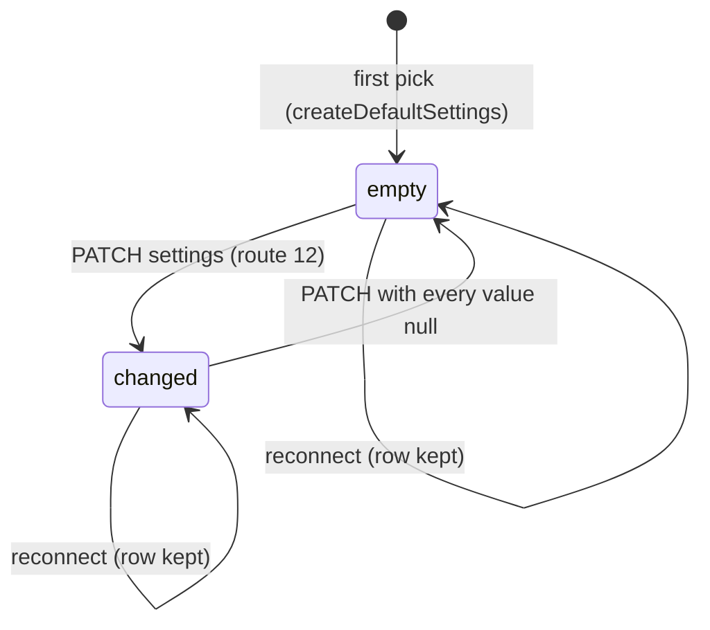

`src/domains/app/sub-domains/instagram-account/instagram-account-settings/`

# Instagram account settings (nested resource)

Parent: [Instagram account](../instagram-account.overview.md)

## Purpose

One Instagram channel account's sending limits, stop words and behaviour switches
(`app.instagram_account_settings`, feat-instagram-dm-sending routes-final § 2.B, IA12–IA14, ROUTE
row R7): one row per channel account, made empty by the pick and kept on a reconnect, so a
disconnect and reconnect of the same account brings the team's choices back. Route 7
(`GET /api/v1/app/social/channel-accounts/{channel_account_id}`) returns it inside the account's
`instagram` part; route 12 (`PATCH /api/v1/app/social/instagram/accounts/{channel_account_id}/settings`,
gate `instagram-account:manage`, team-only) changes it; event processing and the lanes read it.

## Layout

- `instagram-account-settings.schema.ts` — the table, its composite key to the channel account, its
  checks and RLS policy
- the settings-file values an empty limit falls back to (D5, D11, D68), the API ranges and
  `STOP_WORDS` (D49) live in sub-domain 6's settings file,
  `../../instagram-sending/instagram-sending.constants.ts` (ROUTE row R18, P4), so route 12's
  `effective_limits` and the lanes read one source
- `instagram-account-settings.repository.ts` — insert the empty row if absent, read one account's
  row (plain, or locked `FOR UPDATE` for route 12), write route 12's change; a worker factory for
  event processing
- `instagram-account-settings.service.ts` — `createDefaultSettings` (joins the pick's transaction),
  `findSettings` and `updateSettings` (route 12) over the channel account port and the lane port
- `instagram-account-settings.routes.ts` / `.controller.ts` / `.dto.ts` / `.validator.ts` — route 12:
  the strict body (fourteen optional settings and the automation switch, at least one, nullable
  limits, `expected_updated_at`), the merged extra-delay and day-limit checks, the audit entry after
  commit
- `instagram-account-settings.serializer.ts` / `.types.ts` — the settings object (2.B.6) with
  `effective_limits`, shared by routes 7 and 12; the two ports route 12 takes
- `seed/` — bulk: the empty row of every seeded account, after the accounts
- `__tests__/factories/` — a settings row for unit tests; `__tests__/unit/` — the validator, the
  serializer, the service and the database suites; `__tests__/integration/` — route 12 over HTTP

## Key invariants

- **One row per channel account** (`idx_instagram_account_settings_organization_account`), tied to
  it by the composite key `(organization_id, channel_account_id)` → `app.channel_accounts
  (organization_id, id)` `ON DELETE RESTRICT` (P47), so a row never points at another organization's
  account.
- **Written through this sub-domain's service only**, never by the account's repository (2.B.10):
  the pick calls `createDefaultSettings`, which inserts the empty row only when the account has none
  (`ON CONFLICT DO NOTHING`) and otherwise returns the kept row.
- **Every limit is nullable — empty means the settings file's value**: opening DMs 600 an hour (150
  for a new account's first 7 days unless the owner set one), the day limit off, fast 10,000, person
  60, broadcast 600. The answer's `effective_limits` shows what the lanes use now. The checks hold
  the database ranges (opening 1–750, broadcast 1–2,000, the others above 0, at most 50 stop words
  with no null, the extra delay both ends or neither, 1–20, min ≤ max).
- **The automation switch is the channel account's** (P42): route 12 accepts `is_automation_enabled`
  and writes it on `app.channel_accounts` through `ChannelAccountService.setAutomationEnabled` in the
  same commit; event processing reads it from the channel account.
- **The one feature check** (CA11, P50): a change that turns the extra delay on asks for the plan's
  `extra_delay` switch (`403 plan_lacks_feature`, P83); one that turns mark as seen on asks for Meta's
  test (`422 feature_not_offered`, P36); a connection without the permission answers
  `409 permission_not_granted`. Clearing or keeping either is never checked (P10). A save that
  turns features on reads the plan once (`readEntitlementSnapshot` on the port, the entitlement
  module's one resolve) and passes that snapshot to each check (change-plan-gates P41, K2); a save
  that turns none on reads no plan.
- **A stale save is refused**: an `expected_updated_at` older than the saved row answers
  `409 record_changed` (`assertRecordNotChangedSince`, D43). The row is read `FOR UPDATE`.
- **After commit, a changed limit gives the lanes a new turn** through the lane port (sub-domain 6's lane
  service, wired at R18); the switches and stop words count for new events only.
- **Works on an `error` account**; a revoked, another organization's or a non-Instagram account
  answers `404 channel_account_not_found`. Team-only: a personal organization answers `422`.
- **Audit**: `app.instagram_account_settings.update` (INFO, resource type `instagram_account`, the
  account's `cha_…` id, the changed fields with their old and new values — AC-3.11), after commit,
  best-effort.
- **No public-reply fields**: the launch's five reply-safety columns left with R7 — pacing is per
  automation (D32, ROUTE row R13); a body that sends one is a `400`.

## Lifecycle

## Failure modes

- **The account is not in the caller's organization** → the insert is refused (the policy's
  `WITH CHECK`, or the composite key) and the read finds nothing; the pick rolls back.
- **Route 12**: no `instagram-account:manage` → `403 missing_permission`; a personal organization →
  `422`; the account not found → `404 channel_account_not_found`; a refused feature → `403
  plan_lacks_feature`, `422 feature_not_offered`, `409 permission_not_granted`; a stale
  `expected_updated_at` → `409 record_changed`; out of range, not whole, a bad stop word, an empty
  body, an unknown field, or a merged extra delay or day limit out of order → `400`. Nothing is
  written and no audit entry is recorded on any of them.
