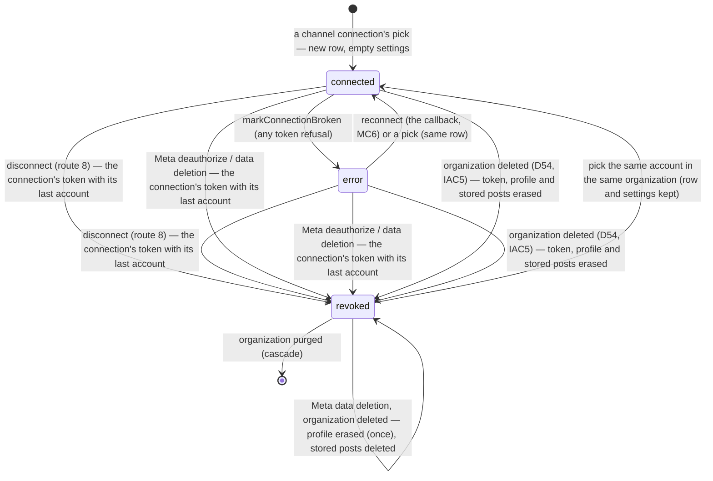

`src/domains/app/sub-domains/instagram-account/`

# Instagram account

Parent: [app](../../app.overview.md)

## Purpose

The Instagram part of the team organization's connected accounts. Since ROUTE row R5 of
`iterations/feat-instagram-dm-sending-2026-11-23-oxak/` every row extends one channel account
(`../channel-account/`, `app.channel_accounts`, 1:1 through `channel_account_id`): the account's routes
(read, disconnect — the launch's `GET` / `DELETE /api/v1/app/social/instagram/account`) moved there as
routes 7 and 8, and the connection the account came through is the channel account's (P111, P116); the
token is that connection's (`app.channel_connection_tokens`). ROUTE row R6 reshaped this table into the
1:1 extension (routes-final § 2.A, IA8): the Instagram user id, the profile, the account type, the private
flag, the webhook stamp and the starter-question time — no public id, status or connection columns of its
own (the account's one id is the channel account's `cha_…`, P47). Every read joins the channel account
for them; the status moves only on `app.channel_accounts`. The extension is written only through
`InstagramAccountExtensionService` (2.A.10). The later sub-domains read the
account through this sub-domain's services: its status and settings on every webhook event, the
guarded status change on a token error, and the two resolvers that find an organization before
one is known.

Built by ROUTE row R3 of the launch iteration (`iterations/launch-2026-11-20-ujai/`,
`plans/routes-final.md` § 1.A, decisions IA5–IA7, IA9–IA14). ROUTE row R7 added the background
work (§ 1 IA8, IA9): the daily account check — refresh the profile, subscribe the webhook fields
again (the token renewal left with WC-35: the connection's token never ends) — and the reconnect
notice that follows every break.
The nested folders carry the rest of § 1: `instagram-account-settings/` (route 12 of
feat-instagram-dm-sending, `PATCH /api/v1/app/social/instagram/accounts/{channel_account_id}/settings`,
ROUTE row R7 — keyed by the channel account), `instagram-media/` (routes
5–6 and the stored posts, R5) and `instagram-account-meta-callback/` (Meta's deauthorize and
data-deletion callbacks, routes 7–8, R6).

## Layout

- `instagram-account.schema.ts` — `app.instagram_accounts`: the 1:1 extension of a channel account,
  one row per organization and Instagram account, so a pick brings a revoked one back with its settings
- `instagram-account.repository.ts` — the live accounts (joined to the channel account), the pick's
  upsert, the webhook stamp and its clearing, the profile erase (once), the locked accounts of one
  Instagram id (Meta's callbacks) and of the whole organization (its delete), the daily check's sweep
  page and profile refresh, the two SECURITY DEFINER resolvers; worker and retention factories
- `instagram-account-extension.service.ts` — the extension's one writer (2.A.10): create at the pick,
  the webhook stamp, the revoke's stamp clear, the profile erase
- `instagram-account.serializer.ts` — the `instagram` object of the channel account (2.A.6)
- `instagram-account.constants.ts` — the status type (the channel account's) and the broken statuses a
  Meta error classifies, the audit resource type (shared with route 3), the frontend's Instagram page
- `queues/` — `instagram-account-daily-check` (one check per account per UTC day, and the sweep's
  job name) and `instagram-reconnect-notice` (one notice per account and break), each with its job
  schema (`organizationPublicId` in every payload, K8)
- `workers/` — the daily check (`createProviderPausableWorker`, provider `instagram`; the 04:00 UTC
  sweep rides the same queue) and the reconnect notice; registered in
  `worker-registration.registry.ts`, the sweep in `scheduler.ts`
- `instagram-account.service.ts` / `.validator.ts` / `.types.ts` — no route of its own since R5 (the
  channel account serves routes 7 and 8): the webhook subscribe / unsubscribe steps, the guarded
  `markConnectionBroken`, and for Meta's callbacks the resolver pass-through and
  `disconnectForMeta` (revoke, token and — on a data deletion — profile erase, in the caller's
  verified scope), for the organization's delete the best-effort unsubscribe and
  `disconnectForOrganizationOffboarding` (D54), and for the run engine `findAutomationAccountAccess` (the event's account with
  its encrypted token and settings row, read in the job's scope — sub-domain 3.B)
- `instagram-account-erasure.service.ts` — the one erase of an account's data in an organization:
  Meta's callbacks (`eraseForMeta`) and the organization's delete (`eraseForOrganizationOffboarding`,
  called by tenancy through its offboarding port, D54) — the account service's disconnect and the
  media service's stored posts, in one transaction
- `instagram-account-settings/` — nested: the account's limits, stop words and behaviour switches,
  and route 12 that changes them (the automation switch with them, on the channel account — R7) ([overview](instagram-account-settings/instagram-account-settings.overview.md))
- `instagram-media/` — nested: the post and story pickers (routes 5–6, read live) and the stored
  posts sub-domains 3–4 write through its service ([overview](instagram-media/instagram-media.overview.md))
- `instagram-account-meta-callback/` — nested, PUBLIC: Meta's deauthorize and data-deletion
  callbacks (routes 7–8), proved by Meta's form-encoded `signed_request`; no table of its own
  ([overview](instagram-account-meta-callback/instagram-account-meta-callback.overview.md))
- `instagram-account-error.util.ts` — the shared route errors (`instagram_not_connected`,
  `instagram_reconnect_required`, `instagram_unavailable` with `Retry-After`,
  `instagram_signed_request_invalid`), built once for the account routes, route 3, the pickers and
  Meta's callbacks
- `seed/` — bulk: a connected account with a fake encrypted token per demo team organization; the
  nested settings and stored-posts contributions follow it
- `__tests__/unit/` — the repository and token-service database suites, the token-isolation
  policy, and the daily check, the reconnect notice and their queues with Instagram and the
  database stubbed
- `__tests__/integration/` — the routes, and the daily check and the reconnect notice against
  Postgres and Redis (Instagram mocked with nock)

## Key invariants

- **Many accounts per organization, one organization per live account.** An organization holds
  as many not-revoked accounts as its plan's `channel_accounts_max` (counted at the pick under the
  organization lock, D26); one row that is not `revoked` per Instagram account across all
  organizations (`idx_instagram_accounts_instagram_user_live`) — a pick race answers
  `409 instagram_account_connected_elsewhere`.
- **No soft delete.** A disconnect sets `revoked` and `disconnected_at`
  (`chk_instagram_accounts_disconnected` keeps the two in step); the row stays until the
  organization is deleted, so a reconnect of the same Instagram account finds its row and its
  settings again (`idx_instagram_accounts_organization_instagram_user`).
- **The token is the connection's, ciphertext everywhere but the Meta client (IA5, MC9).** It is
  stored only as `app.channel_connection_tokens.encrypted_access_token` (`encryptFieldSecret`).
  Only the connection's token repository reads its table, only the token service and the daily
  check's processor use that repository, and only
  `src/domains/app/sub-domains/channel-connection/channel-connection-meta/meta-graph.client.ts` calls `decryptFieldSecret` on it —
  `channel-connection/__tests__/unit/channel-connection-token-isolation.policy.unit.test.ts` pins all three. One
  operator exception, allowlisted there: the secrets-key rotation script
  (`src/scripts/ops/secrets-key-rotate.ts`, `pnpm ops:secrets:rotate`) re-encrypts the column onto
  the current `SECRETS_ENCRYPTION` key version with the other encrypted fields (D37). The
  column is in the log-redaction paths (`PINO_REDACT_PATHS`) and the secret response fields
  (`IDEMPOTENCY_SECRET_RESPONSE_FIELD_NAMES`); route 2 never returns it.
- **The token table has no cross-organization arm.** Its RLS policy is the organization arm only,
  in `USING` and `WITH CHECK` — no retention sweep arm — so no maintenance process can read a token.
  The account and its settings carry the sweep arm in `USING` only.
- **No expiry to copy.** The connection's system-user token never ends (D24); `token_expires_at`,
  `scopes` and the app-scoped id left the extension at R6 (IA8).
- **The token goes with the connection's last account** (route 4, Meta's deauthorize and data
  deletion, routes 7–8, and the organization's delete, D54): a disconnect revokes the account and,
  when no other not-revoked account uses its connection, revokes the connection and deletes its
  token (CA8); `webhook_subscribed_at` is emptied with the account. Meta's data deletion also erases the profile (`profile_erased_at`, only on a
  revoked row) and the stored posts, revoked rows of the same person included — but never a
  connection made after Meta signed its request (D53).
- **A deleted organization holds no Instagram data.** Its delete, as the last step before the soft
  delete, unsubscribes every live account (best effort) and revokes and erases every account it ever
  held — token, profile, stored posts — and revokes every connection still live with its token (one
  left with no account too, IAC5), in its own scope, so the Instagram account connects
  elsewhere at once and Meta's later requests find nothing (D54). After the soft delete row-level
  security hides the rows from that scope, so the erase must come first; a failed one stops the
  delete, and the offboarding reconcile worker runs it again.
- **No Instagram call inside a database context**: the pick calls Meta, then writes in one
  transaction, then subscribes the webhook after the commit; disconnect unsubscribes before its
  transaction (`rls-context-network-isolation.global.test.ts`).
- **Lookups before the organization is known go through two resolvers** that return only
  organization public ids — `app.resolve_organization_public_id_for_instagram_user` (the
  not-revoked channel account of an Instagram user id; webhook routing) and
  `app.resolve_organization_public_ids_for_instagram_app_user` (every row of the Instagram id Meta
  signs, any status — the Instagram user id under Unified Login since R6; R9 replaces it) — then work in that organization's `PRINCIPAL_SCOPE.VERIFIED` scope (IA6;
  `src/tests/security/rls/instagram-account-resolvers.security.test.ts`).
- **Team-only.** Disconnect answers `422` on a personal organization; the read answers
  `404 team_organization_required`. Before either, the permission gate answers `403`: a personal
  organization's Owner never holds `instagram-account:read` or `:manage` (IA3).

## Lifecycle

The status below is the channel account's (`app.channel_accounts.connection_status`, CA4 — no
`expired` since R6; Meta's subcode 463 lands as `error`); the extension follows it.

The guarded change (`markConnectionBroken`, IA9) is the only way out of `connected` other than a
disconnect: it moves only a channel account still `connected`, so of two racing callers exactly one
wins. The winner — and only the winner — enqueues the break's reconnect notice once its unit of work
commits (job id = the account and the channel account's `updated_at` at the break); a rolled-back
break enqueues nothing. A reconnect sets `connected` again, so a later break is a new one and is
told again.

### The daily account check (IA8)

```mermaid
stateDiagram-v2
    [*] --> listed: 04:00 UTC sweep — every connected account of a live organization
    listed --> queued: one job per account per UTC day (job id account + day)
    queued --> parked: Instagram down (circuit open) or throttling — no attempt spent
    parked --> queued: the pause ends (5 min, or Instagram's wait)
    queued --> checked: token ends later, or renewed; profile refreshed; subscribed if not
    queued --> broken: token end passed (no call), or Instagram refuses the token
    queued --> superseded: a reconnect saved a newer token while renewing
    queued --> kept: Instagram down while renewing — error kept, account connected, job retried
    broken --> [*]: markConnectionBroken → reconnect notice after commit
    checked --> [*]
    superseded --> [*]
```

### The reconnect notice (IA9)

One job per account and break. It re-reads the account (a break that is over by then is skipped),
finds every active member holding `instagram-account:manage` through tenancy's membership service,
and sends each an in-app notification with the email channel — type `instagram.reconnect_required`,
in the organization's language, linking to the frontend's Instagram page — through notify's
`NotificationService.createOrganizationNotifications`, keyed once-only by the break.

## Events

None emitted on the event bus. Connect and disconnect write the audit entries
`app.instagram_account.connect` and `app.instagram_account.disconnect` (WARNING, resource type
`instagram_account`, IA7) through `recordScopedAuditEvent`, after the write commits and
best-effort — an audit failure never fails the request (audit-emission, D36). Meta's callbacks
write `app.instagram_account.deauthorize` and `app.instagram_account.data_deletion` the same way,
with an anonymous actor and `metadata.source = 'meta'`, one per organization changed. The erase of
an organization's delete (D54) is named on tenancy's `tenancy.organization.delete` entry.

Background jobs (BullMQ, pull-based, K8): `instagram-reconnect-notice` — enqueued by the guarded
status change after its commit (API and worker processes alike); `instagram-account-daily-check` —
the 04:00 UTC sweep (`scheduler.ts`) and the per-account checks it adds. The notice creates
notify's notifications, whose own `notification` jobs send the email through the mail outbox.

## External integrations

Meta's Graph API on `graph.facebook.com`, only through `src/domains/app/sub-domains/channel-connection/channel-connection-meta/meta-graph.client.ts`
([Meta adapter overview](../channel-connection/channel-connection-meta/channel-connection-meta.overview.md)) with the
account's connection token: `subscribed_apps` (subscribe after a pick, unsubscribe before a
disconnect); the daily check's profile read (`GET /{instagram_user_id}`) and `subscribed_apps`. No
Instagram Login call is left (RC-6, WC-35).
The Instagram app's settings and scopes:
[credentials-and-env.md § 10](docs/integrations/credentials-and-env.md).

## Failure modes

- **The connect's own failures** (the code refused, permissions missing, the plan's limit, Meta
  down) are the channel connection's (`../channel-connection/channel-connection.overview.md`).
- **The webhook subscription fails after a pick** → logged, never fails the pick; the next
  pick or the daily check retries while `webhook_subscribed_at` is empty, and route 2's
  `is_webhook_subscribed` lets the page warn that no events arrive.
- **The daily check meets Meta down or busy** → the account stays `connected`, and the
  provider-pausable worker waits the outage out without spending an attempt; the next day tries
  again. **Meta refuses the token** → `error` (`expired` for subcode 463) at once; a code-10
  "outside the messaging window" answer is a refusal, never a break (D32).
- **A reconnect notice whose enqueue fails** (Redis refusing writes) → logged
  (`app.instagram_account.reconnect_notice_enqueue_failed`); no row holds it, so no sweep re-sends
  it — the Instagram page still shows the reconnect card.
- **The unsubscribe fails before a disconnect or an organization's delete** → logged, never blocks
  it; a revoked account's events are not stored (sub-domain 4).
- **No live account** → route 2 and route 4 answer `404 instagram_not_connected`.
- **Meta's callbacks** (routes 7–8) → `400 instagram_signed_request_invalid` on a bad signed
  request, `413` on a body over 16 KB, `415` on one that is not form-encoded,
  `503 instagram_not_configured` without the app secret; once verified always `200`, also for a person never stored or a repeat.
