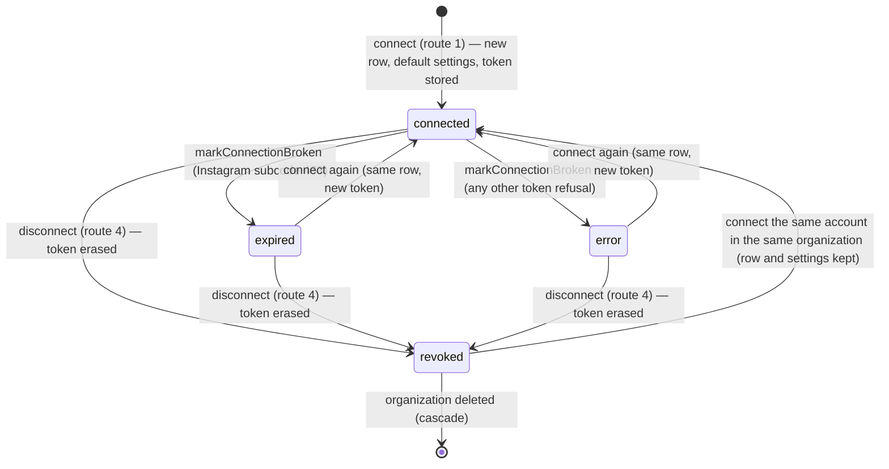

`src/domains/app/sub-domains/instagram-account/`

# Instagram account

Parent: [app](../../app.overview.md)

## Purpose

The team organization's one connected Instagram professional account: connect it (route 1,
`POST /api/v1/app/social/instagram/connect`), read it (route 2, `GET /api/v1/app/social/instagram/account`)
and disconnect it (route 4, `DELETE /api/v1/app/social/instagram/account`). Its long-lived Instagram
token lives beside it as a persistence part of the account — a schema, a repository and a token
service at this folder's root, with no controller and no routes. The later sub-domains read the
account through this sub-domain's services: its status and settings on every webhook event, the
guarded status change on a token error, and the two resolvers that find an organization before
one is known.

Built by ROUTE row R3 of the launch iteration (`iterations/launch-2026-11-20-ujai/`,
`plans/routes-final.md` § 1.A, decisions IA5–IA7, IA9–IA14). The nested folders carry the rest of
§ 1: `instagram-account-settings/` (route 3 lands with R4), and, still to come, `instagram-media/`
(routes 5–6, R5) and `instagram-account-meta-callback/` (Meta's routes 7–8, R6).

## Layout

- `instagram-account.schema.ts` — `app.instagram_accounts`: one row per organization and Instagram
  account, so a reconnect reuses it (revoked included) and its settings come back
- `instagram-account.repository.ts` — the live account, the connect upsert, the guarded status
  change, revoke, the profile erase, the webhook-subscription stamp, the two SECURITY DEFINER
  resolvers; worker and retention factories
- `instagram-account-token.schema.ts` / `instagram-account-token.repository.ts` /
  `instagram-account-token.service.ts` — `app.instagram_account_tokens`, ciphertext only (IA5)
- `instagram-account.constants.ts` — the four connection statuses, the two live-row unique indexes a
  connect race maps to 409, the token type
- `instagram-account.service.ts` / `.controller.ts` / `.routes.ts` / `.dto.ts` / `.validator.ts` /
  `.serializer.ts` / `.types.ts` — routes 1, 2 and 4 (connect, read, disconnect) and the guarded
  `markConnectionBroken`
- `instagram-account-settings/` — nested: the automation switch and public reply safety
  ([overview](instagram-account-settings/instagram-account-settings.overview.md))
- `seed/` — bulk: a connected account with a fake encrypted token per demo team organization; the
  nested settings contribution follows it
- `__tests__/unit/` — the repository and token-service database suites, and the token-isolation
  policy

## Key invariants

- **One live account per organization, one organization per live account.** At most one row that
  is not `revoked` per organization (`idx_instagram_accounts_organization_live`, D5) and per
  Instagram account across all organizations (`idx_instagram_accounts_instagram_user_live`); a
  connect race breaks one of them and answers the matching `409`
  (`organization_already_has_instagram_account`, `instagram_account_connected_elsewhere`).
- **No soft delete.** A disconnect sets `revoked` and `disconnected_at`
  (`chk_instagram_accounts_disconnected` keeps the two in step); the row stays until the
  organization is deleted, so a reconnect of the same Instagram account finds its row and its
  settings again (`idx_instagram_accounts_organization_instagram_user`).
- **The token is ciphertext everywhere but the Instagram client (IA5).** It is stored only as
  `encrypted_access_token` (`encryptFieldSecret`). Only the token repository reads its table, only
  the token service (and, with R7, the daily check) uses that repository, and only
  `src/infrastructure/social/instagram.client.ts` calls `decryptFieldSecret` on it —
  `__tests__/unit/instagram-account-token-isolation.policy.unit.test.ts` pins all three. One
  operator exception, allowlisted there: the secrets-key rotation script
  (`src/scripts/ops/secrets-key-rotate.ts`, `pnpm ops:secrets:rotate`) re-encrypts the column onto
  the current `SECRETS_ENCRYPTION` key version with the other encrypted fields (D37). The
  column is in the log-redaction paths (`PINO_REDACT_PATHS`) and the secret response fields
  (`IDEMPOTENCY_SECRET_RESPONSE_FIELD_NAMES`); route 2 never returns it.
- **The token table has no cross-organization arm.** Its RLS policy is the organization arm only,
  in `USING` and `WITH CHECK` — no retention sweep arm — so no maintenance process can read a token.
  The account and its settings carry the sweep arm in `USING` only.
- **The expiry is copied, not joined.** `app.instagram_accounts.token_expires_at` copies the
  token's `expires_at` in the same transaction, so route 2 and the daily sweep never touch the token
  table. The account object names it `access_expires_at` (D35): no response key names a token, so
  the idempotency layer stores the connect answer and a repeated key replays it (K3).
- **The token is erased on every disconnect** (route 4, and Meta's callbacks with R6), not only on
  Meta's data deletion; `token_expires_at` and `webhook_subscribed_at` are emptied with it.
- **No Instagram call inside a database context**: connect calls Instagram, then writes in one
  transaction, then subscribes the webhook after the commit; disconnect unsubscribes before its
  transaction (`rls-context-network-isolation.global.test.ts`).
- **Lookups before the organization is known go through two resolvers** that return only
  organization public ids — `app.resolve_organization_public_id_for_instagram_user` (the
  not-revoked account of an Instagram user id) and
  `app.resolve_organization_public_ids_for_instagram_app_user` (every row of an app-scoped id, any
  status) — then work in that organization's `PRINCIPAL_SCOPE.VERIFIED` scope (IA6;
  `src/tests/security/rls/instagram-account-resolvers.security.test.ts`).
- **Team-only.** Connect and disconnect answer `422` on a personal organization; the read answers
  `404 team_organization_required`. Before either, the permission gate answers `403`: a personal
  organization's Owner never holds `instagram-account:read` or `:manage` (IA3).

## Lifecycle

The guarded change (`markConnectionBroken`, IA9) is the only way out of `connected` other than a
disconnect: it updates only a row still `connected`, so of two racing callers exactly one wins and
stamps `connection_status_changed_at`. The reconnect notice that follows a break is R7's.

## Events

None emitted on the event bus. Connect and disconnect write the audit entries
`app.instagram_account.connect` and `app.instagram_account.disconnect` (WARNING, resource type
`instagram_account`, IA7) through `recordScopedAuditEvent`, after the write commits and
best-effort — an audit failure never fails the request (audit-emission, D36).

## External integrations

The Instagram API with Instagram Login, only through `src/infrastructure/social/instagram.client.ts`
([social overview](src/infrastructure/social/social.overview.md)): the code exchange, the
long-lived token exchange, `/me`, and `subscribed_apps` (subscribe after a connect, unsubscribe
before a disconnect). The Instagram app's settings and scopes:
[credentials-and-env.md § 10](docs/integrations/credentials-and-env.md).

## Failure modes

- **Instagram refuses the code** (expired, used, another redirect address) → `422 instagram_code_invalid`;
  a personal Instagram account → `422 instagram_account_not_professional`; a permission unticked on
  the consent screen → `422 instagram_scopes_missing`. Nothing is stored.
- **Instagram down, failing or throttling** → `503 instagram_unavailable` (with `Retry-After` on a
  throttle); the three app settings unset → `503 instagram_not_configured`. Nothing is stored.
- **The webhook subscription fails after a connect** → logged, never fails the connect; the next
  connect (or the daily check, R7) retries while `webhook_subscribed_at` is empty, and route 2's
  `is_webhook_subscribed` lets the page warn that no events arrive.
- **The unsubscribe fails before a disconnect** → logged, never blocks it; a revoked account's
  events are not stored (sub-domain 4).
- **No live account** → route 2 and route 4 answer `404 instagram_not_connected`.
