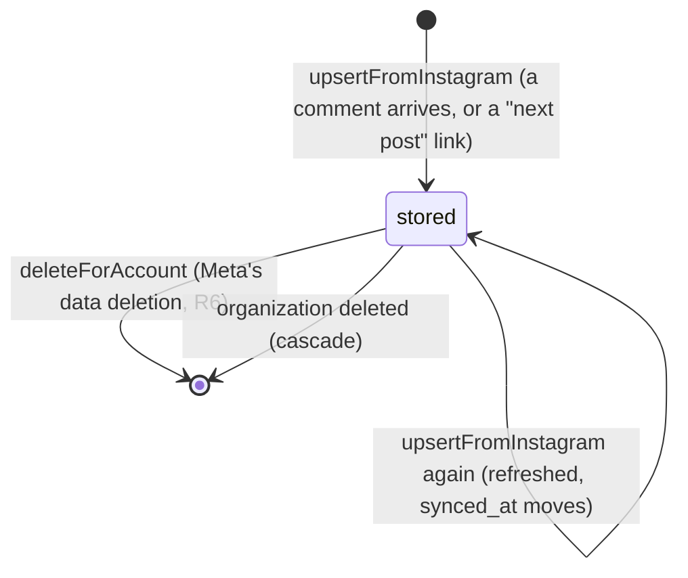

`src/domains/app/sub-domains/instagram-account/instagram-media/`

# Instagram media (nested resource)

Parent: [Instagram account](../instagram-account.overview.md)

## Purpose

The connected Instagram account's posts, reels and stories (routes-final § 1.C, IA16, IA17), in two
halves:

- **The pickers, read live** — route 5 (`GET /api/v1/app/social/instagram/media`, posts and reels for
  the comment automations' post picker) and route 6 (`GET /api/v1/app/social/instagram/stories`, the
  live stories for the story-reply picker). Both read Instagram through the one Instagram client and
  store nothing (AC-3.7); paging is Instagram's own cursor.
- **The stored posts** — `app.instagram_media`: a post or reel an automation ran on, owned by one
  Instagram account. Written only through `InstagramMediaService.upsertFromInstagram`, by event
  processing (a comment on a post not stored yet, sub-domain 4) and "next post" linking
  (sub-domain 3); erased per account by `deleteForAccount` on Meta's data deletion (IA20, R6).

Built by ROUTE row R5 of the launch iteration (`iterations/launch-2026-11-20-ujai/`).

## Layout

- `instagram-media.schema.ts` — `app.instagram_media`: its composite key to the account, its checks
  and RLS policy (`migrations/20261121094404_app_instagram_media.sql`)
- `instagram-media.repository.ts` — the insert-or-refresh of one post, the erase of an account's
  posts; a worker factory for event processing and "next post" linking
- `instagram-media.service.ts` — `listMedia` / `listStories` (routes 5–6), `upsertFromInstagram`
  (IA17), `deleteForAccount` (IA20)
- `instagram-media.controller.ts` / `.routes.ts` / `.dto.ts` / `.validator.ts` — routes 5–6: the
  `instagram-account:read` gate and the strict query (`limit` 1–50, default 25; `after` 1–1000
  characters)
- `instagram-media.serializer.ts` — Instagram's answer as the media item and the story (types lowered,
  `timestamp` → `published_at`, `children.data` → `children`, a story's `expires_at` = published + 24 h)
- `instagram-media.constants.ts` / `.types.ts` — the value lists, the page size, the output objects
- `seed/` — bulk: three stored posts for every seeded connected account, after the accounts
- `__tests__/unit/` — the serializer, validator and pickers' error mapping (no database); the
  repository, service and seed database suites
- `__tests__/integration/` — routes 5–6 over HTTP with Instagram mocked (nock)

## Key invariants

- **Never an Instagram call inside a database context** (1.10): a picker reads the live account and
  its encrypted token in one unit of work through `InstagramAccountService.findLiveAccountAccess`
  (the team check, the account), closes it, calls Instagram, and only on a refused token opens a new
  one for the account's guarded status change (`markConnectionBroken`, IA9).
- **The token stays ciphertext** — the service hands the encrypted token to the Instagram client,
  which decrypts it right before its call (IA5); no picker answer carries it.
- **The pickers store nothing.** Routes 5–6 never write `app.instagram_media` (1.C.10); only the
  media service's `upsertFromInstagram` does, for sub-domains 3–4.
- **Paging is Instagram's.** `limit` is passed on, `after` passed back untouched; `next` is Instagram's
  `paging.cursors.after` only when Instagram has a next page, `has_more` follows it, and there is no
  `estimated_total` (Instagram gives none).
- **One row per organization and Instagram media id** (`idx_instagram_media_organization_media`),
  owned by one account through the composite key `(organization_id, instagram_account_id)` →
  `app.instagram_accounts (organization_id, id)` `ON DELETE CASCADE`. A media id already stored under
  another of the organization's accounts is left untouched (`upsertFromInstagram` answers `null`), so
  two accounts' posts never mix (AC-3.8).
- **Checks hold what Instagram may send**: digit media ids, the three media types and four product
  types lowered, non-negative counts (Instagram's missing counts stored as 0), `graph_data` always a
  JSON object — the Instagram object as read; no `owner_username` (it is the account's own, IA17).
- **RLS**: the organization policy in `USING` and `WITH CHECK`, plus the retention sweep arm in `USING`
  only (listed in `EXPECTED_FORCE_RLS_TABLES`).
- **Kept until the organization is deleted** (D8) or Meta's data deletion erases the account's posts
  (IQ4); automations, runs and comment logs keep naming a post by its Instagram media id, without a
  key, so they outlive an erased post.

## Lifecycle

## Failure modes

- **Route 5–6 errors (1.C.9)**: `404 team_organization_required` on a personal organization;
  `404 instagram_not_connected` with no account (or only revoked ones);
  `404 instagram_reconnect_required` when the account is `expired` or `error` (no Instagram call) or
  Instagram refuses its token (the account moves to `expired` for code 190 / 463, else `error`);
  `503 instagram_unavailable` with `Retry-After` when Instagram is down, failing, throttling or its
  circuit is open; `503 instagram_not_configured` when the Instagram app settings are unset.
- **An Instagram object without an id or a readable `timestamp`** → `upsertFromInstagram` throws an
  `outage` `InstagramApiError` before any write (Instagram misbehaving; the caller retries).
- **A post that names another organization's account** → the composite key refuses it (23503); a write
  under another organization's scope fails the policy's `WITH CHECK`.

## Testing

- `__tests__/unit/instagram-media.serializer.unit.test.ts`, `instagram-media.validator.unit.test.ts`,
  `instagram-media.service.unit.test.ts` — the objects, the query, and every 1.C.9 mapping without a
  database (Instagram mocked with nock, the account service mocked).
- `__tests__/unit/instagram-media.repository.db.unit.test.ts`, `instagram-media.service.db.unit.test.ts`,
  `instagram-media-seed.db.unit.test.ts` — the table through its repository and service, and the seed.
- `__tests__/integration/instagram-media.integration.test.ts` — routes 5–6: success, paging, each
  error, a personal organization, a Member, another organization's account never used.
