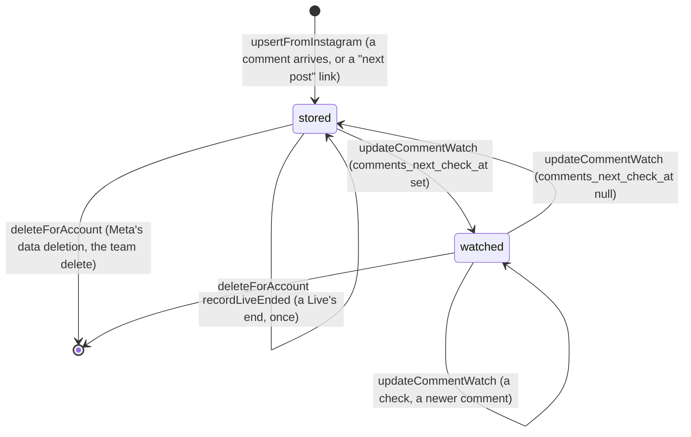

`src/domains/app/sub-domains/instagram-account/instagram-media/`

# Instagram media (nested resource)

Parent: [Instagram account](../instagram-account.overview.md)

## Purpose

One Instagram account's posts, reels and stories (feat-instagram-dm-sending routes-final § 2.C, IA15,
IA17), in two halves:

- **The pickers, read live** — route 13 (`GET /api/v1/app/social/instagram/accounts/{channel_account_id}/media`,
  posts and reels for the comment automations' post picker) and route 14 (`…/stories`, the live
  stories for the story-reply picker). Both read Meta through sub-domain 1's client
  (`channel-connection-meta/`) with the account's connection token and store nothing (AC-4.3);
  paging is Meta's own cursor. Each media item carries `kind` (`post` · `reel` · `ad_post`, from
  `media_product_type`), and a missing `media_url` falls back to `thumbnail_url`, then `permalink`.
- **The stored posts** — `app.instagram_media`: a post, reel or Live an automation ran on, owned by
  one channel account (`channel_account_id`, P47). Written only through `InstagramMediaService`: the
  stored post (`upsertFromInstagram` — event processing and "next post" linking), the missed-comment
  watch (`updateCommentWatch` — `comments_checked_at`, `comments_next_check_at`, empty = not watched,
  `last_comment_at`; D40) and a Live's end (`recordLiveEnded` — `live_ended_at`); erased per account
  by `deleteForAccount` on Meta's data deletion and the team delete.

Built by ROUTE row R5 of the launch iteration (`iterations/launch-2026-11-20-ujai/`); moved under the
named account and given the watch and Live columns by ROUTE row R8 of
`iterations/feat-instagram-dm-sending-2026-11-23-oxak/`.

## Layout

- `instagram-media.schema.ts` — `app.instagram_media`: its composite key to the channel account, the
  watch index, its checks and RLS policy (`migrations/20261121094404_app_instagram_media.sql`)
- `instagram-media.repository.ts` — the insert-or-refresh of one post, the watch's write, the Live end,
  the erase of an account's posts; a worker factory for event processing and "next post" linking
- `instagram-media.service.ts` — `listMedia` / `listStories` (routes 13–14), `upsertFromInstagram`,
  `findStoredMedia`, `updateCommentWatch`, `recordLiveEnded` (IA17, D40), `deleteForAccount` (IA20)
- `instagram-media.controller.ts` / `.routes.ts` / `.dto.ts` / `.validator.ts` — routes 13–14: the
  `{channel_account_id}` path (`cha_…`), the `instagram-account:read` gate and the strict query
  (`limit` 1–50, default 25; `after` 1–1000 characters)
- `instagram-media.serializer.ts` — Meta's answer as the media item and the story (types lowered,
  `kind`, the picture fallback, `timestamp` → `published_at`, `children.data` → `children`, a story's
  `expires_at` = published + 24 h)
- `instagram-media.constants.ts` / `.types.ts` — the value lists (product types with `live`, kinds),
  the page size, the output objects, `InstagramMediaConnectionBreakPort`
- `seed/` — bulk: three stored posts for every seeded connected account, after the accounts
- `__tests__/unit/` — the serializer, validator and pickers' error mapping (no database); the
  repository, service (watch, Live end) and seed database suites
- `__tests__/integration/` — routes 13–14 over HTTP with Meta mocked (nock)

## Key invariants

- **Never a Meta call inside a database context** (2.10): a picker reads the named account, its
  connection's status and token in one unit of work through
  `InstagramAccountService.findAccountReadAccess` (the team check, the account), closes it, calls
  Meta, and only on Meta's code 190 breaks the connection (MC11) through
  `InstagramMediaConnectionBreakPort` in a new unit of work.
- **The token stays ciphertext** — the service hands the connection's encrypted token to the Meta
  client, which decrypts it right before its call; no picker answer carries it.
- **The pickers store nothing.** Routes 13–14 never write `app.instagram_media` (2.C.10); only the
  media service's writers do, for sub-domains 4–6.
- **Paging is Meta's.** `limit` is passed on, `after` passed back untouched; `next` is Meta's
  `paging.cursors.after` only when Meta has a next page, `has_more` follows it, and there is no
  `estimated_total`.
- **One row per organization and Instagram media id** (`idx_instagram_media_organization_media`),
  owned by one channel account through the composite key `(organization_id, channel_account_id)` →
  `app.channel_accounts (organization_id, id)` `ON DELETE RESTRICT`. A media id already stored under
  another of the organization's accounts is left untouched (`upsertFromInstagram` answers `null`), so
  two accounts' posts never mix.
- **The watch**: `comments_next_check_at` empty = not watched; the due read uses the partial index
  `idx_instagram_media_comments_next_check` across organizations (the maintenance arm);
  `last_comment_at` never moves back; `live_ended_at` keeps the first end time.
- **Checks hold what Meta may send**: digit media ids, the three media types and five product types
  lowered (`feed` · `reels` · `story` · `ad` · `live`), non-negative counts (Meta's missing counts
  stored as 0), `graph_data` always a JSON object — the object as read.
- **RLS**: the organization policy in `USING` and `WITH CHECK`, plus the maintenance arm in `USING`
  only (listed in `EXPECTED_FORCE_RLS_TABLES`).
- **Kept until the organization is deleted** (D8) or Meta's data deletion erases the account's posts
  (IQ4); automations, runs and comment logs keep naming a post by its Instagram media id, without a
  key, so they outlive an erased post.

## Lifecycle

## Failure modes

- **Route 13–14 errors (2.C.9)**: `404 team_organization_required` on a personal organization;
  `404 channel_account_not_found` for another organization's, a revoked or a non-Instagram account;
  `404 instagram_reconnect_required` when the account or its connection is `error` (no Meta call),
  or Meta refuses the token (code 190 — the connection and its accounts break, MC11) or a permission
  (no break); `503 instagram_unavailable` with `Retry-After` when Meta is down, failing, throttling or
  its circuit is open; `503 instagram_not_configured` when the Meta app settings are unset.
- **A Meta object without an id or a readable `timestamp`** → `upsertFromInstagram` throws an
  `outage` `MetaGraphApiError` before any write (Meta misbehaving; the caller retries).
- **A post that names another organization's account** → the composite key refuses it (23503); a write
  under another organization's scope fails the policy's `WITH CHECK`.

## Testing

- `__tests__/unit/instagram-media.serializer.unit.test.ts`, `instagram-media.validator.unit.test.ts`,
  `instagram-media.service.unit.test.ts` — the objects (`kind`, the fallback), the query, and every
  2.C.9 mapping without a database (Meta mocked with nock, the account service and the break mocked).
- `__tests__/unit/instagram-media.repository.db.unit.test.ts`, `instagram-media.service.db.unit.test.ts`,
  `instagram-media-seed.db.unit.test.ts` — the table through its repository and service (the watch,
  the Live end), and the seed.
- `__tests__/integration/instagram-media.integration.test.ts` — routes 13–14: success, paging, each
  error, a personal organization, the Editor and Viewer, another organization's or a revoked account
  refused without a Meta call, the break on 190.
