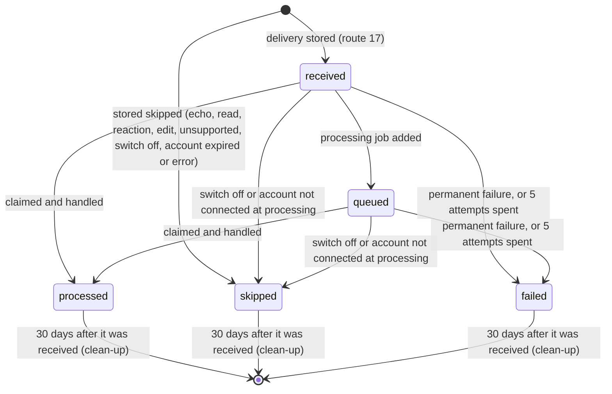

`src/domains/app/sub-domains/instagram-webhook/instagram-webhook-event/`

# Instagram webhook events (nested resource)

Parent: [Instagram webhook](../instagram-webhook.overview.md)

## Purpose

Every event Meta delivers for a connected Instagram account, stored once and kept 30 days with what
happened to it (`app.instagram_webhook_events`, routes-final § 4.B, WH16–WH19). Route 18
(`GET /api/v1/app/social/instagram/webhook-events`) lists them for an Owner or Admin — the
debugging view (D13) — newest first, with the payload masked. The receiver (routes 16–17, ROUTE row
R13) stores the rows and event processing (the parent's worker, R14) claims and marks them, both through this
sub-domain's service: the parent folder never holds the table's SQL (WH1). A daily clean-up deletes
every event received more than 30 days ago (WH19).

## Layout

- `instagram-webhook-event.schema.ts` — the table, its composite key to the account, its checks,
  six indexes and RLS policy
- `instagram-webhook-event.constants.ts` — the kind, status and skip-reason lists, the 30 days
- `instagram-webhook-event.repository.ts` — the store (`ON CONFLICT DO NOTHING`), the `queued` mark,
  the claim (a `MATERIALIZED` CTE), the claim-guarded marks and release, route 18's keyset page, the
  clean-up; a worker factory (processing) and a retention factory (the clean-up)
- `instagram-webhook-event.service.ts` — route 18's list (team-only read) and the write path the
  receiver and processing call
- `instagram-webhook-event.dto.ts` / `.validator.ts` — route 18's query
- `instagram-webhook-event.serializer.ts` + `instagram-webhook-event-payload-masking.util.ts` — the
  event object, its payload masked
- `instagram-webhook-event.controller.ts` / `.routes.ts` — route 18's handler and its registration
  (the parent's `instagram-webhook.routes.ts` mounts it)
- `workers/instagram-webhook-event-retention.*` — the daily 30-day clean-up (family `instagram`)
- `seed/` — bulk: every kind and status for each seeded account, after the accounts
- `__tests__/` — unit (masking, validator, serializer, controller, service, the clean-up's worker
  and processor), database (repository, clean-up, seed), and the test factory; route 18's HTTP suite
  sits in the parent's `__tests__/integration/`, beside the routes file that mounts it

## Key invariants

- **Every row has an organization and an account** (WH4, WH16): events of an Instagram account no team
  holds, or a revoked one, are never stored, so there is no RLS arm for rows without an organization.
  The account is named through the composite key `(organization_id, instagram_account_id)` →
  `app.instagram_accounts (organization_id, id)` `ON DELETE CASCADE`.
- **One row per account and event key** (`idx_instagram_webhook_events_organization_account_event_key`):
  a repeat delivery inserts nothing. Keys are unique per account, never across accounts (WH9).
- **Status pairings are CHECKs**: `skip_reason` exactly when `skipped`; `error_message` exactly when
  `failed` (a code, never payload text); `processed_at` exactly when final (`processed`, `skipped`,
  `failed`); `attempt_count ≥ 0`; `updated_at ≥ created_at` — every change writes
  `greatest(created_at, now())`, since a processing transaction can start before the receiver's insert
  commits. `created_at` is the received time — the API's `received_at`.
- **Strict order per account** (WQ3): the claim takes the account's oldest `received` / `queued` event
  and never skips a head another run holds (a 5-minute lease); its attempt count is the claim's token,
  so a run whose lease ran out changes nothing.
- **Route 18 changes nothing and masks the payload** (WH17): text cut to 40 characters, emails and
  phone numbers masked, links replaced by `[link]`; ids, kinds and usernames kept. The stored payload
  stays as received — processing needs the real text.
- **A contact erase does not reach these rows** (WH18, contacts CQ1): no erasure step is registered;
  the person's events go with the 30-day clean-up.
- **RLS**: the organization policy in `USING` and `WITH CHECK`, plus the retention sweep arm
  (maintenance role) in `USING` only — the clean-up and the stuck-event pick-up read across
  organizations without opening any organization's data otherwise (WH3). No `*_by_user_id`, no audit
  entry (WH6).

## Lifecycle

A waiting event (`received`, `queued`) is claimed again after its 5-minute lease when a run died
(WH15); an Instagram outage releases the claim without spending its attempt, and a temporary failure
ends the lease but keeps its attempt so the job's backoff retry claims it again at once (WH14,
`releaseClaim({ isAttemptSpent })`). The stuck-event pick-up reads the waiting accounts across
organizations under the retention context (`listAccountsWithStuckEvents`).

## Failure modes

- **A cursor minted elsewhere, or under other filters** → `400` on `after` (4.B.9) — never a silent
  restart.
- **A personal organization** → `404 team_organization_required`; a Member → `403 missing_permission`
  (D4).
- **The store fails** → the receiver answers `500` / `503` and Meta delivers again; the part already
  stored dedupes on its key (WH10).
- **The clean-up stops at its batch cap** → the rest goes the next day; deleting twice changes nothing.

## Policy constants

- `INSTAGRAM_WEBHOOK_EVENT_RETENTION_DAYS = 30` (D8) — a constant, not a setting; the clean-up runs
  daily at 03:00 (`src/infrastructure/queue/scheduler.ts`, worker-changes rule 11).
