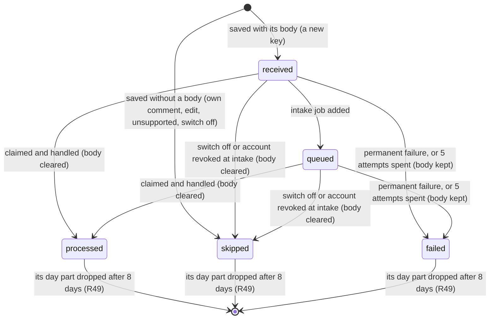

`src/domains/app/sub-domains/instagram-webhook/instagram-webhook-event/`

# Instagram webhook events (nested resource)

Parent: [Instagram webhook](../instagram-webhook.overview.md)

## Purpose

Every event saved for a connected Instagram channel account — from a Meta delivery, and later the
missed-comment check and a past-comments read — with what intake did with it
(`app.instagram_webhook_events`), and every event key seen, so a repeat saves nothing
(`app.instagram_webhook_event_keys`) — launch § 4.B, changed by feat-instagram-dm-sending § 5.B
(WH18–WH24, ROUTE R16). Route 62 (`GET /api/v1/app/social/instagram/webhook-events`) lists the
events for an Owner or Admin — the debugging view (D13) — newest first, filterable by channel account,
with the payload masked while the event waits and `null` once it is done. The receiver stores the
rows and intake claims and marks them, both through this sub-domain's service: the parent folder never
holds the tables' SQL (WH1).

Both tables are **split by day** while they are empty (P96): the events by the UTC day of
`created_at` (the received time), the keys by the UTC day of Meta's own time for the item. They are
kept 8 days (`INSTAGRAM_WEBHOOK_EVENT_KEEP_DAYS`); the day parts are made and dropped by the shared
partition upkeep (WC-55, ROUTE R49) through `app.fn_create_daily_partitions` — the migration makes
the first parts (8 days back to 14 ahead) and one DEFAULT part each. Until R49 retires it, the
launch's daily 30-day batch clean-up still runs.

## Layout

- `instagram-webhook-event.schema.ts` — the events parent (primary key `(id, created_at)`), its
  composite key to the channel account, its checks, seven indexes and RLS policy; `intake_group` is a
  generated column
- `instagram-webhook-event-key.schema.ts` — the key table parent (primary key
  `(organization_id, channel_account_id, event_key, event_day)`), RLS policy; no routes
- `instagram-webhook-event.constants.ts` — the 13 kinds, the statuses, the 6 skip reasons, the 3
  intake groups, the launch's 30 days
- `instagram-webhook-event.repository.ts` — the insert of new events, the `queued` mark, the claim (a
  `MATERIALIZED` CTE), the claim-guarded marks (which clear the body) and release, route 62's keyset
  page, the stuck-event read, the launch clean-up; a worker factory and a retention factory
- `instagram-webhook-event-key.repository.ts` — the one key write (`ON CONFLICT DO NOTHING RETURNING`)
- `instagram-webhook-event.service.ts` — route 62's list (team-only read); **the store function**
  (`recordReceivedEvents`: the 8-day replay guard, each key filed under its Meta day, keys first, then
  only the new keys' events — the one write path for all three sources) and the intake marks
- `instagram-webhook-event.dto.ts` / `.validator.ts` — route 62's query (`channel_account_id`, `status`,
  `event_kind`, received window, page)
- `instagram-webhook-event.serializer.ts` + `instagram-webhook-event-payload-masking.util.ts` — the
  event object (`channel_account_id`, `next_attempt_at`), its payload masked or `null`
- `instagram-webhook-event.controller.ts` / `.routes.ts` — route 62's handler and its registration
  (the parent's `instagram-webhook.routes.ts` mounts it)
- `workers/instagram-webhook-event-retention.*` — the launch's daily clean-up (retired at R49)
- `seed/` — bulk: every kind, status and skip reason for each seeded Instagram channel account, keys
  first
- `__tests__/` — unit (masking, validator, serializer, controller, service with the store function),
  database (repository, the store function against the key table and the day parts, clean-up, seed),
  and the test factory; route 62's HTTP suite sits in the parent's `__tests__/integration/`

## Key invariants

- **Every row has an organization and a channel account** (WH3): events of an account no team holds,
  or a revoked one, are never stored. The account is named through the composite key
  `(organization_id, channel_account_id)` → `app.channel_accounts (organization_id, id)`
  `ON DELETE CASCADE` — on both tables.
- **The key table is the repeat guard** (WH20): one row per organization, account, key and Meta event
  day, inserted `ON CONFLICT DO NOTHING` before the events; only the keys it returned get an event row.
  A redelivery carries the same Meta time, so it lands on the same day. An event whose Meta time is
  over 8 days old is never saved (its key's part may be gone — the replay guard). An item without a
  Meta time is filed under its received day.
- **The body lives only while the event waits or failed** (WH22): `chk_instagram_webhook_events_body`
  — `(status IN ('received', 'queued', 'failed')) = (payload IS NOT NULL)`; a row born `skipped` is
  stored without it, and the guarded mark that makes an event `processed` or `skipped` clears it.
- **Status pairings are CHECKs**: `skip_reason` exactly when `skipped`; `error_message` exactly when
  `failed` (a code, never payload text); `processed_at` exactly when final; `next_attempt_at` only while
  `failed`; `attempt_count ≥ 0`; `updated_at ≥ created_at`.
- **Intake groups** (WH11): `intake_group` is generated — `comments` for a `comment`, `live` for a
  `live_comment`, `messages` for every other kind; the claim index leads with
  `(channel_account_id, intake_group)`.
- **Strict order per account** (launch WQ3, until R41's per-group claim): the claim takes the account's
  oldest waiting event and never skips a head another run holds (a 5-minute lease); its attempt count
  is the claim's token.
- **Route 62 changes nothing** (5.B.10): the masking runs in the serializer only.
- **RLS on both parents**: the organization policy in `USING` and `WITH CHECK`, plus the retention
  sweep arm (maintenance role) in `USING` only. The parts carry **no grant** for the application
  roles: app code reaches them only through the parent, whose policy applies.

## Lifecycle

The hourly retry of a `failed` event through `next_attempt_at` (WH21) is intake's (ROUTE R41).

## Failure modes

- **A cursor minted elsewhere, or under other filters** → `400` on `after` (5.B.9).
- **A `channel_account_id` that is not a `cha_…` id** → `400`; another organization's → an empty page.
- **A personal organization** → `404 team_organization_required`; an Editor or Viewer →
  `403 missing_permission`.
- **The store fails** → the unit rolls back whole (keys and events), the receiver answers `500` / `503`
  and Meta delivers again.
- **A day with no part** (the upkeep fell behind) → the row lands in the DEFAULT part instead of failing;
  the upkeep's alert (R49) reports it.

## Policy constants

- `INSTAGRAM_WEBHOOK_EVENT_KEEP_DAYS = 8` (`src/shared/constants/instagram.constants.ts`) — the keep
  time of events, keys and parts, and the replay guard.
- `INSTAGRAM_WEBHOOK_EVENT_RETENTION_DAYS = 30` (D8) — the launch clean-up's cutoff, until R49 retires
  it.
