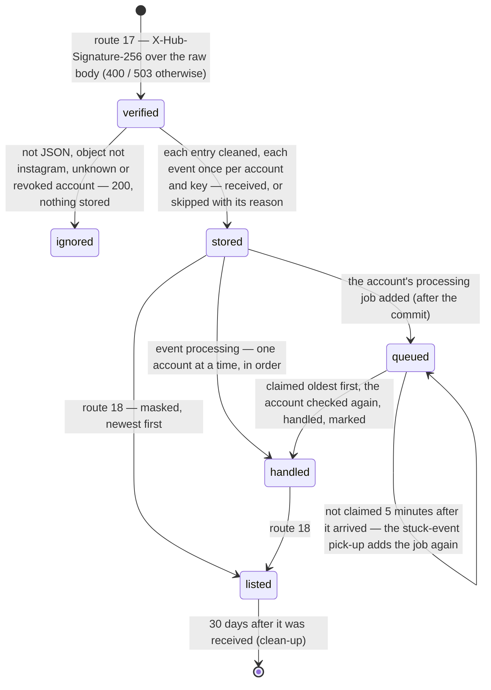

`src/domains/app/sub-domains/instagram-webhook/`

# Instagram webhook

Parent: [App](../../app.overview.md)

## Purpose

Meta's Instagram webhook for the app domain (routes-final § 4, WH1): Meta checks the subscription
(route 16) and delivers comments, DMs, story replies and button clicks (route 17); each event is
stored once before Meta gets its answer, then event processing turns it into contact updates and
automation runs, one Instagram account's events at a time, in order; the team reads what arrived
and what happened to each (route 18).

Built: the nested `instagram-webhook-event/` — the events table, route 18 (its own routes file) and
the 30-day clean-up (ROUTE row R12) — and, at this folder root, the receiver (routes 16–17, R13) and
event processing with the stuck-event pick-up (WH12–WH15, R14). The root holds no table of its own
and writes the events only through the nested sub-domain's service.

## Layout

- `instagram-webhook.routes.ts` — the routes plugin mounted by `app.routes.ts` beside sub-domain 1's
  `/social/instagram/…` routes: route 16 (`GET /social/instagram/webhook`), route 17
  (`POST /social/instagram/webhook`, in its own encapsulated context with the signature hook and
  JSON-only parsing) and the nested `instagram-webhook-event.routes.ts` (route 18)
- `instagram-webhook.controller.ts` — the two handlers; both answer `200 text/plain` (the echoed
  challenge, `OK`) with `raw_response`
- `instagram-webhook.service.ts` — the subscription check (WH7) and the store of a delivery (WH10)
- `instagram-webhook-ingress.plugin.ts` — `X-Hub-Signature-256` over the raw body before anything is
  parsed (WH8): a request without the header is refused before its body is read, and the verified
  bytes are parsed only after the check (D53); mirrors the Stripe receiver's plugin
- `instagram-webhook-event-classifier.util.ts` — the one pure classifier: each item's kind, key,
  skip reason, contact and time (WH9, the table in 4.A.10)
- `instagram-webhook-event-dispatch.util.ts` — the one pure reader of a stored event for its
  handling (4.A.10 "What each event does"): the sender and the kind's fields for the run engine; an
  unreadable payload is `InstagramWebhookEventPermanentError`
- `instagram-webhook.dto.ts` — route 16's `hub.*` query and the delivery / entry shapes the service
  parses after the signature passed; `instagram-webhook.types.ts` (with
  `InstagramWebhookEventPermanentError`), `instagram-webhook.constants.ts`,
  `instagram-webhook-error.util.ts` (the three reasons)
- `queues/instagram-webhook.queue.ts` (+ `.job.schema.ts`) — the processing queue: one job per
  account (`organizationPublicId`, `instagramAccountPublicId`), deduplicated per account with
  `keepLastIfActive` and a unique job id; 5 attempts, exponential from 5 s with jitter
- `workers/instagram-webhook.worker.ts` — provider-pausable on the `instagram` circuit, family
  `instagram`, `WORKER_CONCURRENCY_INSTAGRAM`; routes on `job.name`:
  `workers/instagram-webhook.processor.ts` (one account's events, WH12–WH14) and
  `workers/instagram-webhook-reclaim.processor.ts` (+ `.constants.ts`; the every-minute stuck-event
  pick-up, WH15)
- [`instagram-webhook-event/`](instagram-webhook-event/instagram-webhook-event.overview.md) — the
  stored events, route 18 (`instagram-webhook-event.routes.ts`), the clean-up
- `__tests__/` — `integration/` (routes 16–18 over HTTP, the Stripe receiver still verifying) and
  `unit/` (the classifier, the DTOs, the plugin, the service, the dispatch, the queue, the processor
  and the pick-up — with fakes and against the database through the real run engine — and
  `events/worker/` for the worker)

## Key invariants

- **Signature first** (WH8, D53): route 17 declares no `schema.body`; a request without
  `x-hub-signature-256` is refused in a `preParsing` hook, before its body is read; for one that
  carries it the content-type parser only keeps the raw bytes (the shared raw-body registry, WH2,
  asked with the route that matched) and parses nothing. Nothing is parsed, looked up or stored
  before the HMAC passes — a wrongly signed 5 MB body costs one HMAC.
- **Stored once, before the answer** (WH10): every entry's events go in one `INSERT … ON CONFLICT DO
  NOTHING` keyed by organization, account and event key — a repeat delivery inserts nothing; a store
  failure is never `200`, so Meta delivers again.
- **One bad entry never costs the others theirs** (WH10, D53): every string of an entry — object keys
  and the event key included — is cleaned once, after the signature, of what Postgres refuses (NUL,
  lone surrogates: `cleanStorableJson`); an entry that still cannot be stored is logged
  (`instagram.webhook.entry_store_failed`), the delivery's other entries are stored, and then the
  first failure is thrown.
- **The folder root owns no table** (WH1): every event row is written through
  `InstagramWebhookEventService`; the root never holds the table's SQL.
- **Finding the organization opens no other organization's data** (WH3, K5): the receiver resolves
  the account through sub-domain 1's SECURITY DEFINER resolver, then reads the account's state and
  stores under that organization's `PRINCIPAL_SCOPE.VERIFIED` scope (ledgered); processing runs
  under the job's organization scope; the cross-organization sweeps read ids only.
- **Events of an account no team holds, or a revoked one, are never stored** (WH4, WQ1) — one log
  line and the `instagram_webhook_unknown_account_entries_total` metric.
- **Keys are per account** (WH9): a read receipt is `read:<mid>`, never `message:<mid>`; a click
  without `mid` keys on sender, time and a payload hash; the account's own DMs and comments are
  skipped `echo` (an automation never answers itself; WQ4).
- **No audit entry, no `*_by_user_id`** — nobody signed in acts here (WH6, K6, K9); logs carry ids,
  kinds, keys, statuses and counts, never a payload or message text.
- **The processing hook**: the app container wires `enqueueInstagramWebhookAccountProcessing` into
  `InstagramWebhookService`; after each entry's commit the account's job is added and the just-stored
  rows turn `queued`; a failed add is only logged (the stuck-event pick-up takes over).
- **One account at a time, in order** (WH5, WH12): one processing job per account on any replica
  (the deduplication); the job claims the oldest `received` / `queued` event (one more attempt, a
  5-minute lease) and never skips a leased head, so a failing event holds the account's later events
  back (WQ3); after 25 events the job adds one follow-up and yields its slot.
- **Checked again, the contact first** (WH12, WH13): before each event the account is read again
  (switch off → `skipped` `automation_disabled`, not `connected` → `skipped` `account_disconnected`);
  then the contact (a new one's profile read, failing open), then the kind — a comment's post stored
  and "next post" linking in a savepoint before `startCommentRun`; a DM, story reply or click to its
  engine entry point — every call outside any database context with the job's scope and
  `isLastAttempt`.
- **Failures** (WH14): a temporary one ends the lease (attempt kept) and rethrows — the job retries
  with backoff; the 5th failed attempt, a permanent failure (an unreadable payload, a refused token)
  or the engine's `failedErrorType: 'token'` marks the event `failed` with a code; an Instagram
  outage gives the attempt back and pauses the queue. Every `failed` mark — the claim's own of a head
  whose attempts ran out too — also fails the runs the event left `running`, through the engine's
  `failRunsOfFailedEvent` in the same unit of work: both or neither (D47). A `skipped` mark after a claim
  does the same, for a run an earlier try left running (D51).

## Lifecycle

## Failure modes

- Route 16: a missing `hub.*` part or a challenge over 256 characters → `400 invalid_field`; a mode
  other than `subscribe` or a wrong token → `400 invalid_webhook_verify_token`; the setting unset →
  `503 instagram_webhook_not_configured`.
- Route 17: the app secret unset → `503 instagram_webhook_not_configured`; the signature missing,
  malformed or wrong → `400 invalid_webhook_signature` (missing: before the body is read); over 5 MB
  → `413`; not `application/json` → `415`; over 1,200 a minute per IP → `429`; an entry that could not
  be stored → `500` / `503` after the others are (Meta delivers again).
- Route 18's are in the nested overview.
- Processing: a temporary failure is retried by the job (5 attempts, from 5 s) while the account's
  later events wait; the 5th failure, a permanent one or a dead token marks the event `failed` (a code
  and a short reason, never payload text) and fails the runs it left running; an Instagram outage spends
  no attempt and pauses the queue;
  a lost job is re-added by the every-minute pick-up. Nobody is told about a failed event — it shows
  in route 18 (D13).
