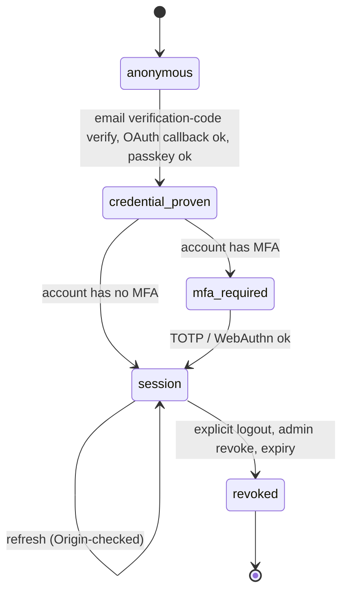

`src/domains/auth/`

# Auth

## Purpose

Owns identity proof and session establishment for the platform. Supports four credential types — email verification-code login, OAuth, MFA (TOTP), and WebAuthn; passwords are off everywhere (feat-instagram-dm-sending P84: no password route, no password code path, every `password_hash` emptied and every `PASSWORD` auth method revoked by the `auth_passwords_off` migration) — the four password routes are kept disabled behind `PASSWORD_ROUTES_ENABLED` (default off, 404; P251, marker `PASSWORD-ROUTES-DISABLED`, `handlers/auth-password.handlers.ts` + `sub-domains/auth-method/password-auth.service.ts`) — and issues short-lived JWTs (RS256) backed by refreshable session rows. The domain is the source of truth for "who is making this request"; everything authorization-related (organization permissions) lives in [tenancy](src/domains/tenancy/).

What it owns:

- The `auth_*` tables (auth methods, sessions, MFA secrets, WebAuthn credentials, verification tokens).
- All credential verification logic and the email-code try counters (per code, per email per day).
- JWT issuance + verification (via [src/shared/utils/security/jwt.util.ts](src/shared/utils/security/jwt.util.ts)).
- Origin-checked session cookies (`session_id`) and the refresh path; CSRF model in [docs/reference/security/csrf-and-session-cookies.md](docs/reference/security/csrf-and-session-cookies.md). Frontend client integration — SPA login across every entry flow, reactive refresh, organization switching, and how many calls each flow takes to reach the dashboard — in [docs/reference/api/frontend-auth-guide.md](docs/reference/api/frontend-auth-guide.md).

What it does not own: user profile (lives in [user](src/domains/user/)), organization permissions (lives in [tenancy/permission](src/domains/tenancy/sub-domains/permission/)), audit (lives in [audit](src/domains/audit/) — auth calls into it).

## Key invariants

- **Anti-enumeration**: email verification-code send answers the same for unknown and known emails (and its `429 code_resend_too_soon` is decided before any lookup); `POST /auth/email/login` answers an unknown email exactly like a wrong code (`401 code_wrong` with the same `tries_left` — the try counter is keyed by the email).
- **One-shot tokens**: every `verification_tokens` row has a single use. Verifies use atomic `UPDATE ... RETURNING` so two concurrent verifies cannot both produce a session. The short-lived Redis handles (MFA session, WebAuthn challenge, OAuth state) are consumed with an atomic `GETDEL` for the same single-use guarantee against a GET-then-DEL race.
- **Active-account gate**: a session is issued only for an `ACTIVE` user. Every issuance path (email verification-code verify, OAuth completion, WebAuthn verify, MFA login completion) rejects a non-active account with `errors:accountNotActive` before a JWT or session row is created.
- **Session revocation on state change**: suspending a user (or any admin status change away from `ACTIVE`), and deleting the account, revokes all of their sessions and ends every trusted device. Each revoke invalidates the Redis token-validity cache so it takes effect immediately.
- **Hashed-at-rest secrets**: email verification-code rows use a keyed, user-scoped HMAC; MFA backup codes and session JWT hashes are stored as `sha256(raw)`. Raw secrets leave the platform only via outbound email or to the client at issuance time.
- **MFA assurance is per session**: a session that proved a second factor (MFA login challenge, authenticated `POST /auth/me/mfa/verify`, or MFA enrollment confirmation) records `auth.sessions.mfa_verified_at`; every token minted for it (login, switch, refresh) carries the RFC 8176 `amr: ['mfa']` claim, read by the auth middleware as `request.auth.mfaVerified`. Organizations whose security policy sets `mfa_required` admit only such sessions — at switch (403 `mfa_required`), at refresh (the organization is dropped from the token) and on every organization-permission check — so joining an organization or an organization turning MFA on after login cannot bypass the policy.
- **Platform admin needs MFA** (A-2): `super_admin` is minted only for an allowlisted (`GLOBAL_ADMIN_EMAILS`), ACTIVE, verified account with an enrolled MFA factor, re-derived per request (an account whose factor is gone is downgraded to `user`), and `requireRole` admits it only on an MFA-verified session (403 `errors:superAdminRequiresMfa`, reason `mfa_required`). Admin delete, suspend and a `status` edit also need a recent strong step-up on the session.
- **Login default organization**: every issuance path (and the refresh fallback when a session's organization is no longer valid) mints the token for `resolveDefaultActiveOrganizationPublicId` — the organization the user pinned (`auth.user_settings.default_organization_id`, through `PATCH /users/me/settings`), else the organization they last switched to (`auth.users.last_active_organization_id`, remembered by `POST /auth/switch-to-organization`, best-effort and only when it changes) while that membership is active, else the most recently joined organization, else the personal organization. With TEAM organizations disabled the personal organization stays first. An organization beats the personal workspace because the frontend answers a personal workspace with the organization picker.
- **Short JWT lifetime**: `ACCESS_TOKEN_EXPIRY_SECONDS = 900` (15 min). Refresh requires the Origin-checked session cookie.
- **Email-code guessing bounds** (AT6–AT8): six digits, 15 minutes, 5 wrong tries per code (`401 code_wrong` + `tries_left`, then `code_used_up`), 20 wrong tries per email per 24 hours (`429 code_day_limit`, `EMAIL_CODE_WRONG_TRIES_PER_DAY`), 60 s between sends (`429 code_resend_too_soon`); plus the per-IP + per-email rate limits and CAPTCHA.
- **Provisional factor + owner notices** (A-1): a TOTP factor enrolled under an email-code step-up window (all a passwordless account without MFA can open — and all brief mailbox access opens) is stored with `provisional_until` (+`PROVISIONAL_FACTOR_PERIOD_SECONDS`, 72 h) and `enrolled_on_session_public_id`; until then, and always on the enrolling session, `POST /auth/me/mfa/verify` with it records a weak `provisional_mfa` window that cannot pass the strong step-up gate (revoke sessions, delete a credential). The owner is emailed (`AuthMethodService.sendAccountSecurityNotice`, `mail:securityNotice*`, en + es, with a "this wasn't me" line) on TOTP enrollment, passkey registration and `DELETE /auth/me/sessions`.
- **Strong step-up without a password** (AT15): `POST /auth/step-up` takes the email code and is refused (`403 mfa_step_up_required`) for a person with a **settled** 2FA factor, so every `email_code` window belongs to a person without one — it passes the strong gate (revoke sessions, remove a passkey, a sign-in way or the 2FA factor); its mailbox can already sign the person in, so it gives no new power. A person with settled 2FA steps up with `POST /auth/me/mfa/verify`. Wrong codes answer `401 code_wrong` + `tries_left`, `code_expired`, `code_used_up` on the step-up's own try budget.
- **Trusted devices** (AT17, D56): "trust this device for 30 days" on a right 2FA code; the next sign-in on that browser skips the 2FA code — never for a `super_admin`, never for a person in an organization that requires 2FA, never as a proved second factor (`mfa_verified_at` stays empty). See [auth-trusted-device](src/domains/auth/sub-domains/auth-trusted-device/).
- **Email code always on** (AT13): the `EMAIL_CODE` way can never be removed — `DELETE /auth/me/auth-methods/{auth_method_id}` on it answers `409 email_code_always_on`.
- **Removed login methods stay closed** (A-5): email-code login and the OAuth callback refuse (`errors:loginMethodTurnedOff`, 403) a method the owner revoked (`AuthMethodService.isLoginMethodTurnedOff`); OAuth no longer re-links a fresh row over the removal.
- **No manual OAuth identity binding**: `POST` auth-method create rejects `provider: manual` with a client-supplied provider identity — only OAuth completion paths may attach provider subjects, preventing account takeover via forged provider linkage.

## Sub-domains

| Sub-domain | Purpose |
| --- | --- |
| [auth-method](src/domains/auth/sub-domains/auth-method/) | Per-user credential methods. Hosts the email verification-code, OAuth, and verification-token implementations as services within the same folder (no separate sub-domain). |
| [auth-session](src/domains/auth/sub-domains/auth-session/) | Session lifecycle: create on successful auth, revoke on logout, list active sessions. Owns the `auth_sessions` table and session retention worker. |
| [auth-mfa](src/domains/auth/sub-domains/auth-mfa/) | TOTP MFA enrolment, challenge, and backup codes. |
| [auth-trusted-device](src/domains/auth/sub-domains/auth-trusted-device/) | "Trust this device for 30 days": the `auth.trusted_devices` rows, the skip at sign-in and its early ends. |
| [auth-webauthn](src/domains/auth/sub-domains/auth-webauthn/) | WebAuthn / passkey enrolment and authentication ceremonies via `@simplewebauthn/server`. |
| [auth-mfa-session](src/domains/auth/sub-domains/auth-mfa-session/) | MFA-challenge ticket store (Redis). Bridges primary auth and second-factor verification. |

## Patterns used

This domain implements the contracts documented in [src/PATTERNS.md](src/PATTERNS.md):

- `audit-emission` — every credential add/remove, every login (a success attributed to the user; a failure as an anonymous `auth.login_failure` that never names the account tried), every MFA recovery-code use, and every session revoke records a row.
- `idempotency` — sign-in and step-up take no `X-Idempotency-Key` (a repeat is a new attempt).
- `transactional-outbox` — auth emails (email verification-code, account security notices) flow through `event-bus` → mail outbox → `mail.processor`.
- `tenant-isolation` does **not** apply at the auth layer — auth is global. Organization scope is layered on later by `tenancy`.

## Cross-domain flows

- `signup-flow` — email verification-code path issuing the user's first session.
- `login-flow` — a first factor (email code, OAuth, passkey; with optional MFA) issuing a session.
- `organization-invitation-flow` — invitee may need to complete `signup-flow` first.

## Lifecycle

## Events

- Emits: `AUTH_EVENT.EMAIL_VERIFICATION_CODE_REQUESTED`, `AUTH_EVENT.ACCOUNT_SECURITY_NOTICE_REQUESTED` (each handler enqueues mail). The code email fails closed with `503` / `errors:mailNotConfigured` when outbound mail is unavailable.
- Consumes: nothing — auth is upstream.

## External integrations

- **OAuth providers** (Google + others, configured via `OAUTH_*` env). State + PKCE bound by Redis with `OAUTH_STATE_TTL_SECONDS = 600`.
- **Resend** — outbound mail for email verification-code and account security notices (via `notify` → mail outbox).

## Failure modes

- **Email code refused** → 401 `code_wrong` (+ `tries_left`) / `code_expired` / `code_used_up`, 429 `code_day_limit` / `code_resend_too_soon` (+ `retry_after_seconds`, `Retry-After`); the Redis counters fail open.
- **Disposable email blocked** → 400 on send; user gets actionable message.
- **MFA challenge expired** (5 min) → 401, client must restart login.
- **OAuth state mismatch** → 400; CSRF defence engaged.
- **Session token replayed after revocation** → 401; positive cache TTL `SESSION_TOKEN_CACHE_TTL_SECONDS = 60` bounds how long a revoked session can keep working.

## Policy constants

See [src/POLICIES.md](src/POLICIES.md) for the full rationale of each:

- `VERIFICATION_CODE_TTL_MINUTES = 15`
- `ACCESS_TOKEN_EXPIRY_SECONDS = 900`
- `MFA_SESSION_TTL_SECONDS = 300`
- `WEBAUTHN_CHALLENGE_TTL_SECONDS = 300`
- `OAUTH_STATE_TTL_SECONDS = 600`
- `SESSION_TOKEN_CACHE_TTL_SECONDS = 60`
- `VERIFICATION_CODE_MAX_VERIFY_ATTEMPTS = 5`
- `EMAIL_CODE_WRONG_TRIES_PER_DAY = 20`
