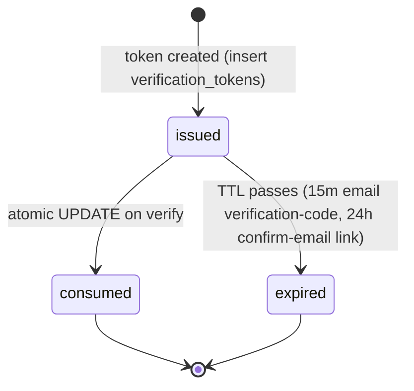

`src/domains/auth/sub-domains/auth-method/`

# Auth method

Parent: [auth](../../auth.overview.md)

## Purpose

Per-user credential records and the [verification-token](src/domains/auth/sub-domains/auth-method/verification-token/) / email verification-code / OAuth flows that issue or validate them. The sub-domain holds the row that says "user X has an OAuth account / email verification-code sign-in" and the services that produce one-shot verification tokens.

The folder also houses the [email verification-code](src/domains/auth/sub-domains/auth-method/) and [oauth](src/domains/auth/sub-domains/auth-method/oauth/) services as **internal modules** (not separate sub-domains) — they're implementation details of how an auth method is exercised, not separate API resources.

## Key invariants

- **One auth method per `(user, method_type[, provider, provider_user_id])`**: enforced by a partial unique index. A user cannot have two Google OAuth links to the same Google account.
- **Hashed-at-rest secrets**: verification-token / email verification-code values are stored as a hash (the code as a keyed HMAC). Passwords are off (P84; the password routes are kept disabled behind `PASSWORD_ROUTES_ENABLED`, P251 — `password-auth.service.ts`, marker `PASSWORD-ROUTES-DISABLED`) — no password is stored or checked. Raw tokens leave the platform only through outbound email (one-shot) or the OAuth callback URL.
- **One-shot, type-scoped consumption**: every `verification_tokens` row is consumed by an atomic `UPDATE ... SET used_at = NOW() WHERE token_hash = $1 AND token_type = $2 AND used_at IS NULL AND expires_at > NOW() RETURNING *`. Two concurrent verifies cannot both succeed, and the `token_type` predicate (sec-r5-L2) means a token replayed against the wrong flow (e.g. an `EMAIL_CONFIRM` link token sent to the email verification-code verify path) never matches — so it is never burned, staying redeemable on its own flow.
- **Single live email verification-code**: each send invalidates the user's prior unused `EMAIL_CODE` codes, so only the most recently emailed code is redeemable (the per-email send cooldown spaces issuance so an in-flight code is not invalidated by a rapid re-request). A successful login additionally invalidates any remaining live codes. Codes are stored as a keyed user-scoped HMAC (never plaintext, never bare sha256).
- **Confirm-your-email link** (`email-confirmation.service.ts`, feat-instagram-dm-sending § 11.B): `POST /users/me/email-confirmation` (route 133, AUTH — registered in the user routes) stores the SHA-256 of a 32-byte token as `EMAIL_CONFIRM` for `EMAIL_CONFIRM_LINK_HOURS` (24), ends the person's earlier link and emails `<FRONTEND_URL>/confirm-email?token=…` through the mail outbox in the same transaction; a new link within 60 s of the last is `429 email_confirmation_resend_too_soon` + `retry_after_seconds` (read from the newest link's `created_at`), an already confirmed email `409 email_already_confirmed`. `POST /auth/email/confirm` (route 134, PUBLIC) consumes the token once and sets `is_email_verified` (audit `user.email.confirm`); an unknown, spent or expired token is `400 email_confirm_token_invalid`; a person a code sign-in already confirmed gets the same success. No session is made.
- **Anti-enumeration on send**: email verification-code send returns identical responses for known and unknown emails. No row inserted, no event emitted, no email sent for unknown emails.

## Lifecycle

## Events

- Emits: `AUTH_EVENT.EMAIL_VERIFICATION_CODE_REQUESTED`, `AUTH_EVENT.EMAIL_CONFIRM_LINK_REQUESTED`, `AUTH_EVENT.ACCOUNT_SECURITY_NOTICE_REQUESTED`. Each handler enqueues outbound mail through the mail outbox. The code and confirm-link mail paths fail closed with `503` / `errors:mailNotConfigured` when outbound mail is unavailable.

## External integrations

- **OAuth providers** — Google + others, configured via `OAUTH_*` env. State + PKCE bound by Redis with `OAUTH_STATE_TTL_SECONDS = 600`.
- **Resend** (indirectly via mail outbox).

## Failure modes

- **Token expired** → 401 `errors:emailCodeExpired` (an email sign-in code; each token type has its own key).
- **Token reused** → 401 (atomic consume returned no row); the confirm-email link answers `400 email_confirm_token_invalid` for an unknown, spent or expired token.
- **Disposable email blocked on send** → 400 `errors:disposableEmail`.
- **OAuth state mismatch on callback** → 400; CSRF defence engaged.

## Policy constants

- `VERIFICATION_CODE_TTL_MINUTES = 15`
- `EMAIL_CONFIRM_LINK_HOURS = 24` (`auth-method.constants.ts`; the 60 s resend wait reuses `VERIFICATION_CODE_RESEND_COOLDOWN_SECONDS`)
- `EMAIL_CODE_WRONG_TRIES_PER_DAY = 20` (`verification-code.ts`)
- `OAUTH_STATE_TTL_SECONDS = 600`
