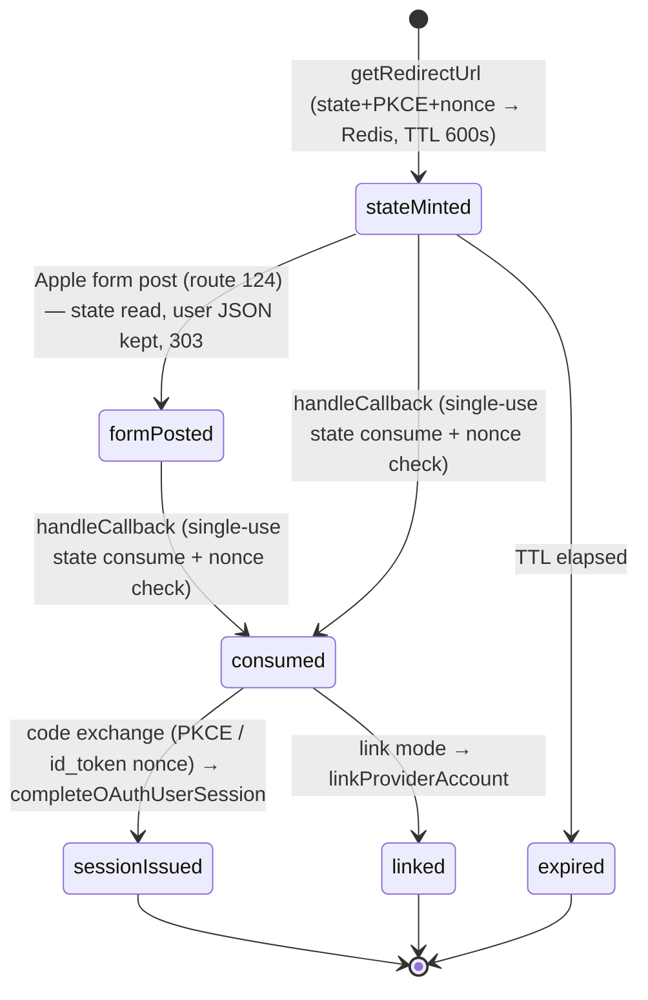

`src/domains/auth/sub-domains/auth-method/oauth/`

# OAuth (nested implementation)

Parent: [auth-method](../auth-method.overview.md)

## Purpose

Coordinates the OAuth authorize-and-callback dance for the supported providers. This is an **internal module** of auth-method, not an API resource — no controller or routes file; auth-method's routes call `oauth.service.ts` directly.

Providers: **Google and Apple** (feat-instagram-dm-sending § 10.B; GitHub removed, AT5). A provider whose env vars are unset is left out of `GET /oauth/providers` and its start answers 404 (AT11).

Browser contract — Google: the registered redirect URI (`OAUTH_GOOGLE_REDIRECT_URI`) is the **SPA's `/callback/google` page**, not this API. Google lands the browser there with `code`+`state`; the SPA forwards both to `GET /api/v1/auth/oauth/google/callback` (an XHR carrying the `oauth_nonce` cookie), and this module consumes the state, exchanges the code (PKCE), and mints the session.

Browser contract — Apple: the start asks `response_mode=form_post` with the `name email` scopes, so Apple **posts a form to this API** (`OAUTH_APPLE_REDIRECT_URI` = `POST /api/v1/auth/oauth/apple/callback`, route 124). That route never signs anyone in: it checks the state is live without using it up, keeps Apple's first-time `user` JSON (the name) next to it (`oauth:provider-user:<state>`, the state's life), and answers **303** to `<FRONTEND_URL>/callback/apple?code&state` (or `?reason=oauth_cancelled|oauth_failed|oauth_expired`) — the one named exception to the method→status policy (P85). The SPA then calls `GET …/apple/callback` as for Google: the state is used once, the code swapped with a fresh ES256 client secret (`jose`, the `.p8` key), Apple's `id_token` verified against Apple's keys (cached ≤ 60 s) with its `nonce` = the SHA-256 of the browser nonce. No PKCE for Apple (its token endpoint does not document it).

Link mode (AT12): `GET /oauth/:provider?intent=link` with a bearer and a recent step-up binds the person and session into the state; the callback then links that Google or Apple account to the person (another email is fine), answers the linked way instead of a session, and refuses one live on someone else (`409 provider_account_in_use`). Sign-in matches a person by the provider account first, then by email (Apple's later sign-ins may carry no email).

## Layout

- `oauth.service.ts` — `getRedirectUrl` (mints state + PKCE + nonce; link mode), `receiveAppleFormCallback` (route 124), `handleCallback` (consumes state, exchanges code, completes the session or links), `linkProviderAccount`
- `oauth-state.ts` — CSRF `state` + browser nonce (+ the link target) stored in Redis (`oauth:state:*`, TTL `OAUTH_STATE_TTL_SECONDS` = 600); the provider `user` JSON next to it (`oauth:provider-user:*`)
- `oauth-pkce.ts` — RFC 7636 PKCE verifier/challenge helpers
- `oauth-user-session.ts` — `completeOAuthUserSession`: find-or-create user, link the auth method, issue access token + session
- `providers/` — `google-oauth.provider.ts`, `apple-oauth.provider.ts` (per-provider redirect URL + code exchange; Apple's client secret and `id_token` check), `oauth-provider-failure.util.ts` (401 `oauth_failed` vs 503)
- `oauth.types.ts` — provider/callback types
- `__tests__/unit/` — state, PKCE, session-completion, and provider suites

## Key invariants

- The Redis state entry is consumed **exactly once** (single-use delete on callback); a replayed or forged callback fails with `UnauthorizedError`, as does a nonce mismatch.
- Google's code exchange always carries the PKCE verifier; Apple's `id_token` must carry this flow's nonce hash. A provider name other than `google`/`apple` is a `400` (route schema); an unconfigured one a `404` before any redirect is minted.
- Apple's form callback only reads the state; the callback uses it once.

## Lifecycle

