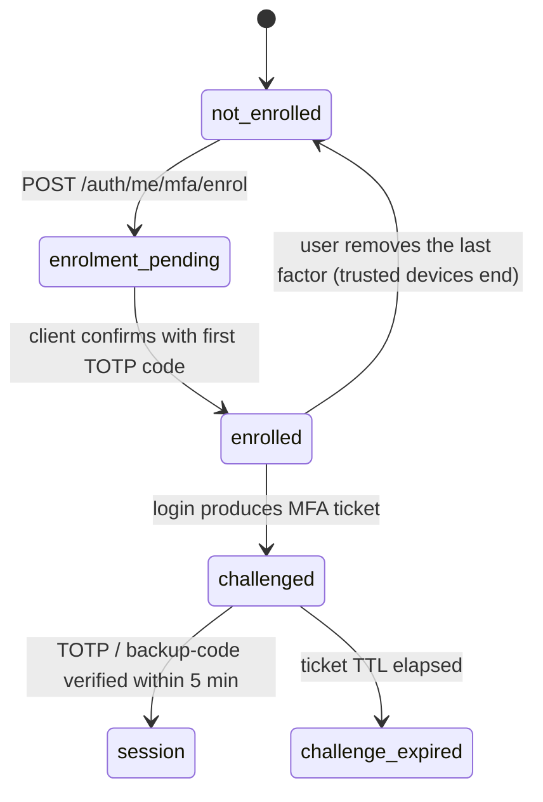

`src/domains/auth/sub-domains/auth-mfa/`

# Auth MFA

Parent: [auth](../../auth.overview.md)

## Purpose

TOTP-based multi-factor authentication: enrolment (generate secret, return provisioning URL + QR code data), verification (during login), backup codes (single-use one-shot codes for recovery), and disable. Backed by [otplib](https://github.com/yeojz/otplib) for TOTP arithmetic and the [auth-mfa-session](../auth-mfa-session/auth-mfa-session.overview.md) module for the in-flight challenge ticket store.

## Key invariants

- **Secret is encrypted at rest** in the `auth_mfa_secrets` table (or hashed if the secret is non-recoverable). Backup codes are stored as `sha256(raw)` and one-shot.
- **Enrolment requires a recent step-up** on this session (an email code for a person without settled 2FA, else the 2FA code). A factor enrolled under an email-code window is **provisional** for 72 hours (`PROVISIONAL_FACTOR_PERIOD_SECONDS`): its own code opens only a weak step-up, and the email code stays a strong one until it settles (AT15).
- **Two-step login**: primary credential → MFA challenge ticket (Redis, `MFA_SESSION_TTL_SECONDS = 300`) → second-factor submission → session.
- **Backup-code consumption is atomic**: same `UPDATE ... RETURNING` pattern as verification tokens.
- **The sign-in step's answers** (AT16): a wrong TOTP code → `401 mfa_code_wrong` + `tries_left`; over 10 wrong in 15 minutes → `429 mfa_locked` + `retry_after_seconds` (the counter's remaining time); recovery codes are not counted. The authenticated step-up (`POST /auth/me/mfa/verify`) keeps its own budget and its generic 401.
- **"Trust this device"** (AT17): `trust_device: true` on a right code creates a [trusted device](../auth-trusted-device/auth-trusted-device.overview.md); removing the last factor ends every one in the same transaction.

## Lifecycle

## Failure modes

- **TOTP code outside drift window** → 401; at login the ticket is already consumed, so the client restarts login.
- **Backup code reuse** → 401 (atomic consume returned no row).
- **MFA ticket expired** (5 min) or already consumed → 401 `mfa_session_invalid`; client must restart login.
- **Remove a factor without a strong recent step-up** → 403 `errors:strongStepUpRequired`; step up first (the 2FA code, or the email code while the factor is provisional).

## Policy constants

- `MFA_SESSION_TTL_SECONDS = 300`
- `MAX_MFA_VERIFICATION_ATTEMPTS = 10`, `MFA_VERIFICATION_LOCKOUT_TTL_SECONDS = 900`
