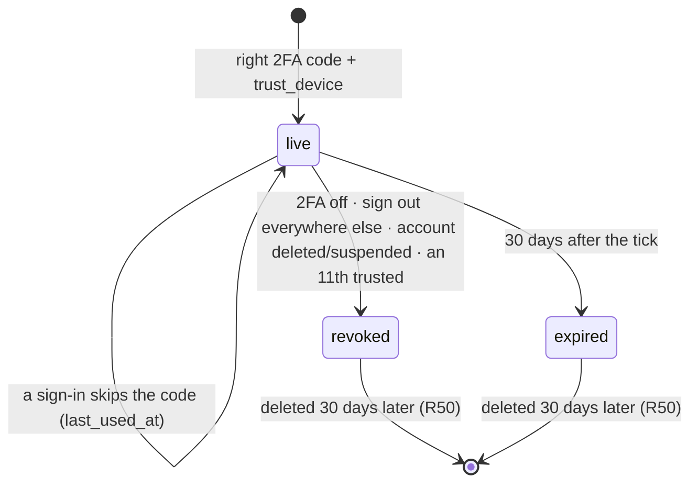

`src/domains/auth/sub-domains/auth-trusted-device/`

# Trusted devices

Parent: [auth](../../auth.overview.md)

## Purpose

"Trust this device for 30 days" (feat-instagram-dm-sending R32, routes-final § 10.C AT17, D56). After
a right 2FA code with `trust_device: true`, `POST /auth/mfa/login` ([auth-mfa](../auth-mfa/auth-mfa.overview.md))
stores one `auth.trusted_devices` row and sets the httpOnly `trusted_device` cookie. On the next sign-in
on that browser, `completeFirstFactorAuth` (`src/domains/auth/shared/complete-first-factor-auth.ts`)
accepts the cookie and opens the session without the 2FA code.

## Key invariants

- **Only the hash is stored**: the cookie is 32 random bytes (base64url); the row keeps its SHA-256
  (`token_hash`, unique). The row is matched by hash **and** `user_id`, so another person's cookie
  never skips anything.
- **Never a proved second factor**: a skipped sign-in opens a session whose `mfa_verified_at` stays
  empty — it never enters an organization that requires 2FA, never opens a step-up, and the skip is
  never offered to a `super_admin` (an email on `GLOBAL_ADMIN_EMAILS`) nor to a person in any
  organization that requires 2FA (`userHasOrganizationRequiringMfa`).
- **30 days from the tick** (`TRUSTED_DEVICE_DAYS`): `expires_at` never moves; use only sets
  `last_used_at`.
- **At most 10 live per person** (`TRUSTED_DEVICES_MAX`): an 11th revokes the oldest, under a per-user
  advisory lock (`RESOURCE_QUOTA_LOCK_NAMESPACE.TRUSTED_DEVICE`).
- **Ended early** (`revoked_at`): removing the last 2FA factor (in the same transaction as the
  removal), "sign out everywhere else" (all but this browser's cookie), and the account deleted or
  suspended (`AuthSessionService.revokeAllSessions`).
- **RLS**: user-owned, FORCE RLS on `app.current_user_public_id` (`USING` and `WITH CHECK`); the
  session clean-up's maintenance arm sits in `USING` only (it deletes, never writes).

## Lifecycle

## Failure modes

- A missing, unknown, expired, revoked or another person's cookie is simply not accepted: the 2FA
  screen shows as without it. No error is ever raised for a cookie.

## Clean-up

- The hourly session clean-up (`auth-session/workers/session-cleanup.processor.ts`, ROUTE R50, WC-64,
  P92) deletes rows expired or revoked over `TRUSTED_DEVICE_ENDED_KEEP_DAYS` (30) days ago through
  `TrustedDeviceRepository.deleteEndedBefore` inside the session-retention maintenance context, within
  its time budget and cap; `readEndedOverdueSeconds` feeds its "oldest row past its keep time" gauge.

## Policy constants

- `TRUSTED_DEVICE_DAYS = 30`, `TRUSTED_DEVICES_MAX = 10`, `TRUSTED_DEVICE_TOKEN_BYTES = 32`,
  `TRUSTED_DEVICE_ENDED_KEEP_DAYS = 30` (`auth-trusted-device.constants.ts`)
- Cookie `trusted_device`: httpOnly, `Secure` per `COOKIE_SECURE`, `SameSite` lax (none when
  `COOKIE_SAMESITE=none`), path `/api/v1/auth`, `Max-Age` 30 days (`auth.http.util.ts`)
