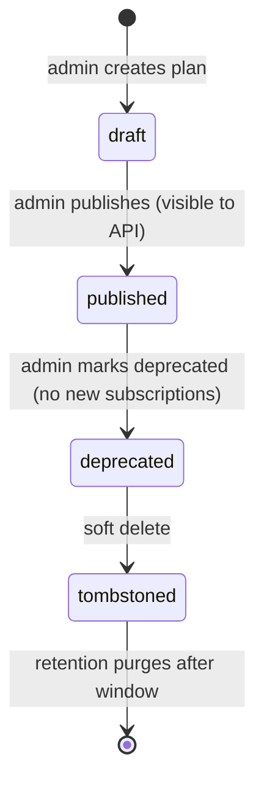

`src/domains/billing/sub-domains/plan/`

# Plan

Parent: [billing](../../billing.overview.md)

## Purpose

Plan catalog: the set of subscription plans offered to organizations, with price, typed features (limits and one switch per feature), and the Stripe `price_id` each plan maps to. The catalog is read-mostly (cached at the edge) and rarely changes; writes are admin-only.

## Key invariants

- **The Flowdm plans** (migration `20261124060244_billing_flowdm_plans.sql`, the reference seed `DEFAULT_PLANS` in step): Free ($0), Creator and Studio (placeholder prices until go-live, P37) are active; Starter, Growth and Pro are switched off and carry **Free's** features and limits, so an organization still on one is held to Free until it picks Creator or Studio (P80). Members are unlimited on every plan (`included_seats` empty).
- **Typed features — one switch per feature** (`planFeaturesSchema` in `plan.types.ts`, P83): `message_month_limit`, `channel_accounts_max`, `has_priority_support` and `feature_switches` — one boolean per key of `PLAN_FEATURE_KEYS` (`plan.constants.ts`; the PRO ones in `PRO_PLAN_FEATURE_KEYS`). Strict at both levels: a missing or unknown key is refused when a row is written (`chk_plans_features` in the database, the schema in the seed) and when it is read (`parsePlanRow` on every repository read). A new or changed plan is a new or changed row; a new feature key is a new billing migration writing its switch into every row.
- **The plan object** answers `price_yearly_per_month` (`price_yearly` ÷ 12, two decimals) and the typed `features`; there is no `limits` field (seats are unlimited). The list is cheapest first.
- **Dual Stripe price ids**: a plan carries `stripe_price_monthly_id` and `stripe_price_yearly_id` (varchar, nullable) — one plan maps to a monthly **and** a yearly Stripe price. A cycle with no price id is not Stripe-billable (e.g. a free plan, or a plan offered on only one cycle); changing a Stripe-backed subscription to such a plan is rejected (`422`, see `billing.overview.md`).
- **Public read endpoint cached by HTTP**: `Cache-Control: max-age=300, stale-while-revalidate=60` aligned with `CATALOG_CACHE_*` constants.
- **And memoized in process for 60 s** (`plan-catalog-memo.ts`), strictly fresher than the five minutes that header already permits a browser or CDN. A memo rather than a Redis cache because the catalog is global — `plans_rls_deny_all` gives it no tenant column and no per-caller filtering — and cannot change while the process runs: every writer is a migration or a CLI seed (`pnpm db:seed` for the catalog, `pnpm db:seed:stripe-catalog` for its Stripe sandbox prices). **Only `PlanService.list()` is memoized.** Every plan read that makes a decision — the seat ceiling, subscription create and change-plan, the Stripe price lookup — goes through a different repository method and still reads Postgres.
- **Hard delete forbidden**: plans soft-delete only (subscriptions reference them by FK).
- **Identified by `public_id`** (Paddle-style prefixed id), not a slug — the `plans` table has no slug column.

## Lifecycle

## External integrations

- **Stripe** — every published plan must have a corresponding Stripe price. The admin write path validates the price exists.

## Failure modes

- **Stripe `price_id` doesn't exist** → 400 on plan create/update.
- **Plan referenced by an active subscription** → 409 on delete; admin must migrate subscribers first.

## Policy constants

- `CATALOG_CACHE_MAX_AGE_SECONDS = 300`
- `CATALOG_CACHE_STALE_WHILE_REVALIDATE_SECONDS = 60`
