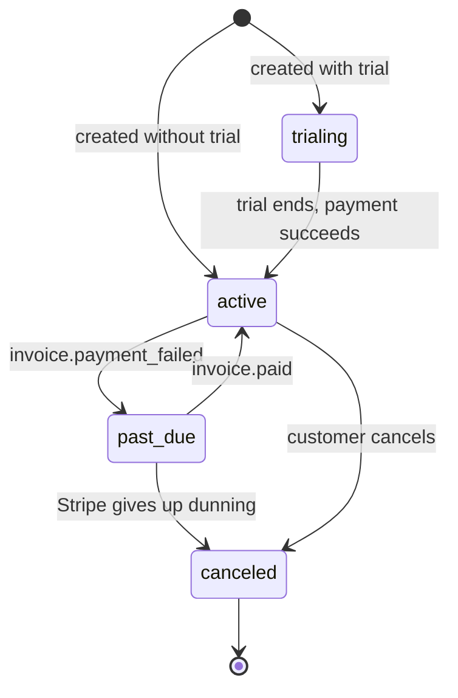

`src/domains/billing/sub-domains/subscription/`

# Subscription

Parent: [billing](../../billing.overview.md)

## Purpose

The organization's active subscription record. One row per organization, bound to a Stripe customer and Stripe subscription. State changes always flow Stripe webhook → service → DB; we never write subscription state to DB without a Stripe-confirmed webhook behind it.

## Key invariants

- **One subscription per organization**: enforced at the service layer; concurrent create attempts resolve to a single Stripe subscription via the forwarded idempotency key.
- **State changes are Stripe-driven**: `subscriptions.status` only transitions in response to a webhook event whose `event.created_at` is newer than the row's last update.
- **Stale-event rejection**: out-of-order webhooks are rejected so state cannot roll backward.
- **Network I/O outside RLS contexts**: Stripe API calls run **outside** `withAppDatabaseContext`. The service interleaves: `withAppDatabaseContext(read)` → Stripe call → `withAppDatabaseContext(write)`.
- **Retained mutable state (not an immutable ledger)** (audit-#B2): subscription rows are updated in place as status transitions (Stripe syncs, cancel/resume, plan changes, seat counts) and are never soft- or hard-deleted — cancellation transitions to `canceled` and the row stays for forensic + invoice-history value. DB-level append-only enforcement (as on `audit.logs`) is intentionally NOT applied, because in-place status transitions are the table's purpose; immutability is scoped to the monotonic `last_stripe_event_created_at` watermark that blocks stale/out-of-order events, not to the row as a whole.

## Lifecycle

## Seats (REQ-4)

> **Switched off since feat-instagram-dm-sending R52 (BL9, D55, WC-65):** `BILLING_SEAT_SYNC_ENABLED` (a billing code constant) is `false` — members are unlimited on every plan, `enqueueSeatQuantitySync` enqueues nothing (Stripe's quantity stays 1) and the hourly reconcile is not scheduled (one an older release left returns at once). A lapsed grace ends through the plan-state check below. The machinery here is kept for a plan that carries seats again.

- The public subscription response carries `seats_total` (the plan's `included_seats`, or the Free ceiling while unpaid or past dunning grace; `null` = unlimited) and `seats_used` (count of ACTIVE + INVITED memberships, resolved cross-domain via the tenancy membership service).
- **Seat enforcement** lives in tenancy's `MembershipService.create`: it calls back into `SubscriptionService.reserveSeatCeilingForMemberAdd` (a `SELECT ... FOR UPDATE` on the active subscription row) and rejects the add with `409 seat_limit_reached` when `used >= ceiling`. No-op when the organization has no active subscription or the plan is unlimited.
- **Billed from the first invoice.** Create passes the organization's ACTIVE + INVITED count (at least 1) as the Stripe `quantity`; a member who joins between that read and the commit is reconciled by the seat sync enqueued after the create.
- **Stripe quantity sync** is out-of-band: every operation that moves the ACTIVE + INVITED count enqueues a `subscription-seat-sync` job (`queues/` + `workers/`); the worker pushes the member count to Stripe (`updateSubscriptionQuantity`) and persists `subscriptions.seats`. The `customer.subscription.updated` webhook also reconciles `seats` from the Stripe item quantity. A Stripe outage never fails member management.
- **One seat sync per organization at a time.** The enqueue deduplicates on `seat-sync-<organization>` with `keepLastIfActive` (`subscriptionSeatSyncDeduplication`): while the organization's job waits, further changes add nothing (it has not read the count yet); while it runs, the latest change is kept and runs once after it. Without it two replicas could sync one organization at once and the run that read the older count could finish last, leaving Stripe on the wrong quantity.
- **Hourly seat reconcile** (`subscription-seat-reconcile`, a repeatable job on the seat-sync queue run by the seat-sync worker — no worker or connection budget of its own): one read across tenants under the retention maintenance context (`findSeatReconcileCandidates`) finds (1) Stripe-backed subscriptions whose synced `seats` differs from the seats in use — a lost enqueue — and re-enqueues their seat sync, and (2) TEAM organizations without a paid entitlement holding more ACTIVE members than the Free allowance, and logs them by public id (`subscription-seat-reconcile.entitlement_lapsed`).
- **Losing the entitlement keeps the team.** When a Stripe event leaves the subscription cancelled, expired, paused or never paid, `logEntitlementLossAfterCommit` logs `billing.entitlement_lost` once the event commits, and the hourly reconcile logs the dunning grace's end (which has no event). No member is suspended: until 2026-10-17 both paths suspended the most recently joined non-owner members down to the Free plan's `included_seats`, which locked an organization's team out with a bare 404 (owner decision D3: a grace period, then read-only, replaces it — see **Plan access** below). Since feat-instagram-dm-sending R24 (BL9) an owner's plan downgrade suspends nobody either — plans carry no seats.
- **Plan changes run one at a time per subscription** (`withRedisLock` on `billing:subscription:change-plan:<subscription>`; contention → `409 subscription_change_in_progress`) and never write `current_period_start` / `current_period_end` — the billing period is Stripe's, synced by the webhook.
- **Compensation only for a failed write.** Create cancels the just-created Stripe subscription only when the local insert fails; a failure after the commit never cancels a subscription the organization now has, and when the webhook's `.created` inserted the row first (`idx_subscriptions_provider_subscription_id_unique`) the create returns that row. The webhook inserts use `createUnlessProviderSubscriptionExists` (`ON CONFLICT DO NOTHING` on that index), so a lost race returns `null` without aborting the event's transaction.
  - The operations that move it: member add, member remove, leave-organization, change-plan, **suspend / reactivate** (SUSPENDED does not occupy a seat, so crossing that line in either direction counts), and **invitation revoke** (an INVITED membership holds a seat). The last two used to be silent, which left Stripe billing a suspended seat until some unrelated member change happened to reconcile it.
  - The one definition of "occupies a seat" is `SEAT_CONSUMING_MEMBERSHIP_STATUSES` in tenancy's `membership.types.ts`, used by both the `seats_used` count query and the status-transition check — keeping those apart is what let the suspend path drift.
- **Cross-domain DI**: membership↔subscription is a true cycle (billing reads `seats_used` from tenancy; tenancy enforces the limit via billing), broken by late-wiring `SubscriptionService` into `MembershipService.wireSeatEnforcement` in the composition root. `MembershipInvitationService.wireSeatQuantitySync` takes the enqueue half of the same port, for revoke.

## Plan access — the plan entitlement (D3, routes-final BL2–BL4)

- **What it is.** `SubscriptionService.getPlanAccess({ organizationPublicId })` answers the organization's plan entitlement — the one plan read every decision uses: `state` (`active`, `grace` or `read_only`), `graceEndsAt`, `trialEndsAt`, the `plan` (`{ publicId, name }`) whose features apply and its typed `features` (`planFeaturesSchema`, BL12). `GET /auth/me/context` and both organization switches carry `{ state, grace_ends_at, trial_ends_at, plan, features, is_plan_choice_required }` as `active_organization.plan_access` (`serializePlanAccess`, BL16 — `is_plan_choice_required` while the live row is on a switched-off plan, BL24) and the not-revoked channel account count as `channel_accounts_count` (billing's accounts port); `assertOrganizationWritable` turns `read_only` into 403 `organization_read_only` (`errors:organizationReadOnly`), run by the app domain as a `preHandler` on the automation writes.
- **Behind `ORGANIZATION_READ_ONLY_ENFORCED_EXCEPT_BILLING`** (static default `true`, BL4). Off, every organization is `active`; the plan and features are read either way.
- **The decision** (`resolvePlanAccess` in `subscription-entitlement.util.ts`, pure, BL3): **Free never ends** — PERSONAL, no subscription, the Free plan, INCOMPLETE / PAUSED or an expired checkout → `active` on Free. ACTIVE / TRIALING on a paid plan → `active` on it (`trialEndsAt` while TRIALING). PAST_DUE / UNPAID → `grace` until `current_period_end + BILLING_DUNNING_GRACE_DAYS`, then `read_only` on Free. A cancelled paid plan → `active` until its period end, then `read_only` with no grace. A switched-off old plan carries Free's features in its row (P80).
- **One query** (`SubscriptionRepository.findPlanAccessSubject`): the organization LEFT JOIN its subscriptions LEFT JOIN the plan LEFT JOIN the Free plan (the active plan priced zero, a scalar subquery), live row first then newest, `LIMIT 1`, under the organization's own context — inside `GET /auth/me/context` it shares that call's transaction. No cache: the read is indexed and a write already costs more.
- **Nothing is stored and nobody is suspended**: paying (an ACTIVE paid row) lifts read-only on the next request. Billing, auth, user, tenancy and upload never check it.

## The trial and the move down (feat-instagram-dm-sending § 8.B, ROUTE row R24)

- **Route 102 over the local Free row** (P502): an organization whose one live row is its local Free row (no Stripe subscription, a free plan — after an unpaid trial end or a move to Free) may subscribe to a paid plan or start its first trial; that row ends `CANCELED` in the create commit. A Free target or a Stripe-backed live row is still `409`.
- **The 7-day no-card trial** (route 102 with `is_trial`, BL7, BL14): a paid plan only (`422 plan_has_no_trial`); one trial per organization (a row with `trial_end` set) and per Instagram account, ever, in any organization (`billing.trial_accounts`, `trial-account.{schema,repository}.ts`, prefix `tra_`; the cross-organization check is the `SECURITY DEFINER` resolver `billing.resolve_trialled_instagram_user_ids`) → `409 trial_already_used`. Stripe gets `trial_period_days` = `PAID_TRIAL_DAYS` (7), `trial_settings.end_behavior.missing_payment_method = cancel` and `payment_settings.save_default_payment_method = on_subscription`; the row is `TRIALING` with `trial_end` (= its first period end), and the trial rows (one per not-revoked account, through the accounts port) are written in the same commit. `SubscriptionTrialService` holds the rules and is the app's trial port: a pick during a trial is checked (`409 trial_used_by_account`) and recorded in the pick's unit. The trial rows outlive their organization (`organization_id` `ON DELETE SET NULL`).
- **Change plan** (route 103, BL5, BL6, BL15; `subscription-plan-change.util.ts`): **up** (dearer, or away from a switched-off plan) — the price swaps at once, any scheduled move released; **down** (cheaper or Free) — a Stripe subscription schedule for the period end (Free: `cancel_at_period_end`), mirrored in `scheduled_plan_id`, `scheduled_change_at`, `downgrade_keep` (`keep_channel_account_ids`, checked through the accounts port against the new plan's `channel_accounts_max`); the entitlement does not move until the Stripe webhook applies it at the period end (8.D — the schedule's flip moves `plan_id` and clears the three columns; a move to Free ends the Stripe row and inserts the local Free row; see the stripe-webhook overview); **the same plan** — the scheduled move is taken back. The answer's `scheduled_change` shows it.
- **The accounts port** (`BillingChannelAccountsPort`, § 8.10): billing never reads app tables — the app's `ChannelAccountService` implements `listActiveChannelAccounts` / `countConnectedChannelAccounts`, wired by the composition roots with `subscriptionService.wireChannelAccounts`.

## The plan-state check (feat-instagram-dm-sending § 8.B BL17, BL24, ROUTE row R52 — WC-59)

- **Every 15 minutes** (`PLAN_STATE_CHECK_MINUTES`; queue `subscription-plan-state-check`, `workers/subscription-plan-state-check.*`) a sweep reads across organizations under the retention maintenance context (the subscriptions policy's `USING` arm — `listPlanStateCheckDue`) and adds one check per due subscription (job id per subscription and 15-minute slot). Inside its organization the job re-reads the row (`findPlanStateCheckRow`, `decidePlanStateCheckFindings` in `subscription-plan-state.util.ts`):
  - **a grace that ended** (`PAST_DUE` / `UNPAID`, `current_period_end` + `BILLING_DUNNING_GRACE_DAYS` passed within the last `PLAN_STATE_CHECK_GRACE_END_LOOKBACK_DAYS` 7) → `emitPlanStateCheckFinding` emits `plan_ended` with `change_key` = the period end, so the app's plan-change job id drops every repeat (no marker column) — the lanes stop with no Stripe event (AC-11.8);
  - **a trial ending** within 3 days, then 1 day (`TRIAL_NOTICE_DAYS`) → `billing.trial_ending` to the `subscription:manage` holders, dedupe key `trial-ending::<days>`;
  - **a switched-off plan row** (Starter, Growth, Pro — Free's features, BL24) → one `billing.plan_choice_required` (dedupe `plan-choice:`), and only when that notice went out a `moved_down` (`change_key` = the subscription): one email and one event however often the check runs; Stripe is never called.

## Cards (feat-instagram-dm-sending § 8.C, ROUTE row R25)

- **Cards live only in Stripe** — no table. Route 104 lists the customer's cards with `is_default`; route 105 (`DELETE /billing/payment-methods/{payment_method_id}`) detaches one; route 106 (`POST …/{payment_method_id}/default`, `X-Idempotency-Key`) sets the customer's `invoice_settings.default_payment_method` and the live Stripe subscription's `default_payment_method`, then answers the cards.
- **`{payment_method_id}` is Stripe's `pm_…` id** (P78) — a non-entity path parameter, shape-checked by `paymentMethodIdParamsDto` (`PAYMENT_METHOD_ID_PATTERN`; a malformed id is `400 params.payment_method_id`) and ownership-checked against the organization's customer (`retrieveStripePaymentMethod`: no customer, no such card and another customer's card all answer the same `404`).
- **The last card stays while a paid plan is on**: with a Stripe subscription in `CARD_REQUIRED_SUBSCRIPTION_STATUSES` (`ACTIVE`, `PAST_DUE`, `UNPAID`, `TRIALING`), removing the only card is `409 default_card_in_use`.
- The two writes go through the payment-provider port (`detachPaymentMethod`, `setDefaultPaymentMethod`); team organizations only (`422` on a personal one); audit `billing.payment_method.delete` / `.set_default` (WARNING, brand and last four digits only).

## Events

- Emits `subscription.created` / `.updated` / `.cancelled` (customer webhooks, notify) and, internal only, `subscription.plan_state_changed` (BL8, `emitPlanStateChanged`) after commit whenever the entitlement moved — a trial start (`trial_started`), a move up (`upgraded`), a Free row ending a plan-ended state (`resumed`); the Stripe webhook's plan-state cases (`emitPlanStateChangedAfterCommit` — `trial_ended`, `moved_down`, `plan_ended`, `resumed`, `upgraded`) and the 15-minute plan-state check (WC-59, R52) emit through the same method. Payload: the organization, `change`, previous / current `{ state, plan_public_id }`, the current `features`, `kept_channel_account_public_ids`, `change_key` (the check's findings only, R52). The app's handler (`instagram-plan-change.event-handlers.ts`, registered by the app container in both processes) enqueues its `plan-change` task (WC-38).

## External integrations

- **Stripe** — wrapped by [src/infrastructure/payment/stripe.client.ts](src/infrastructure/payment/stripe.client.ts) with circuit breaker + Sentry instrumentation.

## Failure modes

- **Stripe API failure on a user-initiated mutation (`create` / `cancel` / `resume`)** → the provider adapter is **fail-closed**: it logs and throws `ServiceUnavailableError` (503, `errors:paymentProviderUnavailable`) *before* any local write, so subscription state in DB is unchanged (no row created, no `cancel_at_period_end` / `status` flip). The Stripe webhook reconciles once Stripe recovers.
- **Stripe `Idempotency-Key` reuse with different payload** → Stripe returns 400; we surface as 400 to the client.
- **Webhook event timestamp older than the row** → service rejects the change (logs at info), Stripe retry will eventually pass with the latest event.

## Policy constants

- `PAID_TRIAL_DAYS = 7`, `TRIAL_NOTICE_DAYS = [3, 1]`, `PLAN_STATE_CHECK_MINUTES = 15`, `PLAN_STATE_CHECK_GRACE_END_LOOKBACK_DAYS = 7`, `BILLING_SEAT_SYNC_ENABLED = false` (`subscription.constants.ts`)
- `IDEMPOTENCY_RESPONSE_CACHE_TTL_SECONDS = 86 400`
