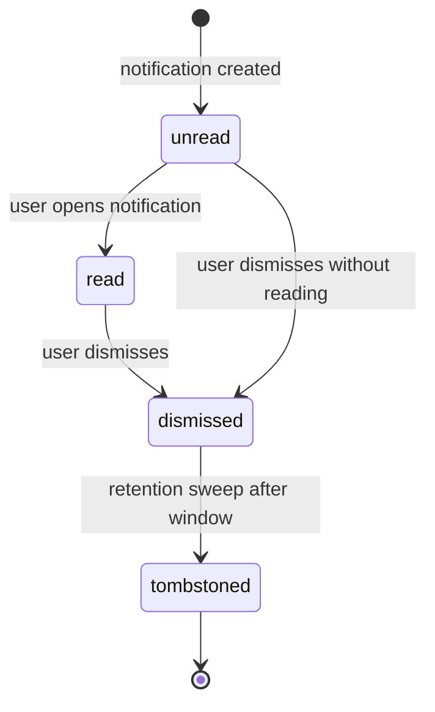

`src/domains/notify/sub-domains/notification/`

# Notification

Parent: [notify](../../notify.overview.md)

## Purpose

In-app notification rows: the user-visible feed, and the emails beside them. Every notification goes through `createAndDispatchNotification` (`notification-dispatch.service.ts`) — **the check before send** (feat-instagram-dm-sending UN11, P88): for all the recipients of one notification it reads their stored choices for the type's kind in ONE query (the SECURITY DEFINER `auth.resolve_notification_choices_by_user_ids`, since the dispatch runs in the organization's context) and the organization's muted channels, then per recipient: in-app on → the inbox row (`data.channels` with `email` when that is on too, `data.dedupe_key`) and its worker job after the commit; in-app off and email on → no row, the mail-outbox row in the same unit (bulk lane); both off → nothing. The emitter's offered `channels` stay the upper bound; a missing choice is the kind's default (`NOTIFICATION_KINDS`); billing email is locked on; a type in no kind (`security.alert`, `system.*`) is always sent; the organization's mute wins. Every email of a notification — with or without a row — is keyed `notification:<type>:<dedupe_key>:<user_public_id>` in the mail outbox, so a replay sends nothing twice. Users mark rows read or dismiss them via the API. Cross-domain event handlers create notifications for the invitation accepted / declined (`events/membership-invitation.event-handlers.ts`) and for a member's main-role change or removal (`events/membership-notice.event-handlers.ts`, see Events below). Another domain's background work notifies an organization's members through the service: `NotificationService.createOrganizationNotifications` (the app domain's Instagram reconnect notice, launch IA9 — type `instagram.reconnect_required`, in-app + email). It runs in the API and the worker process alike: both build this container (`createDomainContainers` in the worker), so the dispatch it wraps is configured in both.

## Key invariants

- **No insert-time uniqueness**: the `notifications` table has no `source_event_id` column and no `(user, …)` uniqueness, so creating the same logical notification twice yields two rows. Idempotency is enforced **downstream** (dispatch + email), not at insert — except that `createOrganizationNotifications` takes a producer key: it writes it as `data.dedupe_key` and sends nothing when the organization already holds a notification of that type with that key, so a producer job run again after its commit sends nothing twice.
- **Public ids in the job, never a bigserial**: the dispatch job carries the notification's public id, its organization's (`null` for a notification without one) and its recipient's. The worker reads the row under the organization's scope, or — for a notification without one — under the recipient's (`notifications_owner_select`); no SECURITY DEFINER lookup, no wide maintenance scope. A row that is gone (deleted, erased, lost to a restore) completes the job as skipped.
- **Idempotent dispatch enqueue**: the dispatch job's `jobId` is the notification's public id (`ntf_…`), so a recovery/redelivery re-enqueue of the same persisted notification is a BullMQ no-op within the retention window — one notification row never fans out (or emails) twice. Not the bigserial: it restarts at 1 after `TRUNCATE ... RESTART IDENTITY` or a database restore while Redis keeps finished jobs for 7 days, and BullMQ silently drops an add whose job id still exists — a new notification reusing the id would never be dispatched. The email channel's `notification:email-dispatched:` marker is keyed by the public id for the same reason; its mail-outbox `dedupe_key` is the emitter's once key with the recipient's public id (UN11) — a row written before UN11 keeps the per-row `notification:<public id>:email:<recipient>` key.
- **Bounded mark-all-read**: `markAllReadForUser` marks the unread backlog in `NOTIFICATION_MARK_ALL_READ_BATCH_SIZE`-row batches (looping until drained), so a huge backlog cannot become one unbounded, long-held write that stalls concurrent inserts for that user; the returned count is summed from each statement's `RETURNING` (never a separate pre-count).
- **Email outcome is honest**: the worker reports `email:outbox_pending` (not `email:queued`) when the mail-outbox row persisted but its BullMQ enqueue failed — the mail-outbox sweeper re-enqueues it and the `mail_outbox_pending` gauge tracks the depth.
- **Tenant-scoped**: notifications belong to a `(user, organization)` pair. Reads are scoped through the standard tenant context.
- **Read state is monotonic**: `unread → read → dismissed`. Marking a dismissed notification "unread" is not allowed.
- **Best-effort fan-out**: a notification fan-out failure does not roll back the originating transaction (it's a downstream side effect).
- **The unread count is cached, and the error only goes one way**: `GET /notify/notifications/unread-count` is served from Redis (`notify:unread-count:<userPublicId>`, 60 s) because every open tab polls it. Every write that names a user invalidates after commit — mark-read, mark-all-read, delete, the invitation accepted / declined fan-outs, and the enqueue-rollback delete (the post-commit task carries the recipient's public id). The one writer that cannot name a user — the retention sweep, which deletes by `created_at` — is bounded by the TTL alone, and only ever removes rows — so a stale badge reads **high**, never low. It can show a notification that is gone; it cannot hide one that arrived. Contract: [read-caching](src/PATTERNS.md).

## Lifecycle

## Events

- Consumes: `MEMBERSHIP_INVITATION_EVENT.ACCEPTED` — a `membership.invite_accepted` notification (in-app + email) to each organization `membership:create` holder the tenancy accept path resolved.
- Consumes: `MEMBERSHIP_INVITATION_EVENT.DECLINED` — a `membership.invite_declined` notification (in-app only) to the inviter, or to the `membership:create` holders when the inviter is gone.
- Consumes: `MEMBERSHIP_NOTICE_EVENT.ROLE_CHANGED` / `.REMOVED` (tenancy, feat-instagram-dm-sending UN8) — `membership.role_changed` (with the previous and the new main role) and `membership.removed` (in-app + email, as the team-change kind allows) to the `membership:update` holders and the member, minus whoever made the change, once per change.
- The handlers (registered by `registerMembershipInvitationNotificationHandlers` and `registerMembershipNoticeNotificationHandlers`) run inside the tenancy write's database context; the dispatch keeps its reads and each recipient's writes in savepoints and the handler logs any error, so a notification never fails the write; the recipients that got an inbox row have their cached unread count dropped after commit. The once key is the invitation's public id, or the membership's public id with its change. Rows are delivered asynchronously by the `notification` BullMQ worker.

## Failure modes

- **Every recipient of one dispatch failed** → the first error is rethrown so the emitter's retry sends them all (the dedupe keys keep it once); one recipient's failure is logged (`notify.dispatch.recipient_failed`) and skipped.
- **Worker crash during fan-out** → BullMQ retries the dispatch job (keyed by the notification's public id), which re-reads the **same** persisted row rather than inserting a new one; the email channel's mail-outbox `dedupeKey` collapses duplicate sends. (The in-app row is created once by the handler, not by the dispatch worker.)
- **Recipient user soft-deleted** → for a notification without an organization the recipient's scope no longer matches (the owner arms require an active user), so the job completes as skipped (`notification.worker.not_found`).
- **Enqueue fails after commit** → the post-commit dispatch deletes the never-dispatched row under its recipient's scope and invalidates their cached unread count.
