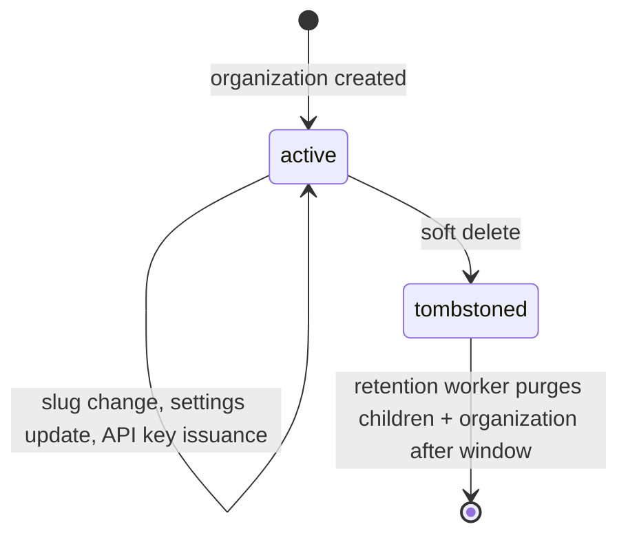

`src/domains/tenancy/sub-domains/organization/`

# Organization

Parent: [tenancy](../../tenancy.overview.md)

## Purpose

The top-level tenancy aggregate. Owns the `organizations` table (id, public id, slug, name, status, settings JSON, billing customer id) and the child resources that share its lifecycle: [organization-settings](src/domains/tenancy/sub-domains/organization/organization-settings/), [organization-notification-policy](src/domains/tenancy/sub-domains/organization/organization-notification-policy/), and [organization-api-key](src/domains/tenancy/sub-domains/organization/organization-api-key/).

## Key invariants

- **Slug is unique among LIVE teams only**: `idx_organizations_slug` is a **partial** unique index (`WHERE deleted_at IS NULL`), so a soft-deleted team releases its slug immediately for reuse instead of burning it until tombstone-retention. Matches `SLUG_REGEX`, lowercased, no leading/trailing/consecutive hyphens. Personal organizations carry a NULL slug and are not constrained here.
- **Single-organization access**: the repository reads the organization and checks owner or active membership in one query under the caller's user RLS context. An explicit access predicate also prevents an unrelated user with an organization GUC from passing the gate.
- **Public id is the API contract**: 21-char URL-safe; the internal numeric id never appears in URLs or JSON.
- **Slug change is rare and audited**: changing the slug rewrites organization-scoped URLs for clients; recorded with `WARNING` severity in audit.
- **Organization profile (launch D7)**: `timezone` (IANA, default `Asia/Kolkata`; IANA validity is the validator's job), `currency` (fixed `INR`, server-set). CHECK: `chk_organizations_currency`.
- **The owner is named (launch D81 (4))**: every organization object (`GET /tenancy/organization`, the
  list, `/auth/me/context`'s `active_organization`, the switch answers) carries `owner_user_id` — the
  owner's user public id, resolved in one batch per response (`auth.resolve_user_public_ids_by_ids`;
  null only if the login is gone). Provisioning makes the `Owner` role `is_system`, `is_locked` and
  slate (`organization-provisioning.ts`).
- **A TEAM organization's default roles are one definition (launch IA2)**: `DEFAULT_TEAM_ROLES` —
  Admin (lav) and Member (sage), both `is_system` and `is_locked` — plus the TEAM Owner codes. A new
  team gets them at provisioning; a team that already exists gets anything missing from
  `reconcileDefaultTeamRoles`, which `prepareDatabase` runs after every seed: it lists the live TEAM
  organizations under the retention arm (read only), then in each organization's own scope adds a
  missing default role, grants the missing codes (`ON CONFLICT DO NOTHING`) and invalidates its
  permission cache. A custom role already holding a default role's name is renamed
  `<name> (custom)` with its people and codes (launch IQ5). Twice is once.
- **Organization soft-delete cascades to child resources**: settings, API keys, and notification policy tombstone with the organization. Memberships are handled separately.

## Lifecycle

## Events

This sub-domain neither emits nor consumes domain events directly. State changes are reflected through audit-emission only.

## Failure modes

- **Slug collision** on create or rename → 409.
- **API key prefix collision** (cosmetic) → service rotates the prefix and retries.
- **Soft-delete with active subscription** → 409; admin must cancel the subscription first.

## Policy constants

- `SLUG_REGEX`
- `ORGANIZATION_DEFAULT_TIMEZONE`, `ORGANIZATION_CURRENCY` (`organization.constants.ts`)
- `ORGANIZATION_API_KEY_RAW_SECRET_BYTE_LENGTH = 32`
- `ORGANIZATION_API_KEY_PREFIX_DISPLAY_LENGTH = 8`
